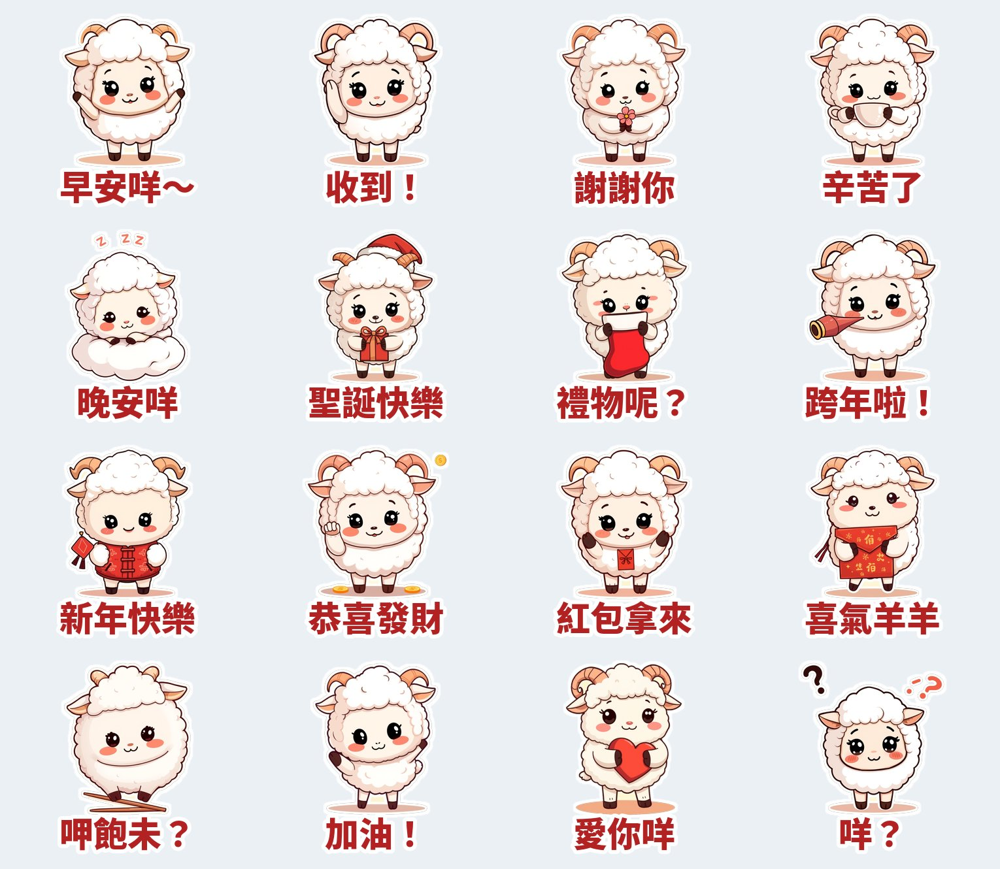

每年 12 月到隔年 2 月，是大家最常一口氣傳貼圖給「平常很少聊天的人」的時候：聖誕快樂、新年快樂、恭喜發財、紅包拿來。家族群組、同事群組、好久沒聯絡的朋友，一張生肖貼圖就把祝福送到了。

2027 年的春節是 **2 月 6 日**，生肖是**羊**。我上一篇整理了 [2026 爆款貼圖的 5 個共同點](/blog/line-sticker-trends-2026/)，這次照同一份清單，提前做了一組羊年貼圖。

## 季節貼圖的時間表：為什麼現在就要上架？

1. **審核要時間。** 我上一組「麻糬海豹噗嚕」10/10 送審，10/12 就開賣，算快的；但年底送審的人多，排隊時間通常會拉長。
2. **使用者會「提前」買。** 想在跨年夜傳貼圖的人，12 月中就會開始逛貼圖小舖。等到 12 月底才上架，最好的兩週已經過了。
3. **越早上架，搜尋「羊年」時越早出現。** 10 月的羊年貼圖還很少，新上架的作品比較容易被看到。

我的結論：**新年貼圖最晚 11 月中前要開賣。** 10 月中送審，時間很充裕。

## 「綿綿羊」怎麼設計？

| 爆款要素 | 綿綿羊的做法 |
|---|---|
| 一眼記得住的角色 | 雲朵一樣的白色捲毛、捲捲小角、大眼腮紅，縮到很小也認得出來 |
| 用在「關係」裡 | 家族群組、同事群組最常傳的祝福：恭喜發財、紅包拿來、喜氣羊羊 |
| 在地語感 | 呷飽未？、早安咩～、晚安咩（咩＝羊叫聲，也是撒嬌語尾） |
| 一套聊一整季 | 聖誕快樂 → 禮物呢？ → 跨年啦！ → 新年快樂 → 紅包拿來 |
| **過完年還能用** | 一半是日常款：早安、收到、謝謝你、辛苦了、加油、愛你、晚安 |

最後一點是這次特別加的。純新年貼圖過了元宵就沒人用，**日常款讓這組貼圖二月以後還有使用場合**，使用者也比較願意買。

## 進度與購買連結

- **麻糬海豹噗嚕・想躺平日常：已開賣 🎉** 👉 [LINE STORE 購買頁](https://store.line.me/stickershop/product/37215265/zh-Hant)（NT$42）
- **芋圓貓・黏TT戀愛日常**：LINE 審核中
- **綿綿羊・喜氣羊羊過好年**：10/12 已送審，通過後自動開賣

三組都會出現在我的 [LINE 貼圖作者頁](https://line.me/S/shop/sticker/author/6564520)，可以先收藏起來。綿綿羊開賣後，我會把連結補在這篇。

## 一點誠實的筆記

這組貼圖用本機的 AI 繪圖模型生圖，再用程式去背、加白邊和文字，LINE 商店頁會標示「使用AI」。AI 讓我一個下午就能做完一組，但**角色要不要紅，還是看台詞選得準不準**。所以每組我都先寫好 16 句「最常傳的話」，最後才生圖。

---

*你們家族群組過年最常傳哪一句？「紅包拿來」還是「恭喜發財」？如果有一句你每年都找不到好貼圖，告訴我，下一組就做那句。*
