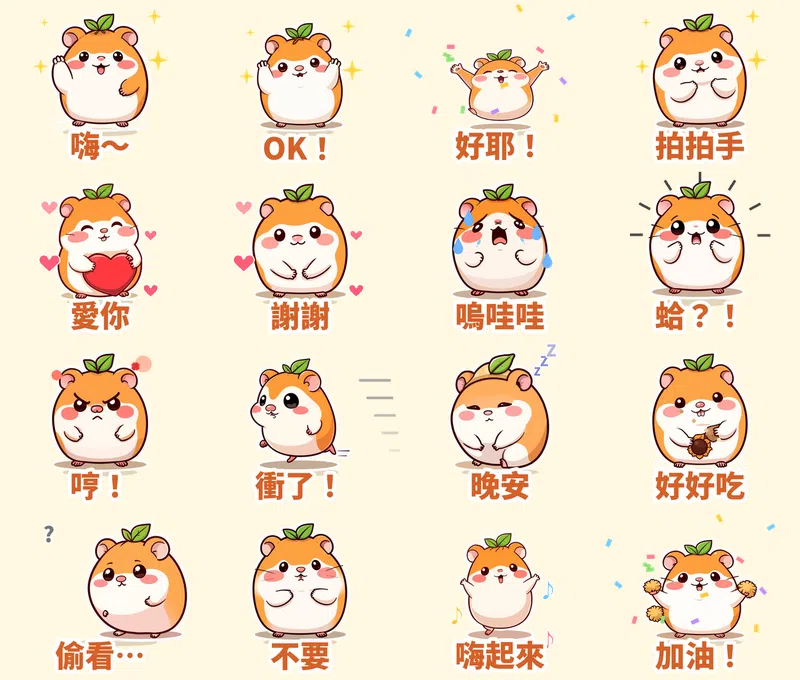

聊天室裡同樣一句「好耶！」，靜態貼圖看一眼就滑過去；**會跳起來、還灑彩紙**的那張，大家會多看兩秒，甚至問「這組哪裡買？」

所以第五組貼圖，我第一次做了**動態貼圖**：一隻頭頂小葉子、圓得像湯圓的倉鼠 **糰糰**。

## 熱門動態貼圖的 5 個元素

看了最近的排行榜，前面幾名常常是西村裕二的「GOKIGEN PANDA」、LOVE RABBIT，還有老面孔白爛貓、野生喵喵怪。我整理出動態貼圖會紅的 5 個共同點：

1. **動作誇張，一秒看懂。** 跳、抖、轉圈、噴愛心。縮到聊天室那麼小，動作也要清楚。
2. **短循環。** LINE 規定每張最多播 4 秒，好的動態貼圖都是 1 秒左右的小動作，重播幾次。
3. **文字也要動。** 字跟著角色一起彈一下，看起來就是「在說話」。
4. **特效比角色還搶戲。** 彩紙、眼淚、怒氣符號、Z 字、音符，這些小東西讓情緒一下就到位。
5. **第一格要能單獨成立。** 商店頁和沒播放的時候只會顯示第一格，所以第一格就要是一張完整的貼圖。

## 16 張的動作設計

我先決定「這句話要怎麼動」，才去生圖：

| 台詞 | 動作 | 特效 |
|---|---|---|
| 嗨～ | 揮手搖擺 | 星星閃爍 |
| OK！ | 輕跳 | 星星 |
| 好耶！ | 大跳＋落地壓扁 | 彩紙 |
| 拍拍手 | 身體一縮一放 | 星星 |
| 愛你 | 心跳般放大 | 兩側冒愛心 |
| 謝謝 | 鞠躬 | 愛心 |
| 嗚哇哇 | 左右抖 | 噴眼淚 |
| 蛤？！ | 原地亂抖 | 驚嚇線 |
| 哼！ | 氣到發抖 | 怒氣符號＋蒸氣 |
| 衝了！ | 奔跑彈跳 | 速度線 |
| 晚安 | 慢慢呼吸 | 飄 Z |
| 好好吃 | 咀嚼 | 掉碎屑 |
| 偷看… | 從旁邊滑進來 | 問號 |
| 不要 | 搖頭 | — |
| 嗨起來 | 扭來扭去 | 音符 |
| 加油！ | 跳躍應援 | 彩紙 |

## 做法：AI 畫姿勢，程式負責動

AI 生圖很難畫出「同一隻角色的 12 格連續動作」，所以我把工作拆成兩半：

- **本機 AI 繪圖模型**只負責畫 16 個姿勢。固定同一個隨機種子，倉鼠的長相才會一致。
- **自己寫的 Python 程式**把角色去背、加白邊，再一格一格加上跳躍、壓扁、旋轉，最後畫上彩紙、眼淚這些特效，輸出成 LINE 規定的 APNG 格式。

每張是 12 格、每格約 0.083 秒，一輪剛好 1 秒，重播 3 次。

## 審核規格裡最容易卡關的一條

第一次上傳，16 張全部顯示「錯誤」。點開才看到：

> 播放時間請設定為1秒、2秒、3秒或4秒。

**LINE 要求總播放時間剛好是整數秒。** 我原本每格 0.09 秒 × 12 格 × 3 次＝3.24 秒，就被擋下來。改成每輪剛好 1 秒（最後一格稍微拉長補足）之後，16 張一次就通過了。想做動態貼圖的人可以先記住這條。

其他規格：每張最大 320×270 px、5～20 格、最多 4 秒、每個檔案 1MB 以下；主要圖片 240×240 也要是動態的。

## 目前上架進度

- **糰糰倉鼠・會動的超有反應**（動態貼圖，NT$60 起）：10/13 送審，通過後會自動開賣，連結我會補在這裡
- **麻糬海豹噗嚕・想躺平日常** 👉 [LINE STORE](https://store.line.me/stickershop/product/37215265/zh-Hant)
- **芋圓貓・黏TT戀愛日常** 👉 [LINE STORE](https://store.line.me/stickershop/product/37220496/zh-Hant)
- **綿綿羊・喜氣羊羊過好年**（2027 羊年）👉 [LINE STORE](https://store.line.me/stickershop/product/37266378/zh-Hant)
- **柚柚水豚・情緒穩定中**：審核中，製作紀錄在[這篇](/blog/line-sticker-capybara-calm/)

全部作品都在我的 [LINE 貼圖作者頁](https://line.me/S/shop/sticker/author/6564520)。

## 誠實筆記

這組貼圖的角色是用 AI 生成的，動畫則是程式產生的，LINE 商店頁會標示「使用AI」。動作是用程式做的，所以比手繪動畫簡單，但每一張都有角色動作、文字彈跳和特效三層，縮到聊天室大小也看得清楚。

---

*你最想看糰糰做什麼動作？「轉圈圈」「被揉臉」還是「塞滿兩頰」？留言給我，下一組動態貼圖就做。*
