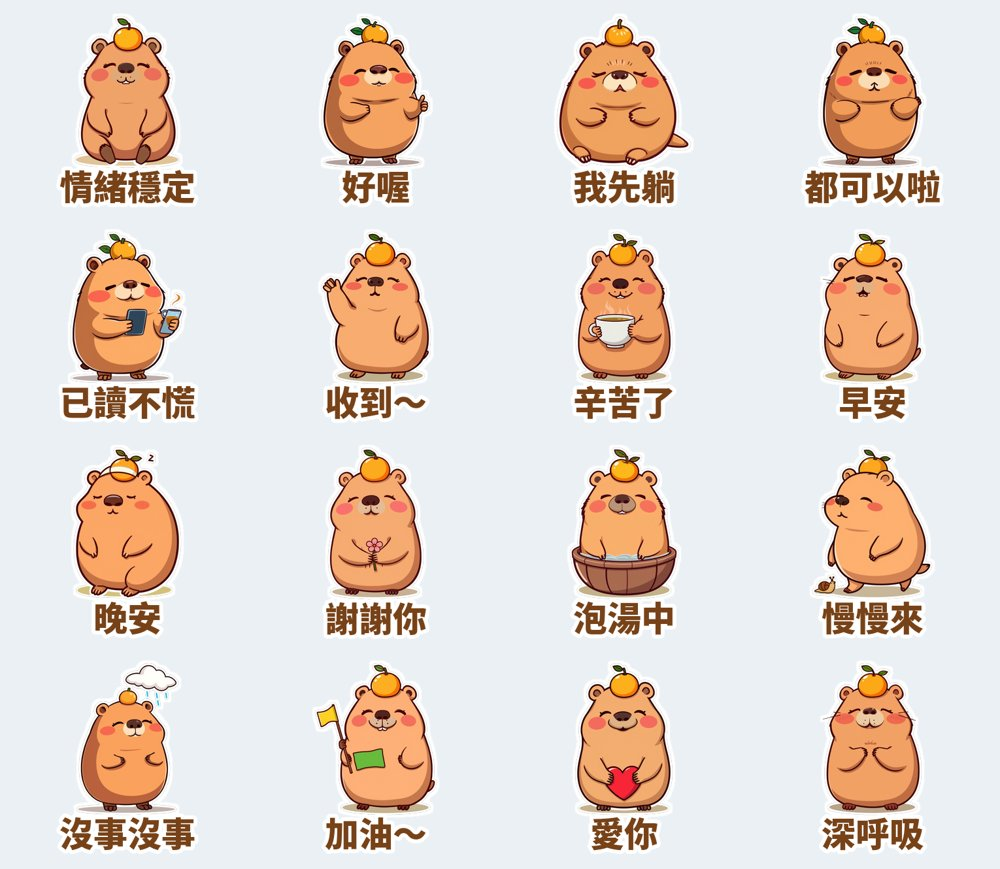

最近聊天室最常出現的一句話，可能不是「哈哈哈」，而是 **「我很情緒穩定」**。

工作爆炸、已讀不回、計畫臨時改掉，大家都在練習同一件事：先深呼吸，然後說「沒事沒事」。網路上最常拿來代表這種狀態的動物，就是**水豚**：泡在溫泉裡、頭上頂著柚子、旁邊發生什麼事都一臉平靜。

所以第四組貼圖，我做了一隻頭頂柚子的水豚：**柚柚水豚・情緒穩定中**。

## 為什麼選水豚？

我在 [2026 爆款貼圖的 5 個共同點](/blog/line-sticker-trends-2026/) 整理過：排行前面的戀愛兔、吉伊卡哇，還有新冒出來的「醜嫩狗勾」「那隻水母」，共同點是**角色簡單、台詞用得到、跟得上社群的梗**。

水豚剛好三個都符合：

1. **形狀簡單。** 一顆圓滾滾的馬鈴薯加上小耳朵，縮到聊天室大小也認得出來。
2. **自帶個性。** 大家對水豚的印象就是「很穩」，不用解釋。
3. **梗還在流行。** 「情緒穩定」是年輕人現在真的會講的話，不是硬造的口號。

## 16 句台詞怎麼選？

我先寫台詞，最後才生圖。台詞分成三類：

| 類型 | 台詞 | 用在哪裡 |
|---|---|---|
| 情緒穩定梗 | 情緒穩定、已讀不慌、沒事沒事、深呼吸、慢慢來 | 同事群組、被催進度的時候 |
| 佛系回覆 | 好喔、都可以啦、我先躺、泡湯中 | 揪團、問「要吃什麼」的時候 |
| 日常必備 | 早安、晚安、收到～、謝謝你、辛苦了、加油～、愛你 | 每天都用得到 |

日常款佔了快一半。**一組貼圖要每天都有機會被傳出去，別人才會看到、才會想買。**

## 前三組貼圖的結果

這是我第一次公開進度，三組都在送審後 1～3 天通過，現在都可以買了（每組 NT$42）：

- **麻糬海豹噗嚕・想躺平日常**（上班族厭世）👉 [LINE STORE](https://store.line.me/stickershop/product/37215265/zh-Hant)
- **芋圓貓・黏TT戀愛日常**（情侶、曖昧）👉 [LINE STORE](https://store.line.me/stickershop/product/37220496/zh-Hant)
- **綿綿羊・喜氣羊羊過好年**（2027 羊年、聖誕跨年）👉 [LINE STORE](https://store.line.me/stickershop/product/37266378/zh-Hant)
- **柚柚水豚・情緒穩定中**：10/13 送審，通過後我會把連結補在這裡

全部作品都在我的 [LINE 貼圖作者頁](https://line.me/S/shop/sticker/author/6564520)。

## 誠實筆記

這組貼圖用本機的 AI 繪圖模型生圖，再用程式去背、加白邊和文字，LINE 商店頁會標示「使用AI」。這次我固定同一個隨機種子，16 張的水豚長相才會一致；每張再生兩個版本，挑動作比較清楚的那張。

---

*你最需要哪一句「情緒穩定」的貼圖？「我不生氣」還是「好的老闆」？告訴我，下一組就做。*
