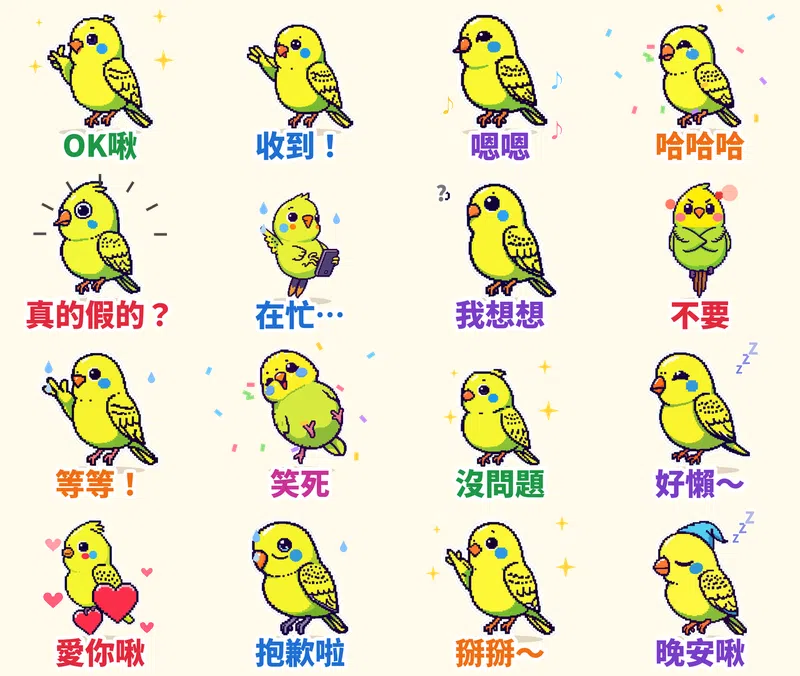

> 🛒 **像素鸚鵡啾比・敷衍回覆** 已在 LINE 商店開賣（動態貼圖・NT$60）👉 [在 LINE 商店購買](https://line.me/S/sticker/37327360)

群組一天跳 300 則訊息，主管、家族、同學會輪流轟炸，你其實只想回「嗯」。可是只回一個字又顯得太冷淡。

第十四組貼圖就是為這種時候做的：一隻**復古像素風的小虎皮鸚鵡「啾比」**，16 張全是最常用的懶人回覆，每張都會動，還幫每一張配了一句**啾啾鳥語**。

## 🔊 點一下就有聲音：啾比有聲貼圖板

**點任何一張貼圖，就會聽到啾比「啾啾」叫一聲再說那句話。** 手機上按「傳給朋友」可以直接把有聲版丟進 LINE 聊天室（會以 3 秒影片傳出，對方點開就有聲音）。也可以 [一次下載 16 支有聲貼圖（zip，3.6MB）](https://github.com/ckw19810413/ckw19810413.github.io/releases/download/media-line-animated-sticker-budgie-pixel/Jiubi_sound_stickers.zip)。

<figure class="ms-c"><video src="https://github.com/ckw19810413/ckw19810413.github.io/releases/download/media-line-animated-sticker-budgie-pixel/sound-01.mp4" poster="sound/01.jpg" muted autoplay loop playsinline preload="metadata"></video><figcaption>OK啾！</figcaption><button type="button" class="ms-share" data-k="01">傳給朋友</button></figure><figure class="ms-c"><video src="https://github.com/ckw19810413/ckw19810413.github.io/releases/download/media-line-animated-sticker-budgie-pixel/sound-02.mp4" poster="sound/02.jpg" muted autoplay loop playsinline preload="metadata"></video><figcaption>收到啾啾！</figcaption><button type="button" class="ms-share" data-k="02">傳給朋友</button></figure><figure class="ms-c"><video src="https://github.com/ckw19810413/ckw19810413.github.io/releases/download/media-line-animated-sticker-budgie-pixel/sound-03.mp4" poster="sound/03.jpg" muted autoplay loop playsinline preload="metadata"></video><figcaption>嗯嗯，啾～</figcaption><button type="button" class="ms-share" data-k="03">傳給朋友</button></figure><figure class="ms-c"><video src="https://github.com/ckw19810413/ckw19810413.github.io/releases/download/media-line-animated-sticker-budgie-pixel/sound-04.mp4" poster="sound/04.jpg" muted autoplay loop playsinline preload="metadata"></video><figcaption>哈哈哈啾啾啾！</figcaption><button type="button" class="ms-share" data-k="04">傳給朋友</button></figure><figure class="ms-c"><video src="https://github.com/ckw19810413/ckw19810413.github.io/releases/download/media-line-animated-sticker-budgie-pixel/sound-05.mp4" poster="sound/05.jpg" muted autoplay loop playsinline preload="metadata"></video><figcaption>蛤？真的假的啾？</figcaption><button type="button" class="ms-share" data-k="05">傳給朋友</button></figure><figure class="ms-c"><video src="https://github.com/ckw19810413/ckw19810413.github.io/releases/download/media-line-animated-sticker-budgie-pixel/sound-06.mp4" poster="sound/06.jpg" muted autoplay loop playsinline preload="metadata"></video><figcaption>在忙啦，啾！</figcaption><button type="button" class="ms-share" data-k="06">傳給朋友</button></figure><figure class="ms-c"><video src="https://github.com/ckw19810413/ckw19810413.github.io/releases/download/media-line-animated-sticker-budgie-pixel/sound-07.mp4" poster="sound/07.jpg" muted autoplay loop playsinline preload="metadata"></video><figcaption>嗯…我想想啾～</figcaption><button type="button" class="ms-share" data-k="07">傳給朋友</button></figure><figure class="ms-c"><video src="https://github.com/ckw19810413/ckw19810413.github.io/releases/download/media-line-animated-sticker-budgie-pixel/sound-08.mp4" poster="sound/08.jpg" muted autoplay loop playsinline preload="metadata"></video><figcaption>不要啾！</figcaption><button type="button" class="ms-share" data-k="08">傳給朋友</button></figure><figure class="ms-c"><video src="https://github.com/ckw19810413/ckw19810413.github.io/releases/download/media-line-animated-sticker-budgie-pixel/sound-09.mp4" poster="sound/09.jpg" muted autoplay loop playsinline preload="metadata"></video><figcaption>等等等等！啾！</figcaption><button type="button" class="ms-share" data-k="09">傳給朋友</button></figure><figure class="ms-c"><video src="https://github.com/ckw19810413/ckw19810413.github.io/releases/download/media-line-animated-sticker-budgie-pixel/sound-10.mp4" poster="sound/10.jpg" muted autoplay loop playsinline preload="metadata"></video><figcaption>笑死啾～</figcaption><button type="button" class="ms-share" data-k="10">傳給朋友</button></figure><figure class="ms-c"><video src="https://github.com/ckw19810413/ckw19810413.github.io/releases/download/media-line-animated-sticker-budgie-pixel/sound-11.mp4" poster="sound/11.jpg" muted autoplay loop playsinline preload="metadata"></video><figcaption>沒問題啾！</figcaption><button type="button" class="ms-share" data-k="11">傳給朋友</button></figure><figure class="ms-c"><video src="https://github.com/ckw19810413/ckw19810413.github.io/releases/download/media-line-animated-sticker-budgie-pixel/sound-12.mp4" poster="sound/12.jpg" muted autoplay loop playsinline preload="metadata"></video><figcaption>好懶喔…啾～</figcaption><button type="button" class="ms-share" data-k="12">傳給朋友</button></figure><figure class="ms-c"><video src="https://github.com/ckw19810413/ckw19810413.github.io/releases/download/media-line-animated-sticker-budgie-pixel/sound-13.mp4" poster="sound/13.jpg" muted autoplay loop playsinline preload="metadata"></video><figcaption>愛你啾啾！</figcaption><button type="button" class="ms-share" data-k="13">傳給朋友</button></figure><figure class="ms-c"><video src="https://github.com/ckw19810413/ckw19810413.github.io/releases/download/media-line-animated-sticker-budgie-pixel/sound-14.mp4" poster="sound/14.jpg" muted autoplay loop playsinline preload="metadata"></video><figcaption>抱歉啦…啾</figcaption><button type="button" class="ms-share" data-k="14">傳給朋友</button></figure><figure class="ms-c"><video src="https://github.com/ckw19810413/ckw19810413.github.io/releases/download/media-line-animated-sticker-budgie-pixel/sound-15.mp4" poster="sound/15.jpg" muted autoplay loop playsinline preload="metadata"></video><figcaption>掰掰啾～</figcaption><button type="button" class="ms-share" data-k="15">傳給朋友</button></figure><figure class="ms-c"><video src="https://github.com/ckw19810413/ckw19810413.github.io/releases/download/media-line-animated-sticker-budgie-pixel/sound-16.mp4" poster="sound/16.jpg" muted autoplay loop playsinline preload="metadata"></video><figcaption>晚安啾～</figcaption><button type="button" class="ms-share" data-k="16">傳給朋友</button></figure>

## 🔊 一次聽完 16 句（48 秒）

<video src="https://github.com/ckw19810413/ckw19810413.github.io/releases/download/media-line-animated-sticker-budgie-pixel/jiubi-voice.mp4" controls playsinline preload="metadata" poster="cover.jpg" style="max-width:360px;width:100%;border-radius:12px"></video>

先說清楚：**LINE 開放給一般創作者的「LINE Creators Market」只有 7 種貼圖類型**（一般、動態、隨你填、訊息、大貼圖、全螢幕、特效），沒有「有聲貼圖」，有聲貼圖只有 LINE 官方品牌貼圖才有。所以上架到 LINE 的是**無聲的動態貼圖**；要有聲音，就用上面的有聲貼圖板，或把有聲版影片直接傳進聊天室。

## 為什麼是「敷衍回覆」＋「像素鸚鵡」？

1. **最常被傳的貼圖，往往是最省力的那幾張。** 台灣原創榜長年被動物角色包辦（像 GOKIGEN PANDA、LOVE RABBIT），共通點是台詞短、情緒一看就懂、不用多解釋。「OK」「收到」「笑死」「晚安」這種萬用回覆，每天都用得到。
2. **萌寵＋叫聲最有記憶點。** 養鳥的人都知道虎皮鸚鵡多吵多黏人，「啾」這個字本身就很可愛，所以台詞都帶一個「啾」。
3. **這次的畫風是復古像素。** 從七種畫風（扁平色塊、蠟筆／鉛筆／粉彩手繪、水彩、粗黑輪廓卡通、懷舊復古、黏土、像素）隨機抽到像素風，像小時候紅白機遊戲裡的小角色，在一堆圓滾滾的手繪貼圖裡反而很顯眼。

## 16 張的台詞、動作和啾語

| 貼圖台詞 | 動作 | 配音啾語 |
|---|---|---|
| OK啾 | 比讚眨眼 + 星星 | OK啾！ |
| 收到！ | 敬禮 + 打勾 | 收到啾啾！ |
| 嗯嗯 | 閉眼點頭 + 音符 | 嗯嗯，啾～ |
| 哈哈哈 | 笑到搖擺 + 彩帶 | 哈哈哈啾啾啾！ |
| 真的假的？ | 嚇到炸毛 | 蛤？真的假的啾？ |
| 在忙… | 低頭滑手機 + 冒汗 | 在忙啦，啾！ |
| 我想想 | 托腮思考 + 問號 | 嗯…我想想啾～ |
| 不要 | 雙翅交叉 + 冒氣 | 不要啾！ |
| 等等！ | 伸翅喊停 + 冒汗 | 等等等等！啾！ |
| 笑死 | 笑到抖 + 彩帶 | 笑死啾～ |
| 沒問題 | 挺胸跳躍 + 星星 | 沒問題啾！ |
| 好懶～ | 軟爛呼吸 + ZZZ | 好懶喔…啾～ |
| 愛你啾 | 抱著像素愛心 | 愛你啾啾！ |
| 抱歉啦 | 低頭道歉 + 冒汗 | 抱歉啦…啾 |
| 掰掰～ | 揮翅掰掰 + 星星 | 掰掰啾～ |
| 晚安啾 | 戴睡帽睡覺 + ZZZ | 晚安啾～ |

## 做法

- **畫圖**：本機的 AI 繪圖模型畫 16 個姿勢，固定同一個隨機種子，讓啾比每張長得一樣。第一版用淡黃色背景，結果黃綠色的鸚鵡跟背景太像、去背會被吃掉，改成淡藍色背景重畫。
- **動畫**：用自己寫的 Python 程式一格一格加上動作和特效（打勾、彩帶、問號、冒氣、ZZZ），輸出成 LINE 要求的 APNG，每張剛好播 3 秒。
- **配音**：先用程式合成一段三連音的「啾啾啾」鳥叫，再接上語音合成的高音台詞，每句不到 3 秒。

## 目前上架進度

- **像素鸚鵡啾比・敷衍回覆**（動態貼圖，NT$60 起）：10/14 送審，通過後自動開賣，連結會補在這裡
- 另外還有 9 組動態貼圖在審核中（[蠟筆虎斑貓喵吉](/blog/line-animated-sticker-kitten-voice/)、[黏土豬豬嘟嘟](/blog/line-animated-sticker-piglet-foodie/)、[貓頭鷹咕咕](/blog/line-animated-sticker-owl-exam/)、[馴鹿叮噹](/blog/line-animated-sticker-reindeer-xmas/)、[無尾熊可可](/blog/line-animated-sticker-koala-comfort/)、[水獺拉拉](/blog/line-animated-sticker-otter-love/)、[柴犬福福](/blog/line-animated-sticker-shiba-greetings/)、[企鵝啵啵](/blog/line-animated-sticker-penguin-office/)、[糰糰倉鼠](/blog/line-animated-sticker-hamster/)）
- 已經開賣：**麻糬海豹噗嚕** 👉 [LINE STORE](https://store.line.me/stickershop/product/37215265/zh-Hant)、**芋圓貓** 👉 [LINE STORE](https://store.line.me/stickershop/product/37220496/zh-Hant)、**綿綿羊** 👉 [LINE STORE](https://store.line.me/stickershop/product/37266378/zh-Hant)

全部作品都在我的 [LINE 貼圖作者頁](https://line.me/S/shop/sticker/author/6564520)。

## 誠實筆記

角色是 AI 生成的，動畫是程式做的，鳥叫和配音是合成的。LINE 商店頁會標示「使用AI」。

---

*你最常拿來敷衍別人的一句話是什麼？留給我，下一組就把它做進去。*

---

> 🛒 [在 LINE 商店購買「像素鸚鵡啾比・敷衍回覆」](https://line.me/S/sticker/37327360)｜全部 27 組依主題整理在 [Massor LINE 貼圖全系列](/line-stickers/)
