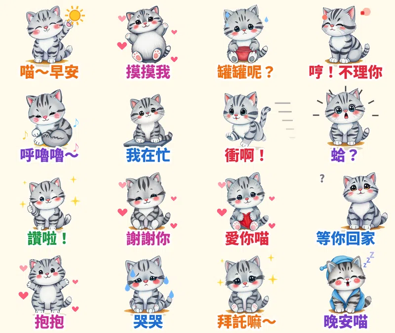

養貓的人都知道，家裡真正的老闆是誰。早上被踩醒、罐罐要準時、摸三下就翻臉、半夜在客廳暴衝。

第十三組貼圖，我做了一隻灰色虎斑小貓 **喵吉**，用蠟筆和粉彩的手繪筆觸畫，16 張都會動。這次還多做了一件事：**幫每一張配上一句萌寵喵語。**

## 🔊 開聲音聽聽喵吉說話

<video src="miaoji-voice.mp4" controls playsinline preload="metadata" poster="cover.jpg" style="max-width:360px;width:100%;border-radius:12px"></video>

先說清楚：**LINE 開放給一般創作者的「LINE Creators Market」目前只有 7 種貼圖類型**（一般、動態、隨你填、訊息、大貼圖、全螢幕、特效），沒有「有聲貼圖」。有聲貼圖只有 LINE 官方的品牌貼圖才有。所以上架到 LINE 的版本是**無聲的動態貼圖**，上面這段有聲版是拿來分享到 Reels、Shorts、Threads 的。

## 為什麼是「萌寵」？

1. **動物角色一直是 LINE 原創貼圖的主力。** 2025 年度原創榜由「戀愛兔」和吉伊卡哇拿下，共通點是情緒鮮明、台詞口語，傳出去不用多解釋。
2. **貓奴的日常台詞很固定。** 罐罐呢、哼不理你、呼嚕嚕、我在忙（坐在你的鍵盤上）、衝啊（半夜暴衝），養過貓的人一看就懂。
3. **這次的畫風是蠟筆手繪。** 從七種畫風（扁平色塊、蠟筆／鉛筆／粉彩手繪、水彩、粗黑輪廓卡通、懷舊復古、黏土、像素）隨機抽到蠟筆粉彩，看起來毛茸茸、軟綿綿。

## 16 張的台詞、動作和喵語

| 貼圖台詞 | 動作 | 配音喵語 |
|---|---|---|
| 喵～早安 | 伸懶腰揮手 + 太陽 | 喵～早安！ |
| 摸摸我 | 翻肚躺平 | 摸摸我嘛～喵 |
| 罐罐呢？ | 捧著空碗發抖 | 罐罐呢？喵喵！ |
| 哼！不理你 | 鼻子朝天甩頭 | 哼！不理你喵 |
| 呼嚕嚕～ | 母雞蹲 | 呼嚕嚕～呼嚕嚕 |
| 我在忙 | 坐在筆電鍵盤上 | 我在忙，喵！ |
| 衝啊！ | 暴衝 | 衝啊～喵喵喵！ |
| 蛤？ | 嚇到炸毛 | 蛤？喵？ |
| 讚啦！ | 比讚眨眼 | 讚啦！喵～ |
| 謝謝你 | 鞠躬 | 謝謝你喵～ |
| 愛你喵 | 抱著大愛心 | 愛你喵！ |
| 等你回家 | 歪頭等待 | 等你回家喵～ |
| 抱抱 | 張開雙手 | 抱抱～喵 |
| 哭哭 | 掉眼淚 | 嗚嗚…喵嗚～ |
| 拜託嘛～ | 雙手合十閃亮眼 | 拜託嘛～喵～ |
| 晚安喵 | 裹毯子戴睡帽 | 晚安喵～ |

## 做法

- **畫圖**：本機的 AI 繪圖模型畫 16 個姿勢，固定同一個隨機種子，讓喵吉每張長得一樣。有一張「蛤？」第一次畫得不夠驚訝，重畫了一次。
- **動畫**：用自己寫的 Python 程式一格一格加上動作和特效，輸出成 LINE 要求的 APNG，每張剛好播 3 秒。
- **配音**：用語音合成做成高音、奶聲奶氣的「小貓語氣」，每句不到 3 秒，再跟動畫合成影片。

## 目前上架進度

- **蠟筆虎斑貓喵吉・萌寵日常**（動態貼圖，NT$60 起）：10/14 送審，通過後自動開賣，連結會補在這裡
- 另外還有 8 組動態貼圖在審核中（[黏土豬豬嘟嘟](/blog/line-animated-sticker-piglet-foodie/)、[貓頭鷹咕咕](/blog/line-animated-sticker-owl-exam/)、[馴鹿叮噹](/blog/line-animated-sticker-reindeer-xmas/)、[無尾熊可可](/blog/line-animated-sticker-koala-comfort/)、[水獺拉拉](/blog/line-animated-sticker-otter-love/)、[柴犬福福](/blog/line-animated-sticker-shiba-greetings/)、[企鵝啵啵](/blog/line-animated-sticker-penguin-office/)、[糰糰倉鼠](/blog/line-animated-sticker-hamster/)）
- 已經開賣：**麻糬海豹噗嚕** 👉 [LINE STORE](https://store.line.me/stickershop/product/37215265/zh-Hant)、**芋圓貓** 👉 [LINE STORE](https://store.line.me/stickershop/product/37220496/zh-Hant)、**綿綿羊** 👉 [LINE STORE](https://store.line.me/stickershop/product/37266378/zh-Hant)

全部作品都在我的 [LINE 貼圖作者頁](https://line.me/S/shop/sticker/author/6564520)。

## 誠實筆記

角色是 AI 生成的，動畫是程式做的，配音是語音合成的。LINE 商店頁會標示「使用AI」。

---

*你家主子最常對你說的「喵語」是哪一句？告訴我，下一組就把它做進去。*
