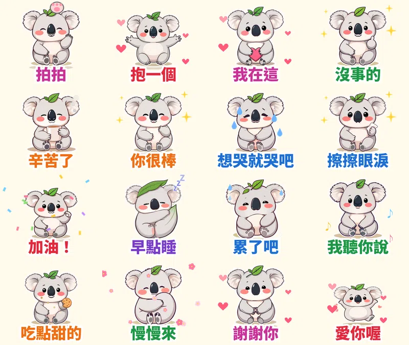

> 🛒 **無尾熊可可・療癒拍拍動起來** 已在 LINE 商店開賣（動態貼圖・NT$60）👉 [在 LINE 商店購買](https://line.me/S/sticker/37302939)

朋友傳來一句「今天好累」，你打了「辛苦了」，又刪掉，覺得太敷衍。打了一大段，又覺得太沉重。

這種時候，一張會動的「拍拍」通常比一段話好用。

所以第九組貼圖，我做了一隻頭上頂著尤加利葉的小無尾熊 **可可**，專門用來安慰人。牠會拍拍你的頭、張開手抱你、遞衛生紙給你，也會陪你早點睡。

## 為什麼做「療癒安慰」主題？

1. **安慰是最難打字的情境。** 抱怨、生氣都很好打，安慰反而最容易詞窮。這是貼圖最能幫上忙的地方。
2. **排行榜上紅的貼圖，都是「拿來互動」的。** LINE 公布的 2025 年度排行，分析爆紅貼圖有四個共通點，其中兩個是「接地氣、生活化的中文」和「能創造互動的內容」。一個人說累、另一個人回拍拍，就是最典型的互動。
3. **LINE 官方正好在辦「療癒系拍拍」特輯。** 符合主題的新貼圖可以報名，收件到 11/15。這組已經報名。
4. **無尾熊天生就是抱抱的形象。** 牠整天抱著樹，很適合當「抱一個」的角色。前面幾組做過倉鼠、企鵝、柴犬、水獺，這次也剛好換一隻沒做過的動物。

## 16 張的台詞和動作

| 台詞 | 動作 | 特效 |
|---|---|---|
| 拍拍 | 被拍得一縮一縮 | 小肉球拍頭 |
| 抱一個 | 張開雙手跳 | 愛心 |
| 我在這 | 捧著愛心 | 愛心 |
| 沒事的 | 比讚搖擺 | 星星 |
| 辛苦了 | 捧著熱茶 | 冒熱氣 |
| 你很棒 | 放大縮小 | 星星 |
| 想哭就哭吧 | 抱著自己發抖 | 眼淚 |
| 擦擦眼淚 | 遞出衛生紙 | 星星 |
| 加油！ | 握拳跳 | 彩紙 |
| 早點睡 | 抱著葉子睡著 | 飄 Z |
| 累了吧 | 癱成一團 | 冷汗 |
| 我聽你說 | 認真點頭 | 音符 |
| 吃點甜的 | 遞出餅乾 | 餅乾屑 |
| 慢慢來 | 抱著枕頭 | 花瓣 |
| 謝謝你 | 點頭道謝 | 愛心 |
| 愛你喔 | 高舉雙手跳起來 | 愛心 |

## 做法

做法跟前幾組[糰糰倉鼠](/blog/line-animated-sticker-hamster/)、[社畜企鵝啵啵](/blog/line-animated-sticker-penguin-office/)、[柴犬福福](/blog/line-animated-sticker-shiba-greetings/)、[黏人水獺拉拉](/blog/line-animated-sticker-otter-love/)一樣：本機的 AI 繪圖模型畫 16 個姿勢，固定同一個隨機種子，讓可可每張長得一樣；動作和特效用自己寫的 Python 程式一格一格做，輸出成 LINE 要求的 APNG。每張播剛好 3 秒，18 張圖第一次上傳就全部通過。

這次新增了一個「拍拍」特效：一隻粉紅色的小肉球從上面拍下來，可可被拍到的時候會縮一下。

## 目前上架進度

- **無尾熊可可・療癒拍拍動起來**（動態貼圖，NT$60 起）：10/14 送審，已報名「療癒系拍拍」特輯，通過後自動開賣，連結會補在這裡
- **黏人水獺拉拉・戀愛情勒動起來**（動態貼圖）：審核中
- **柴犬福福・長輩早安問候動起來**（動態貼圖）：審核中
- **社畜企鵝啵啵・上班日常動起來**（動態貼圖）：審核中
- **糰糰倉鼠・會動的超有反應**（動態貼圖）：審核中
- **柚柚水豚・情緒穩定中**：審核中
- **麻糬海豹噗嚕・想躺平日常** 👉 [LINE STORE](https://store.line.me/stickershop/product/37215265/zh-Hant)
- **芋圓貓・黏TT戀愛日常** 👉 [LINE STORE](https://store.line.me/stickershop/product/37220496/zh-Hant)
- **綿綿羊・喜氣羊羊過好年**（2027 羊年）👉 [LINE STORE](https://store.line.me/stickershop/product/37266378/zh-Hant)

全部作品都在我的 [LINE 貼圖作者頁](https://line.me/S/shop/sticker/author/6564520)。

## 誠實筆記

角色是 AI 生成的，動畫是程式做的，LINE 商店頁會標示「使用AI」。

---

*你最近一次想安慰朋友卻不知道說什麼，是什麼情況？告訴我，下一組就把那句話做出來。*

---

> 🛒 [在 LINE 商店購買「無尾熊可可・療癒拍拍動起來」](https://line.me/S/sticker/37302939)｜全部 27 組依主題整理在 [Massor LINE 貼圖全系列](/line-stickers/)
