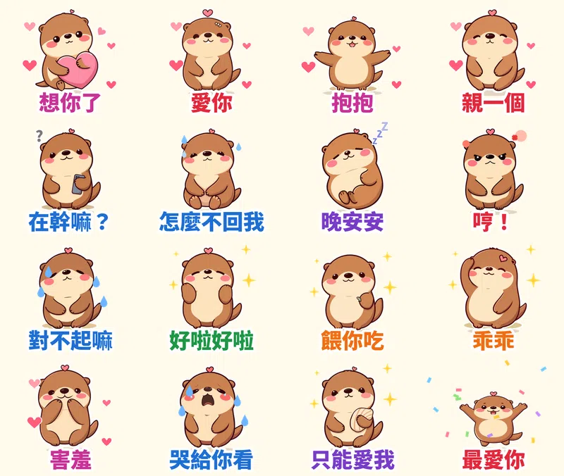

「在幹嘛？」（三分鐘後）「怎麼不回我」（再三分鐘）「哼！」

情侶之間最常傳的，往往不是什麼大事，就是這種黏人又有點鬧的小句子。

所以第八組貼圖，我做了一隻頭上別著愛心髮夾的水獺 **拉拉**，把談戀愛最常用的 16 句做成動態貼圖。黏人、會撒嬌、會生氣，也會乖乖道歉。

## 為什麼做「戀愛情勒」主題？

1. **排行榜證明它賣得動。** 台灣 LINE 原創貼圖排行前幾名，曾經整排都是日本作家西村裕二的作品，帶頭的就是台詞超情勒的「LOVE RABBIT」。新聞說它是靠情侶間的「情緒勒索」台詞在 Threads 爆紅的。
2. **情侶天天傳，而且會成對買。** 一個人買了，另一半常常也會跟著買來回嘴。
3. **LINE 官方正好在辦「我們的戀愛日常」特輯。** 符合主題的新貼圖可以報名，通過的話 12/16～12/29 會上特輯橫幅。這組已經報名。

我沒有照抄別人的台詞，而是挑了自己跟朋友真的會傳的句子，語氣走「可愛的鬧」，不走真的兇。

## 16 張的台詞和動作

| 台詞 | 動作 | 特效 |
|---|---|---|
| 想你了 | 抱著愛心枕發呆 | 愛心 |
| 愛你 | 放大縮小 | 愛心 |
| 抱抱 | 張開雙手跳 | 愛心 |
| 親一個 | 嘟嘴放大 | 愛心 |
| 在幹嘛？ | 拿手機歪頭 | 問號 |
| 怎麼不回我 | 抱膝坐著等 | 冷汗 |
| 晚安安 | 抱星星睡覺 | 飄 Z |
| 哼！ | 氣到發抖 | 冒煙 |
| 對不起嘛 | 合掌鞠躬 | 掉眼淚 |
| 好啦好啦 | 搖頭擺手 | 星星 |
| 餵你吃 | 遞出小魚 | 星星 |
| 乖乖 | 摸自己的頭 | 星星 |
| 害羞 | 摀臉發抖 | 愛心 |
| 哭給你看 | 大哭搖晃 | 眼淚 |
| 只能愛我 | 捧著貝殼放大 | 星星 |
| 最愛你 | 高舉雙手跳起來 | 彩紙 |

## 做法

做法跟前幾組[糰糰倉鼠](/blog/line-animated-sticker-hamster/)、[社畜企鵝啵啵](/blog/line-animated-sticker-penguin-office/)、[柴犬福福](/blog/line-animated-sticker-shiba-greetings/)一樣：本機的 AI 繪圖模型畫 16 個姿勢，固定同一個隨機種子，讓拉拉每張長得一樣；動作和特效用自己寫的 Python 程式一格一格做，輸出成 LINE 要求的 APNG。每張播剛好 3 秒，18 張圖第一次上傳就全部通過。

小插曲：原本有一張是「晚安寶貝」，但特輯規定貼圖裡不能有姓名或暱稱，「寶貝」可能算暱稱，所以改成「晚安安」。

## 目前上架進度

- **黏人水獺拉拉・戀愛情勒動起來**（動態貼圖，NT$60 起）：10/14 送審，已報名「我們的戀愛日常」特輯，通過後自動開賣，連結會補在這裡
- **柴犬福福・長輩早安問候動起來**（動態貼圖）：審核中
- **社畜企鵝啵啵・上班日常動起來**（動態貼圖）：審核中
- **糰糰倉鼠・會動的超有反應**（動態貼圖）：審核中
- **柚柚水豚・情緒穩定中**：審核中
- **麻糬海豹噗嚕・想躺平日常** 👉 [LINE STORE](https://store.line.me/stickershop/product/37215265/zh-Hant)
- **芋圓貓・黏TT戀愛日常** 👉 [LINE STORE](https://store.line.me/stickershop/product/37220496/zh-Hant)（喜歡拉拉的話，這組是靜態版的戀愛貼圖）
- **綿綿羊・喜氣羊羊過好年**（2027 羊年）👉 [LINE STORE](https://store.line.me/stickershop/product/37266378/zh-Hant)

全部作品都在我的 [LINE 貼圖作者頁](https://line.me/S/shop/sticker/author/6564520)。

## 誠實筆記

角色是 AI 生成的，動畫是程式做的，LINE 商店頁會標示「使用AI」。

---

*你跟另一半最常傳哪一句？告訴我，下一組就把它做出來。*
