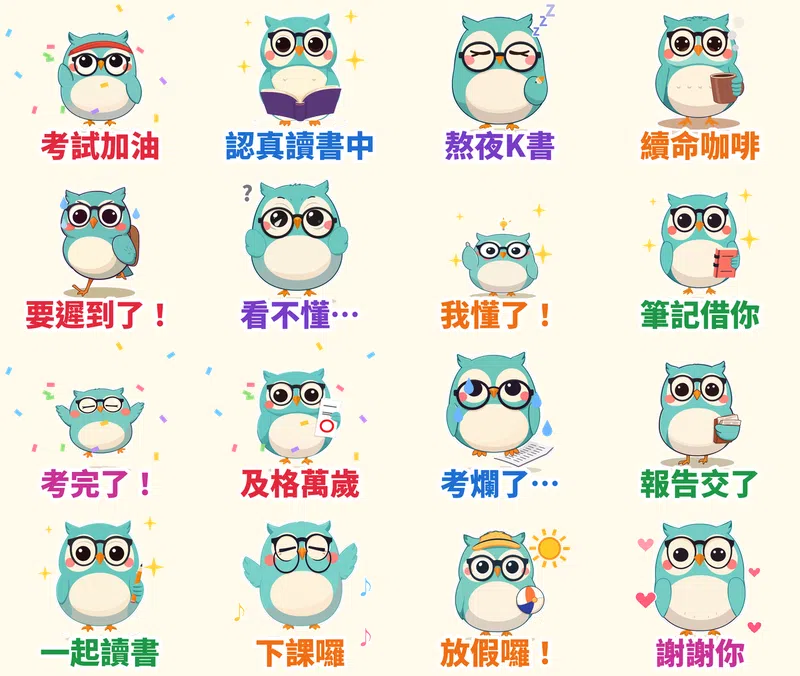

> 🛒 **貓頭鷹咕咕・考試週求生中** 已在 LINE 商店開賣（動態貼圖・NT$60）👉 [在 LINE 商店購買](https://line.me/S/sticker/37303917)

10 月底到 11 月是期中考季。班級群組、讀書會群組、報告小組，每天來回傳的都是那幾句：「考試加油」「我熬夜了」「看不懂…」「考完了！」

所以第十一組貼圖，我做了一隻戴眼鏡的貓頭鷹 **咕咕**。貓頭鷹本來就是「智慧」和「夜貓子」的代表，剛好就是考試週的學生。

## 為什麼做「學生／考試」？

1. **學生是最常傳貼圖的一群人。** LINE 甚至有學生專屬的貼圖方案。班群和小組群組的訊息量又大，同一句「加油」一天可以傳好幾次。
2. **考試週有固定的台詞。** 加油、熬夜、咖啡續命、遲到、看不懂、考爛了、考完了、放假，從考前到放榜整個流程都用得到，而且每學期都會重來一次。
3. **這次換一種畫風：平面色塊風。** 前面試過粗黑線條卡通、鉛筆手繪；這組改成沒有線條、沒有漸層的簡約色塊，小小一張在聊天室裡也很清楚。

## 16 張的台詞和動作

| 台詞 | 動作 | 特效 |
|---|---|---|
| 考試加油 | 綁頭巾握拳跳 | 彩紙 |
| 認真讀書中 | 捧書呼吸 | 星星 |
| 熬夜K書 | 拿著筆打瞌睡 | 飄 Z |
| 續命咖啡 | 捧著咖啡 | 冒熱氣 |
| 要遲到了！ | 背書包狂奔 | 汗滴 |
| 看不懂… | 抱頭發抖 | 問號 |
| 我懂了！ | 靈光一閃跳起來 | 星星 |
| 筆記借你 | 遞出筆記本 | 星星 |
| 考完了！ | 雙手舉高跳 | 彩紙 |
| 及格萬歲 | 舉著畫圈的考卷 | 彩紙 |
| 考爛了… | 發抖 | 眼淚 |
| 報告交了 | 抱著一疊報告 | 打勾 |
| 一起讀書 | 拿著鉛筆揮手 | 星星 |
| 下課囉 | 伸懶腰 | 音符 |
| 放假囉！ | 戴草帽抱沙灘球跳舞 | 太陽 |
| 謝謝你 | 鞠躬道謝 | 愛心 |

## 做法

做法跟前幾組[馴鹿叮噹](/blog/line-animated-sticker-reindeer-xmas/)、[無尾熊可可](/blog/line-animated-sticker-koala-comfort/)一樣：本機的 AI 繪圖模型畫 16 個姿勢，固定同一個隨機種子，讓咕咕每張長得一樣；動作和特效用自己寫的 Python 程式一格一格做，輸出成 LINE 要求的 APNG。每張剛好播 3 秒，18 張圖第一次上傳就全部通過。

## 目前上架進度

- **貓頭鷹咕咕・考試週求生中**（動態貼圖，NT$60 起）：10/14 送審，通過後自動開賣，連結會補在這裡
- **馴鹿叮噹・聖誕新年動起來**（動態貼圖）：審核中
- **無尾熊可可・療癒拍拍動起來**（動態貼圖）：審核中
- **黏人水獺拉拉・戀愛情勒動起來**（動態貼圖）：審核中
- **柴犬福福・長輩早安問候動起來**（動態貼圖）：審核中
- **社畜企鵝啵啵・上班日常動起來**（動態貼圖）：審核中
- **糰糰倉鼠・會動的超有反應**（動態貼圖）：審核中
- **柚柚水豚・情緒穩定中**：審核中
- **麻糬海豹噗嚕・想躺平日常** 👉 [LINE STORE](https://store.line.me/stickershop/product/37215265/zh-Hant)
- **芋圓貓・黏TT戀愛日常** 👉 [LINE STORE](https://store.line.me/stickershop/product/37220496/zh-Hant)
- **綿綿羊・喜氣羊羊過好年**（2027 羊年）👉 [LINE STORE](https://store.line.me/stickershop/product/37266378/zh-Hant)

全部作品都在我的 [LINE 貼圖作者頁](https://line.me/S/shop/sticker/author/6564520)。

## 誠實筆記

角色是 AI 生成的，動畫是程式做的，LINE 商店頁會標示「使用AI」。

---

*考試週你在群組裡最常傳的是哪一句？告訴我，下一組就把它做進去。*

---

> 🛒 [在 LINE 商店購買「貓頭鷹咕咕・考試週求生中」](https://line.me/S/sticker/37303917)｜全部 27 組依主題整理在 [Massor LINE 貼圖全系列](/line-stickers/)
