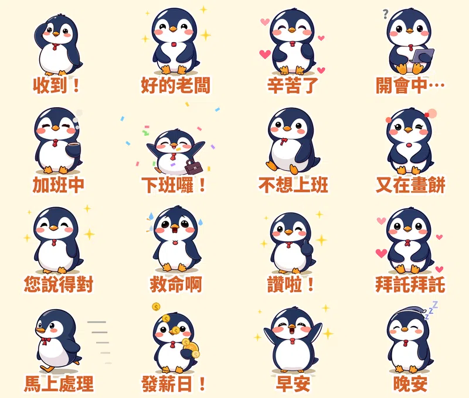

工作群組裡一天要回幾次「收到」？主管丟來一個新需求，你只想回「好的老闆」，心裡想的卻是「又在畫餅」。

這些話不好直接打出來，用貼圖傳就剛好。所以第六組貼圖，我做了一隻打紅領帶的上班族企鵝 **啵啵**，16 張全都會動。

## 為什麼做「上班族」主題？

翻了一下最近的推薦清單，上班族主題的貼圖一直很多：白爛貓、ㄇㄚˊ幾兔上班族篇、森田的工作日常、熊小姐、怪奇事物所的上班真心話；LINE 也辦過「慰勞社畜們」的貼圖折扣活動。我觀察到三個原因：

1. **使用頻率高。** 工作群組每天都在用，「收到」「辛苦了」比「愛你」用得更多。
2. **不方便直說的話，交給貼圖。** 「不想上班」「您說得對」直接打字很尷尬，用可愛角色傳出去，大家只會笑。
3. **會動的更好用。** 「下班囉！」配上彩紙、「發薪日！」掉金幣，動起來情緒更清楚。

## 16 張的台詞和動作

| 台詞 | 動作 | 特效 |
|---|---|---|
| 收到！ | 敬禮小跳 | 打勾 ✔ |
| 好的老闆 | 鞠躬 | 星星 |
| 辛苦了 | 心跳般放大 | 愛心 |
| 開會中… | 慢慢呼吸 | 問號 |
| 加班中 | 疲憊發抖 | 咖啡冒煙 |
| 下班囉！ | 大跳＋落地壓扁 | 彩紙 |
| 不想上班 | 癱著呼吸 | — |
| 又在畫餅 | 抖 | 怒氣 |
| 您說得對 | 假笑點頭 | 星星 |
| 救命啊 | 原地亂抖 | 冒冷汗 |
| 讚啦！ | 輕跳 | 星星 |
| 拜託拜託 | 放大 | 愛心 |
| 馬上處理 | 奔跑 | 速度線 |
| 發薪日！ | 扭來扭去 | 掉金幣 |
| 早安 | 揮手伸懶腰 | 星星 |
| 晚安 | 慢慢呼吸 | 飄 Z |

## 做法

做法跟上一組[糰糰倉鼠](/blog/line-animated-sticker-hamster/)一樣：本機的 AI 繪圖模型畫 16 個姿勢，固定同一個隨機種子，讓企鵝的長相一致；動作和特效則用自己寫的 Python 程式一格一格做，輸出成 LINE 要求的 APNG。

這次多寫了 4 種特效：**打勾、冒冷汗、咖啡冒煙、掉金幣**。上次學到的規則這次也遵守了：總播放時間要剛好是整數秒，所以每張都是 12 格，一輪 1 秒、播 3 次，剛好 3 秒。18 張圖第一次上傳就全部通過。

## 目前上架進度

- **社畜企鵝啵啵・上班日常動起來**（動態貼圖，NT$60 起）：10/14 送審，通過後自動開賣，連結會補在這裡
- **糰糰倉鼠・會動的超有反應**（動態貼圖）：審核中
- **柚柚水豚・情緒穩定中**：審核中
- **麻糬海豹噗嚕・想躺平日常** 👉 [LINE STORE](https://store.line.me/stickershop/product/37215265/zh-Hant)
- **芋圓貓・黏TT戀愛日常** 👉 [LINE STORE](https://store.line.me/stickershop/product/37220496/zh-Hant)
- **綿綿羊・喜氣羊羊過好年**（2027 羊年）👉 [LINE STORE](https://store.line.me/stickershop/product/37266378/zh-Hant)

全部作品都在我的 [LINE 貼圖作者頁](https://line.me/S/shop/sticker/author/6564520)。

## 誠實筆記

角色是 AI 生成的，動畫是程式做的，LINE 商店頁會標示「使用AI」。

---

*你在公司群組最常傳哪一句？告訴我，下一組上班族貼圖就把它做出來。*
