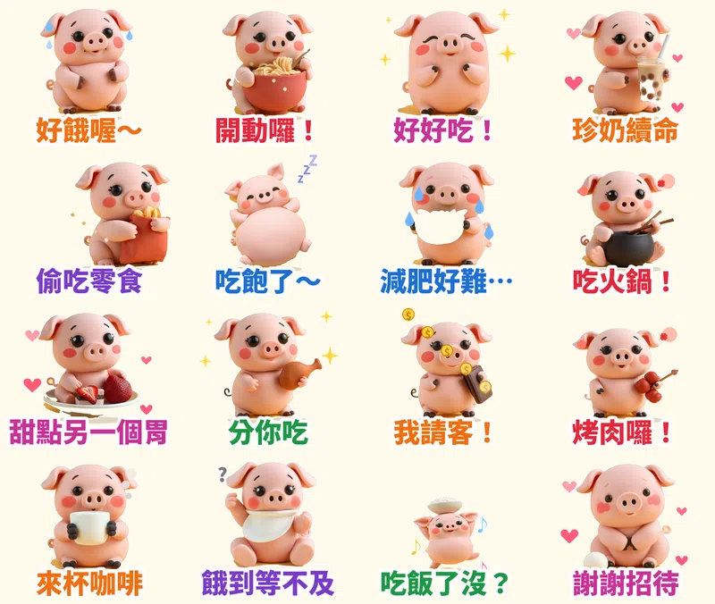

> 🛒 **黏土豬豬嘟嘟・吃貨日常** 已在 LINE 商店開賣（動態貼圖・NT$60）👉 [在 LINE 商店購買](https://line.me/S/sticker/37327325)

在台灣，「吃飯了沒？」幾乎等於「你好」。家族群組問晚餐吃什麼、同事群組揪下午茶、朋友群組約火鍋，聊天室裡跟「吃」有關的訊息永遠最多。

所以第十二組貼圖，我做了一隻黏土小豬 **嘟嘟**。牠每天只想著吃。

## 為什麼做「吃貨」？

1. **吃是每天都會聊的話題。** 不像節日貼圖只能用一季，「好餓」「開動」「吃飽了」一年 365 天都用得到。
2. **台灣人有自己的吃貨台詞。** 珍奶續命、吃火鍋、烤肉、甜點另一個胃，這組都放進去了。
3. **這次的畫風是黏土風。** 從七種畫風裡隨機抽到「可愛立體黏土」：圓潤、有手捏的質感，看起來就很好捏、很好吃。

## 16 張的台詞和動作

| 台詞 | 動作 | 特效 |
|---|---|---|
| 好餓喔～ | 抱著肚子發抖 | 汗滴 |
| 開動囉！ | 捧著麵碗嚼嚼嚼 | 碎屑 |
| 好好吃！ | 捧臉陶醉 | 星星 |
| 珍奶續命 | 捧著珍奶 | 愛心 |
| 偷吃零食 | 從旁邊探頭抱零食 | 碎屑 |
| 吃飽了～ | 圓滾滾躺平 | 飄 Z |
| 減肥好難… | 捧著沙拉哭 | 眼淚 |
| 吃火鍋！ | 抱著鍋子跳 | 冒熱氣 |
| 甜點另一個胃 | 草莓蛋糕放大縮小 | 愛心 |
| 分你吃 | 遞出雞腿 | 星星 |
| 我請客！ | 拿著錢包跳 | 金幣 |
| 烤肉囉！ | 舉著烤肉串歡呼 | 熱氣 |
| 來杯咖啡 | 捧著咖啡 | 冒熱氣 |
| 餓到等不及 | 圍著圍兜坐不住 | 問號 |
| 吃飯了沒？ | 頂著飯碗跳 | 音符 |
| 謝謝招待 | 鞠躬 | 愛心 |

## 做法

做法跟前一組[貓頭鷹咕咕](/blog/line-animated-sticker-owl-exam/)一樣：本機的 AI 繪圖模型畫 16 個姿勢，固定同一個隨機種子，讓嘟嘟每張長得一樣；動作和特效用自己寫的 Python 程式一格一格做，輸出成 LINE 要求的 APNG，每張剛好播 3 秒。

這次遇到一個新問題：粉紅色的小豬放在淡黃色背景上，原本的去背程式把小豬的肚子也當成背景挖掉了。後來改用「綠色比藍色高很多」來判斷黃色背景（粉紅色的綠和藍差不多），才把整隻小豬完整剪下來。

## 目前上架進度

- **黏土豬豬嘟嘟・吃貨日常**（動態貼圖，NT$60 起）：10/14 送審，通過後自動開賣，連結會補在這裡
- **貓頭鷹咕咕・考試週求生中**（動態貼圖）：審核中
- **馴鹿叮噹・聖誕新年動起來**（動態貼圖）：審核中
- **無尾熊可可・療癒拍拍動起來**（動態貼圖）：審核中
- **黏人水獺拉拉・戀愛情勒動起來**（動態貼圖）：審核中
- **柴犬福福・長輩早安問候動起來**（動態貼圖）：審核中
- **社畜企鵝啵啵・上班日常動起來**（動態貼圖）：審核中
- **糰糰倉鼠・會動的超有反應**（動態貼圖）：審核中
- **柚柚水豚・情緒穩定中**：審核中
- **麻糬海豹噗嚕・想躺平日常** 👉 [LINE STORE](https://store.line.me/stickershop/product/37215265/zh-Hant)
- **芋圓貓・黏TT戀愛日常** 👉 [LINE STORE](https://store.line.me/stickershop/product/37220496/zh-Hant)
- **綿綿羊・喜氣羊羊過好年**（2027 羊年）👉 [LINE STORE](https://store.line.me/stickershop/product/37266378/zh-Hant)

全部作品都在我的 [LINE 貼圖作者頁](https://line.me/S/shop/sticker/author/6564520)。

## 誠實筆記

角色是 AI 生成的，動畫是程式做的，LINE 商店頁會標示「使用AI」。

---

*你在群組裡最常傳的吃貨台詞是哪一句？告訴我，下一組就把它做進去。*

---

> 🛒 [在 LINE 商店購買「黏土豬豬嘟嘟・吃貨日常」](https://line.me/S/sticker/37327325)｜全部 27 組依主題整理在 [Massor LINE 貼圖全系列](/line-stickers/)
