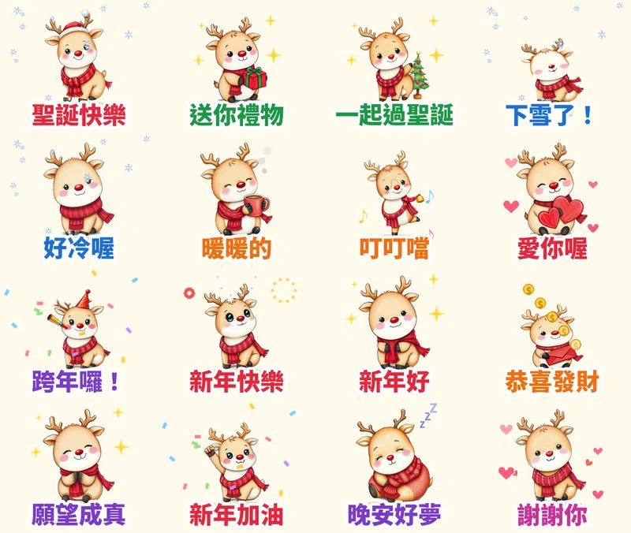

> 🛒 **馴鹿叮噹・聖誕新年動起來** 已在 LINE 商店開賣（動態貼圖・NT$60）👉 [在 LINE 商店購買](https://line.me/S/sticker/37302946)

每年 12 月，LINE 群組都會出現同一個問題：「誰有聖誕貼圖？」過完聖誕節，一週後又要找新年貼圖。

所以第十組貼圖，我把兩個節日做在同一組：一隻圍著紅色圍巾的小馴鹿 **叮噹**。從平安夜一路用到跨年、元旦，買一組就夠。

## 為什麼做「聖誕＋新年」？

1. **節日是貼圖最集中使用的時候。** 每年年底，LINE 官方和各家品牌都會推出一整批聖誕、跨年貼圖。最常見的做法就是「聖誕・新年・問候」做成同一組。
2. **現在送審，時間剛好。** 審核大約要幾天，10 月送審，11 月就能開賣，趕得上整個 12 月。
3. **這次換一種畫風：鉛筆手繪。** 前面幾組都是粗黑線條的卡通風。這組改成看得到鉛筆線條和色鉛筆筆觸，很有繪本的感覺，跟聖誕節的溫暖氣氛很搭。

## 16 張的台詞和動作

| 台詞 | 動作 | 特效 |
|---|---|---|
| 聖誕快樂 | 戴聖誕帽揮手 | 飄雪 |
| 送你禮物 | 捧著禮物跳 | 星星 |
| 一起過聖誕 | 在聖誕樹旁跳舞 | 星星 |
| 下雪了！ | 伸舌頭接雪花 | 飄雪 |
| 好冷喔 | 縮在圍巾裡發抖 | 飄雪 |
| 暖暖的 | 捧著熱可可 | 冒熱氣 |
| 叮叮噹 | 搖鈴鐺跳舞 | 音符 |
| 愛你喔 | 抱著大愛心 | 愛心 |
| 跨年囉！ | 吹派對喇叭 | 彩紙 |
| 新年快樂 | 看煙火 | 煙火 |
| 新年好 | 鞠躬拜年 | 星星 |
| 恭喜發財 | 拿紅包跳起來 | 金幣 |
| 願望成真 | 雙手合十許願 | 星星 |
| 新年加油 | 握拳跳 | 彩紙 |
| 晚安好夢 | 裹著毛毯睡著 | 飄 Z |
| 謝謝你 | 鞠躬道謝 | 愛心 |

## 做法

做法跟前幾組[無尾熊可可](/blog/line-animated-sticker-koala-comfort/)、[黏人水獺拉拉](/blog/line-animated-sticker-otter-love/)、[柴犬福福](/blog/line-animated-sticker-shiba-greetings/)一樣：本機的 AI 繪圖模型畫 16 個姿勢，固定同一個隨機種子，讓叮噹每張長得一樣；動作和特效用自己寫的 Python 程式一格一格做，輸出成 LINE 要求的 APNG。每張播剛好 3 秒，18 張圖第一次上傳就全部通過。

這次新增了兩個特效：**飄雪**（大小不同的雪花一邊轉一邊往下飄）和 **煙火**（三朵煙火輪流綻放、慢慢淡掉）。

## 目前上架進度

- **馴鹿叮噹・聖誕新年動起來**（動態貼圖，NT$60 起）：10/14 送審，通過後自動開賣，連結會補在這裡
- **無尾熊可可・療癒拍拍動起來**（動態貼圖）：審核中
- **黏人水獺拉拉・戀愛情勒動起來**（動態貼圖）：審核中
- **柴犬福福・長輩早安問候動起來**（動態貼圖）：審核中
- **社畜企鵝啵啵・上班日常動起來**（動態貼圖）：審核中
- **糰糰倉鼠・會動的超有反應**（動態貼圖）：審核中
- **柚柚水豚・情緒穩定中**：審核中
- **麻糬海豹噗嚕・想躺平日常** 👉 [LINE STORE](https://store.line.me/stickershop/product/37215265/zh-Hant)
- **芋圓貓・黏TT戀愛日常** 👉 [LINE STORE](https://store.line.me/stickershop/product/37220496/zh-Hant)
- **綿綿羊・喜氣羊羊過好年**（2027 羊年）👉 [LINE STORE](https://store.line.me/stickershop/product/37266378/zh-Hant)

全部作品都在我的 [LINE 貼圖作者頁](https://line.me/S/shop/sticker/author/6564520)。想要羊年的新年貼圖，可以跟綿綿羊一起搭配。

## 誠實筆記

角色是 AI 生成的，動畫是程式做的，LINE 商店頁會標示「使用AI」。

---

*你的群組每年聖誕節最常傳的是哪一句？告訴我，明年的版本就把它加進去。*

---

> 🛒 [在 LINE 商店購買「馴鹿叮噹・聖誕新年動起來」](https://line.me/S/sticker/37302946)｜全部 27 組依主題整理在 [Massor LINE 貼圖全系列](/line-stickers/)
