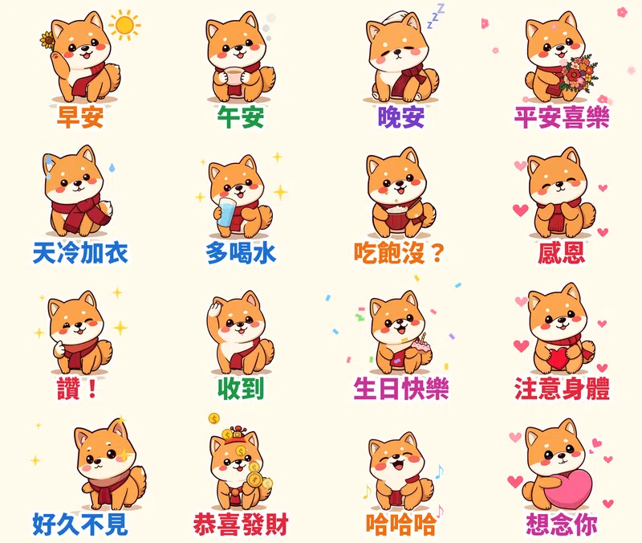

家族群組每天早上七點，一定有人傳「早安 平安喜樂」。

有人覺得長輩圖很好笑，但它其實是一種報平安：傳一張圖，等於說「我今天也很好，你也要好好的」。只是那些花花綠綠的圖，有時候字太小、畫面太亂。

所以第七組貼圖，我做了一隻圍紅圍巾的柴犬 **福福**，把長輩最常傳的 16 句問候做成動態貼圖。字大、顏色亮、每張都會動，可以送給爸媽用，也可以拿來回爸媽。

## 為什麼做「長輩問候」主題？

1. **天天都用。** 早安、午安、晚安是家族群組裡最常傳的話，一天可以用好幾次。
2. **長輩愛傳，晚輩也需要回。** 爸媽傳「天冷加衣」，回一張「收到」「感恩」比打字快，也比貼一個讚有溫度。
3. **發早安圖其實是在報平安。** 有報導提到，有長輩在另一半過世後，靠每天傳早安圖讓親友知道自己還好。這類貼圖要的是溫暖和清楚，不是搞笑。

所以設計上我把字放大、每句用不同的鮮豔顏色，角色則選了圓滾滾、表情溫和的柴犬。

## 16 張的台詞和動作

| 台詞 | 動作 | 特效 |
|---|---|---|
| 早安 | 揮手 | 太陽轉轉 ☀️ |
| 午安 | 捧著熱茶呼吸 | 茶冒煙 |
| 晚安 | 戴睡帽打盹 | 飄 Z |
| 平安喜樂 | 捧花放大 | 花瓣飄落 🌸 |
| 天冷加衣 | 圍著大圍巾發抖 | 冷汗 |
| 多喝水 | 拿水杯輕跳 | 星星 |
| 吃飽沒？ | 捧碗嚼嚼 | 飯粒 |
| 感恩 | 合掌鞠躬 | 愛心 |
| 讚！ | 比讚輕跳 | 星星 |
| 收到 | 敬禮 | 打勾 ✔ |
| 生日快樂 | 拿蛋糕扭來扭去 | 彩紙 |
| 注意身體 | 抱著愛心放大 | 愛心 |
| 好久不見 | 從旁邊探頭 | 星星 |
| 恭喜發財 | 戴小帽扭來扭去 | 掉金幣 |
| 哈哈哈 | 笑到跳起來 | 音符 |
| 想念你 | 抱著愛心枕 | 愛心 |

## 做法

做法跟前兩組[糰糰倉鼠](/blog/line-animated-sticker-hamster/)、[社畜企鵝啵啵](/blog/line-animated-sticker-penguin-office/)一樣：本機的 AI 繪圖模型畫 16 個姿勢，固定同一個隨機種子，讓福福每張長得一樣；動作和特效用自己寫的 Python 程式一格一格做，輸出成 LINE 要求的 APNG。

這次新寫了兩種特效：**會轉的太陽**和**飄落的花瓣**，另外讓每句台詞有自己的顏色，更像大家熟悉的早安圖。每張 12 格、一輪 1 秒、播 3 次，剛好 3 秒，18 張圖第一次上傳就全部通過。

## 目前上架進度

- **柴犬福福・長輩早安問候動起來**（動態貼圖，NT$60 起）：10/14 送審，通過後自動開賣，連結會補在這裡
- **社畜企鵝啵啵・上班日常動起來**（動態貼圖）：審核中
- **糰糰倉鼠・會動的超有反應**（動態貼圖）：審核中
- **柚柚水豚・情緒穩定中**：審核中
- **麻糬海豹噗嚕・想躺平日常** 👉 [LINE STORE](https://store.line.me/stickershop/product/37215265/zh-Hant)
- **芋圓貓・黏TT戀愛日常** 👉 [LINE STORE](https://store.line.me/stickershop/product/37220496/zh-Hant)
- **綿綿羊・喜氣羊羊過好年**（2027 羊年）👉 [LINE STORE](https://store.line.me/stickershop/product/37266378/zh-Hant)

全部作品都在我的 [LINE 貼圖作者頁](https://line.me/S/shop/sticker/author/6564520)。

## 誠實筆記

角色是 AI 生成的，動畫是程式做的，LINE 商店頁會標示「使用AI」。

---

*你家群組最常出現哪一句問候？告訴我，下一組就把它做出來。*
