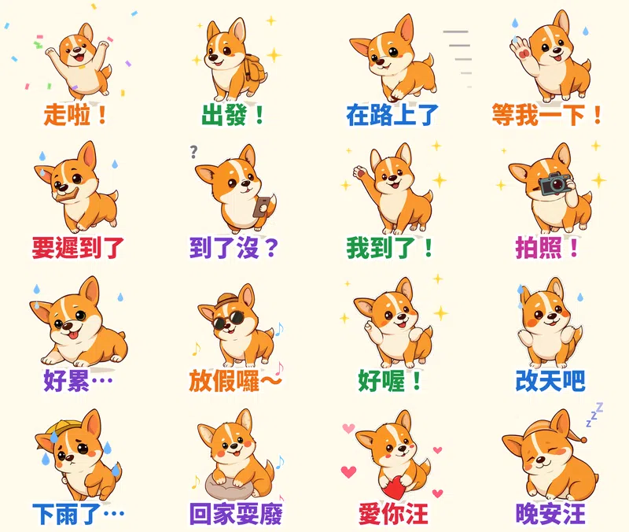

「我出門了」其實是「我才剛起床」，「快到了」其實是「還在找鑰匙」。每次約吃飯、約看電影、約爬山，群組裡都在上演這齣戲。

第十五組貼圖就是為**約出門**做的：一隻**短腿柯基「短短」**，用 **70 年代復古卡通**的畫風，16 張全是約人出門最常用的台詞。每張都會動，也都配了一聲**汪汪語音**。

## 🔊 點一下就有聲音：短短有聲貼圖板

**點任何一張貼圖，就會聽到短短先「汪汪」兩聲，再說那句台詞。** 手機上按「傳給朋友」可以直接把有聲版傳進 LINE 聊天室，會以 3 秒影片傳出，對方點開就有聲音。也可以 [一次下載 16 支有聲貼圖（zip，3.3MB）](Duanduan_sound_stickers.zip)。

<figure class="ms-c"><video src="sound/01.mp4" poster="sound/01.jpg" muted autoplay loop playsinline preload="metadata"></video><figcaption>汪汪！走啦走啦！</figcaption><button type="button" class="ms-share" data-k="01">傳給朋友</button></figure><figure class="ms-c"><video src="sound/02.mp4" poster="sound/02.jpg" muted autoplay loop playsinline preload="metadata"></video><figcaption>出發囉，汪！</figcaption><button type="button" class="ms-share" data-k="02">傳給朋友</button></figure><figure class="ms-c"><video src="sound/03.mp4" poster="sound/03.jpg" muted autoplay loop playsinline preload="metadata"></video><figcaption>在路上了汪！</figcaption><button type="button" class="ms-share" data-k="03">傳給朋友</button></figure><figure class="ms-c"><video src="sound/04.mp4" poster="sound/04.jpg" muted autoplay loop playsinline preload="metadata"></video><figcaption>等我一下汪！</figcaption><button type="button" class="ms-share" data-k="04">傳給朋友</button></figure><figure class="ms-c"><video src="sound/05.mp4" poster="sound/05.jpg" muted autoplay loop playsinline preload="metadata"></video><figcaption>嗚汪！要遲到了！</figcaption><button type="button" class="ms-share" data-k="05">傳給朋友</button></figure><figure class="ms-c"><video src="sound/06.mp4" poster="sound/06.jpg" muted autoplay loop playsinline preload="metadata"></video><figcaption>到了沒啦，汪？</figcaption><button type="button" class="ms-share" data-k="06">傳給朋友</button></figure><figure class="ms-c"><video src="sound/07.mp4" poster="sound/07.jpg" muted autoplay loop playsinline preload="metadata"></video><figcaption>我到了汪汪！</figcaption><button type="button" class="ms-share" data-k="07">傳給朋友</button></figure><figure class="ms-c"><video src="sound/08.mp4" poster="sound/08.jpg" muted autoplay loop playsinline preload="metadata"></video><figcaption>拍照！笑一個汪！</figcaption><button type="button" class="ms-share" data-k="08">傳給朋友</button></figure><figure class="ms-c"><video src="sound/09.mp4" poster="sound/09.jpg" muted autoplay loop playsinline preload="metadata"></video><figcaption>好累喔…嗚～</figcaption><button type="button" class="ms-share" data-k="09">傳給朋友</button></figure><figure class="ms-c"><video src="sound/10.mp4" poster="sound/10.jpg" muted autoplay loop playsinline preload="metadata"></video><figcaption>放假囉汪汪～</figcaption><button type="button" class="ms-share" data-k="10">傳給朋友</button></figure><figure class="ms-c"><video src="sound/11.mp4" poster="sound/11.jpg" muted autoplay loop playsinline preload="metadata"></video><figcaption>好喔，汪！</figcaption><button type="button" class="ms-share" data-k="11">傳給朋友</button></figure><figure class="ms-c"><video src="sound/12.mp4" poster="sound/12.jpg" muted autoplay loop playsinline preload="metadata"></video><figcaption>嗚…改天吧汪</figcaption><button type="button" class="ms-share" data-k="12">傳給朋友</button></figure><figure class="ms-c"><video src="sound/13.mp4" poster="sound/13.jpg" muted autoplay loop playsinline preload="metadata"></video><figcaption>下雨了…嗚嗚</figcaption><button type="button" class="ms-share" data-k="13">傳給朋友</button></figure><figure class="ms-c"><video src="sound/14.mp4" poster="sound/14.jpg" muted autoplay loop playsinline preload="metadata"></video><figcaption>回家耍廢囉汪～</figcaption><button type="button" class="ms-share" data-k="14">傳給朋友</button></figure><figure class="ms-c"><video src="sound/15.mp4" poster="sound/15.jpg" muted autoplay loop playsinline preload="metadata"></video><figcaption>愛你汪汪！</figcaption><button type="button" class="ms-share" data-k="15">傳給朋友</button></figure><figure class="ms-c"><video src="sound/16.mp4" poster="sound/16.jpg" muted autoplay loop playsinline preload="metadata"></video><figcaption>晚安汪～</figcaption><button type="button" class="ms-share" data-k="16">傳給朋友</button></figure>

## 🔊 一次聽完 16 句（48 秒）

<video src="duanduan-voice.mp4" controls playsinline preload="metadata" poster="cover.jpg" style="max-width:360px;width:100%;border-radius:12px"></video>

先說清楚：**LINE 開放給一般創作者的 LINE Creators Market 只有 7 種貼圖類型**（一般、動態、隨你填、訊息、大貼圖、全螢幕、特效），沒有「有聲貼圖」，有聲貼圖只有 LINE 官方品牌貼圖才有。所以上架到 LINE 的是**無聲的動態貼圖**。想要有聲音，可以用上面的有聲貼圖板，或把有聲版影片直接傳進聊天室。

## 為什麼是「約出門」＋「柯基」？

1. **柯基是台灣最吃香的狗狗角色之一。** 今年夏天 LINE 上好幾款品牌免費貼圖都找柯基當主角，例如卡卡CACA 的萌萌柯基犬。短腿、圓屁股，光看就想笑。
2. **熱賣貼圖的共通點是台詞短、情緒一看就懂、天天用得到。** 約出門這件事每週都在發生，「在路上了」「等我一下」「到了沒」幾乎每個群組都會用到。
3. **這次的畫風是懷舊復古。** 從七種畫風（扁平色塊、蠟筆／鉛筆／粉彩手繪、水彩、粗黑輪廓卡通、懷舊復古、黏土、像素）裡，在還沒用過的兩種中隨機抽到**復古**：芥末黃、焦橘、奶油色的 70 年代配色，加上柔和的咖啡色線條，在一堆粉嫩貼圖裡反而很顯眼。

## 16 張的台詞、動作和汪語

| 貼圖台詞 | 動作 | 配音汪語 |
|---|---|---|
| 走啦！ | 高舉雙手跳起來 + 彩帶 | 汪汪！走啦走啦！ |
| 出發！ | 揹小背包踏步 + 星星 | 出發囉，汪！ |
| 在路上了 | 短腿狂奔 + 速度線 | 在路上了汪！ |
| 等我一下！ | 伸手喊停喘氣 + 冒汗 | 等我一下汪！ |
| 要遲到了 | 咬吐司衝刺 + 冒汗 | 嗚汪！要遲到了！ |
| 到了沒？ | 滑手機嘟嘴 + 問號 | 到了沒啦，汪？ |
| 我到了！ | 用力揮手 + 星星 | 我到了汪汪！ |
| 拍照！ | 舉底片相機拍照 + 閃光 | 拍照！笑一個汪！ |
| 好累… | 攤平成柯基煎餅 + 冒汗 | 好累喔…嗚～ |
| 放假囉～ | 戴墨鏡草帽搖擺 + 音符 | 放假囉汪汪～ |
| 好喔！ | 比讚眨眼 + 星星 | 好喔，汪！ |
| 改天吧 | 聳肩尷尬笑 + 冒汗 | 嗚…改天吧汪 |
| 下雨了… | 撐小黃傘耳朵下垂 + 淚滴 | 下雨了…嗚嗚 |
| 回家耍廢 | 抱坐墊放空 + 音符 | 回家耍廢囉汪～ |
| 愛你汪 | 抱著紅愛心 + 愛心 | 愛你汪汪！ |
| 晚安汪 | 戴睡帽縮成一團 + ZZZ | 晚安汪～ |

## 做法

- **畫圖**：用本機的 AI 繪圖模型畫 16 個姿勢，都用同一個隨機種子，所以短短每張長得都一樣。第一版的「我到了」被 AI 在腳下多畫了一行英文字，那張重畫了一次。
- **動畫**：用自己寫的 Python 程式一格一格加上動作和特效（速度線、冒汗、問號、淚滴、ZZZ），輸出成 LINE 要求的 APNG 格式，每張剛好播 3 秒。
- **配音**：先用程式合成兩聲小狗「汪汪」（音高往下滑的短促叫聲），再接上高音的語音合成台詞，每句不到 3 秒。

## 目前上架進度

- **柯基短短・約出門**（動態貼圖，NT$60 起）：10/15 送審，通過後會自動開賣，到時再把連結補上來
- 🎉 **這幾組動態貼圖已經開賣**：[糰糰倉鼠・會動的超有反應](https://store.line.me/stickershop/product/37292039/zh-Hant)、[社畜企鵝啵啵・上班日常](https://store.line.me/stickershop/product/37292394/zh-Hant)、[柴犬福福・長輩早安問候](https://store.line.me/stickershop/product/37292442/zh-Hant)
- 已開賣的靜態貼圖：[柚柚水豚・情緒穩定中](https://store.line.me/stickershop/product/37291887/zh-Hant)、[麻糬海豹噗嚕](https://store.line.me/stickershop/product/37215265/zh-Hant)、[芋圓貓](https://store.line.me/stickershop/product/37220496/zh-Hant)、[綿綿羊](https://store.line.me/stickershop/product/37266378/zh-Hant)
- 另外還有 7 組在審核中，例如[像素鸚鵡啾比](/blog/line-animated-sticker-budgie-pixel/)、[蠟筆虎斑貓喵吉](/blog/line-animated-sticker-kitten-voice/)、[黏土豬豬嘟嘟](/blog/line-animated-sticker-piglet-foodie/)

全部作品都在我的 [LINE 貼圖作者頁](https://line.me/S/shop/sticker/author/6564520)。

## 誠實筆記

角色是 AI 生成的，動畫是程式做的，狗叫聲和配音都是合成的。LINE 商店頁會標示「使用AI」。

---

*你約出門最常說的謊是「在路上了」還是「快到了」？告訴我，下一組就把它做進去。*
