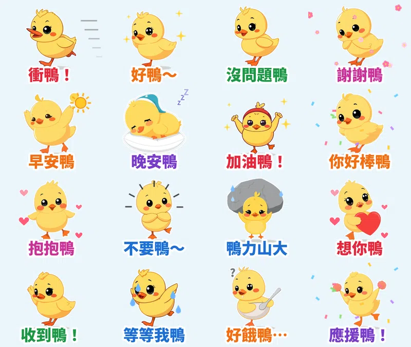

朋友要考試、要上台、要加班，你想傳一句「加油」又覺得太普通？那就傳 **「衝鴨！」**。

這組貼圖的主角是小黃鴨 **嘎嘎**，畫風是 **平面簡約色塊風**：沒有線條、沒有漸層，只有乾淨的色塊。16 張都會動，台詞全部是 **「鴨＝呀」諧音梗**，**每張都配一句嘎嘎的萌寵語音**。

## 🔊 點一下就有聲音：嘎嘎有聲貼圖板

**點任何一張，就會聽到嘎嘎說那句話。** 在手機上按「傳給朋友」，可以把有聲版（3 秒短影音）傳進 LINE 聊天室。也可以 [一次下載 16 支有聲貼圖（zip，3.0MB）](https://github.com/ckw19810413/ckw19810413.github.io/releases/download/media-line-animated-sticker-duck-cheer/Gaga_sound_stickers.zip)。

<figure class="ms-c"><video src="https://github.com/ckw19810413/ckw19810413.github.io/releases/download/media-line-animated-sticker-duck-cheer/gaga-01.mp4" poster="sound/01.jpg" muted autoplay loop playsinline preload="metadata"></video><figcaption>衝鴨！</figcaption><button type="button" class="ms-share" data-k="01">傳給朋友</button></figure><figure class="ms-c"><video src="https://github.com/ckw19810413/ckw19810413.github.io/releases/download/media-line-animated-sticker-duck-cheer/gaga-02.mp4" poster="sound/02.jpg" muted autoplay loop playsinline preload="metadata"></video><figcaption>好鴨～</figcaption><button type="button" class="ms-share" data-k="02">傳給朋友</button></figure><figure class="ms-c"><video src="https://github.com/ckw19810413/ckw19810413.github.io/releases/download/media-line-animated-sticker-duck-cheer/gaga-03.mp4" poster="sound/03.jpg" muted autoplay loop playsinline preload="metadata"></video><figcaption>沒問題鴨</figcaption><button type="button" class="ms-share" data-k="03">傳給朋友</button></figure><figure class="ms-c"><video src="https://github.com/ckw19810413/ckw19810413.github.io/releases/download/media-line-animated-sticker-duck-cheer/gaga-04.mp4" poster="sound/04.jpg" muted autoplay loop playsinline preload="metadata"></video><figcaption>謝謝鴨</figcaption><button type="button" class="ms-share" data-k="04">傳給朋友</button></figure><figure class="ms-c"><video src="https://github.com/ckw19810413/ckw19810413.github.io/releases/download/media-line-animated-sticker-duck-cheer/gaga-05.mp4" poster="sound/05.jpg" muted autoplay loop playsinline preload="metadata"></video><figcaption>早安鴨</figcaption><button type="button" class="ms-share" data-k="05">傳給朋友</button></figure><figure class="ms-c"><video src="https://github.com/ckw19810413/ckw19810413.github.io/releases/download/media-line-animated-sticker-duck-cheer/gaga-06.mp4" poster="sound/06.jpg" muted autoplay loop playsinline preload="metadata"></video><figcaption>晚安鴨</figcaption><button type="button" class="ms-share" data-k="06">傳給朋友</button></figure><figure class="ms-c"><video src="https://github.com/ckw19810413/ckw19810413.github.io/releases/download/media-line-animated-sticker-duck-cheer/gaga-07.mp4" poster="sound/07.jpg" muted autoplay loop playsinline preload="metadata"></video><figcaption>加油鴨！</figcaption><button type="button" class="ms-share" data-k="07">傳給朋友</button></figure><figure class="ms-c"><video src="https://github.com/ckw19810413/ckw19810413.github.io/releases/download/media-line-animated-sticker-duck-cheer/gaga-08.mp4" poster="sound/08.jpg" muted autoplay loop playsinline preload="metadata"></video><figcaption>你好棒鴨</figcaption><button type="button" class="ms-share" data-k="08">傳給朋友</button></figure><figure class="ms-c"><video src="https://github.com/ckw19810413/ckw19810413.github.io/releases/download/media-line-animated-sticker-duck-cheer/gaga-09.mp4" poster="sound/09.jpg" muted autoplay loop playsinline preload="metadata"></video><figcaption>抱抱鴨</figcaption><button type="button" class="ms-share" data-k="09">傳給朋友</button></figure><figure class="ms-c"><video src="https://github.com/ckw19810413/ckw19810413.github.io/releases/download/media-line-animated-sticker-duck-cheer/gaga-10.mp4" poster="sound/10.jpg" muted autoplay loop playsinline preload="metadata"></video><figcaption>不要鴨～</figcaption><button type="button" class="ms-share" data-k="10">傳給朋友</button></figure><figure class="ms-c"><video src="https://github.com/ckw19810413/ckw19810413.github.io/releases/download/media-line-animated-sticker-duck-cheer/gaga-11.mp4" poster="sound/11.jpg" muted autoplay loop playsinline preload="metadata"></video><figcaption>鴨力山大</figcaption><button type="button" class="ms-share" data-k="11">傳給朋友</button></figure><figure class="ms-c"><video src="https://github.com/ckw19810413/ckw19810413.github.io/releases/download/media-line-animated-sticker-duck-cheer/gaga-12.mp4" poster="sound/12.jpg" muted autoplay loop playsinline preload="metadata"></video><figcaption>想你鴨</figcaption><button type="button" class="ms-share" data-k="12">傳給朋友</button></figure><figure class="ms-c"><video src="https://github.com/ckw19810413/ckw19810413.github.io/releases/download/media-line-animated-sticker-duck-cheer/gaga-13.mp4" poster="sound/13.jpg" muted autoplay loop playsinline preload="metadata"></video><figcaption>收到鴨！</figcaption><button type="button" class="ms-share" data-k="13">傳給朋友</button></figure><figure class="ms-c"><video src="https://github.com/ckw19810413/ckw19810413.github.io/releases/download/media-line-animated-sticker-duck-cheer/gaga-14.mp4" poster="sound/14.jpg" muted autoplay loop playsinline preload="metadata"></video><figcaption>等等我鴨</figcaption><button type="button" class="ms-share" data-k="14">傳給朋友</button></figure><figure class="ms-c"><video src="https://github.com/ckw19810413/ckw19810413.github.io/releases/download/media-line-animated-sticker-duck-cheer/gaga-15.mp4" poster="sound/15.jpg" muted autoplay loop playsinline preload="metadata"></video><figcaption>好餓鴨…</figcaption><button type="button" class="ms-share" data-k="15">傳給朋友</button></figure><figure class="ms-c"><video src="https://github.com/ckw19810413/ckw19810413.github.io/releases/download/media-line-animated-sticker-duck-cheer/gaga-16.mp4" poster="sound/16.jpg" muted autoplay loop playsinline preload="metadata"></video><figcaption>應援鴨！</figcaption><button type="button" class="ms-share" data-k="16">傳給朋友</button></figure>

## 🔊 一次聽完 16 句（48 秒直式影片）

<video src="https://github.com/ckw19810413/ckw19810413.github.io/releases/download/media-line-animated-sticker-duck-cheer/gaga-voice.mp4" controls playsinline preload="metadata" poster="cover.jpg" style="max-width:360px;width:100%;border-radius:12px"></video>

> 💡 **關於聲音：** LINE Creators Market 開放給一般創作者的動態貼圖是 APNG 格式，不能帶聲音；有聲貼圖目前只有官方合作夥伴能做。所以 LINE 商店裡的是 **無聲動態貼圖**，萌寵語音版要在這一頁聽、下載或傳給朋友。

## 調研：爆款貼圖的共通點

- **數字先看**：2025 年台灣原創貼圖年度榜前 10 名累計銷售約 **16 億日圓**；台灣用戶平均 **每年下載 18 組貼圖**，是日本用戶的 2 倍；LINE「表情回應」每月有 **940 萬** 不重複用戶在用。
- **萌系圓滾小動物**：戀愛兔、吉伊卡哇都是圓滾滾的小動物。
- **諧音梗**：「謝謝鴨」「好興奮鴨」這類鴨鴨貼圖，連品牌都拿來當免費貼圖的誘因。諧音梗好記，也容易被轉傳。
- **天天用得到**：早安、晚安、收到、謝謝、加油，是群組裡最常傳的話。
- **短台詞＋誇張情緒**：2～6 個字，一眼看懂。

## 16 張台詞、動態、語音

| 台詞 | 動態 | 語音 |
|---|---|---|
| 衝鴨！ | 往前衝＋速度線 | 嘎嘎！衝鴨！ |
| 好鴨～ | 比讚彈跳＋星星 | 好鴨好鴨～ |
| 沒問題鴨 | 拍胸脯＋打勾 | 沒問題鴨，交給我！ |
| 謝謝鴨 | 鞠躬＋花瓣 | 謝謝鴨～ |
| 早安鴨 | 伸懶腰揮手＋太陽 | 早安鴨！嘎～ |
| 晚安鴨 | 戴睡帽睡枕頭＋Zzz | 晚安鴨，好夢喔 |
| 加油鴨！ | 綁頭巾雙手握拳 | 加油鴨！你可以的！ |
| 你好棒鴨 | 拍手＋彩帶 | 你好棒鴨！ |
| 抱抱鴨 | 抱抱＋愛心 | 抱抱鴨～ |
| 不要鴨～ | 雙手打叉搖頭 | 不要鴨～ |
| 鴨力山大 | 頂著大石頭發抖 | 鴨力山大啦… |
| 想你鴨 | 抱著大愛心害羞 | 想你鴨～ |
| 收到鴨！ | 敬禮＋打勾 | 收到鴨！ |
| 等等我鴨 | 哭著追上來 | 等等我鴨～嘎嘎！ |
| 好餓鴨… | 捧空碗流口水 | 肚子好餓鴨… |
| 應援鴨！ | 拿彩球跳舞＋彩帶 | 應援鴨！嘎嘎嘎！ |

## 製作方式

- **畫面**：用本機 AI 繪圖模型畫 16 個姿勢，固定同一個隨機種子，所以每張的嘎嘎長得一樣。畫風是從 7 種常見風格裡隨機抽的。
- **動態**：自己寫的 Python 程式幫每張加上衝刺、鞠躬、發抖、跳舞等動作和星星、彩帶、汗滴特效。輸出 LINE 規格的 APNG，每張剛好播 3 秒。
- **語音**：每句前面先用程式合成兩聲小鴨的「嘎嘎」叫，再接一句台詞。

## 上架進度

- **小黃鴨嘎嘎・衝鴨應援**（動態貼圖，NT$60）：已送審，通過後自動開賣，到時會在這裡補上購買連結。
- 已經開賣的動態貼圖：[糰糰倉鼠](https://store.line.me/stickershop/product/37292039/zh-Hant)、[社畜企鵝啵啵](https://store.line.me/stickershop/product/37292394/zh-Hant)、[柴犬福福](https://store.line.me/stickershop/product/37292442/zh-Hant)。
- 一般貼圖：[柚柚水豚](https://store.line.me/stickershop/product/37291887/zh-Hant)、[麻糬海豹噗嚕](https://store.line.me/stickershop/product/37215265/zh-Hant)。
- 所有作品：[LINE 貼圖作者主頁](https://line.me/S/shop/sticker/author/6564520)

## 說明

角色用 AI 輔助生成，動畫和音效由程式製作；送審時已勾選「使用AI」。

---
