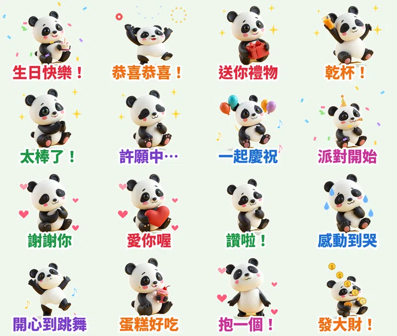

> 🛒 **黏土熊貓滾滾・生日恭喜** 已在 LINE 商店開賣（動態貼圖・NT$60）👉 [在 LINE 商店購買](https://line.me/S/sticker/37360223)

群組裡有人生日、升遷、考上、結婚、生寶寶，你總要說點什麼。打字太普通，就傳一張 **「生日快樂！」**。

這組貼圖的主角是小熊貓寶寶 **滾滾**，畫風是 **可愛立體黏土風**：圓滾滾、霧面黏土質感，看起來像手捏的公仔。16 張都會動，主題是 **生日＋恭喜祝賀**，**每張都配一句滾滾嚶嚶叫的萌寵語音**。

## 🔊 點一下就有聲音：滾滾有聲貼圖板

**點任何一張，就會聽到滾滾說那句話。** 在手機上按「傳給朋友」，可以把有聲版（3 秒短影音）傳進 LINE 聊天室。也可以 [一次下載 16 支有聲貼圖（zip，3.1MB）](https://github.com/ckw19810413/ckw19810413.github.io/releases/download/media-line-animated-sticker-panda-birthday/Gungun_sound_stickers.zip)。

<figure class="ms-c"><video src="https://github.com/ckw19810413/ckw19810413.github.io/releases/download/media-line-animated-sticker-panda-birthday/gungun-01.mp4" poster="sound/01.jpg" muted autoplay loop playsinline preload="metadata"></video><figcaption>生日快樂！</figcaption><button type="button" class="ms-share" data-k="01">傳給朋友</button></figure><figure class="ms-c"><video src="https://github.com/ckw19810413/ckw19810413.github.io/releases/download/media-line-animated-sticker-panda-birthday/gungun-02.mp4" poster="sound/02.jpg" muted autoplay loop playsinline preload="metadata"></video><figcaption>恭喜恭喜！</figcaption><button type="button" class="ms-share" data-k="02">傳給朋友</button></figure><figure class="ms-c"><video src="https://github.com/ckw19810413/ckw19810413.github.io/releases/download/media-line-animated-sticker-panda-birthday/gungun-03.mp4" poster="sound/03.jpg" muted autoplay loop playsinline preload="metadata"></video><figcaption>送你禮物</figcaption><button type="button" class="ms-share" data-k="03">傳給朋友</button></figure><figure class="ms-c"><video src="https://github.com/ckw19810413/ckw19810413.github.io/releases/download/media-line-animated-sticker-panda-birthday/gungun-04.mp4" poster="sound/04.jpg" muted autoplay loop playsinline preload="metadata"></video><figcaption>乾杯！</figcaption><button type="button" class="ms-share" data-k="04">傳給朋友</button></figure><figure class="ms-c"><video src="https://github.com/ckw19810413/ckw19810413.github.io/releases/download/media-line-animated-sticker-panda-birthday/gungun-05.mp4" poster="sound/05.jpg" muted autoplay loop playsinline preload="metadata"></video><figcaption>太棒了！</figcaption><button type="button" class="ms-share" data-k="05">傳給朋友</button></figure><figure class="ms-c"><video src="https://github.com/ckw19810413/ckw19810413.github.io/releases/download/media-line-animated-sticker-panda-birthday/gungun-06.mp4" poster="sound/06.jpg" muted autoplay loop playsinline preload="metadata"></video><figcaption>許願中…</figcaption><button type="button" class="ms-share" data-k="06">傳給朋友</button></figure><figure class="ms-c"><video src="https://github.com/ckw19810413/ckw19810413.github.io/releases/download/media-line-animated-sticker-panda-birthday/gungun-07.mp4" poster="sound/07.jpg" muted autoplay loop playsinline preload="metadata"></video><figcaption>一起慶祝</figcaption><button type="button" class="ms-share" data-k="07">傳給朋友</button></figure><figure class="ms-c"><video src="https://github.com/ckw19810413/ckw19810413.github.io/releases/download/media-line-animated-sticker-panda-birthday/gungun-08.mp4" poster="sound/08.jpg" muted autoplay loop playsinline preload="metadata"></video><figcaption>派對開始</figcaption><button type="button" class="ms-share" data-k="08">傳給朋友</button></figure><figure class="ms-c"><video src="https://github.com/ckw19810413/ckw19810413.github.io/releases/download/media-line-animated-sticker-panda-birthday/gungun-09.mp4" poster="sound/09.jpg" muted autoplay loop playsinline preload="metadata"></video><figcaption>謝謝你</figcaption><button type="button" class="ms-share" data-k="09">傳給朋友</button></figure><figure class="ms-c"><video src="https://github.com/ckw19810413/ckw19810413.github.io/releases/download/media-line-animated-sticker-panda-birthday/gungun-10.mp4" poster="sound/10.jpg" muted autoplay loop playsinline preload="metadata"></video><figcaption>愛你喔</figcaption><button type="button" class="ms-share" data-k="10">傳給朋友</button></figure><figure class="ms-c"><video src="https://github.com/ckw19810413/ckw19810413.github.io/releases/download/media-line-animated-sticker-panda-birthday/gungun-11.mp4" poster="sound/11.jpg" muted autoplay loop playsinline preload="metadata"></video><figcaption>讚啦！</figcaption><button type="button" class="ms-share" data-k="11">傳給朋友</button></figure><figure class="ms-c"><video src="https://github.com/ckw19810413/ckw19810413.github.io/releases/download/media-line-animated-sticker-panda-birthday/gungun-12.mp4" poster="sound/12.jpg" muted autoplay loop playsinline preload="metadata"></video><figcaption>感動到哭</figcaption><button type="button" class="ms-share" data-k="12">傳給朋友</button></figure><figure class="ms-c"><video src="https://github.com/ckw19810413/ckw19810413.github.io/releases/download/media-line-animated-sticker-panda-birthday/gungun-13.mp4" poster="sound/13.jpg" muted autoplay loop playsinline preload="metadata"></video><figcaption>開心到跳舞</figcaption><button type="button" class="ms-share" data-k="13">傳給朋友</button></figure><figure class="ms-c"><video src="https://github.com/ckw19810413/ckw19810413.github.io/releases/download/media-line-animated-sticker-panda-birthday/gungun-14.mp4" poster="sound/14.jpg" muted autoplay loop playsinline preload="metadata"></video><figcaption>蛋糕好吃</figcaption><button type="button" class="ms-share" data-k="14">傳給朋友</button></figure><figure class="ms-c"><video src="https://github.com/ckw19810413/ckw19810413.github.io/releases/download/media-line-animated-sticker-panda-birthday/gungun-15.mp4" poster="sound/15.jpg" muted autoplay loop playsinline preload="metadata"></video><figcaption>抱一個！</figcaption><button type="button" class="ms-share" data-k="15">傳給朋友</button></figure><figure class="ms-c"><video src="https://github.com/ckw19810413/ckw19810413.github.io/releases/download/media-line-animated-sticker-panda-birthday/gungun-16.mp4" poster="sound/16.jpg" muted autoplay loop playsinline preload="metadata"></video><figcaption>發大財！</figcaption><button type="button" class="ms-share" data-k="16">傳給朋友</button></figure>

## 🔊 一次聽完 16 句（48 秒直式影片）

<video src="https://github.com/ckw19810413/ckw19810413.github.io/releases/download/media-line-animated-sticker-panda-birthday/gungun-voice.mp4" controls playsinline preload="metadata" poster="cover.jpg" style="max-width:360px;width:100%;border-radius:12px"></video>

> 💡 **關於聲音：** LINE Creators Market 開放給一般創作者的動態貼圖是 APNG 格式，不能帶聲音；有聲貼圖目前只有官方合作夥伴能做。所以 LINE 商店裡的是 **無聲動態貼圖**，萌寵語音版要在這一頁聽、下載或傳給朋友。

## 調研：爆款貼圖的共通點

- **數字先看**：2025 年台灣原創貼圖年度榜前 10 名累計銷售約 **16 億日圓**；台灣用戶平均 **每年下載 18 組貼圖**，是日本用戶的 2 倍；LINE「表情回應」每月有 **940 萬** 不重複用戶在用。下載最多的創作者是麻糬爸、胸毛公寓、YI-LING。
- **祝賀是固定需求**：官方每年的免費貼圖都會把生日快樂、新年快樂放在一起推。生日、升遷、考上、結婚，一整年都用得到，而且常常一個人發、整個群組跟著回。
- **萌系圓滾小動物**：戀愛兔、吉伊卡哇都是圓滾滾的小動物；熊貓在台灣大家都熟（圓仔）。
- **短台詞＋誇張情緒**：2～6 個字，一眼看懂。

## 16 張台詞、動態、語音

| 台詞 | 動態 | 語音 |
|---|---|---|
| 生日快樂！ | 捧著小蛋糕彈跳＋彩帶 | 嚶嚶～生日快樂！ |
| 恭喜恭喜！ | 雙手高舉跳起來＋煙火 | 恭喜恭喜！ |
| 送你禮物 | 捧禮物盒＋閃光 | 送你禮物～ |
| 乾杯！ | 舉杯搖擺＋閃光 | 乾杯！ |
| 太棒了！ | 拍手＋閃光 | 太棒了！ |
| 許願中… | 雙手合十慢慢呼吸 | 許願中… |
| 一起慶祝 | 拿氣球彈跳＋音符 | 一起慶祝吧～ |
| 派對開始 | 戴派對帽跳舞＋彩帶 | 派對開始囉！ |
| 謝謝你 | 鞠躬＋愛心 | 謝謝你～ |
| 愛你喔 | 抱大愛心＋愛心 | 愛你喔～ |
| 讚啦！ | 比讚＋打勾 | 讚啦！ |
| 感動到哭 | 感動到發抖＋淚滴 | 嗚嗚，感動到哭… |
| 開心到跳舞 | 單腳跳舞＋音符 | 開心到跳舞～ |
| 蛋糕好吃 | 吃杯子蛋糕＋碎屑 | 蛋糕好好吃～ |
| 抱一個！ | 張開雙手抱抱＋愛心 | 抱一個！ |
| 發大財！ | 抱金幣跳起來＋金幣雨 | 發大財！嚶！ |

## 製作方式

- **畫面**：用本機 AI 繪圖模型畫 16 個姿勢，固定同一個隨機種子，所以每張的滾滾長得一樣。畫風是從 7 種常見風格裡隨機抽的，這次抽到黏土風。
- **動態**：自己寫的 Python 程式幫每張加上彈跳、跳舞、鞠躬、發抖等動作和彩帶、煙火、金幣雨、愛心特效。輸出 LINE 規格的 APNG，每張剛好播 3 秒。
- **語音**：每句前面先用程式合成兩聲熊貓寶寶的「嚶嚶」叫聲，再接一句台詞。

## 上架進度

- **黏土熊貓滾滾・生日恭喜**（動態貼圖，NT$60）：已送審，也報名了 LINE「2026 放手去DRAW 貼圖大賽」。通過後自動開賣，到時會在這裡補上購買連結。
- 已經開賣的動態貼圖：[糰糰倉鼠](https://store.line.me/stickershop/product/37292039/zh-Hant)、[社畜企鵝啵啵](https://store.line.me/stickershop/product/37292394/zh-Hant)、[柴犬福福](https://store.line.me/stickershop/product/37292442/zh-Hant)。
- 一般貼圖：[柚柚水豚](https://store.line.me/stickershop/product/37291887/zh-Hant)、[麻糬海豹噗嚕](https://store.line.me/stickershop/product/37215265/zh-Hant)。
- 所有作品：[LINE 貼圖作者主頁](https://line.me/S/shop/sticker/author/6564520)

## 說明

角色用 AI 輔助生成，動畫和音效由程式製作；送審時已勾選「使用AI」。

---

> 🛒 [在 LINE 商店購買「黏土熊貓滾滾・生日恭喜」](https://line.me/S/sticker/37360223)｜全部 27 組依主題整理在 [Massor LINE 貼圖全系列](/line-stickers/)
