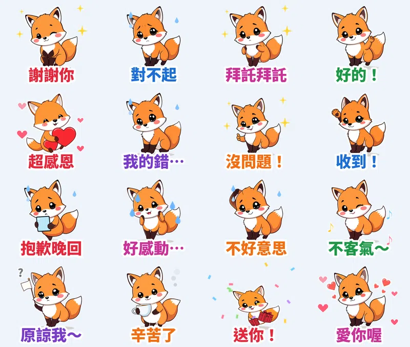

> 🛒 **小狐狸橙橙・謝謝對不起拜託** 已在 LINE 商店開賣（動態貼圖・NT$60）👉 [在 LINE 商店購買](https://line.me/S/sticker/37375782)

聊天室裡最常打的字是什麼？不是「哈哈」，是 **謝謝、對不起、拜託、收到**。每天都要講好幾次，用貼圖講比較不尷尬，也比較有誠意。

這組貼圖的主角是圓滾滾的小狐狸 **橙橙**，畫風是 **粗黑輪廓卡通風**：粗線條、亮橘色、乾淨的平塗上色，縮小在聊天室裡也看得很清楚。16 張都是 **萬用禮貌回覆**，**每張都配一句橙橙「嗚嗚～」叫的娃娃音語音**。

## 🔊 點一下就有聲音：橙橙有聲貼圖板

**點任何一張，就會聽到橙橙說那句話。** 在手機上按「傳給朋友」，可以把有聲版（3 秒短影音）傳進 LINE 聊天室。也可以 [一次下載 16 支有聲貼圖（zip，3.6MB）](https://github.com/ckw19810413/ckw19810413.github.io/releases/download/media-line-animated-sticker-fox-thanks/Chengcheng_sound_stickers.zip)。

<figure class="ms-c"><video src="https://github.com/ckw19810413/ckw19810413.github.io/releases/download/media-line-animated-sticker-fox-thanks/chengcheng-01.mp4" poster="sound/01.jpg" muted autoplay loop playsinline preload="metadata"></video><figcaption>謝謝你</figcaption><button type="button" class="ms-share" data-k="01">傳給朋友</button></figure><figure class="ms-c"><video src="https://github.com/ckw19810413/ckw19810413.github.io/releases/download/media-line-animated-sticker-fox-thanks/chengcheng-02.mp4" poster="sound/02.jpg" muted autoplay loop playsinline preload="metadata"></video><figcaption>對不起</figcaption><button type="button" class="ms-share" data-k="02">傳給朋友</button></figure><figure class="ms-c"><video src="https://github.com/ckw19810413/ckw19810413.github.io/releases/download/media-line-animated-sticker-fox-thanks/chengcheng-03.mp4" poster="sound/03.jpg" muted autoplay loop playsinline preload="metadata"></video><figcaption>拜託拜託</figcaption><button type="button" class="ms-share" data-k="03">傳給朋友</button></figure><figure class="ms-c"><video src="https://github.com/ckw19810413/ckw19810413.github.io/releases/download/media-line-animated-sticker-fox-thanks/chengcheng-04.mp4" poster="sound/04.jpg" muted autoplay loop playsinline preload="metadata"></video><figcaption>好的！</figcaption><button type="button" class="ms-share" data-k="04">傳給朋友</button></figure><figure class="ms-c"><video src="https://github.com/ckw19810413/ckw19810413.github.io/releases/download/media-line-animated-sticker-fox-thanks/chengcheng-05.mp4" poster="sound/05.jpg" muted autoplay loop playsinline preload="metadata"></video><figcaption>超感恩</figcaption><button type="button" class="ms-share" data-k="05">傳給朋友</button></figure><figure class="ms-c"><video src="https://github.com/ckw19810413/ckw19810413.github.io/releases/download/media-line-animated-sticker-fox-thanks/chengcheng-06.mp4" poster="sound/06.jpg" muted autoplay loop playsinline preload="metadata"></video><figcaption>我的錯…</figcaption><button type="button" class="ms-share" data-k="06">傳給朋友</button></figure><figure class="ms-c"><video src="https://github.com/ckw19810413/ckw19810413.github.io/releases/download/media-line-animated-sticker-fox-thanks/chengcheng-07.mp4" poster="sound/07.jpg" muted autoplay loop playsinline preload="metadata"></video><figcaption>沒問題！</figcaption><button type="button" class="ms-share" data-k="07">傳給朋友</button></figure><figure class="ms-c"><video src="https://github.com/ckw19810413/ckw19810413.github.io/releases/download/media-line-animated-sticker-fox-thanks/chengcheng-08.mp4" poster="sound/08.jpg" muted autoplay loop playsinline preload="metadata"></video><figcaption>收到！</figcaption><button type="button" class="ms-share" data-k="08">傳給朋友</button></figure><figure class="ms-c"><video src="https://github.com/ckw19810413/ckw19810413.github.io/releases/download/media-line-animated-sticker-fox-thanks/chengcheng-09.mp4" poster="sound/09.jpg" muted autoplay loop playsinline preload="metadata"></video><figcaption>抱歉晚回</figcaption><button type="button" class="ms-share" data-k="09">傳給朋友</button></figure><figure class="ms-c"><video src="https://github.com/ckw19810413/ckw19810413.github.io/releases/download/media-line-animated-sticker-fox-thanks/chengcheng-10.mp4" poster="sound/10.jpg" muted autoplay loop playsinline preload="metadata"></video><figcaption>好感動…</figcaption><button type="button" class="ms-share" data-k="10">傳給朋友</button></figure><figure class="ms-c"><video src="https://github.com/ckw19810413/ckw19810413.github.io/releases/download/media-line-animated-sticker-fox-thanks/chengcheng-11.mp4" poster="sound/11.jpg" muted autoplay loop playsinline preload="metadata"></video><figcaption>不好意思</figcaption><button type="button" class="ms-share" data-k="11">傳給朋友</button></figure><figure class="ms-c"><video src="https://github.com/ckw19810413/ckw19810413.github.io/releases/download/media-line-animated-sticker-fox-thanks/chengcheng-12.mp4" poster="sound/12.jpg" muted autoplay loop playsinline preload="metadata"></video><figcaption>不客氣～</figcaption><button type="button" class="ms-share" data-k="12">傳給朋友</button></figure><figure class="ms-c"><video src="https://github.com/ckw19810413/ckw19810413.github.io/releases/download/media-line-animated-sticker-fox-thanks/chengcheng-13.mp4" poster="sound/13.jpg" muted autoplay loop playsinline preload="metadata"></video><figcaption>原諒我～</figcaption><button type="button" class="ms-share" data-k="13">傳給朋友</button></figure><figure class="ms-c"><video src="https://github.com/ckw19810413/ckw19810413.github.io/releases/download/media-line-animated-sticker-fox-thanks/chengcheng-14.mp4" poster="sound/14.jpg" muted autoplay loop playsinline preload="metadata"></video><figcaption>辛苦了</figcaption><button type="button" class="ms-share" data-k="14">傳給朋友</button></figure><figure class="ms-c"><video src="https://github.com/ckw19810413/ckw19810413.github.io/releases/download/media-line-animated-sticker-fox-thanks/chengcheng-15.mp4" poster="sound/15.jpg" muted autoplay loop playsinline preload="metadata"></video><figcaption>送你！</figcaption><button type="button" class="ms-share" data-k="15">傳給朋友</button></figure><figure class="ms-c"><video src="https://github.com/ckw19810413/ckw19810413.github.io/releases/download/media-line-animated-sticker-fox-thanks/chengcheng-16.mp4" poster="sound/16.jpg" muted autoplay loop playsinline preload="metadata"></video><figcaption>愛你喔</figcaption><button type="button" class="ms-share" data-k="16">傳給朋友</button></figure>

## 🔊 一次聽完 16 句（48 秒直式影片）

<video src="https://github.com/ckw19810413/ckw19810413.github.io/releases/download/media-line-animated-sticker-fox-thanks/chengcheng-voice.mp4" controls playsinline preload="metadata" poster="cover.jpg" style="max-width:360px;width:100%;border-radius:12px"></video>

> 💡 **關於聲音：** LINE Creators Market 開放給一般創作者的動態貼圖是 APNG 格式，不能帶聲音；有聲貼圖目前只有官方合作夥伴能做。所以 LINE 商店裡的是 **無聲動態貼圖**，萌寵語音版要在這一頁聽、下載或傳給朋友。

## 調研：爆款貼圖的共通點

- **數字先看**：2025 年台灣原創貼圖年度榜前 10 名累計銷售約 **16 億日圓**；台灣用戶平均 **每年下載 18 組貼圖**，是日本用戶的 2 倍；LINE「表情回應」每月有 **940 萬** 不重複用戶在用。
- **萬用語最耐用**：台灣原創榜前 5 名都是西村裕二「動物王國」系列台灣版（GOKIGEN PANDA、LOVE RABBIT），主力就是問候和禮貌語，同系列已經出了 238 款。謝謝、對不起、收到這種話天天都會用，買了不會放著積灰塵。
- **萌系圓滾小動物**：戀愛兔、吉伊卡哇都是圓滾滾的小動物；橙橙也是大眼睛、胖身體、蓬蓬大尾巴。
- **短台詞＋清楚動作**：2～4 個字，一個動作講一件事。

## 16 張台詞、動態、語音

| 台詞 | 動態 | 語音 |
|---|---|---|
| 謝謝你 | 雙手合十點頭鞠躬＋閃光 | 謝謝你喔～ |
| 對不起 | 深深鞠躬＋冒冷汗 | 對不起嘛… |
| 拜託拜託 | 合掌一直搓手拜託＋閃光 | 拜託拜託～ |
| 好的！ | 比 OK 眨眼＋打勾 | 好的喔！ |
| 超感恩 | 抱著大愛心撲通撲通＋愛心 | 超感恩的～ |
| 我的錯… | 低頭認錯鞠躬＋汗滴 | 都是我的錯… |
| 沒問題！ | 比讚彈跳＋閃光 | 沒問題啦！ |
| 收到！ | 立正敬禮＋打勾 | 收到！遵命！ |
| 抱歉晚回 | 拿著手機慌張發抖＋汗滴 | 抱歉晚回了！ |
| 好感動… | 捧臉感動到發抖＋眼淚 | 嗚嗚，好感動～ |
| 不好意思 | 抓頭傻笑左右晃＋汗滴 | 不好意思耶～ |
| 不客氣～ | 揮揮手＋音符 | 不客氣喔～ |
| 原諒我～ | 舉白旗搓手求饒＋問號 | 原諒我好不好～ |
| 辛苦了 | 鞠躬奉茶＋熱氣 | 辛苦了，喝杯茶～ |
| 送你！ | 捧禮物跳起來＋彩帶 | 送你一個禮物！ |
| 愛你喔 | 往前飛吻＋愛心 | 愛你喔，啾～ |

## 製作方式

- **畫面**：用本機 AI 繪圖模型畫 16 個姿勢，固定同一個隨機種子，所以每張的橙橙長得一樣。畫風是從 7 種常見風格（簡約色塊、蠟筆／鉛筆／粉彩手繪、水彩、粗黑輪廓卡通、復古、黏土、像素）裡隨機抽的，這次抽到粗黑輪廓卡通風。
- **動態**：自己寫的 Python 程式幫每張加上鞠躬、搓手拜託、立正敬禮、飛吻等動作，和汗滴、打勾、愛心、彩帶等特效。輸出 LINE 規格的 APNG，每張剛好播 3 秒。
- **語音**：每句前面先用程式合成兩聲小狐狸的「嗚嗚～」嫩叫聲，再接一句娃娃音台詞。

## 上架進度

- **小狐狸橙橙・謝謝對不起拜託**（動態貼圖，NT$60）：已送審，也報名了 LINE「2026 放手去DRAW 貼圖大賽」。通過後自動開賣，到時會在這裡補上購買連結。
- 前一組 [水彩青蛙呱寶・減肥明天再說](/blog/line-animated-sticker-frog-diet/) 也在審核中。
- 已經開賣的動態貼圖：[糰糰倉鼠](https://store.line.me/stickershop/product/37292039/zh-Hant)、[社畜企鵝啵啵](https://store.line.me/stickershop/product/37292394/zh-Hant)、[柴犬福福](https://store.line.me/stickershop/product/37292442/zh-Hant)。
- 一般貼圖：[柚柚水豚](https://store.line.me/stickershop/product/37291887/zh-Hant)、[麻糬海豹噗嚕](https://store.line.me/stickershop/product/37215265/zh-Hant)。
- 所有作品：[LINE 貼圖作者主頁](https://line.me/S/shop/sticker/author/6564520)

## 說明

角色用 AI 輔助生成，動畫和音效由程式製作；送審時已勾選「使用AI」。

---

> 🛒 [在 LINE 商店購買「小狐狸橙橙・謝謝對不起拜託」](https://line.me/S/sticker/37375782)｜全部 27 組依主題整理在 [Massor LINE 貼圖全系列](/line-stickers/)
