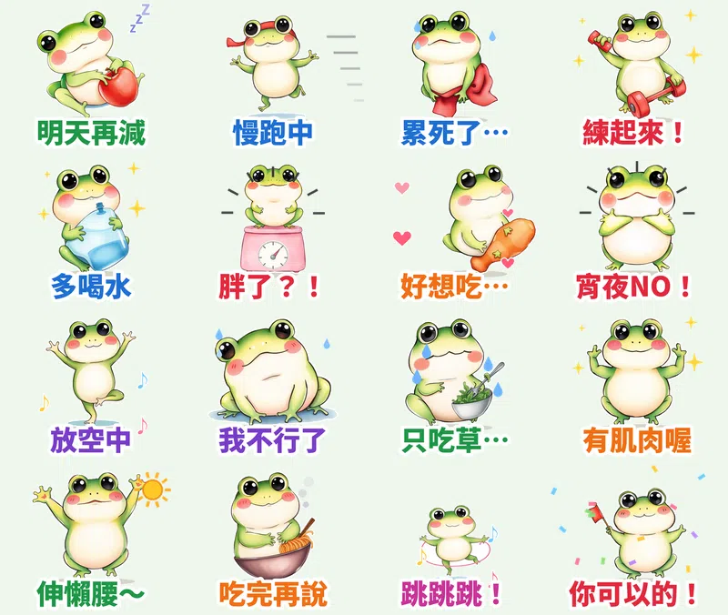

「明天開始減肥」——每個群組都有人每天說一次。吃到飽、聚餐、宵夜之後，總要有一張圖可以自嘲一下。

這組貼圖的主角是胖青蛙寶寶 **呱寶**，畫風是 **水彩風**：細細的線條，加上透明水彩暈開的質感。16 張都會動，主題是 **減肥＋運動**，**每張都配一句呱寶呱呱叫的娃娃音語音**。

## 🔊 點一下就有聲音：呱寶有聲貼圖板

**點任何一張，就會聽到呱寶說那句話。** 在手機上按「傳給朋友」，可以把有聲版（3 秒短影音）傳進 LINE 聊天室。也可以 [一次下載 16 支有聲貼圖（zip，3.3MB）](https://github.com/ckw19810413/ckw19810413.github.io/releases/download/media-line-animated-sticker-frog-diet/Guabao_sound_stickers.zip)。

<figure class="ms-c"><video src="https://github.com/ckw19810413/ckw19810413.github.io/releases/download/media-line-animated-sticker-frog-diet/guabao-01.mp4" poster="sound/01.jpg" muted autoplay loop playsinline preload="metadata"></video><figcaption>明天再減</figcaption><button type="button" class="ms-share" data-k="01">傳給朋友</button></figure><figure class="ms-c"><video src="https://github.com/ckw19810413/ckw19810413.github.io/releases/download/media-line-animated-sticker-frog-diet/guabao-02.mp4" poster="sound/02.jpg" muted autoplay loop playsinline preload="metadata"></video><figcaption>慢跑中</figcaption><button type="button" class="ms-share" data-k="02">傳給朋友</button></figure><figure class="ms-c"><video src="https://github.com/ckw19810413/ckw19810413.github.io/releases/download/media-line-animated-sticker-frog-diet/guabao-03.mp4" poster="sound/03.jpg" muted autoplay loop playsinline preload="metadata"></video><figcaption>累死了…</figcaption><button type="button" class="ms-share" data-k="03">傳給朋友</button></figure><figure class="ms-c"><video src="https://github.com/ckw19810413/ckw19810413.github.io/releases/download/media-line-animated-sticker-frog-diet/guabao-04.mp4" poster="sound/04.jpg" muted autoplay loop playsinline preload="metadata"></video><figcaption>練起來！</figcaption><button type="button" class="ms-share" data-k="04">傳給朋友</button></figure><figure class="ms-c"><video src="https://github.com/ckw19810413/ckw19810413.github.io/releases/download/media-line-animated-sticker-frog-diet/guabao-05.mp4" poster="sound/05.jpg" muted autoplay loop playsinline preload="metadata"></video><figcaption>多喝水</figcaption><button type="button" class="ms-share" data-k="05">傳給朋友</button></figure><figure class="ms-c"><video src="https://github.com/ckw19810413/ckw19810413.github.io/releases/download/media-line-animated-sticker-frog-diet/guabao-06.mp4" poster="sound/06.jpg" muted autoplay loop playsinline preload="metadata"></video><figcaption>胖了？！</figcaption><button type="button" class="ms-share" data-k="06">傳給朋友</button></figure><figure class="ms-c"><video src="https://github.com/ckw19810413/ckw19810413.github.io/releases/download/media-line-animated-sticker-frog-diet/guabao-07.mp4" poster="sound/07.jpg" muted autoplay loop playsinline preload="metadata"></video><figcaption>好想吃…</figcaption><button type="button" class="ms-share" data-k="07">傳給朋友</button></figure><figure class="ms-c"><video src="https://github.com/ckw19810413/ckw19810413.github.io/releases/download/media-line-animated-sticker-frog-diet/guabao-08.mp4" poster="sound/08.jpg" muted autoplay loop playsinline preload="metadata"></video><figcaption>宵夜NO！</figcaption><button type="button" class="ms-share" data-k="08">傳給朋友</button></figure><figure class="ms-c"><video src="https://github.com/ckw19810413/ckw19810413.github.io/releases/download/media-line-animated-sticker-frog-diet/guabao-09.mp4" poster="sound/09.jpg" muted autoplay loop playsinline preload="metadata"></video><figcaption>放空中</figcaption><button type="button" class="ms-share" data-k="09">傳給朋友</button></figure><figure class="ms-c"><video src="https://github.com/ckw19810413/ckw19810413.github.io/releases/download/media-line-animated-sticker-frog-diet/guabao-10.mp4" poster="sound/10.jpg" muted autoplay loop playsinline preload="metadata"></video><figcaption>我不行了</figcaption><button type="button" class="ms-share" data-k="10">傳給朋友</button></figure><figure class="ms-c"><video src="https://github.com/ckw19810413/ckw19810413.github.io/releases/download/media-line-animated-sticker-frog-diet/guabao-11.mp4" poster="sound/11.jpg" muted autoplay loop playsinline preload="metadata"></video><figcaption>只吃草…</figcaption><button type="button" class="ms-share" data-k="11">傳給朋友</button></figure><figure class="ms-c"><video src="https://github.com/ckw19810413/ckw19810413.github.io/releases/download/media-line-animated-sticker-frog-diet/guabao-12.mp4" poster="sound/12.jpg" muted autoplay loop playsinline preload="metadata"></video><figcaption>有肌肉喔</figcaption><button type="button" class="ms-share" data-k="12">傳給朋友</button></figure><figure class="ms-c"><video src="https://github.com/ckw19810413/ckw19810413.github.io/releases/download/media-line-animated-sticker-frog-diet/guabao-13.mp4" poster="sound/13.jpg" muted autoplay loop playsinline preload="metadata"></video><figcaption>伸懶腰～</figcaption><button type="button" class="ms-share" data-k="13">傳給朋友</button></figure><figure class="ms-c"><video src="https://github.com/ckw19810413/ckw19810413.github.io/releases/download/media-line-animated-sticker-frog-diet/guabao-14.mp4" poster="sound/14.jpg" muted autoplay loop playsinline preload="metadata"></video><figcaption>吃完再說</figcaption><button type="button" class="ms-share" data-k="14">傳給朋友</button></figure><figure class="ms-c"><video src="https://github.com/ckw19810413/ckw19810413.github.io/releases/download/media-line-animated-sticker-frog-diet/guabao-15.mp4" poster="sound/15.jpg" muted autoplay loop playsinline preload="metadata"></video><figcaption>跳跳跳！</figcaption><button type="button" class="ms-share" data-k="15">傳給朋友</button></figure><figure class="ms-c"><video src="https://github.com/ckw19810413/ckw19810413.github.io/releases/download/media-line-animated-sticker-frog-diet/guabao-16.mp4" poster="sound/16.jpg" muted autoplay loop playsinline preload="metadata"></video><figcaption>你可以的！</figcaption><button type="button" class="ms-share" data-k="16">傳給朋友</button></figure>

## 🔊 一次聽完 16 句（48 秒直式影片）

<video src="https://github.com/ckw19810413/ckw19810413.github.io/releases/download/media-line-animated-sticker-frog-diet/guabao-voice.mp4" controls playsinline preload="metadata" poster="cover.jpg" style="max-width:360px;width:100%;border-radius:12px"></video>

> 💡 **關於聲音：** LINE Creators Market 開放給一般創作者的動態貼圖是 APNG 格式，不能帶聲音；有聲貼圖目前只有官方合作夥伴能做。所以 LINE 商店裡的是 **無聲動態貼圖**，萌寵語音版要在這一頁聽、下載或傳給朋友。

## 調研：爆款貼圖的共通點

- **數字先看**：2025 年台灣原創貼圖年度榜前 10 名累計銷售約 **16 億日圓**；台灣用戶平均 **每年下載 18 組貼圖**，是日本用戶的 2 倍；LINE「表情回應」每月有 **940 萬** 不重複用戶在用。下載最多的創作者是麻糬爸、胸毛公寓、YI-LING。
- **自嘲梗最好傳**：2025 年度黑馬「醜嫩狗勾」「那隻水母」都是靠貼近社群梗的自嘲內容爆紅。「減肥明天再說」就是這種人人都講過的梗。
- **萌系圓滾小動物**：戀愛兔、吉伊卡哇都是圓滾滾的小動物；胖嘟嘟的青蛙剛好跟減肥主題對上。
- **短台詞＋誇張情緒**：2～6 個字，一眼看懂。

## 16 張台詞、動態、語音

| 台詞 | 動態 | 語音 |
|---|---|---|
| 明天再減 | 躺著啃蘋果慢慢呼吸＋zzz | 呱～減肥明天再說啦～ |
| 慢跑中 | 綁頭帶擺手慢跑＋速度線 | 慢跑中，呼呼～ |
| 累死了… | 掛毛巾喘氣＋汗滴 | 累死了… |
| 練起來！ | 舉啞鈴一上一下＋閃光 | 練起來！嘿咻！ |
| 多喝水 | 抱水壺咕嚕喝水 | 多喝水喔～ |
| 胖了？！ | 站上體重計嚇到發抖 | 什麼？胖了？！ |
| 好想吃… | 盯著雞腿探頭＋愛心 | 好想吃喔… |
| 宵夜NO！ | 雙手交叉搖頭拒絕 | 宵夜不准吃！ |
| 放空中 | 瑜伽單腳站慢慢呼吸＋音符 | 放空中～ |
| 我不行了 | 癱坐發抖＋汗滴 | 我不行了啦… |
| 只吃草… | 邊吃沙拉邊掉淚 | 嗚嗚，只能吃草… |
| 有肌肉喔 | 秀二頭肌＋閃光 | 你看，有肌肉喔！ |
| 伸懶腰～ | 拉長身體伸懶腰＋太陽 | 伸懶腰～ |
| 吃完再說 | 抱著泡麵大口吃＋熱氣 | 吃完再說嘛～ |
| 跳跳跳！ | 跳繩跳起來＋音符 | 跳跳跳！呱！ |
| 你可以的！ | 揮小旗加油＋彩帶 | 你可以的！加油呱！ |

## 製作方式

- **畫面**：用本機 AI 繪圖模型畫 16 個姿勢，固定同一個隨機種子，所以每張的呱寶長得一樣。畫風是從 7 種常見風格裡隨機抽的，這次抽到水彩風。
- **動態**：自己寫的 Python 程式幫每張加上慢跑、舉啞鈴、發抖、伸懶腰、跳繩等動作，和汗滴、速度線、彩帶等特效。輸出 LINE 規格的 APNG，每張剛好播 3 秒。
- **語音**：每句前面先用程式合成兩聲青蛙寶寶的「呱呱」叫聲，再接一句娃娃音台詞。

## 上架進度

- **水彩青蛙呱寶・減肥明天再說**（動態貼圖，NT$60）：已送審，也報名了 LINE「2026 放手去DRAW 貼圖大賽」。通過後自動開賣，到時會在這裡補上購買連結。
- 已經開賣的動態貼圖：[糰糰倉鼠](https://store.line.me/stickershop/product/37292039/zh-Hant)、[社畜企鵝啵啵](https://store.line.me/stickershop/product/37292394/zh-Hant)、[柴犬福福](https://store.line.me/stickershop/product/37292442/zh-Hant)。
- 一般貼圖：[柚柚水豚](https://store.line.me/stickershop/product/37291887/zh-Hant)、[麻糬海豹噗嚕](https://store.line.me/stickershop/product/37215265/zh-Hant)。
- 所有作品：[LINE 貼圖作者主頁](https://line.me/S/shop/sticker/author/6564520)

## 說明

角色用 AI 輔助生成，動畫和音效由程式製作；送審時已勾選「使用AI」。
