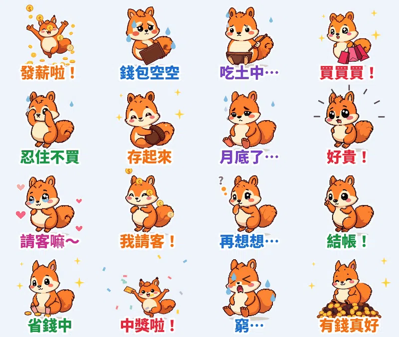

月初 **「發薪啦！」**，月中 **「買買買！」**，月底 **「吃土中…」**——這不就是我們每個月的循環嗎？

這組貼圖的主角是復古 **像素風** 的小松鼠 **存存**：松鼠最會存糧，存存卻老是存不住錢。16 張全部是 **發薪／花錢／省錢／哭窮** 的日常，**每張都會「演表情」**（眨眼、> < 大哭、驚嚇到瞳孔縮小、累到眼皮垂下來），還配了一句存存「吱吱吱～」叫的娃娃音語音。

## 🔊 點一下就有聲音：存存有聲貼圖板

**點任何一張，就會聽到存存說那句話。** 在手機上按「傳給朋友」，可以把有聲版（3 秒短影音）傳進 LINE 聊天室。也可以 [一次下載 16 支有聲貼圖（zip，4.3MB）](https://github.com/ckw19810413/ckw19810413.github.io/releases/download/media-line-animated-sticker-squirrel-payday/Cuncun_sound_stickers.zip)。

<figure class="ms-c"><video src="https://github.com/ckw19810413/ckw19810413.github.io/releases/download/media-line-animated-sticker-squirrel-payday/cuncun-01.mp4" poster="sound/01.jpg" muted autoplay loop playsinline preload="metadata"></video><figcaption>發薪啦！</figcaption><button type="button" class="ms-share" data-k="01">傳給朋友</button></figure><figure class="ms-c"><video src="https://github.com/ckw19810413/ckw19810413.github.io/releases/download/media-line-animated-sticker-squirrel-payday/cuncun-02.mp4" poster="sound/02.jpg" muted autoplay loop playsinline preload="metadata"></video><figcaption>錢包空空</figcaption><button type="button" class="ms-share" data-k="02">傳給朋友</button></figure><figure class="ms-c"><video src="https://github.com/ckw19810413/ckw19810413.github.io/releases/download/media-line-animated-sticker-squirrel-payday/cuncun-03.mp4" poster="sound/03.jpg" muted autoplay loop playsinline preload="metadata"></video><figcaption>吃土中…</figcaption><button type="button" class="ms-share" data-k="03">傳給朋友</button></figure><figure class="ms-c"><video src="https://github.com/ckw19810413/ckw19810413.github.io/releases/download/media-line-animated-sticker-squirrel-payday/cuncun-04.mp4" poster="sound/04.jpg" muted autoplay loop playsinline preload="metadata"></video><figcaption>買買買！</figcaption><button type="button" class="ms-share" data-k="04">傳給朋友</button></figure><figure class="ms-c"><video src="https://github.com/ckw19810413/ckw19810413.github.io/releases/download/media-line-animated-sticker-squirrel-payday/cuncun-05.mp4" poster="sound/05.jpg" muted autoplay loop playsinline preload="metadata"></video><figcaption>忍住不買</figcaption><button type="button" class="ms-share" data-k="05">傳給朋友</button></figure><figure class="ms-c"><video src="https://github.com/ckw19810413/ckw19810413.github.io/releases/download/media-line-animated-sticker-squirrel-payday/cuncun-06.mp4" poster="sound/06.jpg" muted autoplay loop playsinline preload="metadata"></video><figcaption>存起來</figcaption><button type="button" class="ms-share" data-k="06">傳給朋友</button></figure><figure class="ms-c"><video src="https://github.com/ckw19810413/ckw19810413.github.io/releases/download/media-line-animated-sticker-squirrel-payday/cuncun-07.mp4" poster="sound/07.jpg" muted autoplay loop playsinline preload="metadata"></video><figcaption>月底了…</figcaption><button type="button" class="ms-share" data-k="07">傳給朋友</button></figure><figure class="ms-c"><video src="https://github.com/ckw19810413/ckw19810413.github.io/releases/download/media-line-animated-sticker-squirrel-payday/cuncun-08.mp4" poster="sound/08.jpg" muted autoplay loop playsinline preload="metadata"></video><figcaption>好貴！</figcaption><button type="button" class="ms-share" data-k="08">傳給朋友</button></figure><figure class="ms-c"><video src="https://github.com/ckw19810413/ckw19810413.github.io/releases/download/media-line-animated-sticker-squirrel-payday/cuncun-09.mp4" poster="sound/09.jpg" muted autoplay loop playsinline preload="metadata"></video><figcaption>請客嘛～</figcaption><button type="button" class="ms-share" data-k="09">傳給朋友</button></figure><figure class="ms-c"><video src="https://github.com/ckw19810413/ckw19810413.github.io/releases/download/media-line-animated-sticker-squirrel-payday/cuncun-10.mp4" poster="sound/10.jpg" muted autoplay loop playsinline preload="metadata"></video><figcaption>我請客！</figcaption><button type="button" class="ms-share" data-k="10">傳給朋友</button></figure><figure class="ms-c"><video src="https://github.com/ckw19810413/ckw19810413.github.io/releases/download/media-line-animated-sticker-squirrel-payday/cuncun-11.mp4" poster="sound/11.jpg" muted autoplay loop playsinline preload="metadata"></video><figcaption>再想想…</figcaption><button type="button" class="ms-share" data-k="11">傳給朋友</button></figure><figure class="ms-c"><video src="https://github.com/ckw19810413/ckw19810413.github.io/releases/download/media-line-animated-sticker-squirrel-payday/cuncun-12.mp4" poster="sound/12.jpg" muted autoplay loop playsinline preload="metadata"></video><figcaption>結帳！</figcaption><button type="button" class="ms-share" data-k="12">傳給朋友</button></figure><figure class="ms-c"><video src="https://github.com/ckw19810413/ckw19810413.github.io/releases/download/media-line-animated-sticker-squirrel-payday/cuncun-13.mp4" poster="sound/13.jpg" muted autoplay loop playsinline preload="metadata"></video><figcaption>省錢中</figcaption><button type="button" class="ms-share" data-k="13">傳給朋友</button></figure><figure class="ms-c"><video src="https://github.com/ckw19810413/ckw19810413.github.io/releases/download/media-line-animated-sticker-squirrel-payday/cuncun-14.mp4" poster="sound/14.jpg" muted autoplay loop playsinline preload="metadata"></video><figcaption>中獎啦！</figcaption><button type="button" class="ms-share" data-k="14">傳給朋友</button></figure><figure class="ms-c"><video src="https://github.com/ckw19810413/ckw19810413.github.io/releases/download/media-line-animated-sticker-squirrel-payday/cuncun-15.mp4" poster="sound/15.jpg" muted autoplay loop playsinline preload="metadata"></video><figcaption>窮…</figcaption><button type="button" class="ms-share" data-k="15">傳給朋友</button></figure><figure class="ms-c"><video src="https://github.com/ckw19810413/ckw19810413.github.io/releases/download/media-line-animated-sticker-squirrel-payday/cuncun-16.mp4" poster="sound/16.jpg" muted autoplay loop playsinline preload="metadata"></video><figcaption>有錢真好</figcaption><button type="button" class="ms-share" data-k="16">傳給朋友</button></figure>

## 🔊 一次聽完 16 句（48 秒直式影片）

<video src="https://github.com/ckw19810413/ckw19810413.github.io/releases/download/media-line-animated-sticker-squirrel-payday/cuncun-voice.mp4" controls playsinline preload="metadata" poster="cover.jpg" style="max-width:360px;width:100%;border-radius:12px"></video>

> 💡 **關於聲音：** LINE Creators Market 開放給一般創作者的動態貼圖是 APNG 格式，不能帶聲音；有聲貼圖目前只有官方合作夥伴能做。所以 LINE 商店裡的是 **無聲動態貼圖**，萌寵語音版要在這一頁聽、下載或傳給朋友。

## 調研：爆款貼圖的共通點

- **數字先看**：2025 年台灣原創貼圖年度榜前 10 名累計銷售約 **16 億日圓**；台灣用戶平均 **每年下載 18 組貼圖**，是日本用戶的 2 倍；LINE「表情回應」每月有 **940 萬** 不重複用戶。
- **萌系圓滾小動物＋天天用得到**：排行前 5 名都是「動物王國」系列的問候語。錢的話題也是天天都會聊：發薪、團購、請客、月底哭窮。
- **在地流行語**：「吃土」「月光族」「剁手」台灣香港都通用，一看就懂。
- **動態要演表情**：好評的動態貼圖都會眨眼、哭、嚇到，不只是整隻晃來晃去。

## 16 張台詞、動態、語音

| 台詞 | 動態（身體＋表情） | 語音 |
|---|---|---|
| 發薪啦！ | 雙手高舉歡呼跳＋金幣雨 | 發薪水囉！耶～ |
| 錢包空空 | 搖空錢包，眼眶泛淚→> < 大哭＋淚滴 | 嗚嗚，錢包空空… |
| 吃土中… | 捧空碗嚼嚼＋難過眨眼 | 我只能吃土了… |
| 買買買！ | 提購物袋跳舞＋星星眼閃個不停 | 買！買！買！ |
| 忍住不買 | 摀眼搖頭＋冒汗 | 忍住！不能買！ |
| 存起來 | 抱著大橡實搖一搖＋閃光 | 存起來，存起來～ |
| 月底了… | 癱坐喘氣，眼皮慢慢垂下閉上＋汗滴 | 唉…月底了… |
| 好貴！ | 嚇得彈起來，瞳孔縮成小點、嘴巴張大 | 蛤？好貴喔！ |
| 請客嘛～ | 搓手拜託＋水汪汪星星眼＋愛心 | 拜託～請客嘛～ |
| 我請客！ | 立正拍胸口＋金幣 | 今天我請客！ |
| 再想想… | 托下巴左右晃＋眨眼＋問號 | 嗯…再想想… |
| 結帳！ | 往前一指＋打勾 | 結帳！不管了！ |
| 省錢中 | 數硬幣一邊點頭＋眨眼 | 一塊、兩塊、三塊… |
| 中獎啦！ | 舉彩券跳起來，笑到瞇眼張嘴＋彩帶 | 中獎啦！發財了！ |
| 窮… | > < 大哭，嘴巴一開一合哇哇叫＋淚滴 | 嗚哇～好窮喔… |
| 有錢真好 | 躺在金幣堆上搖＋閃光 | 有錢真好～ |

## 製作方式

- **畫面**：本機 AI 繪圖模型畫 16 個姿勢，固定同一個隨機種子，每張的存存長得一樣。畫風從 7 種常見風格（簡約色塊、蠟筆／鉛筆／粉彩手繪、水彩、粗黑輪廓卡通、復古、黏土、像素）隨機抽，這次抽到 **復古像素風**。
- **表情動畫（這次新增）**：程式自動找出每張的眼睛和嘴巴，逐格換成眨眼、> < 哭眼、驚嚇縮瞳、半垂眼皮、星星眼、張嘴大哭等「表情影格」，再疊上跳、搖、嚇一跳等身體動作和特效。輸出 LINE 規格 APNG，每張剛好 3 秒。
- **語音**：每句前面先用程式合成小松鼠「吱吱吱」的連續叫聲和一聲上揚的「啾？」，再接一句娃娃音台詞。

## 上架進度

- **像素松鼠存存・月光族日常**（動態貼圖，NT$60）：已送審，並報名 LINE「2026 放手去DRAW 貼圖大賽」。通過後自動開賣，到時補上購買連結。
- 前一組 [黏土垂耳兔睏睏・晚安熬夜中](/blog/line-animated-sticker-bunny-goodnight/) 也在審核中。
- **好消息：之前的動態貼圖都開賣了！**
  - 回覆／問候：[糰糰倉鼠](https://store.line.me/stickershop/product/37292039/zh-Hant)、[柴犬福福・長輩早安](https://store.line.me/stickershop/product/37292442/zh-Hant)、[小狐狸橙橙・謝謝對不起拜託](https://store.line.me/stickershop/product/37375782/zh-Hant)、[像素鸚鵡啾比・敷衍回覆](https://store.line.me/stickershop/product/37327360/zh-Hant)
  - 上班上學：[社畜企鵝啵啵](https://store.line.me/stickershop/product/37292394/zh-Hant)、[貓頭鷹咕咕・考試週](https://store.line.me/stickershop/product/37303917/zh-Hant)、[小黃鴨嘎嘎・衝鴨應援](https://store.line.me/stickershop/product/37350499/zh-Hant)
  - 戀愛療癒：[黏人水獺拉拉](https://store.line.me/stickershop/product/37304821/zh-Hant)、[無尾熊可可・療癒拍拍](https://store.line.me/stickershop/product/37302939/zh-Hant)
  - 生活：[黏土豬豬嘟嘟・吃貨](https://store.line.me/stickershop/product/37327325/zh-Hant)、[蠟筆貓喵吉](https://store.line.me/stickershop/product/37327389/zh-Hant)、[復古柯基短短・約出門](https://store.line.me/stickershop/product/37327480/zh-Hant)、[樹懶懶懶・週末耍廢](https://store.line.me/stickershop/product/37360149/zh-Hant)、[水彩青蛙呱寶・減肥](https://store.line.me/stickershop/product/37374736/zh-Hant)
  - 節日：[馴鹿叮噹・聖誕新年](https://store.line.me/stickershop/product/37302946/zh-Hant)、[小熊貓糖糖・萬聖節](https://store.line.me/stickershop/product/37350480/zh-Hant)、[黏土熊貓滾滾・生日恭喜](https://store.line.me/stickershop/product/37360223/zh-Hant)、[水彩刺蝟栗栗・天冷保暖](https://store.line.me/stickershop/product/37336572/zh-Hant)
- 所有作品：[LINE 貼圖作者主頁](https://line.me/S/shop/sticker/author/6564520)

## 說明

角色用 AI 輔助生成，動畫和音效由程式製作；送審時已勾選「使用AI」。
