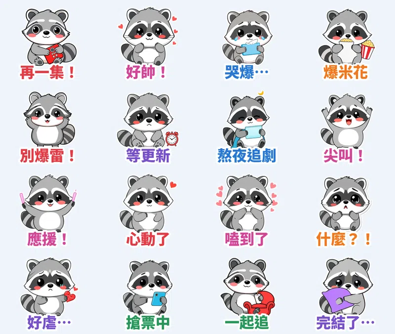

半夜一點還在說 **「再一集就好」**、看到男主角出場就 **「好帥！」**、朋友要講結局馬上摀耳朵 **「別爆雷！」**——追劇、追星的人，聊天室天天都在用這幾句。

這組貼圖的主角是 **粗黑輪廓卡通風** 小浣熊 **嚕嚕**：灰灰圓圓、戴著黑眼罩，16 張全部是 **追劇追星日常**。**每張都是本機 AI 影片模型讓嚕嚕真的「演」出來的**：眼睛變愛心扭來扭去、抽衛生紙大哭、摀耳朵猛搖頭、揮手燈應援，不是整張圖晃來晃去。每張還配了一句嚕嚕「啾啾～」叫的娃娃音語音。

## 🔊 點一下就有聲音：嚕嚕有聲貼圖板

**點任何一張，就會聽到嚕嚕說那句話。** 在手機上按「傳給朋友」，可以把有聲版（3 秒短影音）傳進 LINE 聊天室。也可以 [一次下載 16 支有聲貼圖（zip，3.1MB）](https://github.com/ckw19810413/ckw19810413.github.io/releases/download/media-line-animated-sticker-raccoon-binge/Lulu_sound_stickers.zip)。

<figure class="ms-c"><video src="https://github.com/ckw19810413/ckw19810413.github.io/releases/download/media-line-animated-sticker-raccoon-binge/lulu-01.mp4" poster="sound/01.jpg" muted autoplay loop playsinline preload="metadata"></video><figcaption>再一集！</figcaption><button type="button" class="ms-share" data-k="01">傳給朋友</button></figure><figure class="ms-c"><video src="https://github.com/ckw19810413/ckw19810413.github.io/releases/download/media-line-animated-sticker-raccoon-binge/lulu-02.mp4" poster="sound/02.jpg" muted autoplay loop playsinline preload="metadata"></video><figcaption>好帥！</figcaption><button type="button" class="ms-share" data-k="02">傳給朋友</button></figure><figure class="ms-c"><video src="https://github.com/ckw19810413/ckw19810413.github.io/releases/download/media-line-animated-sticker-raccoon-binge/lulu-03.mp4" poster="sound/03.jpg" muted autoplay loop playsinline preload="metadata"></video><figcaption>哭爆…</figcaption><button type="button" class="ms-share" data-k="03">傳給朋友</button></figure><figure class="ms-c"><video src="https://github.com/ckw19810413/ckw19810413.github.io/releases/download/media-line-animated-sticker-raccoon-binge/lulu-04.mp4" poster="sound/04.jpg" muted autoplay loop playsinline preload="metadata"></video><figcaption>爆米花</figcaption><button type="button" class="ms-share" data-k="04">傳給朋友</button></figure><figure class="ms-c"><video src="https://github.com/ckw19810413/ckw19810413.github.io/releases/download/media-line-animated-sticker-raccoon-binge/lulu-05.mp4" poster="sound/05.jpg" muted autoplay loop playsinline preload="metadata"></video><figcaption>別爆雷！</figcaption><button type="button" class="ms-share" data-k="05">傳給朋友</button></figure><figure class="ms-c"><video src="https://github.com/ckw19810413/ckw19810413.github.io/releases/download/media-line-animated-sticker-raccoon-binge/lulu-06.mp4" poster="sound/06.jpg" muted autoplay loop playsinline preload="metadata"></video><figcaption>等更新</figcaption><button type="button" class="ms-share" data-k="06">傳給朋友</button></figure><figure class="ms-c"><video src="https://github.com/ckw19810413/ckw19810413.github.io/releases/download/media-line-animated-sticker-raccoon-binge/lulu-07.mp4" poster="sound/07.jpg" muted autoplay loop playsinline preload="metadata"></video><figcaption>熬夜追劇</figcaption><button type="button" class="ms-share" data-k="07">傳給朋友</button></figure><figure class="ms-c"><video src="https://github.com/ckw19810413/ckw19810413.github.io/releases/download/media-line-animated-sticker-raccoon-binge/lulu-08.mp4" poster="sound/08.jpg" muted autoplay loop playsinline preload="metadata"></video><figcaption>尖叫！</figcaption><button type="button" class="ms-share" data-k="08">傳給朋友</button></figure><figure class="ms-c"><video src="https://github.com/ckw19810413/ckw19810413.github.io/releases/download/media-line-animated-sticker-raccoon-binge/lulu-09.mp4" poster="sound/09.jpg" muted autoplay loop playsinline preload="metadata"></video><figcaption>應援！</figcaption><button type="button" class="ms-share" data-k="09">傳給朋友</button></figure><figure class="ms-c"><video src="https://github.com/ckw19810413/ckw19810413.github.io/releases/download/media-line-animated-sticker-raccoon-binge/lulu-10.mp4" poster="sound/10.jpg" muted autoplay loop playsinline preload="metadata"></video><figcaption>心動了</figcaption><button type="button" class="ms-share" data-k="10">傳給朋友</button></figure><figure class="ms-c"><video src="https://github.com/ckw19810413/ckw19810413.github.io/releases/download/media-line-animated-sticker-raccoon-binge/lulu-11.mp4" poster="sound/11.jpg" muted autoplay loop playsinline preload="metadata"></video><figcaption>嗑到了</figcaption><button type="button" class="ms-share" data-k="11">傳給朋友</button></figure><figure class="ms-c"><video src="https://github.com/ckw19810413/ckw19810413.github.io/releases/download/media-line-animated-sticker-raccoon-binge/lulu-12.mp4" poster="sound/12.jpg" muted autoplay loop playsinline preload="metadata"></video><figcaption>什麼？！</figcaption><button type="button" class="ms-share" data-k="12">傳給朋友</button></figure><figure class="ms-c"><video src="https://github.com/ckw19810413/ckw19810413.github.io/releases/download/media-line-animated-sticker-raccoon-binge/lulu-13.mp4" poster="sound/13.jpg" muted autoplay loop playsinline preload="metadata"></video><figcaption>好虐…</figcaption><button type="button" class="ms-share" data-k="13">傳給朋友</button></figure><figure class="ms-c"><video src="https://github.com/ckw19810413/ckw19810413.github.io/releases/download/media-line-animated-sticker-raccoon-binge/lulu-14.mp4" poster="sound/14.jpg" muted autoplay loop playsinline preload="metadata"></video><figcaption>搶票中</figcaption><button type="button" class="ms-share" data-k="14">傳給朋友</button></figure><figure class="ms-c"><video src="https://github.com/ckw19810413/ckw19810413.github.io/releases/download/media-line-animated-sticker-raccoon-binge/lulu-15.mp4" poster="sound/15.jpg" muted autoplay loop playsinline preload="metadata"></video><figcaption>一起追</figcaption><button type="button" class="ms-share" data-k="15">傳給朋友</button></figure><figure class="ms-c"><video src="https://github.com/ckw19810413/ckw19810413.github.io/releases/download/media-line-animated-sticker-raccoon-binge/lulu-16.mp4" poster="sound/16.jpg" muted autoplay loop playsinline preload="metadata"></video><figcaption>完結了…</figcaption><button type="button" class="ms-share" data-k="16">傳給朋友</button></figure>

## 🔊 一次聽完 16 句（48 秒直式影片）

<video src="https://github.com/ckw19810413/ckw19810413.github.io/releases/download/media-line-animated-sticker-raccoon-binge/lulu-voice.mp4" controls playsinline preload="metadata" poster="cover.jpg" style="max-width:360px;width:100%;border-radius:12px"></video>

> 💡 **關於聲音：** LINE Creators Market 開放給一般創作者的動態貼圖是 APNG 格式，不能帶聲音；有聲貼圖目前只有官方合作夥伴能做。所以 LINE 商店裡的是 **無聲動態貼圖**，萌寵語音版要在這一頁聽、下載或傳給朋友。

## 調研：為什麼選「追劇追星」

- **追劇人口**：資策會 MIC 2026 影音觀看調查，72% 網友用過串流平台，**38.4% 幾乎每天看**；Netflix 訂閱率 56.0%（2025 年 51.4%），月均花費 355 元。
- **貼圖市場**：2025 年台灣原創貼圖年度榜前 10 名累計銷售約 **16 億日圓**；台灣用戶平均 **每年下載 18 組貼圖**，是日本用戶的 2 倍；2024 年銷售前五名創作者合計破 **新台幣 4.5 億元**。（LINE 不公開單組下載數，以上為公開報導數據。）
- **爆款共通點**：圓滾滾小動物、2～4 字短台詞、一張一個清楚表情、天天用得到；再加上「嗑到了」「爆雷」「搶票」這種同溫層流行語，台港追劇族一看就懂。
- **動態要演表情**：好評的動態貼圖都會眨眼、大哭、尖叫，不只是整隻晃來晃去。

## 16 張台詞、動態、語音

| 台詞 | 動態（AI 影片演出） | 語音 |
|---|---|---|
| 再一集！ | 握緊遙控器、眼睛發亮、豎起一根手指拜託 | 拜託，再看一集就好！ |
| 好帥！ | 雙手捧臉、眼睛變愛心、左右扭來扭去 | 哇～好帥喔！ |
| 哭爆… | 眼淚狂流、抽衛生紙擦眼睛 | 嗚嗚嗚，哭爆了啦… |
| 爆米花 | 抓爆米花塞滿嘴、臉頰鼓鼓猛嚼 | 爆米花準備好了！ |
| 別爆雷！ | 摀住耳朵、閉眼猛搖頭 | 不要爆雷！我不聽！ |
| 等更新 | 嘟嘴、看鬧鐘、無聊垂頭 | 怎麼還不更新啦～ |
| 熬夜追劇 | 眼皮越來越重、打瞌睡又驚醒揉眼睛 | 熬夜追劇，好睏喔… |
| 尖叫！ | 跳起來、雙手亂揮、笑到瞇眼 | 啊啊啊！尖叫！ |
| 應援！ | 揮舞粉紅手燈、跟著節奏蹦跳 | 應援！衝呀！ |
| 心動了 | 摸胸口、臉紅低頭、再害羞偷看 | 心動了啦～ |
| 嗑到了 | 摀嘴偷笑、肩膀抖、冒出小愛心 | 嘻嘻，我嗑到了！ |
| 什麼？！ | 倒抽一口氣、下巴掉下來、雙手抓臉 | 什麼？！怎麼會這樣！ |
| 好虐… | 看著碎掉的心、嘴唇發抖、抱著心垂頭 | 好虐喔…心好痛… |
| 搶票中 | 雙手猛點手機、流汗、最後握拳成功 | 搶票中！快快快！ |
| 一起追 | 拍拍沙發、歪頭眨眼、舉起飲料 | 一起來追劇嘛～ |
| 完結了… | 抱緊抱枕、眼眶含淚、把臉埋進去 | 完結了…捨不得… |

## 製作方式

- **畫面**：本機 AI 繪圖模型畫 16 個姿勢，固定同一個隨機種子，每張的嚕嚕長得一樣。畫風從 7 種常見風格（簡約色塊、蠟筆／鉛筆／粉彩手繪、水彩、粗黑輪廓卡通、復古、黏土、像素）隨機抽，這次抽到 **粗黑輪廓卡通風**。
- **動態**：用本機的 **MiniMax H3** 影片模型（首幀＝尾幀＝同一張姿勢圖），讓嚕嚕照每句台詞做出表情和動作，產生可以無縫循環的影片，再去背、加白邊和字，轉成 LINE 規格 APNG（20 格 × 150ms，剛好 3 秒）。
- **語音**：每句前面先用程式合成小浣熊「啾啾啾」叫聲，再接一句台灣娃娃音台詞，整段壓在 3 秒內。

## 上架進度

- **浣熊嚕嚕・追劇追星日常**（動態貼圖，NT$60）：已送審，並報名 LINE「2026 放手去DRAW 貼圖大賽」。通過後自動開賣，到時補上購買連結。
- **水彩河馬胖胖・颱風天氣篇**：審核中。
- **好消息：之前的 20 組動態貼圖都開賣了！**
  - 回覆／問候：[糰糰倉鼠](https://store.line.me/stickershop/product/37292039/zh-Hant)、[柴犬福福・長輩早安](https://store.line.me/stickershop/product/37292442/zh-Hant)、[小狐狸橙橙・謝謝對不起拜託](https://store.line.me/stickershop/product/37375782/zh-Hant)、[像素鸚鵡啾比・敷衍回覆](https://store.line.me/stickershop/product/37327360/zh-Hant)、[黏土垂耳兔睏睏・晚安熬夜中](https://store.line.me/stickershop/product/37390703/zh-Hant)
  - 上班上學：[社畜企鵝啵啵](https://store.line.me/stickershop/product/37292394/zh-Hant)、[貓頭鷹咕咕・考試週](https://store.line.me/stickershop/product/37303917/zh-Hant)、[小黃鴨嘎嘎・衝鴨應援](https://store.line.me/stickershop/product/37350499/zh-Hant)
  - 戀愛療癒：[黏人水獺拉拉](https://store.line.me/stickershop/product/37304821/zh-Hant)、[無尾熊可可・療癒拍拍](https://store.line.me/stickershop/product/37302939/zh-Hant)
  - 生活：[黏土豬豬嘟嘟・吃貨](https://store.line.me/stickershop/product/37327325/zh-Hant)、[蠟筆貓喵吉](https://store.line.me/stickershop/product/37327389/zh-Hant)、[復古柯基短短・約出門](https://store.line.me/stickershop/product/37327480/zh-Hant)、[樹懶懶懶・週末耍廢](https://store.line.me/stickershop/product/37360149/zh-Hant)、[水彩青蛙呱寶・減肥](https://store.line.me/stickershop/product/37374736/zh-Hant)、[像素松鼠存存・月光族](https://store.line.me/stickershop/product/37390747/zh-Hant)
  - 節日／季節：[馴鹿叮噹・聖誕新年](https://store.line.me/stickershop/product/37302946/zh-Hant)、[小熊貓糖糖・萬聖節](https://store.line.me/stickershop/product/37350480/zh-Hant)、[黏土熊貓滾滾・生日恭喜](https://store.line.me/stickershop/product/37360223/zh-Hant)、[水彩刺蝟栗栗・天冷保暖](https://store.line.me/stickershop/product/37336572/zh-Hant)
- 所有作品：[LINE 貼圖作者主頁](https://line.me/S/shop/sticker/author/6564520)

## 說明

角色用 AI 輔助生成，動畫用本機 AI 影片模型製作、音效由程式合成；送審時已勾選「使用AI」。
