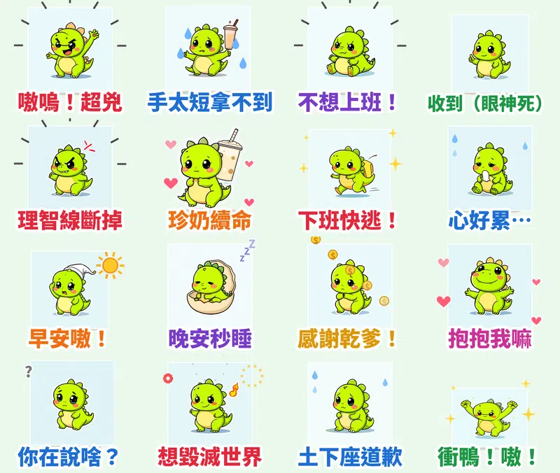

誰說小恐龍一定要威風凜凜？手短短、拿不到珍奶、上班秒崩潰但又超愛討抱抱的反差萌，才是現代社畜最真實的心聲！

第二十組原創貼圖，我創作了一隻圓滾滾、嫩綠色的小霸王龍 **「嘟嘟」（Dudu）**！結合數位硬邊平滑黑線（Clean Vector Pen）與明亮乾淨的賽璐珞平塗，外層特別自帶高明度白邊光暈，無論在日間模式還是深色模式（Dark Mode）下都清晰分明。16 張全都是高幀率流暢循環的動態貼圖，更特別的是：**每張貼圖都搭上了台灣口音的超萌幼態娃娃音＋小恐龍嗷嗚啾啾叫聲！**

## 🔊 點一下就有聲音：嘟嘟有聲貼圖板

**點任何一張貼圖，就會聽到嘟嘟用超萌娃娃音說出那句心聲。** 手機上按「傳給朋友」可以直接把有聲版（3 秒動態短影音）傳進 LINE 或社群聊天室。也可以 [一次下載 16 支有聲貼圖（zip，3.8MB）](https://github.com/ckw19810413/ckw19810413.github.io/releases/download/media-line-animated-sticker-dino-furious/Dudu_sound_stickers.zip)。

<figure class="ms-c"><video src="https://github.com/ckw19810413/ckw19810413.github.io/releases/download/media-line-animated-sticker-dino-furious/dudu-01.mp4" poster="sound/01.jpg" muted autoplay loop playsinline preload="metadata"></video><figcaption>嗷嗚！我很兇喔！</figcaption><button type="button" class="ms-share" data-k="01">傳給朋友</button></figure><figure class="ms-c"><video src="https://github.com/ckw19810413/ckw19810413.github.io/releases/download/media-line-animated-sticker-dino-furious/dudu-02.mp4" poster="sound/02.jpg" muted autoplay loop playsinline preload="metadata"></video><figcaption>手太短了啦…拿不到！</figcaption><button type="button" class="ms-share" data-k="02">傳給朋友</button></figure><figure class="ms-c"><video src="https://github.com/ckw19810413/ckw19810413.github.io/releases/download/media-line-animated-sticker-dino-furious/dudu-03.mp4" poster="sound/03.jpg" muted autoplay loop playsinline preload="metadata"></video><figcaption>嗚…我不想上班啦！</figcaption><button type="button" class="ms-share" data-k="03">傳給朋友</button></figure><figure class="ms-c"><video src="https://github.com/ckw19810413/ckw19810413.github.io/releases/download/media-line-animated-sticker-dino-furious/dudu-04.mp4" poster="sound/04.jpg" muted autoplay loop playsinline preload="metadata"></video><figcaption>好的…收到囉。</figcaption><button type="button" class="ms-share" data-k="04">傳給朋友</button></figure><figure class="ms-c"><video src="https://github.com/ckw19810413/ckw19810413.github.io/releases/download/media-line-animated-sticker-dino-furious/dudu-05.mp4" poster="sound/05.jpg" muted autoplay loop playsinline preload="metadata"></video><figcaption>氣死我了！理智線斷掉！</figcaption><button type="button" class="ms-share" data-k="05">傳給朋友</button></figure><figure class="ms-c"><video src="https://github.com/ckw19810413/ckw19810413.github.io/releases/download/media-line-animated-sticker-dino-furious/dudu-06.mp4" poster="sound/06.jpg" muted autoplay loop playsinline preload="metadata"></video><figcaption>吸一口珍奶～復活啦！</figcaption><button type="button" class="ms-share" data-k="06">傳給朋友</button></figure><figure class="ms-c"><video src="https://github.com/ckw19810413/ckw19810413.github.io/releases/download/media-line-animated-sticker-dino-furious/dudu-07.mp4" poster="sound/07.jpg" muted autoplay loop playsinline preload="metadata"></video><figcaption>下班啦！快逃快逃～！</figcaption><button type="button" class="ms-share" data-k="07">傳給朋友</button></figure><figure class="ms-c"><video src="https://github.com/ckw19810413/ckw19810413.github.io/releases/download/media-line-animated-sticker-dino-furious/dudu-08.mp4" poster="sound/08.jpg" muted autoplay loop playsinline preload="metadata"></video><figcaption>唉…心真的好累喔…</figcaption><button type="button" class="ms-share" data-k="08">傳給朋友</button></figure><figure class="ms-c"><video src="https://github.com/ckw19810413/ckw19810413.github.io/releases/download/media-line-animated-sticker-dino-furious/dudu-09.mp4" poster="sound/09.jpg" muted autoplay loop playsinline preload="metadata"></video><figcaption>嗷嗚～早安早安！</figcaption><button type="button" class="ms-share" data-k="09">傳給朋友</button></figure><figure class="ms-c"><video src="https://github.com/ckw19810413/ckw19810413.github.io/releases/download/media-line-animated-sticker-dino-furious/dudu-10.mp4" poster="sound/10.jpg" muted autoplay loop playsinline preload="metadata"></video><figcaption>呼啊…晚安，秒睡囉～</figcaption><button type="button" class="ms-share" data-k="10">傳給朋友</button></figure><figure class="ms-c"><video src="https://github.com/ckw19810413/ckw19810413.github.io/releases/download/media-line-animated-sticker-dino-furious/dudu-11.mp4" poster="sound/11.jpg" muted autoplay loop playsinline preload="metadata"></video><figcaption>謝謝乾爹乾媽大恩大德！</figcaption><button type="button" class="ms-share" data-k="11">傳給朋友</button></figure><figure class="ms-c"><video src="https://github.com/ckw19810413/ckw19810413.github.io/releases/download/media-line-animated-sticker-dino-furious/dudu-12.mp4" poster="sound/12.jpg" muted autoplay loop playsinline preload="metadata"></video><figcaption>手短短也要抱抱～抱我嘛！</figcaption><button type="button" class="ms-share" data-k="12">傳給朋友</button></figure><figure class="ms-c"><video src="https://github.com/ckw19810413/ckw19810413.github.io/releases/download/media-line-animated-sticker-dino-furious/dudu-13.mp4" poster="sound/13.jpg" muted autoplay loop playsinline preload="metadata"></video><figcaption>蛤？你到底在說啥啦？</figcaption><button type="button" class="ms-share" data-k="13">傳給朋友</button></figure><figure class="ms-c"><video src="https://github.com/ckw19810413/ckw19810413.github.io/releases/download/media-line-animated-sticker-dino-furious/dudu-14.mp4" poster="sound/14.jpg" muted autoplay loop playsinline preload="metadata"></video><figcaption>呼！我想毀滅世界啦！嗷！</figcaption><button type="button" class="ms-share" data-k="14">傳給朋友</button></figure><figure class="ms-c"><video src="https://github.com/ckw19810413/ckw19810413.github.io/releases/download/media-line-animated-sticker-dino-furious/dudu-15.mp4" poster="sound/15.jpg" muted autoplay loop playsinline preload="metadata"></video><figcaption>對不起！小的土下座認錯！</figcaption><button type="button" class="ms-share" data-k="15">傳給朋友</button></figure><figure class="ms-c"><video src="https://github.com/ckw19810413/ckw19810413.github.io/releases/download/media-line-animated-sticker-dino-furious/dudu-16.mp4" poster="sound/16.jpg" muted autoplay loop playsinline preload="metadata"></video><figcaption>衝鴨！嘟嘟出擊，嗷嗚！</figcaption><button type="button" class="ms-share" data-k="16">傳給朋友</button></figure>

## 🔊 一次聽完 16 句（48 秒直式展示影片）

<video src="https://github.com/ckw19810413/ckw19810413.github.io/releases/download/media-line-animated-sticker-dino-furious/dudu-voice.mp4" controls playsinline preload="metadata" poster="cover.jpg" style="max-width:360px;width:100%;border-radius:12px"></video>

> 💡 **聲音特別說明：** LINE Creators Market 目前開放給一般原創作者的格式為 APNG 動態貼圖（無聲），官方將聲音貼圖保留給大型官方合作夥伴。因此上架到 LINE 貼圖商店的是高畫質的 **無聲動態貼圖**；而可愛的萌寵娃娃音短影音版本，則可以直接透過本網頁隨點隨聽、傳給朋友或下載整包收藏！

---

## 爆款熱門動態語音貼圖調研與市場數據分析

在企劃這組貼圖前，我們深入調研了台灣與香港 LINE 貼圖小舖當期最受歡迎的爆款動態貼圖數據與成功要素：

### 1. 實際下載與市場規模數據
- **台灣頂級創作者年收入驚人**：2024–2025 年台灣原創貼圖年度榜前 10 名累計銷售額突破 **15.2 億至 16 億日圓**（約 **NT$ 3.23 億～3.4 億元**），前 5 名平均創作者累計銷售高達 **NT$ 2.9 億元**。
- **人均下載量全球第一**：台灣用戶每人每年平均下載 **18 組付費貼圖**，人均下載率是日本用戶的近 2 倍，年平均傳送貼圖高達 **1,235 張**（每人每天發送 3.4 張）。
- **表情互動剛需**：LINE「表情回應」功能每月有超過 **940 萬名** 不重複活躍用戶使用，證明短小精悍的視覺符號已取代文字成為主要溝通媒介。

### 2. 爆款貼圖核心三大關鍵設計
1. **避免複雜光影與過度厚塗**：在手機聊天室縮圖中，複雜漸層往往會顯得雜亂或「發髒」。熱門貼圖 90% 以上採賽璐珞平塗（Flat Color）或極簡單一陰影層，維持純粹高辨識度。
2. **預留白邊或自帶外描邊**：手機使用者切換深色模式（Dark Mode）比例超過 60%，自帶細緻白邊或光暈能確保角色輪廓在黑底聊天桌布中依然俐落彈出。
3. **情緒張力遠大於純粹畫功**：「一句話＋一個強烈表情/動作」的爆發力與心理共鳴，遠比精雕細琢的靜態美感更能決定下載與轉發率。

---

## 16 張貼圖台詞、動態演出與萌寵語音設計

| 編號 | 貼圖台詞 | 動態演出效果 | 幼態萌寵語音配音 |
|---|---|---|---|
| 01 | 嗷嗚！超兇 | 短短雙手猛烈揮舞咆哮＋怒火震動線 | 嗷嗚！我很兇喔！ |
| 02 | 手太短拿不到 | 拼命伸短短手拿不到珍奶＋眼角飆淚 | 手太短了啦…拿不到！ |
| 03 | 不想上班！ | 趴地踢腿打滾抗拒＋雷電震撼特效 | 嗚…我不想上班啦！ |
| 04 | 收到（眼神死） | 機械式點頭比讚＋綠色打勾標籤 | 好的…收到囉。 |
| 05 | 理智線斷掉 | 頭頂冒煙臉色脹紅全身劇烈震動＋憤怒爆發 | 氣死我了！理智線斷掉！ |
| 06 | 珍奶續命 | 雙手緊抱特大珍奶狂吸鼓腮幫子＋愛心飄動 | 吸一口珍奶～復活啦！ |
| 07 | 下班快逃！ | 踏風火輪背黃書包奪門狂奔＋殘影煙塵 | 下班啦！快逃快逃～！ |
| 08 | 心好累… | 嘴裡飄出半透明白色小靈魂＋流冷汗 | 唉…心真的好累喔… |
| 09 | 早安嗷！ | 揉惺忪睡眼＋小太陽升起光暈 | 嗷嗚～早安早安！ |
| 10 | 晚安秒睡 | 縮在恐龍蛋被窩秒閉眼打呼＋鼻涕泡泡 | 呼啊…晚安，秒睡囉～ |
| 11 | 感謝乾爹！ | 九十度深鞠躬雙手合十＋滿地金幣雨 | 謝謝乾爹乾媽大恩大德！ |
| 12 | 抱抱我嘛 | 伸短手求抱抱＋水汪汪無辜大眼愛心跳動 | 手短短也要抱抱～抱我嘛！ |
| 13 | 你在說啥？ | 單側挑眉歪頭盯著看＋滿頭大問號 | 蛤？你到底在說啥啦？ |
| 14 | 想毀滅世界 | 挺胸張嘴吐出小小火苗氣噗噗＋火焰背景 | 呼！我想毀滅世界啦！嗷！ |
| 15 | 土下座道歉 | 雙膝跪地額頭貼地狂發抖＋冷汗四濺 | 對不起！小的土下座認錯！ |
| 16 | 衝鴨！嗷！ | 雙手握小拳頭上下跳躍＋璀璨星光 | 衝鴨！嘟嘟出擊，嗷嗚！ |

---

## 🎨 筆觸與風格流派解析
本組貼圖整合了市場四大主流特徵：
- **筆觸**：數位硬邊平滑線（Clean Vector / Studio Pen），線條閉合緊實，縮至 100px 依舊無毛邊。
- **四大流派融合**：
  - **圓潤療癒系**：1:1.2 圓潤頭身比、草莓粉腮紅、鵝黃奶腹。
  - **賤萌顏藝系**：翻白眼眼神死、暴怒冒煙、土下座誇張動作。
  - **醜萌迷因系**：短手拿不到珍奶的無奈、靈魂飄出的厭世感。
  - **極簡社畜系**：「收到」、「不想上班」、「下班快逃」職場剛需對白。
