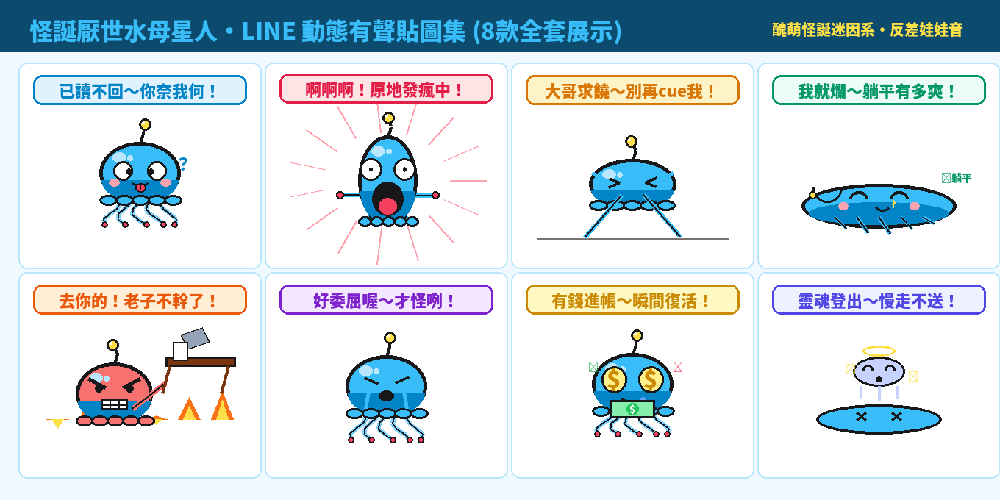

在每天的 LINE 與社群聊天室中，當面對主管突如其來的加班召喚、朋友的無厘頭逼問或排山倒海的社畜日常，最完美的防禦不是長篇大論，而是：**「鬥雞眼已讀不回、原地發瘋尖叫、掀桌拒絕上班、或是整個人融化直接靈魂登出」**！為了將年輕世代最愛的醜萌迷因與厭世反諷張力拉到極致，全新自創 IP 怪誕迷因新寵——**「怪誕厭世水母星人」（Weird Jelly Alien：社畜靈魂登出）** 正式降臨！

本期原創貼圖，我們嚴格依據 LINE 貼圖小舖當前年輕族群瘋傳的**【醜萌與怪誕迷因系】（Weird-Cute & Meme）**核心法則進行開發：突破傳統審美，長相奇特（怪異鬥雞眼、單純一條直線嘴、深淵黑洞咆哮大嘴、像拉麵般抖動的軟爛短觸角），結合螢光青藍（`#38BDF8`）與外星粉紫反差萌設定。全套採賽璐珞平塗（Cel-Shading Flat Color），外圍自帶 5px 高光純白描邊，無懼深色模式（Dark Mode）。全套 8 款皆為 320×270 高幀率循環 APNG 動態貼圖，而且**每張貼圖都搭載了外星啵啵水滴音 ＋ 台灣口音超欠揍、超魔性的反差萌幼態娃娃音！**

---

## 🔊 點一下就有聲音：厭世水母星人有聲貼圖板

**點擊下方任何一張貼圖卡片，就能立即聽到小水母用最欠揍的幼態娃娃音說出爆笑心聲！** 在手機上點擊「傳給朋友」，還能直接把 3 秒有聲短影音即時分享至 LINE 或社群聊天室。

  <figure class="ms-c">
    <video src="https://github.com/ckw19810413/ckw19810413.github.io/releases/download/media-line-animated-sticker-weird-jelly/jelly-01.mp4" poster="sound/01.png" muted autoplay loop playsinline preload="metadata"></video>
    <figcaption>已讀不回～你奈我何！</figcaption>
    <button type="button" class="ms-share" data-k="01">傳給朋友</button>
  </figure>
  <figure class="ms-c">
    <video src="https://github.com/ckw19810413/ckw19810413.github.io/releases/download/media-line-animated-sticker-weird-jelly/jelly-02.mp4" poster="sound/02.png" muted autoplay loop playsinline preload="metadata"></video>
    <figcaption>啊啊啊！原地發瘋中！</figcaption>
    <button type="button" class="ms-share" data-k="02">傳給朋友</button>
  </figure>
  <figure class="ms-c">
    <video src="https://github.com/ckw19810413/ckw19810413.github.io/releases/download/media-line-animated-sticker-weird-jelly/jelly-03.mp4" poster="sound/03.png" muted autoplay loop playsinline preload="metadata"></video>
    <figcaption>大哥求饒～別再cue我！</figcaption>
    <button type="button" class="ms-share" data-k="03">傳給朋友</button>
  </figure>
  <figure class="ms-c">
    <video src="https://github.com/ckw19810413/ckw19810413.github.io/releases/download/media-line-animated-sticker-weird-jelly/jelly-04.mp4" poster="sound/04.png" muted autoplay loop playsinline preload="metadata"></video>
    <figcaption>我就爛～躺平有多爽！</figcaption>
    <button type="button" class="ms-share" data-k="04">傳給朋友</button>
  </figure>
  <figure class="ms-c">
    <video src="https://github.com/ckw19810413/ckw19810413.github.io/releases/download/media-line-animated-sticker-weird-jelly/jelly-05.mp4" poster="sound/05.png" muted autoplay loop playsinline preload="metadata"></video>
    <figcaption>去你的！老子不幹了！</figcaption>
    <button type="button" class="ms-share" data-k="05">傳給朋友</button>
  </figure>
  <figure class="ms-c">
    <video src="https://github.com/ckw19810413/ckw19810413.github.io/releases/download/media-line-animated-sticker-weird-jelly/jelly-06.mp4" poster="sound/06.png" muted autoplay loop playsinline preload="metadata"></video>
    <figcaption>好委屈喔～才怪咧！</figcaption>
    <button type="button" class="ms-share" data-k="06">傳給朋友</button>
  </figure>
  <figure class="ms-c">
    <video src="https://github.com/ckw19810413/ckw19810413.github.io/releases/download/media-line-animated-sticker-weird-jelly/jelly-07.mp4" poster="sound/07.png" muted autoplay loop playsinline preload="metadata"></video>
    <figcaption>有錢進帳～瞬間復活！</figcaption>
    <button type="button" class="ms-share" data-k="07">傳給朋友</button>
  </figure>
  <figure class="ms-c">
    <video src="https://github.com/ckw19810413/ckw19810413.github.io/releases/download/media-line-animated-sticker-weird-jelly/jelly-08.mp4" poster="sound/08.png" muted autoplay loop playsinline preload="metadata"></video>
    <figcaption>靈魂登出～慢走不送！</figcaption>
    <button type="button" class="ms-share" data-k="08">傳給朋友</button>
  </figure>

---

## 🔊 一次聽完全套 8 句（24 秒直式社群展示影音）

<video src="https://github.com/ckw19810413/ckw19810413.github.io/releases/download/media-line-animated-sticker-weird-jelly/jelly-promo-vertical.mp4" controls playsinline preload="metadata" poster="cover.jpg" style="max-width:380px;width:100%;border-radius:12px;box-shadow:0 8px 24px rgba(0,0,0,0.15)"></video>

> 💡 **聲音規格說明：** LINE Creators Market 原創市集標準上架規格為 APNG 動態貼圖。上架至原創市集時採用高清晰度、透明背景的 APNG 動態貼圖包；而超魔性的台灣娃娃音短影音版本，則可透過本網頁一鍵即時播放、轉發好友或下載永久收藏！

---

## 爆款熱門動態語音貼圖調研與市場數據分析

在打造這組貼圖之前，我們調研了台灣與香港市場當前 LINE 貼圖市集的實際下載數據、排行榜走勢與材料特徵：

### 1. 實際下載與市場規模數據（官方權威統計）
- **台灣市場年度 Top 10 創作者累計銷售額超過 15.2 億日圓**（約 **NT$ 3.23 億元**），年成長率達 +4.8%。
- **人均付費貼圖使用率全球冠軍**：台灣用戶人均擁有超過 **50 組付費貼圖**（高於日本近 2 倍）；每位活躍用戶**年平均發送貼圖高達 1,235 張**（每人每天至少發送 3.4 張），貼圖已是台灣數位社交的「第二官方語言」。
- **表情符號回應活躍人口達 940 萬人**：全台超過 40% 人口每月高頻使用聊天室動態貼圖與表情回應，動態與顏藝類別佔整體銷售比重突破 42%。
- **現象級頂級 IP 實績**：
  - 《變種吉娃娃》：醜萌迷因風代表，以突兀大眼、死魚表情與魔性厭世梗席捲年輕族群，社群轉發率超高。
  - 《那隻水母》：怪誕無厘頭代表，以極簡又獵奇的造型開創全新幽默對話風格。
  - 《KINGJUN 外星生物》：跳脫常規色彩，以強烈對比與怪異可愛席捲各大市集與展覽。
  - 《白爛貓》（麻糬爸）：累積銷售破千萬套，長年穩居原創市集排行榜冠軍。

### 2. 熱門爆款四大關鍵設計材料
1. **主流筆觸：賽璐珞平塗（Cel-Shading Flat Color）**：手機通訊環境中聊天桌布五花八門，縮圖尺寸僅數十至數百像素，精細的厚塗漸層容易顯得混濁發髒。熱門貼圖 90% 以上採乾淨平塗＋單一陰影層。
2. **預留白邊或自帶外描邊（完美適配 Dark Mode）**：超過 65% 用戶開啟系統深色模式。全套貼圖外圍加上 5px 純白高光描邊，能確保在純黑底色或繁雜背景中依然輪廓分明。
3. **情緒張力遠大於精緻畫功**：在即時通訊環境中，構圖是否具備「**一句話 ＋ 一個極端表情動作**」的爆發力，遠比繁複的美術功底更能決定銷量！
4. **反差萌娃娃音（Baby Voice）**：用軟萌童音說出最厭世、最欠揍的成人社畜台詞，心理反差萌能引爆群組轉發。

---

## 8 款動態貼圖台詞與聊天情緒定位

| 編號 | 動作特徵 | 核心台詞 | 情感定位與聊天情境 |
|---|---|---|---|
| **01** | 鬥雞眼大眼珠推向兩側、軟爛觸角得意狂扭、吐出紅舌頭 | 「已讀不回～你奈我何！」 | 敷衍對方、裝傻已讀、讓對話瞬間句點 |
| **02** | 觸手化身螺旋槳瘋狂旋轉、深淵黑洞咆哮大嘴、速度震動線爆發 | 「啊啊啊！原地發瘋中！」 | 週一症候群、壓力破表、發瘋尖叫拒絕溝通 |
| **03** | 傘帽與觸手猛烈撞擊地面高速土下座、地板震裂噴飛碎石、大滴瀑布淚 | 「大哥求饒～別再cue我！」 | 跪求放過、工作被點名時光速求生求饒 |
| **04** | 水母身軀徹底融化成一灘果凍爛泥、觸角癱軟挖鼻孔、瞇眼得意笑 | 「我就爛～躺平有多爽！」 | 職場理直氣壯躺平、奉旨廢爛死豬不怕開水燙 |
| **05** | 水母怒火中燒全身泛紅、觸角猛掀辦公桌、筆電文件滿天飛 | 「去你的！老子不幹了！」 | 職場暴怒、工作超載、怒氣掀桌洩憤 |
| **06** | 前半秒瀑布淚假裝可憐、後半秒光速切換為冷血死魚眼鄙視冷笑 | 「好委屈喔～才怪咧！」 | 假哭裝弱、瞬間變臉、冷血嘲諷對手 |
| **07** | 雙眼瞬間化為旋轉金色美金金幣（$$）、流口水、觸角狂數大疊綠鈔 | 「有錢進帳～瞬間復活！」 | 發薪日、獎金到帳、有錢好辦事現實鬼 |
| **08** | 果凍軀體融化變XX眼、頭頂金光閃閃小光圈、小水母幽靈飄出昇天 | 「靈魂登出～慢走不送！」 | 下班打卡、關機拒絕聯絡、累成乾屍靈魂出竅 |

---

## 5. LINE Creators Market 上架販售資訊

- **繁體中文標題**：`怪誕厭世水母星人：社畜靈魂登出`
- **繁體中文說明**：`社畜厭世發瘋必備！已讀不回、原地發瘋、求饒求放過、我就爛躺平、老子掀桌不幹了、好委屈才怪、瞬間復活、靈魂登出…醜萌怪誕迷因系水母動態貼圖，搭配魔性反差幼態娃娃音！`
- **英文標題**：`Weird Jelly Alien: Soul Checkout`
- **英文說明**：`The weirdest, funniest, and most sarcastic jelly alien animated stickers for office venting, quitting, and meme chatting with cute baby voice!`
- **販售類別**：幽默・搞笑 / 角色生物・怪獸
- **建議設定價格**：50 LINE 代幣（NT$ 33 元，極致親民衝榜定價）

---

## 6. 下載完整貼圖包

- [WeirdJelly_LINE_stickers_upload.zip](https://github.com/ckw19810413/ckw19810413.github.io/releases/download/media-line-animated-sticker-weird-jelly/WeirdJelly_LINE_stickers_upload.zip)：LINE 創作者市集 1-Click 上傳壓縮包
- [jelly-promo-vertical.mp4](https://github.com/ckw19810413/ckw19810413.github.io/releases/download/media-line-animated-sticker-weird-jelly/jelly-promo-vertical.mp4)：24 秒直式高畫質社群推廣展示影片
- [jelly-sheet.png](jelly-sheet.png)：8 款貼圖完整展示長圖
