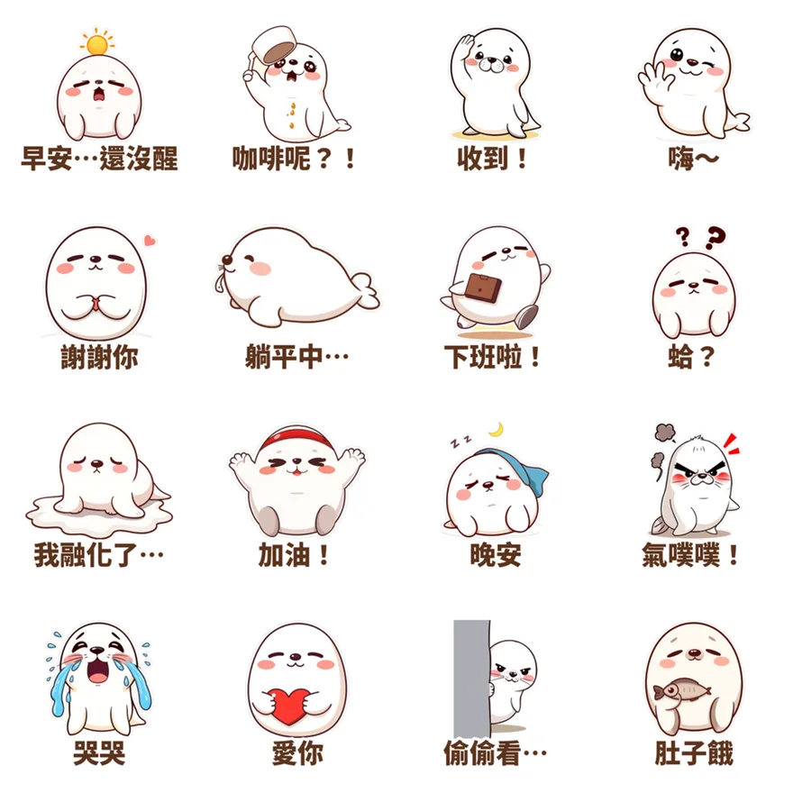

> 🛒 **麻糬海豹噗嚕・想躺平日常**（16 張靜態貼圖・NT$42）👉 [在 LINE 商店購買](https://line.me/S/sticker/37215265)

早上九點，人到了公司，靈魂還在被窩裡。咖啡還沒喝到，整隻人是融化狀態。

「噗嚕」是一隻白白軟軟、像剛蒸好的麻糬一樣的小海豹。牠沒有什麼遠大的志向，最大的願望就是**躺平**。但該說的「收到」「謝謝你」「加油」，牠一句都不會少：厭世歸厭世，禮貌還是要有。

## 16 句話，從早安用到晚安

| 時段 | 貼圖 | 什麼時候傳 |
|---|---|---|
| 早上 | 早安…還沒醒、咖啡呢？！ | 早會前、群組有人說早安 |
| 上班中 | 收到！、蛤？、偷偷看… | 主管交代事情、看不懂的訊息、潛水看群組 |
| 下午 | 躺平中…、我融化了…、肚子餓 | 下午三點的低潮 |
| 下班 | 下班啦！、加油！ | 下班衝第一、替還在加班的同事打氣 |
| 情緒 | 氣噗噗！、哭哭、謝謝你、愛你 | 生氣、委屈、感謝、撒嬌 |
| 晚上 | 嗨～、晚安 | 跟朋友聊天開場、睡前道晚安 |

## 為什麼是「躺平」？

2026 年的聊天室裡，「好累」「想躺平」「不想上班」是最常出現的句子之一。直接打這幾個字有點負面，但換成一隻趴在地上的軟Q海豹，對方看了會笑，你的心情也說出來了。

這也是「療癒系」貼圖好用的地方：**把不好意思直說的情緒，交給角色替你說。**

- 在工作群組回「收到！」，比打一個「好」多一點溫度。
- 已讀很久才回時，先丟一張「偷偷看…」，尷尬感少一半。
- 朋友抱怨工作，傳一張「躺平中…」表示「我懂」。

## 適合誰

- **上班族**：想在工作群組保持禮貌，又想偷偷厭世一下。
- **喜歡白色圓滾滾角色的人**：噗嚕跟[肉毛兔](/blog/line-sticker-roumao-rabbit/)、[無尾熊可可](/blog/line-animated-sticker-koala-comfort/)一樣，屬於療癒系。
- **想找已讀不回替代方案的人**：16 張裡有一半都能當「我看到了但我很累」的回覆。

想要會動的版本？可以看看同樣主打躺平的[樹懶懶懶・週末耍廢](https://line.me/S/sticker/37360149)，或[社畜企鵝啵啵](https://line.me/S/sticker/37292394)。

所有貼圖依主題整理在 👉 [Massor LINE 貼圖全系列](/line-stickers/)。

## 誠實筆記

角色是 AI 輔助生成的，LINE 商店頁會標示「使用AI」。噗嚕是我的第二組貼圖，10/11 開賣。

---

> 🛒 **喜歡噗嚕的話**：[在 LINE 商店購買「麻糬海豹噗嚕・想躺平日常」](https://line.me/S/sticker/37215265)，也可以在商店頁按「贈送禮物」送給一樣想躺平的朋友。
