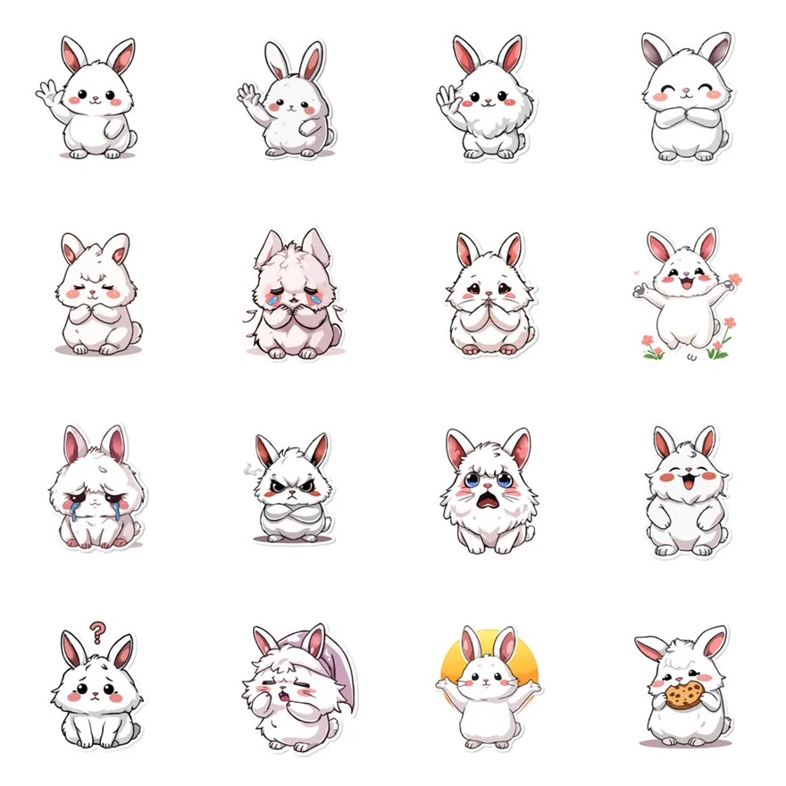

> 🛒 **肉毛兔**（32 張靜態貼圖・NT$42）👉 [在 LINE 商店購買](https://line.me/S/sticker/36099823)

「肉毛兔」是我上架的**第一組** LINE 貼圖（2026/8/26 開賣）。那時候還沒想好什麼主題、梗或台詞，只想做一隻看了會想摸一下的白色毛球兔子。

結果牠變成最「萬用」的一組：沒有文字，所以什麼對話都能接。

## 沒有字的貼圖，反而最好用

肉毛兔一組 32 張，都只有表情和動作，沒有文字：

- **打招呼**：揮手、雙手合十的「謝謝／拜託」
- **開心**：在花叢裡跳、雙手舉高迎接太陽（早安用）
- **難過**：眼淚汪汪、大哭、委屈
- **生氣**：雙手抱胸的臭臉
- **其他**：嚇一跳、頭上一個問號、戴睡帽打呵欠、抱著餅乾啃

沒有文字的好處是：**不管對方說什麼，都能回。**朋友說「我今天被罵了」，回大哭兔；說「今天加薪」，回花叢跳躍兔；說「晚上吃什麼」，回啃餅乾兔。台灣、日本、香港的朋友也都看得懂。

## 適合誰

- 喜歡白色、毛茸茸、簡單角色的人
- 不喜歡貼圖上有一堆字的人
- 想找一組「什麼都能回」的日常貼圖

同樣是白色療癒系，可以搭配[麻糬海豹噗嚕・想躺平日常](/blog/line-sticker-pulu-seal-lazy/)；想要會動、晚安專用的兔子，可以看[黏土垂耳兔睏睏・晚安熬夜中](https://line.me/S/sticker/37390703)。

所有貼圖依主題整理在 👉 [Massor LINE 貼圖全系列](/line-stickers/)。

## 誠實筆記

角色是 AI 輔助生成的。這組上架快兩個月，到目前為止還沒有賣出，所以這篇也算是給牠的第二次機會。

---

> 🛒 [在 LINE 商店購買「肉毛兔」](https://line.me/S/sticker/36099823)
