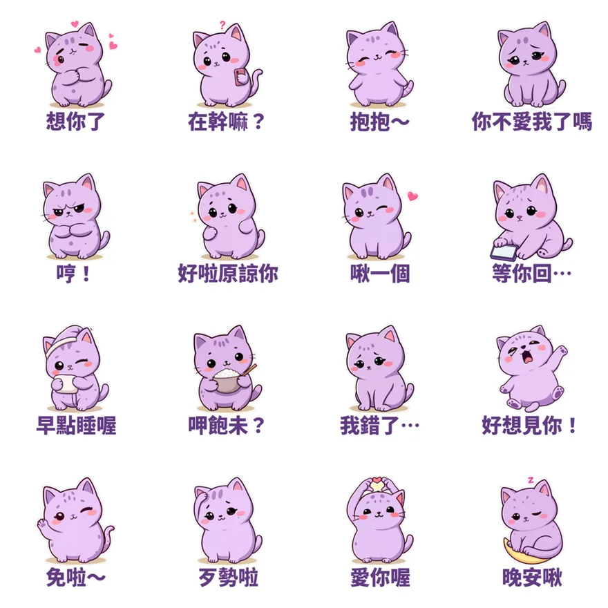

> 🛒 **芋圓貓・黏TT戀愛日常**（16 張靜態貼圖・NT$42）👉 [在 LINE 商店購買](https://line.me/S/sticker/37220496)

情侶之間最常打的字，其實就那幾句：「在幹嘛？」「想你了」「你不愛我了嗎」「好啦原諒你」。每天打一樣的字會膩，換成一隻圓滾滾的紫色芋圓貓，同一句話就變得可愛又不肉麻。

## 一天的戀愛對話，16 張剛好

- **開場**：在幹嘛？、想你了、好想見你！
- **撒嬌**：抱抱～、啾一個、愛你喔
- **鬧脾氣**：你不愛我了嗎、哼！、等你回…（專治已讀不回）
- **和好**：我錯了…、好啦原諒你、歹勢啦
- **關心**：呷飽未？、早點睡喔、免啦～
- **收尾**：晚安啾

吵架的時候，「我錯了…」比一段長長的道歉訊息更容易讓對方笑出來。對方已讀不回？丟一張「等你回…」，比追問「你在幹嘛」溫柔很多。

## 為什麼加了台語？

「呷飽未」「免啦」「歹勢啦」是台灣人每天都在講的話。在 [2026 爆款貼圖的 5 個共同點](/blog/line-sticker-trends-2026/) 裡，**在地語感**就是其中一點：一句台語，親切感馬上不一樣。也很適合傳給爸媽、家人。

## 適合誰

- 情侶、夫妻、曖昧中的兩個人
- 想送另一半一個小禮物（在 LINE 商店頁按「贈送禮物」即可）
- 喜歡紫色、圓滾滾角色的人

想要會動的情侶貼圖？可以搭配[黏人水獺拉拉・戀愛情勒動起來](https://line.me/S/sticker/37304821)，或吵架後求原諒專用的[小狐狸橙橙・謝謝對不起拜託](https://line.me/S/sticker/37375782)。更多組合在 [情侶＋療癒 LINE 貼圖推薦](/blog/line-sticker-couple-healing-picks/)。

所有貼圖依主題整理在 👉 [Massor LINE 貼圖全系列](/line-stickers/)。

## 誠實筆記

角色是 AI 輔助生成的，LINE 商店頁會標示「使用AI」。

---

> 🛒 **送給另一半**：[在 LINE 商店購買「芋圓貓・黏TT戀愛日常」](https://line.me/S/sticker/37220496)
