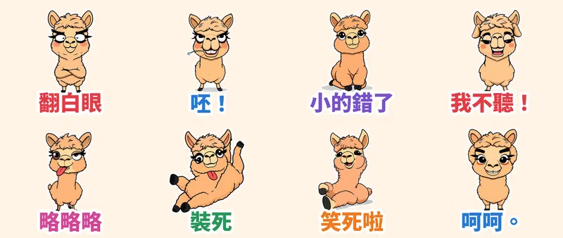

LINE 聊天室裡最好用的，往往不是最漂亮的貼圖，而是**一句話＋一個誇張到欠揍的表情**。這次的主題是「賤萌與浮誇顏藝系」：粗黑輪廓線、平塗配色、外圍白邊（深色模式也看得清楚），主角是一隻永遠覺得自己最屌的羊駝——**賤萌羊駝呸呸**。

> 🛒 **LINE 貼圖商店**：審核中，上架後會把連結補在這裡；也可以先到 [Massor 的作者頁](https://line.me/S/shop/sticker/author/6564520) 追蹤。

## 動作是真的「演」出來的

每張貼圖的動作都由本地端 **MiniMax H3**（首尾幀相同的影片生成）產生，不是單純位移或縮放：翻白眼時眼珠真的轉一圈、尖叫時嘴巴與眉毛一起變形、土下座後會偷偷抬頭賊笑。再把 73 幀影片抽成 20 幀、3 秒循環的 APNG，疊上白邊與大字，符合 LINE 動態貼圖規格。

## 🔊 點一下就有聲音

LINE Creators Market 目前沒有「有聲貼圖」類型，所以 App 內的貼圖本身是無聲的。我另外為每張貼圖做了娃娃音版本，點下面的卡片就能聽（手機點「傳給朋友」可直接分享）。

  <figure class="ms-c">
    <video src="https://github.com/ckw19810413/ckw19810413.github.io/releases/download/media-line-animated-sticker-alpaca-savage/peipei-01.mp4" poster="sound/01.jpg" muted autoplay loop playsinline preload="metadata"></video>
    <figcaption>翻白眼：哈？你認真的喔？</figcaption>
    <button type="button" class="ms-share" data-k="01">傳給朋友</button>
  </figure>
  <figure class="ms-c">
    <video src="https://github.com/ckw19810413/ckw19810413.github.io/releases/download/media-line-animated-sticker-alpaca-savage/peipei-02.mp4" poster="sound/02.jpg" muted autoplay loop playsinline preload="metadata"></video>
    <figcaption>呸！呸呸呸！</figcaption>
    <button type="button" class="ms-share" data-k="02">傳給朋友</button>
  </figure>
  <figure class="ms-c">
    <video src="https://github.com/ckw19810413/ckw19810413.github.io/releases/download/media-line-animated-sticker-alpaca-savage/peipei-03.mp4" poster="sound/03.jpg" muted autoplay loop playsinline preload="metadata"></video>
    <figcaption>小的錯了～嘿嘿</figcaption>
    <button type="button" class="ms-share" data-k="03">傳給朋友</button>
  </figure>
  <figure class="ms-c">
    <video src="https://github.com/ckw19810413/ckw19810413.github.io/releases/download/media-line-animated-sticker-alpaca-savage/peipei-04.mp4" poster="sound/04.jpg" muted autoplay loop playsinline preload="metadata"></video>
    <figcaption>我不聽我不聽！</figcaption>
    <button type="button" class="ms-share" data-k="04">傳給朋友</button>
  </figure>
  <figure class="ms-c">
    <video src="https://github.com/ckw19810413/ckw19810413.github.io/releases/download/media-line-animated-sticker-alpaca-savage/peipei-05.mp4" poster="sound/05.jpg" muted autoplay loop playsinline preload="metadata"></video>
    <figcaption>略略略～氣死你</figcaption>
    <button type="button" class="ms-share" data-k="05">傳給朋友</button>
  </figure>
  <figure class="ms-c">
    <video src="https://github.com/ckw19810413/ckw19810413.github.io/releases/download/media-line-animated-sticker-alpaca-savage/peipei-06.mp4" poster="sound/06.jpg" muted autoplay loop playsinline preload="metadata"></video>
    <figcaption>裝死：別找我</figcaption>
    <button type="button" class="ms-share" data-k="06">傳給朋友</button>
  </figure>
  <figure class="ms-c">
    <video src="https://github.com/ckw19810413/ckw19810413.github.io/releases/download/media-line-animated-sticker-alpaca-savage/peipei-07.mp4" poster="sound/07.jpg" muted autoplay loop playsinline preload="metadata"></video>
    <figcaption>笑死啦！</figcaption>
    <button type="button" class="ms-share" data-k="07">傳給朋友</button>
  </figure>
  <figure class="ms-c">
    <video src="https://github.com/ckw19810413/ckw19810413.github.io/releases/download/media-line-animated-sticker-alpaca-savage/peipei-08.mp4" poster="sound/08.jpg" muted autoplay loop playsinline preload="metadata"></video>
    <figcaption>呵呵，你高興就好</figcaption>
    <button type="button" class="ms-share" data-k="08">傳給朋友</button>
  </figure>

48 秒直式合輯（開聲音）：

<video src="https://github.com/ckw19810413/ckw19810413.github.io/releases/download/media-line-animated-sticker-alpaca-savage/peipei-voice.mp4" controls playsinline preload="none" style="max-width:360px;width:100%"></video>

## 8 款情境

| 編號 | 貼圖 | 適合用在 |
| :--- | :--- | :--- |
| 01 | 翻白眼 | 對方講了一句你完全不想接的話 |
| 02 | 呸！ | 氣到想呸他一臉 |
| 03 | 小的錯了 | 認錯速度第一名，但眼神不太誠懇 |
| 04 | 我不聽！ | 摀耳朵尖叫，拒絕聽任何道理 |
| 05 | 略略略 | 吐舌頭＋拉眼皮，經典嘲諷 |
| 06 | 裝死 | 被追問進度時 |
| 07 | 笑死啦 | 笑到在地上打滾 |
| 08 | 呵呵。 | 死魚眼＋微笑，句點對方 |

👉 更多原創動態貼圖請看 [LINE 貼圖總目錄](/line-stickers/)。本套貼圖為 AI 輔助創作。
