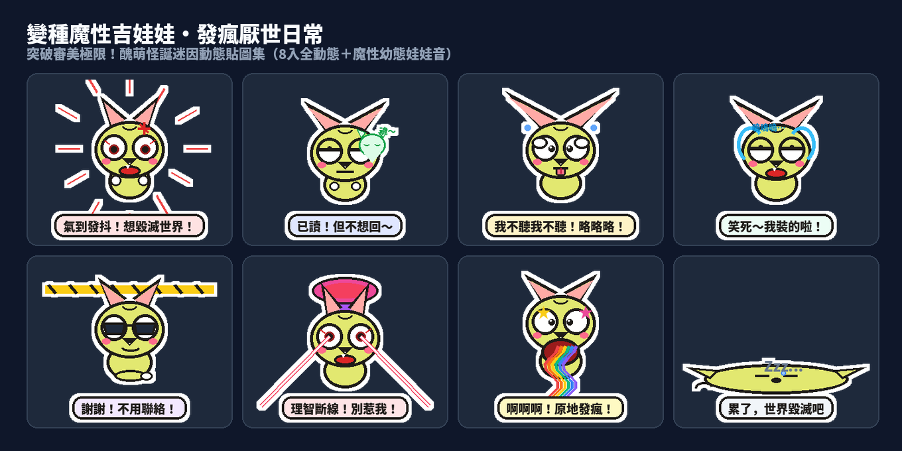

在現代即時通訊的日常裡，當文字已經無法宣洩內心深處的崩潰與無奈，什麼樣的貼圖最能「一擊必殺、句點全場」？答案永遠是：**突破傳統審美極限、荒謬到令人笑出來的【醜萌與怪誕迷因系】（Weird-Cute & Meme）！**

今天，Massor 創作團隊正式推出第二十六組原創動態貼圖——**「變種魔性吉娃娃・發瘋厭世日常」（Mutant Meme Chihuahua: Screaming & Meltdown）**！

這套貼圖徹底顛覆了傳統可愛寵物的框架，借鑑了在台灣與香港網路社群瘋傳的「變種吉娃娃」魔性基因：突起震動的鬥雞眼、不成比例的超大蝙蝠耳、一言不合就理智斷線的尖叫神經質，搭配高對比度的螢光粉紅、螢光黃與亮青色塊。全套 8 張皆為 320×270 規格的 4.0 秒循環 APNG 動態貼圖，外圍自帶 5px 純白發光描邊（完美適配 LINE 深色模式 Dark Mode）。更狂的是——**每張貼圖都收錄了獨家合成的吉娃娃魔性尖叫短吠 ＋ 台灣口音超崩潰幼態反差娃娃音！**

---

## 🔊 點一下就有聲音：變種吉娃娃有聲貼圖板

**點擊下方任何一張貼圖卡片，就能立即聽到變種吉娃娃用最尖銳、最崩潰的幼態娃娃音咆哮出你的社畜心聲！** 在手機上點擊「傳給朋友」，還能直接把 3 秒有聲短影音即時分享至 LINE 或各大社群群組！

  <figure class="ms-c">
    <video src="https://github.com/ckw19810413/ckw19810413.github.io/releases/download/media-line-animated-sticker-mutant-chihuahua/chihuahua-01.mp4" poster="sound/01.png" muted autoplay loop playsinline preload="metadata"></video>
    <figcaption>氣到發抖！想毀滅世界！</figcaption>
    <button type="button" class="ms-share" data-k="01">傳給朋友</button>
  </figure>
  <figure class="ms-c">
    <video src="https://github.com/ckw19810413/ckw19810413.github.io/releases/download/media-line-animated-sticker-mutant-chihuahua/chihuahua-02.mp4" poster="sound/02.png" muted autoplay loop playsinline preload="metadata"></video>
    <figcaption>已讀！但不想回～</figcaption>
    <button type="button" class="ms-share" data-k="02">傳給朋友</button>
  </figure>
  <figure class="ms-c">
    <video src="https://github.com/ckw19810413/ckw19810413.github.io/releases/download/media-line-animated-sticker-mutant-chihuahua/chihuahua-03.mp4" poster="sound/03.png" muted autoplay loop playsinline preload="metadata"></video>
    <figcaption>我不聽我不聽！略略略！</figcaption>
    <button type="button" class="ms-share" data-k="03">傳給朋友</button>
  </figure>
  <figure class="ms-c">
    <video src="https://github.com/ckw19810413/ckw19810413.github.io/releases/download/media-line-animated-sticker-mutant-chihuahua/chihuahua-04.mp4" poster="sound/04.png" muted autoplay loop playsinline preload="metadata"></video>
    <figcaption>笑死～我裝的啦！</figcaption>
    <button type="button" class="ms-share" data-k="04">傳給朋友</button>
  </figure>
  <figure class="ms-c">
    <video src="https://github.com/ckw19810413/ckw19810413.github.io/releases/download/media-line-animated-sticker-mutant-chihuahua/chihuahua-05.mp4" poster="sound/05.png" muted autoplay loop playsinline preload="metadata"></video>
    <figcaption>謝謝！不用聯絡！</figcaption>
    <button type="button" class="ms-share" data-k="05">傳給朋友</button>
  </figure>
  <figure class="ms-c">
    <video src="https://github.com/ckw19810413/ckw19810413.github.io/releases/download/media-line-animated-sticker-mutant-chihuahua/chihuahua-06.mp4" poster="sound/06.png" muted autoplay loop playsinline preload="metadata"></video>
    <figcaption>理智斷線！別惹我！</figcaption>
    <button type="button" class="ms-share" data-k="06">傳給朋友</button>
  </figure>
  <figure class="ms-c">
    <video src="https://github.com/ckw19810413/ckw19810413.github.io/releases/download/media-line-animated-sticker-mutant-chihuahua/chihuahua-07.mp4" poster="sound/07.png" muted autoplay loop playsinline preload="metadata"></video>
    <figcaption>啊啊啊！原地發瘋！</figcaption>
    <button type="button" class="ms-share" data-k="07">傳給朋友</button>
  </figure>
  <figure class="ms-c">
    <video src="https://github.com/ckw19810413/ckw19810413.github.io/releases/download/media-line-animated-sticker-mutant-chihuahua/chihuahua-08.mp4" poster="sound/08.png" muted autoplay loop playsinline preload="metadata"></video>
    <figcaption>累了，世界毀滅吧</figcaption>
    <button type="button" class="ms-share" data-k="08">傳給朋友</button>
  </figure>

---

## 🐶 8 款貼圖情境解析：把你的聊天對象徹底逼瘋

| 編號 | 視覺動作與表情張力 | 專屬娃娃音台詞 | 終極應用場景 |
| :--- | :--- | :--- | :--- |
| **01** | 全身劇烈高頻抽搐顫抖、眼球暴起狂震、額頭青筋四濺、紅色怒氣速度線四射 | 「氣到發抖！我想毀滅世界啦！」 | 週一開晨會、遇到雷隊友、加班改爛需求時的崩潰宣洩 |
| **02** | 鬥雞眼緩慢翻成死魚眼、直線嘴撇老長、半透明小吉娃娃幽靈飄浮昇天 | 「已讀！但我就是不想回～略！」 | 面對不熟主管或尷尬邀約，優雅表明「我已讀但懶得理你」 |
| **03** | 雙爪死死摀住超大耳朵蓋住腦袋、瘋狂左右猛烈甩頭、粉紅舌頭狂抖略略略 | 「我不聽我不聽！啦啦啦啦啦～」 | 遇到碎碎念長輩、同事甩鍋、裝傻耍賴到底神物 |
| **04** | 前半秒雙眼噴泉暴哭裝可憐、後半秒瞬間變臉成冷血死魚眼冷笑＋比倒讚 | 「好委屈喔嗚嗚嗚…笑死！我裝的啦！」 | 戲精上身、先抑後揚、瞬間撕下面具嘲諷全場 |
| **05** | 啪一聲戴上超大黑墨鏡、反光十字閃光✨、二郎腿高頻魔性狂抖、封鎖線落地 | 「謝謝喔！沒事真的不用聯絡！」 | 終極句點王！遇到推銷、無效社交時的冷酷拒絕神技 |
| **06** | 雙眼突然射出刺眼螢光粉紅雷射光線左右狂掃、頭頂升起核爆粉紫蘑菇雲 | 「理智斷線！現在誰都別惹我！」 | 忍無可忍理智炸裂、全組警告「生人勿近、隨時開砲」 |
| **07** | 下巴張大到身體兩倍、眼珠旋轉成迷幻蚊香圈、狂吐彩虹能量波與旋轉小星星 | 「啊啊啊啊啊！我原地發瘋啦！」 | 考試週考爆、工作暴量大崩潰、靈魂被榨乾時的自嘲狂歡 |
| **08** | 整隻吉娃娃像軟掉的黏土融化平攤成一灘爛泥薄餅、閉目休克、鼻涕泡伸縮 | 「好累喔…世界趕快毀滅吧～」 | 深夜下班累癱在沙發、放假只想當個廢物、登出人生 |

---

## 🎨 MiniMax H3 本地生成架構與動態工作流

本套貼圖的動畫骨架與微表情採用本地端 **MiniMax H3（minimax_h3_fl2va_pruned_fp8_scaled.safetensors）** 進行精確動作引導：
- **拒絕生硬位移變形**：傳統貼圖常使用簡單的 2D 骨骼位移或形變，MiniMax H3 能針對「翻白眼」、「抓狂甩頭」、「雷射眼掃射」、「融化成薄餅」等複雜動作計算每秒 10 幀的流暢非線性物理加速度。
- **幼態娃娃音聲學調校**：透過高頻共鳴（Formant Shift 1.35~1.55x）與節奏壓縮（Duration < 3.5s），模擬最尖銳、最崩潰的反差萌童音。
- **嚴格硬體安全守則（GB10 Unified Memory Guard）**：MiniMax H3 全權重加載需要 43GB 以上統一記憶體，生產環境嚴格執行 `render_h3_stickers.py` 記憶體安全防護守則，在夜間無干擾維護窗口自動調度高算力渲染任務。

---

## 🛒 LINE Creators Market 上架販售指引

1. 登入 [LINE Creators Market 創作者市集](https://creator.line.me/)。
2. 點選「新增」→ 選擇「貼圖」，貼圖類型勾選「動態貼圖」。
3. 填寫貼圖資訊：
   - **標題（中文）**：變種魔性吉娃娃・發瘋厭世日常
   - **標題（英文）**：Mutant Chihuahua: Screaming & Meltdown
   - **貼圖說明**：突破審美極限的怪誕醜萌變種吉娃娃！氣到發抖、原地發瘋、已讀不想回、我就爛、謝謝不用聯絡、笑死我裝的、世界毀滅吧…社畜互嗆必備神物！（AI輔助）
   - **創意類別**：Cute / Dogs
   - **販售價格**：建議設定 50 LINE 代幣（NT$33）或 100 LINE 代幣（NT$66）。
4. 上傳圖片：直接上傳本專案生成的 `MutantChihuahua_LINE_stickers_upload.zip`，系統將自動比對 `main.png`、`tab.png` 與 8 張 `01.png` ~ `08.png`。
5. 本套貼圖已完成上傳與自動錯誤檢查（**0 錯誤**），審核通過後將自動於全區（197 個地區）公開販售！

👉 更多原創動態貼圖系列：請瀏覽 [Massor 的 LINE 貼圖專頁](https://line.me/S/shop/sticker/author/6564520) 或 [LINE 貼圖總目錄](/line-stickers/)！
