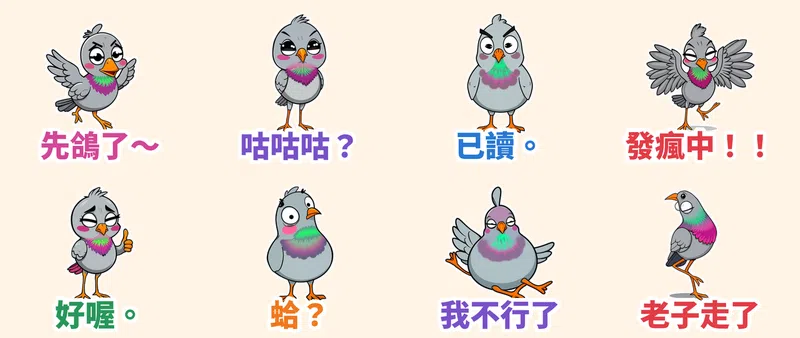

有些貼圖不是用來表達情緒，是用來**結束對話**的。這次走「醜萌與怪誕迷因系」：鬥雞眼、大小眼、螢光綠＋桃紅的脖子、細長到不合理的橘色腿，主角是一隻永遠在狀況外的鴿子——**魔性鬥雞眼鴿子咕咕**。台灣人都懂：約好的事要落跑，就說一聲「**先鴿了**」。

> 🛒 **魔性鬥雞眼鴿子咕咕・厭世發瘋** 已在 LINE 商店正式開賣（動態貼圖・NT$60）👉 [在 LINE 商店購買](https://line.me/S/sticker/37523393)

## 動作是真的「演」出來的

每張貼圖的動作都由本地端 **MiniMax H3**（首尾幀相同的影片生成）產生，不是單純位移或縮放：咕咕咕時脖子真的一伸一縮像真鴿子、發瘋時翅膀狂拍羽毛亂飛、已讀時眼珠慢慢斜過去再冷冷轉頭。73 幀影片抽成 20 幀、3 秒循環的 APNG，外加白邊和大字，深色模式也清楚。

## 🔊 點一下就有聲音

LINE Creators Market 目前沒有「有聲貼圖」類型，所以 App 內的貼圖本身是無聲的。我另外為每張貼圖做了「鴿子咕咕叫＋娃娃音」版本，點下面的卡片就能聽（手機點「傳給朋友」可直接分享）。

  <figure class="ms-c">
    <video src="https://github.com/ckw19810413/ckw19810413.github.io/releases/download/media-line-animated-sticker-pigeon-derpy/gugu-01.mp4" poster="sound/01.jpg" muted autoplay loop playsinline preload="metadata"></video>
    <figcaption>先鴿了～掰掰！</figcaption>
    <button type="button" class="ms-share" data-k="01">傳給朋友</button>
  </figure>
  <figure class="ms-c">
    <video src="https://github.com/ckw19810413/ckw19810413.github.io/releases/download/media-line-animated-sticker-pigeon-derpy/gugu-02.mp4" poster="sound/02.jpg" muted autoplay loop playsinline preload="metadata"></video>
    <figcaption>咕咕咕？你說啥？</figcaption>
    <button type="button" class="ms-share" data-k="02">傳給朋友</button>
  </figure>
  <figure class="ms-c">
    <video src="https://github.com/ckw19810413/ckw19810413.github.io/releases/download/media-line-animated-sticker-pigeon-derpy/gugu-03.mp4" poster="sound/03.jpg" muted autoplay loop playsinline preload="metadata"></video>
    <figcaption>已讀。不回。</figcaption>
    <button type="button" class="ms-share" data-k="03">傳給朋友</button>
  </figure>
  <figure class="ms-c">
    <video src="https://github.com/ckw19810413/ckw19810413.github.io/releases/download/media-line-animated-sticker-pigeon-derpy/gugu-04.mp4" poster="sound/04.jpg" muted autoplay loop playsinline preload="metadata"></video>
    <figcaption>發瘋中！！</figcaption>
    <button type="button" class="ms-share" data-k="04">傳給朋友</button>
  </figure>
  <figure class="ms-c">
    <video src="https://github.com/ckw19810413/ckw19810413.github.io/releases/download/media-line-animated-sticker-pigeon-derpy/gugu-05.mp4" poster="sound/05.jpg" muted autoplay loop playsinline preload="metadata"></video>
    <figcaption>好喔。隨便你。</figcaption>
    <button type="button" class="ms-share" data-k="05">傳給朋友</button>
  </figure>
  <figure class="ms-c">
    <video src="https://github.com/ckw19810413/ckw19810413.github.io/releases/download/media-line-animated-sticker-pigeon-derpy/gugu-06.mp4" poster="sound/06.jpg" muted autoplay loop playsinline preload="metadata"></video>
    <figcaption>蛤？蛤？蛤？</figcaption>
    <button type="button" class="ms-share" data-k="06">傳給朋友</button>
  </figure>
  <figure class="ms-c">
    <video src="https://github.com/ckw19810413/ckw19810413.github.io/releases/download/media-line-animated-sticker-pigeon-derpy/gugu-07.mp4" poster="sound/07.jpg" muted autoplay loop playsinline preload="metadata"></video>
    <figcaption>我不行了</figcaption>
    <button type="button" class="ms-share" data-k="07">傳給朋友</button>
  </figure>
  <figure class="ms-c">
    <video src="https://github.com/ckw19810413/ckw19810413.github.io/releases/download/media-line-animated-sticker-pigeon-derpy/gugu-08.mp4" poster="sound/08.jpg" muted autoplay loop playsinline preload="metadata"></video>
    <figcaption>哼，老子走了！</figcaption>
    <button type="button" class="ms-share" data-k="08">傳給朋友</button>
  </figure>

24 秒直式合輯（開聲音）：

<video src="https://github.com/ckw19810413/ckw19810413.github.io/releases/download/media-line-animated-sticker-pigeon-derpy/gugu-voice.mp4" controls playsinline preload="none" style="max-width:360px;width:100%"></video>

## 8 款情境

| 編號 | 貼圖 | 適合用在 |
| :--- | :--- | :--- |
| 01 | 先鴿了～ | 約好的聚會突然不想去 |
| 02 | 咕咕咕？ | 完全沒在聽對方講什麼 |
| 03 | 已讀。 | 不想回，但要讓對方知道你看到了 |
| 04 | 發瘋中！！ | 星期一、報告、老闆訊息 |
| 05 | 好喔。 | 經典句點，隨便你 |
| 06 | 蛤？ | 大小眼看懂不懂的訊息 |
| 07 | 我不行了 | 累到原地昏倒 |
| 08 | 老子走了 | 抬頭挺胸帥氣離場 |

> 🛒 [在 LINE 商店購買「魔性鬥雞眼鴿子咕咕・厭世發瘋」](https://line.me/S/sticker/37523393)｜全系列依主題整理在 [Massor LINE 貼圖全系列](/line-stickers/)

👉 更多原創動態貼圖請看 [LINE 貼圖總目錄](/line-stickers/)。本套貼圖為 AI 輔助創作。
