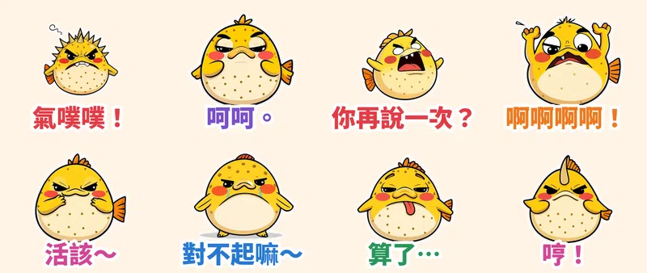

台灣人生氣叫「**氣噗噗**」，那有什麼動物比**河豚**更適合代言？這次走「賤萌與浮誇顏藝系」：粗黑輪廓、賽璐珞平塗、翻白眼、咆哮、抓狂甩頭、土下座道歉——主角是一隻一被惹毛就整隻鼓成刺球、臉漲紅還冒煙的河豚**噗噗**。

> 🛒 **賤萌氣噗噗河豚・互嗆暴走** 已送審 LINE Creators Market（動態貼圖・NT$60），審核通過後會在這裡補上購買連結；先逛逛 [Massor 的 LINE 貼圖全系列](/line-stickers/)。

## 鼓起來是真的「演」出來的

每張貼圖的動作都由本地端 **MiniMax H3**（首尾幀相同的影片生成）產生，不是單純位移或縮放：「氣噗噗！」時噗噗的臉從黃轉紅、整隻充氣膨脹、背刺一根根豎起、頭頂狂冒煙，再慢慢消氣；「呵呵。」眼珠翻到只剩眼白；「算了…」像漏氣的氣球整隻塌掉。73 幀影片抽成 20 幀、3 秒循環的 APNG，外加 6 px 白邊和大字，深色模式也清楚。

## 🔊 點一下就有聲音

LINE Creators Market 目前沒有「有聲貼圖」類型，所以 App 內的貼圖本身是無聲的。我另外為每張貼圖做了「噗～啵 充氣聲＋娃娃音」版本，點下面的卡片就能聽（手機點「傳給朋友」可直接分享）。

  <figure class="ms-c">
    <video src="https://github.com/ckw19810413/ckw19810413.github.io/releases/download/media-line-animated-sticker-pufferfish-rage/pupu-01.mp4" poster="sound/01.jpg" muted autoplay loop playsinline preload="metadata"></video>
    <figcaption>氣噗噗！我要爆炸了！</figcaption>
    <button type="button" class="ms-share" data-k="01">傳給朋友</button>
  </figure>
  <figure class="ms-c">
    <video src="https://github.com/ckw19810413/ckw19810413.github.io/releases/download/media-line-animated-sticker-pufferfish-rage/pupu-02.mp4" poster="sound/02.jpg" muted autoplay loop playsinline preload="metadata"></video>
    <figcaption>呵呵。你開心就好。</figcaption>
    <button type="button" class="ms-share" data-k="02">傳給朋友</button>
  </figure>
  <figure class="ms-c">
    <video src="https://github.com/ckw19810413/ckw19810413.github.io/releases/download/media-line-animated-sticker-pufferfish-rage/pupu-03.mp4" poster="sound/03.jpg" muted autoplay loop playsinline preload="metadata"></video>
    <figcaption>你再說一次看看？</figcaption>
    <button type="button" class="ms-share" data-k="03">傳給朋友</button>
  </figure>
  <figure class="ms-c">
    <video src="https://github.com/ckw19810413/ckw19810413.github.io/releases/download/media-line-animated-sticker-pufferfish-rage/pupu-04.mp4" poster="sound/04.jpg" muted autoplay loop playsinline preload="metadata"></video>
    <figcaption>啊啊啊啊我要瘋了！</figcaption>
    <button type="button" class="ms-share" data-k="04">傳給朋友</button>
  </figure>
  <figure class="ms-c">
    <video src="https://github.com/ckw19810413/ckw19810413.github.io/releases/download/media-line-animated-sticker-pufferfish-rage/pupu-05.mp4" poster="sound/05.jpg" muted autoplay loop playsinline preload="metadata"></video>
    <figcaption>嘻嘻嘻，活該～</figcaption>
    <button type="button" class="ms-share" data-k="05">傳給朋友</button>
  </figure>
  <figure class="ms-c">
    <video src="https://github.com/ckw19810413/ckw19810413.github.io/releases/download/media-line-animated-sticker-pufferfish-rage/pupu-06.mp4" poster="sound/06.jpg" muted autoplay loop playsinline preload="metadata"></video>
    <figcaption>對不起嘛～原諒我啦！</figcaption>
    <button type="button" class="ms-share" data-k="06">傳給朋友</button>
  </figure>
  <figure class="ms-c">
    <video src="https://github.com/ckw19810413/ckw19810413.github.io/releases/download/media-line-animated-sticker-pufferfish-rage/pupu-07.mp4" poster="sound/07.jpg" muted autoplay loop playsinline preload="metadata"></video>
    <figcaption>算了…我沒力了…</figcaption>
    <button type="button" class="ms-share" data-k="07">傳給朋友</button>
  </figure>
  <figure class="ms-c">
    <video src="https://github.com/ckw19810413/ckw19810413.github.io/releases/download/media-line-animated-sticker-pufferfish-rage/pupu-08.mp4" poster="sound/08.jpg" muted autoplay loop playsinline preload="metadata"></video>
    <figcaption>哼！不理你了！</figcaption>
    <button type="button" class="ms-share" data-k="08">傳給朋友</button>
  </figure>

24 秒直式合輯（開聲音）：

<video src="https://github.com/ckw19810413/ckw19810413.github.io/releases/download/media-line-animated-sticker-pufferfish-rage/pupu-voice.mp4" controls playsinline preload="none" style="max-width:360px;width:100%"></video>

## 8 款情境：從吵架到和好

| 編號 | 貼圖 | 適合用在 |
| :--- | :--- | :--- |
| 01 | 氣噗噗！ | 被惹毛，整隻鼓起來冒煙 |
| 02 | 呵呵。 | 翻白眼，懶得跟你解釋 |
| 03 | 你再說一次？ | 對方講錯話，給他最後機會 |
| 04 | 啊啊啊啊！ | 抓頭甩頭，原地崩潰 |
| 05 | 活該～ | 摀嘴偷笑，幸災樂禍 |
| 06 | 對不起嘛～ | 哭著土下座道歉 |
| 07 | 算了… | 氣到漏氣，整隻塌掉 |
| 08 | 哼！ | 轉頭鬧彆扭，等你來哄 |

👉 更多原創動態貼圖請看 [LINE 貼圖總目錄](/line-stickers/)。本套貼圖為 AI 輔助創作。
