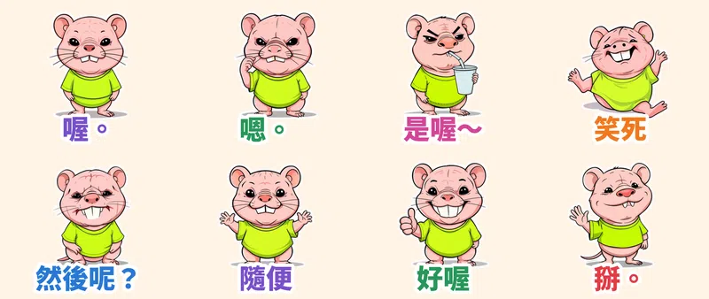

聊天最強的武器不是長篇大論，是一個「**喔。**」。這次走「醜萌與怪誕迷因系」：主角是一隻皮皺皺、兩顆大暴牙、死魚豆豆眼、穿螢光綠 T 恤的**裸鼴鼠皺皺**，長得不好看，但句點人的功力一流。

> 🛒 **醜萌裸鼴鼠皺皺・句點王** 已在 LINE 商店正式開賣（動態貼圖・NT$60）👉 [在 LINE 商店購買](https://line.me/S/sticker/37541978)

## 死魚眼也是「演」出來的

每張貼圖的動作都由本地端 **MiniMax H3**（首尾幀相同的影片生成）產生，不是單純位移或縮放：「喔。」是慢慢眨一下死魚眼再敷衍點個頭；「嗯。」一邊挖鼻孔一邊點頭，挖完還彈走；「是喔～」吸著飲料挑眉斜眼；「笑死」直接倒在地上踢腳狂笑噴淚；「然後呢？」托腮打一個大到看見暴牙的哈欠；「掰。」揮手、轉身就走、再回頭看你一眼。73 幀影片抽成 20 幀、3 秒循環的 APNG，外加 6 px 白邊和大字，深色模式也清楚。

## 🔊 點一下就有聲音

LINE Creators Market 目前沒有「有聲貼圖」類型，所以 App 內的貼圖本身是無聲的。我另外為每張貼圖做了「吱吱叫＋娃娃音」版本，點下面的卡片就能聽（手機點「傳給朋友」可直接分享）。

  <figure class="ms-c">
    <video src="https://github.com/ckw19810413/ckw19810413.github.io/releases/download/media-line-animated-sticker-molerat-chat-killer/zhouzhou-01.mp4" poster="sound/01.jpg" muted autoplay loop playsinline preload="metadata"></video>
    <figcaption>喔～是這樣喔。</figcaption>
    <button type="button" class="ms-share" data-k="01">傳給朋友</button>
  </figure>
  <figure class="ms-c">
    <video src="https://github.com/ckw19810413/ckw19810413.github.io/releases/download/media-line-animated-sticker-molerat-chat-killer/zhouzhou-02.mp4" poster="sound/02.jpg" muted autoplay loop playsinline preload="metadata"></video>
    <figcaption>嗯嗯，你說得都對。</figcaption>
    <button type="button" class="ms-share" data-k="02">傳給朋友</button>
  </figure>
  <figure class="ms-c">
    <video src="https://github.com/ckw19810413/ckw19810413.github.io/releases/download/media-line-animated-sticker-molerat-chat-killer/zhouzhou-03.mp4" poster="sound/03.jpg" muted autoplay loop playsinline preload="metadata"></video>
    <figcaption>是喔～好厲害喔～</figcaption>
    <button type="button" class="ms-share" data-k="03">傳給朋友</button>
  </figure>
  <figure class="ms-c">
    <video src="https://github.com/ckw19810413/ckw19810413.github.io/releases/download/media-line-animated-sticker-molerat-chat-killer/zhouzhou-04.mp4" poster="sound/04.jpg" muted autoplay loop playsinline preload="metadata"></video>
    <figcaption>哈哈哈笑死我了！</figcaption>
    <button type="button" class="ms-share" data-k="04">傳給朋友</button>
  </figure>
  <figure class="ms-c">
    <video src="https://github.com/ckw19810413/ckw19810413.github.io/releases/download/media-line-animated-sticker-molerat-chat-killer/zhouzhou-05.mp4" poster="sound/05.jpg" muted autoplay loop playsinline preload="metadata"></video>
    <figcaption>然後呢？說完了嗎？</figcaption>
    <button type="button" class="ms-share" data-k="05">傳給朋友</button>
  </figure>
  <figure class="ms-c">
    <video src="https://github.com/ckw19810413/ckw19810413.github.io/releases/download/media-line-animated-sticker-molerat-chat-killer/zhouzhou-06.mp4" poster="sound/06.jpg" muted autoplay loop playsinline preload="metadata"></video>
    <figcaption>隨便啦，都可以。</figcaption>
    <button type="button" class="ms-share" data-k="06">傳給朋友</button>
  </figure>
  <figure class="ms-c">
    <video src="https://github.com/ckw19810413/ckw19810413.github.io/releases/download/media-line-animated-sticker-molerat-chat-killer/zhouzhou-07.mp4" poster="sound/07.jpg" muted autoplay loop playsinline preload="metadata"></video>
    <figcaption>好喔，你開心就好。</figcaption>
    <button type="button" class="ms-share" data-k="07">傳給朋友</button>
  </figure>
  <figure class="ms-c">
    <video src="https://github.com/ckw19810413/ckw19810413.github.io/releases/download/media-line-animated-sticker-molerat-chat-killer/zhouzhou-08.mp4" poster="sound/08.jpg" muted autoplay loop playsinline preload="metadata"></video>
    <figcaption>掰掰，我先下線囉。</figcaption>
    <button type="button" class="ms-share" data-k="08">傳給朋友</button>
  </figure>

24 秒直式合輯（開聲音）：

<video src="https://github.com/ckw19810413/ckw19810413.github.io/releases/download/media-line-animated-sticker-molerat-chat-killer/zhouzhou-voice.mp4" controls playsinline preload="none" style="max-width:360px;width:100%"></video>

## 8 款句點：已讀不如回一個字

| 編號 | 貼圖 | 適合用在 |
| :--- | :--- | :--- |
| 01 | 喔。 | 對方講了一大串，你只想回一個字 |
| 02 | 嗯。 | 邊挖鼻孔邊敷衍 |
| 03 | 是喔～ | 吸飲料挑眉，聽聽就好 |
| 04 | 笑死 | 真的好笑（或假裝好笑） |
| 05 | 然後呢？ | 打哈欠催他講重點 |
| 06 | 隨便 | 聳肩，吃什麼都可以 |
| 07 | 好喔 | 比讚＋假笑，你開心就好 |
| 08 | 掰。 | 揮手轉身，聊天結束 |

> 🛒 [在 LINE 商店購買「醜萌裸鼴鼠皺皺・句點王」](https://line.me/S/sticker/37541978)｜全系列依主題整理在 [Massor LINE 貼圖全系列](/line-stickers/)

本套貼圖為 AI 輔助創作。
