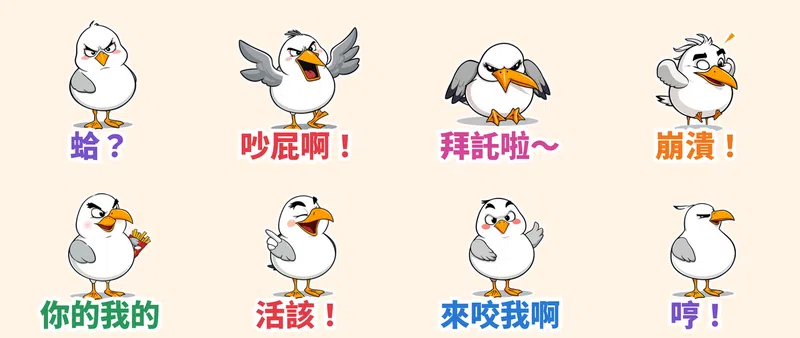

去過海邊的人都知道，**海鷗是全世界最賤的鳥**：搶你薯條、對你大叫、搶完還一臉「怎樣？」。這次走「賤萌與浮誇顏藝系」：粗黑輪廓線、賽璐珞平塗、翻白眼咆哮土下座一次到位，主角就是這隻胖嘟嘟的**賤嘴海鷗阿薯**。

> 🛒 **賤嘴海鷗阿薯・搶薯條互嗆王**（動態貼圖・NT$60）已送 LINE 審核，通常 1–3 天內上架。上架前可先逛 [Massor 的 LINE 貼圖作者頁](https://line.me/S/shop/sticker/author/6564520)，全系列依主題整理在 [Massor LINE 貼圖全系列](/line-stickers/)。

## 賤，是「演」出來的

每張貼圖的動作都由本地端 **MiniMax H3**（首尾幀相同的影片生成）產生，不是單純位移或縮放：「蛤？」是慢慢把白眼翻到頂、單翅叉腰再斜眼瞪你；「吵屁啊！」嘴張到最大、全身發抖狂吼；「拜託啦～」直接土下座磕頭再抬起淚汪汪的狗狗眼；「崩潰！」抱頭甩到羽毛亂飛；「你的我的」從紅紙杯叼走一根薯條一口吞，還奸笑回頭再拿一根；「活該！」指著你笑到拍膝蓋噴淚；「來咬我啊」挺胸勾手挑眉扭屁股；「哼！」鳥嘴一抬、翅膀一甩轉身就走。73 幀影片抽成 20 幀、3 秒循環的 APNG，外加白邊和大字，深色模式也清楚。

## 🔊 點一下就有聲音

LINE Creators Market 目前沒有「有聲貼圖」類型，所以 App 內的貼圖本身是無聲的。我另外為每張貼圖配了「娃娃音」版本，點下面的卡片就能聽（手機點「傳給朋友」可直接分享）。

  <figure class="ms-c">
    <video src="https://github.com/ckw19810413/ckw19810413.github.io/releases/download/media-line-animated-sticker-seagull-fry-thief/ashu-01.mp4" poster="sound/01.jpg" muted autoplay loop playsinline preload="metadata"></video>
    <figcaption>蛤？你說什麼啦～</figcaption>
    <button type="button" class="ms-share" data-k="01">傳給朋友</button>
  </figure>
  <figure class="ms-c">
    <video src="https://github.com/ckw19810413/ckw19810413.github.io/releases/download/media-line-animated-sticker-seagull-fry-thief/ashu-02.mp4" poster="sound/02.jpg" muted autoplay loop playsinline preload="metadata"></video>
    <figcaption>吵屁啊！閉嘴啦！</figcaption>
    <button type="button" class="ms-share" data-k="02">傳給朋友</button>
  </figure>
  <figure class="ms-c">
    <video src="https://github.com/ckw19810413/ckw19810413.github.io/releases/download/media-line-animated-sticker-seagull-fry-thief/ashu-03.mp4" poster="sound/03.jpg" muted autoplay loop playsinline preload="metadata"></video>
    <figcaption>拜託拜託～求求你嘛～</figcaption>
    <button type="button" class="ms-share" data-k="03">傳給朋友</button>
  </figure>
  <figure class="ms-c">
    <video src="https://github.com/ckw19810413/ckw19810413.github.io/releases/download/media-line-animated-sticker-seagull-fry-thief/ashu-04.mp4" poster="sound/04.jpg" muted autoplay loop playsinline preload="metadata"></video>
    <figcaption>啊啊啊我要崩潰了！</figcaption>
    <button type="button" class="ms-share" data-k="04">傳給朋友</button>
  </figure>
  <figure class="ms-c">
    <video src="https://github.com/ckw19810413/ckw19810413.github.io/releases/download/media-line-animated-sticker-seagull-fry-thief/ashu-05.mp4" poster="sound/05.jpg" muted autoplay loop playsinline preload="metadata"></video>
    <figcaption>你的就是我的啦～</figcaption>
    <button type="button" class="ms-share" data-k="05">傳給朋友</button>
  </figure>
  <figure class="ms-c">
    <video src="https://github.com/ckw19810413/ckw19810413.github.io/releases/download/media-line-animated-sticker-seagull-fry-thief/ashu-06.mp4" poster="sound/06.jpg" muted autoplay loop playsinline preload="metadata"></video>
    <figcaption>哈哈哈活該喔！</figcaption>
    <button type="button" class="ms-share" data-k="06">傳給朋友</button>
  </figure>
  <figure class="ms-c">
    <video src="https://github.com/ckw19810413/ckw19810413.github.io/releases/download/media-line-animated-sticker-seagull-fry-thief/ashu-07.mp4" poster="sound/07.jpg" muted autoplay loop playsinline preload="metadata"></video>
    <figcaption>來啊～你來咬我啊～</figcaption>
    <button type="button" class="ms-share" data-k="07">傳給朋友</button>
  </figure>
  <figure class="ms-c">
    <video src="https://github.com/ckw19810413/ckw19810413.github.io/releases/download/media-line-animated-sticker-seagull-fry-thief/ashu-08.mp4" poster="sound/08.jpg" muted autoplay loop playsinline preload="metadata"></video>
    <figcaption>哼！不理你了啦！</figcaption>
    <button type="button" class="ms-share" data-k="08">傳給朋友</button>
  </figure>

24 秒直式合輯（開聲音）：

<video src="https://github.com/ckw19810413/ckw19810413.github.io/releases/download/media-line-animated-sticker-seagull-fry-thief/ashu-voice.mp4" controls playsinline preload="none" style="max-width:360px;width:100%"></video>

## 8 款互嗆：朋友群組的吵架神器

| 編號 | 貼圖 | 適合用在 |
| :--- | :--- | :--- |
| 01 | 蛤？ | 對方說了什麼離譜的話，翻白眼回他 |
| 02 | 吵屁啊！ | 群組洗版、有人一直 tag 你 |
| 03 | 拜託啦～ | 求幫忙、求原諒，直接土下座 |
| 04 | 崩潰！ | 加班、考試、被雷，抓狂甩頭 |
| 05 | 你的我的 | 偷吃朋友的宵夜，理直氣壯 |
| 06 | 活該！ | 朋友自作自受，指著他笑 |
| 07 | 來咬我啊 | 嘴砲吵贏之後的挑釁 |
| 08 | 哼！ | 傲嬌生氣，不理你了 |

> 🛒 上架後會在這裡補上 LINE 商店購買連結｜先看 [Massor 的 LINE 貼圖作者頁](https://line.me/S/shop/sticker/author/6564520)｜全系列 [Massor LINE 貼圖全系列](/line-stickers/)

本套貼圖為 AI 輔助創作。
