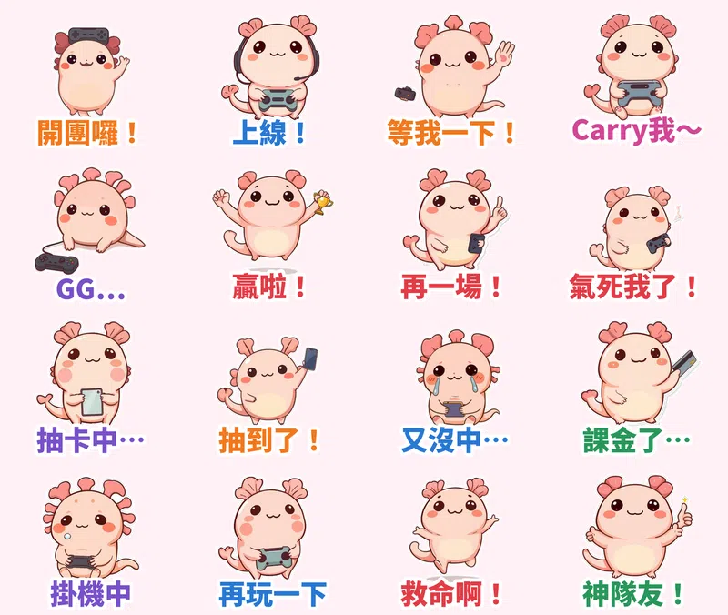
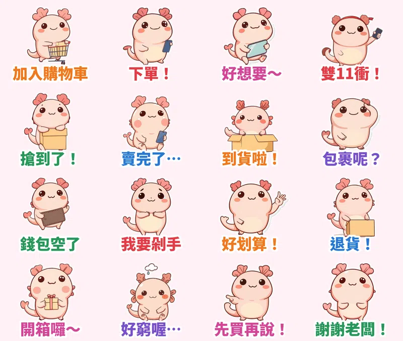

最近 LINE 上最紅的貼圖有兩個共同點：**角色小小一隻、圓圓軟軟**（吉伊卡哇、小傢伙那一路），而且**句子要能天天用**。這次的主角是粉紅色的**宅宅六角恐龍「宅寶」**。牠白天上網購物，晚上開團打電動，所以這次一口氣出了 **2 套共 32 張**動態貼圖。

> 🛒 **宅宅六角恐龍宅寶** 2 套已送審，通過後就會上架（先看作者頁）（動態貼圖・NT$60）👉 [在 LINE 商店購買 Vol.1「電玩開團中」](https://line.me/S/shop/sticker/author/6564520)｜[在 LINE 商店購買 Vol.2「網購剁手中」](https://line.me/S/shop/sticker/author/6564520)

## Vol.1 電玩開團中

## Vol.2 網購剁手中

## 每個表情都是「演」出來的

每張貼圖的動作都由本地端 **MiniMax H3**（首尾幀相同的影片生成）產生，不是單純的位移或縮放。「開團囉！」是舉著手把跳上跳下；「Carry我～」是跪著搓手、淚眼汪汪地拜託；「GG…」是手把一丟、整隻趴倒，連鰓都垂下來；「抽卡中…」是閉眼對手機唸咒；「錢包空了」是把錢包倒過來甩，結果什麼都沒掉出來；「我要剁手」是雙手打叉、含淚搖頭。角色先用 FLUX＋LoRA 畫好 32 個姿勢，H3 生成 73 幀影片後，再抽成 20 幀、剛好 3 秒循環的 APNG，最後加上白邊和大字，深色模式也看得清楚。

## 🔊 點一下就有聲音

LINE Creators Market 目前沒有「有聲貼圖」類型，所以 App 裡的貼圖本身沒有聲音。我另外幫每張貼圖配了娃娃音版本，點下面的卡片就能聽（手機上按「傳給朋友」可以直接分享）。

### Vol.1 電玩開團中

  <figure class="ms-c">
    <video src="https://github.com/ckw19810413/ckw19810413.github.io/releases/download/media-line-animated-sticker-axolotl-gamer-shopping/zhaibao-a01.mp4" poster="sound/a01.jpg" muted autoplay loop playsinline preload="metadata"></video>
    <figcaption>開團囉～快來一起玩！</figcaption>
    <button type="button" class="ms-share">傳給朋友</button>
  </figure>
  <figure class="ms-c">
    <video src="https://github.com/ckw19810413/ckw19810413.github.io/releases/download/media-line-animated-sticker-axolotl-gamer-shopping/zhaibao-a02.mp4" poster="sound/a02.jpg" muted autoplay loop playsinline preload="metadata"></video>
    <figcaption>上線！準備好了！</figcaption>
    <button type="button" class="ms-share">傳給朋友</button>
  </figure>
  <figure class="ms-c">
    <video src="https://github.com/ckw19810413/ckw19810413.github.io/releases/download/media-line-animated-sticker-axolotl-gamer-shopping/zhaibao-a03.mp4" poster="sound/a03.jpg" muted autoplay loop playsinline preload="metadata"></video>
    <figcaption>等我一下啦～馬上好！</figcaption>
    <button type="button" class="ms-share">傳給朋友</button>
  </figure>
  <figure class="ms-c">
    <video src="https://github.com/ckw19810413/ckw19810413.github.io/releases/download/media-line-animated-sticker-axolotl-gamer-shopping/zhaibao-a04.mp4" poster="sound/a04.jpg" muted autoplay loop playsinline preload="metadata"></video>
    <figcaption>拜託～Carry我嘛～</figcaption>
    <button type="button" class="ms-share">傳給朋友</button>
  </figure>
  <figure class="ms-c">
    <video src="https://github.com/ckw19810413/ckw19810413.github.io/releases/download/media-line-animated-sticker-axolotl-gamer-shopping/zhaibao-a05.mp4" poster="sound/a05.jpg" muted autoplay loop playsinline preload="metadata"></video>
    <figcaption>嗚嗚…GG了啦…</figcaption>
    <button type="button" class="ms-share">傳給朋友</button>
  </figure>
  <figure class="ms-c">
    <video src="https://github.com/ckw19810413/ckw19810413.github.io/releases/download/media-line-animated-sticker-axolotl-gamer-shopping/zhaibao-a06.mp4" poster="sound/a06.jpg" muted autoplay loop playsinline preload="metadata"></video>
    <figcaption>贏啦！我超強的！</figcaption>
    <button type="button" class="ms-share">傳給朋友</button>
  </figure>
  <figure class="ms-c">
    <video src="https://github.com/ckw19810413/ckw19810413.github.io/releases/download/media-line-animated-sticker-axolotl-gamer-shopping/zhaibao-a07.mp4" poster="sound/a07.jpg" muted autoplay loop playsinline preload="metadata"></video>
    <figcaption>不行！再一場！</figcaption>
    <button type="button" class="ms-share">傳給朋友</button>
  </figure>
  <figure class="ms-c">
    <video src="https://github.com/ckw19810413/ckw19810413.github.io/releases/download/media-line-animated-sticker-axolotl-gamer-shopping/zhaibao-a08.mp4" poster="sound/a08.jpg" muted autoplay loop playsinline preload="metadata"></video>
    <figcaption>啊啊啊氣死我了！</figcaption>
    <button type="button" class="ms-share">傳給朋友</button>
  </figure>
  <figure class="ms-c">
    <video src="https://github.com/ckw19810413/ckw19810413.github.io/releases/download/media-line-animated-sticker-axolotl-gamer-shopping/zhaibao-a09.mp4" poster="sound/a09.jpg" muted autoplay loop playsinline preload="metadata"></video>
    <figcaption>拜託拜託～讓我抽到～</figcaption>
    <button type="button" class="ms-share">傳給朋友</button>
  </figure>
  <figure class="ms-c">
    <video src="https://github.com/ckw19810413/ckw19810413.github.io/releases/download/media-line-animated-sticker-axolotl-gamer-shopping/zhaibao-a10.mp4" poster="sound/a10.jpg" muted autoplay loop playsinline preload="metadata"></video>
    <figcaption>哇！抽到了！</figcaption>
    <button type="button" class="ms-share">傳給朋友</button>
  </figure>
  <figure class="ms-c">
    <video src="https://github.com/ckw19810413/ckw19810413.github.io/releases/download/media-line-animated-sticker-axolotl-gamer-shopping/zhaibao-a11.mp4" poster="sound/a11.jpg" muted autoplay loop playsinline preload="metadata"></video>
    <figcaption>嗚嗚…又沒中…</figcaption>
    <button type="button" class="ms-share">傳給朋友</button>
  </figure>
  <figure class="ms-c">
    <video src="https://github.com/ckw19810413/ckw19810413.github.io/releases/download/media-line-animated-sticker-axolotl-gamer-shopping/zhaibao-a12.mp4" poster="sound/a12.jpg" muted autoplay loop playsinline preload="metadata"></video>
    <figcaption>嘿嘿…課金了…</figcaption>
    <button type="button" class="ms-share">傳給朋友</button>
  </figure>
  <figure class="ms-c">
    <video src="https://github.com/ckw19810413/ckw19810413.github.io/releases/download/media-line-animated-sticker-axolotl-gamer-shopping/zhaibao-a13.mp4" poster="sound/a13.jpg" muted autoplay loop playsinline preload="metadata"></video>
    <figcaption>呼嚕嚕…掛機中…</figcaption>
    <button type="button" class="ms-share">傳給朋友</button>
  </figure>
  <figure class="ms-c">
    <video src="https://github.com/ckw19810413/ckw19810413.github.io/releases/download/media-line-animated-sticker-axolotl-gamer-shopping/zhaibao-a14.mp4" poster="sound/a14.jpg" muted autoplay loop playsinline preload="metadata"></video>
    <figcaption>再玩一下下就好～</figcaption>
    <button type="button" class="ms-share">傳給朋友</button>
  </figure>
  <figure class="ms-c">
    <video src="https://github.com/ckw19810413/ckw19810413.github.io/releases/download/media-line-animated-sticker-axolotl-gamer-shopping/zhaibao-a15.mp4" poster="sound/a15.jpg" muted autoplay loop playsinline preload="metadata"></video>
    <figcaption>救命啊！快來救我！</figcaption>
    <button type="button" class="ms-share">傳給朋友</button>
  </figure>
  <figure class="ms-c">
    <video src="https://github.com/ckw19810413/ckw19810413.github.io/releases/download/media-line-animated-sticker-axolotl-gamer-shopping/zhaibao-a16.mp4" poster="sound/a16.jpg" muted autoplay loop playsinline preload="metadata"></video>
    <figcaption>神隊友！你最棒！</figcaption>
    <button type="button" class="ms-share">傳給朋友</button>
  </figure>

### Vol.2 網購剁手中

  <figure class="ms-c">
    <video src="https://github.com/ckw19810413/ckw19810413.github.io/releases/download/media-line-animated-sticker-axolotl-gamer-shopping/zhaibao-b01.mp4" poster="sound/b01.jpg" muted autoplay loop playsinline preload="metadata"></video>
    <figcaption>加入購物車～</figcaption>
    <button type="button" class="ms-share">傳給朋友</button>
  </figure>
  <figure class="ms-c">
    <video src="https://github.com/ckw19810413/ckw19810413.github.io/releases/download/media-line-animated-sticker-axolotl-gamer-shopping/zhaibao-b02.mp4" poster="sound/b02.jpg" muted autoplay loop playsinline preload="metadata"></video>
    <figcaption>下單！就決定是你了！</figcaption>
    <button type="button" class="ms-share">傳給朋友</button>
  </figure>
  <figure class="ms-c">
    <video src="https://github.com/ckw19810413/ckw19810413.github.io/releases/download/media-line-animated-sticker-axolotl-gamer-shopping/zhaibao-b03.mp4" poster="sound/b03.jpg" muted autoplay loop playsinline preload="metadata"></video>
    <figcaption>哇～好想要喔～</figcaption>
    <button type="button" class="ms-share">傳給朋友</button>
  </figure>
  <figure class="ms-c">
    <video src="https://github.com/ckw19810413/ckw19810413.github.io/releases/download/media-line-animated-sticker-axolotl-gamer-shopping/zhaibao-b04.mp4" poster="sound/b04.jpg" muted autoplay loop playsinline preload="metadata"></video>
    <figcaption>雙十一！衝啊！</figcaption>
    <button type="button" class="ms-share">傳給朋友</button>
  </figure>
  <figure class="ms-c">
    <video src="https://github.com/ckw19810413/ckw19810413.github.io/releases/download/media-line-animated-sticker-axolotl-gamer-shopping/zhaibao-b05.mp4" poster="sound/b05.jpg" muted autoplay loop playsinline preload="metadata"></video>
    <figcaption>耶！搶到了！</figcaption>
    <button type="button" class="ms-share">傳給朋友</button>
  </figure>
  <figure class="ms-c">
    <video src="https://github.com/ckw19810413/ckw19810413.github.io/releases/download/media-line-animated-sticker-axolotl-gamer-shopping/zhaibao-b06.mp4" poster="sound/b06.jpg" muted autoplay loop playsinline preload="metadata"></video>
    <figcaption>嗚嗚…賣完了…</figcaption>
    <button type="button" class="ms-share">傳給朋友</button>
  </figure>
  <figure class="ms-c">
    <video src="https://github.com/ckw19810413/ckw19810413.github.io/releases/download/media-line-animated-sticker-axolotl-gamer-shopping/zhaibao-b07.mp4" poster="sound/b07.jpg" muted autoplay loop playsinline preload="metadata"></video>
    <figcaption>到貨啦！好開心！</figcaption>
    <button type="button" class="ms-share">傳給朋友</button>
  </figure>
  <figure class="ms-c">
    <video src="https://github.com/ckw19810413/ckw19810413.github.io/releases/download/media-line-animated-sticker-axolotl-gamer-shopping/zhaibao-b08.mp4" poster="sound/b08.jpg" muted autoplay loop playsinline preload="metadata"></video>
    <figcaption>我的包裹呢？</figcaption>
    <button type="button" class="ms-share">傳給朋友</button>
  </figure>
  <figure class="ms-c">
    <video src="https://github.com/ckw19810413/ckw19810413.github.io/releases/download/media-line-animated-sticker-axolotl-gamer-shopping/zhaibao-b09.mp4" poster="sound/b09.jpg" muted autoplay loop playsinline preload="metadata"></video>
    <figcaption>錢包…空了…</figcaption>
    <button type="button" class="ms-share">傳給朋友</button>
  </figure>
  <figure class="ms-c">
    <video src="https://github.com/ckw19810413/ckw19810413.github.io/releases/download/media-line-animated-sticker-axolotl-gamer-shopping/zhaibao-b10.mp4" poster="sound/b10.jpg" muted autoplay loop playsinline preload="metadata"></video>
    <figcaption>不行！我要剁手！</figcaption>
    <button type="button" class="ms-share">傳給朋友</button>
  </figure>
  <figure class="ms-c">
    <video src="https://github.com/ckw19810413/ckw19810413.github.io/releases/download/media-line-animated-sticker-axolotl-gamer-shopping/zhaibao-b11.mp4" poster="sound/b11.jpg" muted autoplay loop playsinline preload="metadata"></video>
    <figcaption>哇～好划算喔！</figcaption>
    <button type="button" class="ms-share">傳給朋友</button>
  </figure>
  <figure class="ms-c">
    <video src="https://github.com/ckw19810413/ckw19810413.github.io/releases/download/media-line-animated-sticker-axolotl-gamer-shopping/zhaibao-b12.mp4" poster="sound/b12.jpg" muted autoplay loop playsinline preload="metadata"></video>
    <figcaption>退貨！不要了！</figcaption>
    <button type="button" class="ms-share">傳給朋友</button>
  </figure>
  <figure class="ms-c">
    <video src="https://github.com/ckw19810413/ckw19810413.github.io/releases/download/media-line-animated-sticker-axolotl-gamer-shopping/zhaibao-b13.mp4" poster="sound/b13.jpg" muted autoplay loop playsinline preload="metadata"></video>
    <figcaption>開箱囉～你看你看！</figcaption>
    <button type="button" class="ms-share">傳給朋友</button>
  </figure>
  <figure class="ms-c">
    <video src="https://github.com/ckw19810413/ckw19810413.github.io/releases/download/media-line-animated-sticker-axolotl-gamer-shopping/zhaibao-b14.mp4" poster="sound/b14.jpg" muted autoplay loop playsinline preload="metadata"></video>
    <figcaption>嗚嗚…好窮喔…</figcaption>
    <button type="button" class="ms-share">傳給朋友</button>
  </figure>
  <figure class="ms-c">
    <video src="https://github.com/ckw19810413/ckw19810413.github.io/releases/download/media-line-animated-sticker-axolotl-gamer-shopping/zhaibao-b15.mp4" poster="sound/b15.jpg" muted autoplay loop playsinline preload="metadata"></video>
    <figcaption>先買再說啦！</figcaption>
    <button type="button" class="ms-share">傳給朋友</button>
  </figure>
  <figure class="ms-c">
    <video src="https://github.com/ckw19810413/ckw19810413.github.io/releases/download/media-line-animated-sticker-axolotl-gamer-shopping/zhaibao-b16.mp4" poster="sound/b16.jpg" muted autoplay loop playsinline preload="metadata"></video>
    <figcaption>謝謝老闆～</figcaption>
    <button type="button" class="ms-share">傳給朋友</button>
  </figure>

48 秒直式合輯（記得開聲音）：

<video src="https://github.com/ckw19810413/ckw19810413.github.io/releases/download/media-line-animated-sticker-axolotl-gamer-shopping/zhaibao-v1-voice.mp4" controls playsinline preload="none" style="max-width:360px;width:100%"></video>
<video src="https://github.com/ckw19810413/ckw19810413.github.io/releases/download/media-line-animated-sticker-axolotl-gamer-shopping/zhaibao-v2-voice.mp4" controls playsinline preload="none" style="max-width:360px;width:100%"></video>

## Vol.1 怎麼用：不打電動也很好用

| 編號 | 貼圖 | 適合用在 |
| :--- | :--- | :--- |
| 01 | 開團囉！ | 揪朋友開黑、群組約打 |
| 02 | 上線！ | 準備好了、我到了 |
| 03 | 等我一下！ | 還在忙、馬上來（不限遊戲） |
| 04 | Carry我～ | 求大神帶、求幫忙 |
| 05 | GG… | 輸了、搞砸了、放棄了 |
| 06 | 贏啦！ | 贏了、考過了、搶到了 |
| 07 | 再一場！ | 不服輸、再來一次 |
| 08 | 氣死我了！ | 被雷、被氣到 |
| 09 | 抽卡中… | 抽卡、抽獎、等開獎 |
| 10 | 抽到了！ | 中了、抽到了、願望成真 |
| 11 | 又沒中… | 沒中、槓龜 |
| 12 | 課金了… | 花錢了、手滑了 |
| 13 | 掛機中 | 已讀不回的藉口、在發呆 |
| 14 | 再玩一下 | 熬夜、捨不得睡 |
| 15 | 救命啊！ | 求救、來不及了 |
| 16 | 神隊友！ | 稱讚朋友、謝謝幫忙 |

## Vol.2 怎麼用：雙11 前先備好

| 編號 | 貼圖 | 適合用在 |
| :--- | :--- | :--- |
| 01 | 加入購物車 | 看到想買的、先收藏 |
| 02 | 下單！ | 決定了、就這樣 |
| 03 | 好想要～ | 心動、羨慕 |
| 04 | 雙11衝！ | 雙11、週年慶、搶購開始 |
| 05 | 搶到了！ | 搶到票、搶到限量 |
| 06 | 賣完了… | 沒搶到、來不及 |
| 07 | 到貨啦！ | 包裹到了、等到了 |
| 08 | 包裹呢？ | 催進度、問人在哪 |
| 09 | 錢包空了 | 月底、吃土 |
| 10 | 我要剁手 | 忍住、不能再買了 |
| 11 | 好划算！ | 揪團、分享好康 |
| 12 | 退貨！ | 不要了、拒絕 |
| 13 | 開箱囉～ | 炫耀戰利品、分享 |
| 14 | 好窮喔… | 沒錢、哭窮 |
| 15 | 先買再說！ | 衝動、先做再說 |
| 16 | 謝謝老闆！ | 有人請客、感謝贊助 |

> 🛒 [在 LINE 商店購買 Vol.1「電玩開團中」](https://line.me/S/shop/sticker/author/6564520)｜[在 LINE 商店購買 Vol.2「網購剁手中」](https://line.me/S/shop/sticker/author/6564520)｜全系列依主題整理在 [Massor LINE 貼圖全系列](/line-stickers/)

本套貼圖為 AI 輔助創作。
