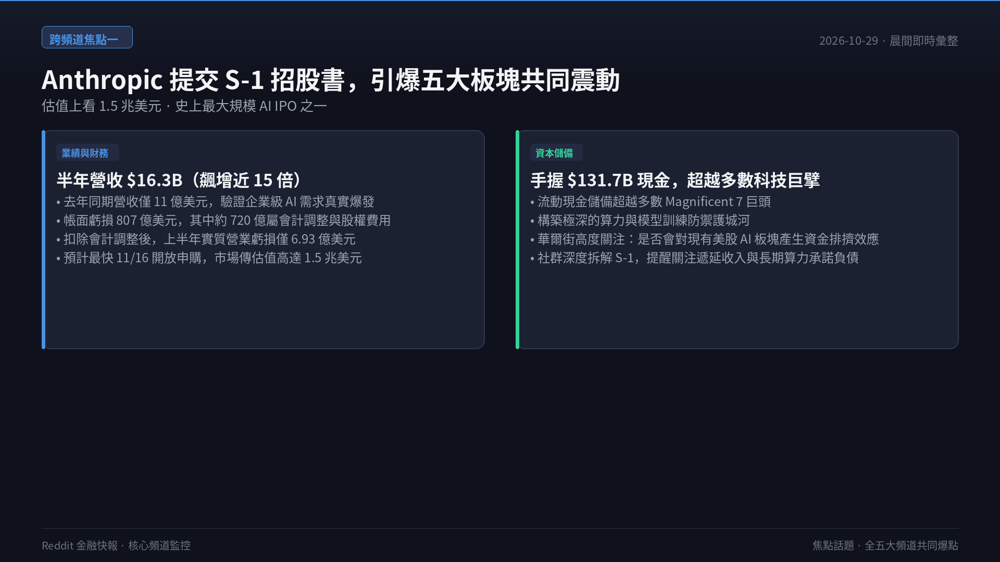
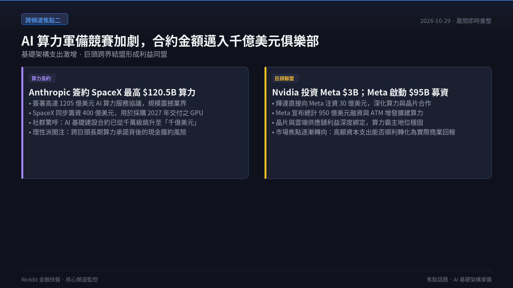
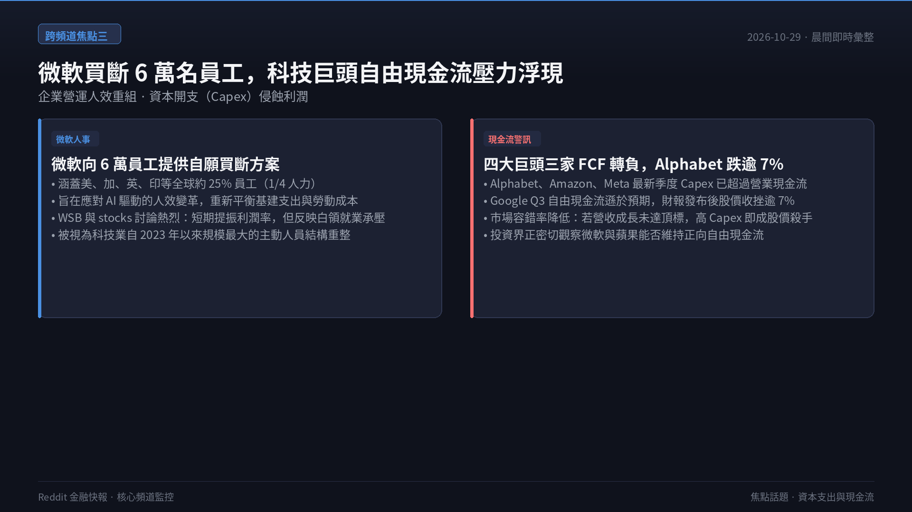
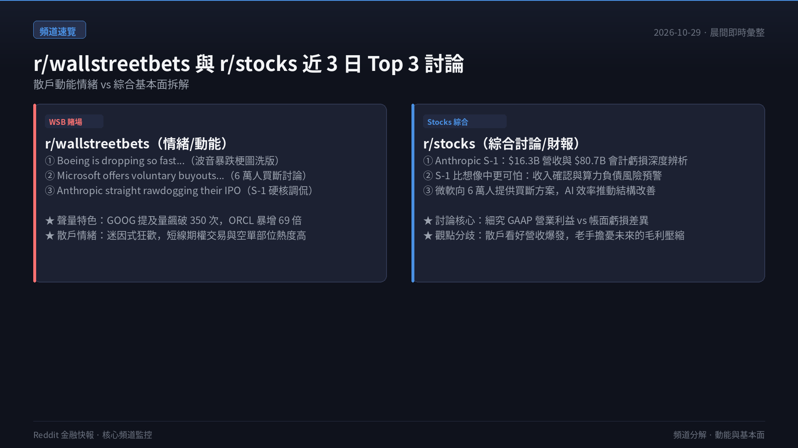
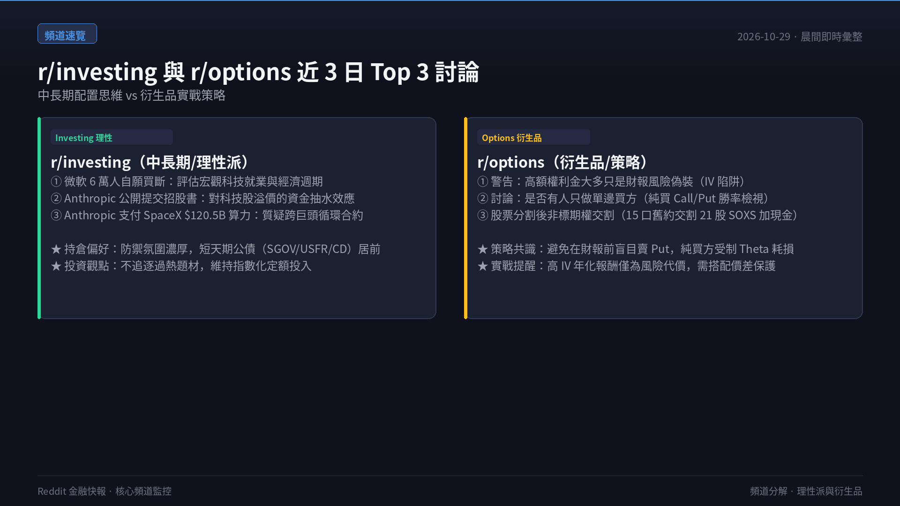
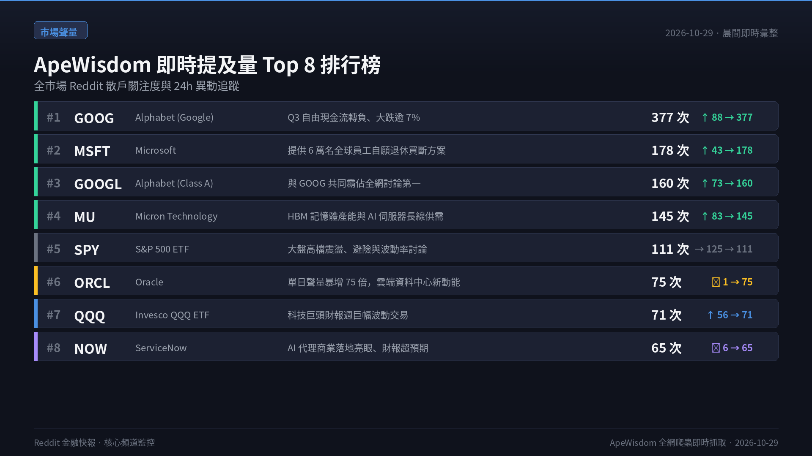
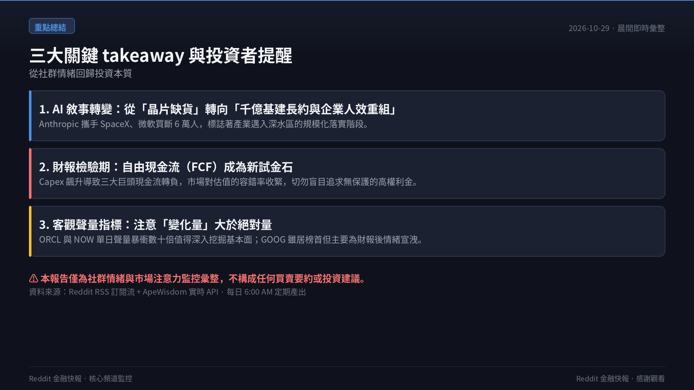

> **監控頻道**：r/wallstreetbets、r/stocks、r/investing、r/options、r/StockMarket  
> **觀測區間**：近 3 日（2026-10-26 至 2026-10-29）最熱門話題 Top 3  
> **資料來源**：Reddit 公開 RSS 數據流、ApeWisdom 全網即時熱度監控 API  
> **核心原則**：Reddit 反映的是市場「誰在關注什麼」（注意力、資金流向與情緒溫度），一手資料與財報為客觀驗證基準。

  <video controls width="100%" poster="s01.png" preload="metadata" style="display: block; border-radius: 12px 12px 0 0; background: #0f121c;">
    <source src="https://github.com/ckw19810413/ckw19810413.github.io/releases/download/media-reddit-finance-daily/reddit-finance-2026-10-29.mp4" type="video/mp4">
    您的瀏覽器不支援直接播放 MP4 影片。
  </video>
  

    🎬 <strong>60 秒晨間快報影音動態版</strong>（含 AI 摘要朗讀語音與專屬背景音樂）
  

---

## 🎯 跨頻道三大核心主題（宏觀速覽）

1. **Anthropic 提交 S-1 招股書，成為全五大頻道共同震撼爆點**
   - **營收爆發**：2026 上半年營收達 **$16.3B**（較去年同期 $1.1B 成長近 15 倍），手中現金儲備高達 **$131.7B**，超越多數科技巨頭（Magnificent 7）。
   - **虧損真相**：帳面虧損高達 **$80.7B**，但社群深度拆解顯示其中約 **$72B 為非現金會計調整與股權費用**；排除後上半年實質營業虧損僅 **$693M**。傳聞估值上看 **$1.5 兆**，最快將於 11/16 開放認購，或成歷史級 IPO。
2. **AI 算力軍備競賽進入「千億美元俱樂部」**
   - **巨額合約**：Anthropic 宣布向 SpaceX 簽署高達 **$120.5B** 的 AI 算力服務協議；SpaceX 同步籌措 **$40B** 採購 2027 年交付之尖端 GPU。
   - **巨頭結盟**：Nvidia 宣布向 Meta 注資 **$3B** 深化算力合作；Meta 宣布高達 **$95B** 的融資與 ATM 增發計畫。市場注意力高度聚焦於 AI 資本開支（Capex）的持續擴張。
3. **微軟買斷 6 萬名員工加速 AI 轉型，科技巨頭現金流（FCF）壓力浮現**
   - **微軟瘦身**：微軟宣布向全球約 25% 員工（60,000 人）開放自願買斷退休方案，涵蓋美、加、英、印等地區，以 AI 驅動營運人效。
   - **現金流分化**：四大 AI 巨頭中有三家（Alphabet、Amazon、Meta）自由現金流（FCF）轉負；Alphabet 最新 Q3 自由現金流遜於預期，股價收跌逾 7%，引發市場對高 Capex 投資回報率的審慎討論。

---

## 📊 五大核心頻道：近 3 日熱門話題 Top 3 與要點剖析

### 1. r/wallstreetbets（規模：1,800 萬+ · 類型：情緒／動能 · 雜訊：🔴 極高）

| 排名 | 貼文標題 | 發布日期 | 討論熱度與核心要點 |
|:---:|:---|:---:|:---|
| **#1** | **[Boeing is dropping so fast it transcended this post lmao](https://www.reddit.com/r/wallstreetbets/comments/1xgyccm/)** | 2026-10-27 | **BA 暴跌迷因狂歡**：波音股價盤中連續重挫，社群以動態梗圖瘋狂洗版，散戶情緒從恐慌轉為迷因嘲諷，空方部位與看跌期權討論激增。 |
| **#2** | **[Microsoft offers voluntary buyouts to 60,000 employees](https://www.reddit.com/r/wallstreetbets/comments/1xg11cu/)** | 2026-10-26 | **科技白領被 AI 取代焦慮**：微軟買斷 6 萬員工消息發布後，WSB 討論焦點轉向人力成本縮減對短期 EPS 的拉抬，以及基層工程師面臨的 AI 裁員海嘯。 |
| **#3** | **[Anthropic straight rawdogging their IPO](https://www.reddit.com/r/wallstreetbets/comments/1xgpx1n/)** | 2026-10-27 | **S-1 招股書硬核吐槽**：直接擷取 S-1 第 63 頁，社群戲稱「連 WSB 最頂級的賭客半年也虧不出 720 億美元」，但對其 15 倍營收成長率展現極高投機興致。 |

- **頻道標的提及榜（ApeWisdom 即時）**：`GOOG` (352次，24h 由 80 急升)、`GOOGL` (144次)、`MSFT` (143次)、`MU` (136次)、`SPY` (104次)、`ORCL` (69次，24h 由 1 暴增)、`QQQ` (67次)、`HOOD` (65次)。

---

### 2. r/stocks（規模：約 900 萬 · 類型：綜合討論 · 雜訊：🟡 中）

| 排名 | 貼文標題 | 發布日期 | 討論熱度與核心要點 |
|:---:|:---|:---:|:---|
| **#1** | **[Anthropic just filed to go public. $16.3B in revenue in six months… and an $80.7B reported loss](https://www.reddit.com/r/stocks/comments/1xfwuks/)** | 2026-10-26 | **營收爆衝與會計虧損辯論**：全面檢視 Anthropic 財報數字。社群指出半年 163 億營收驗證了 AI 需求真實存在，而 807 億帳面虧損多為非現金公允價值重估，市場估值上看 1.5 兆美元。 |
| **#2** | **[I love Anthropic's products, BUT I think their S1 is a far more scarier than people let on](https://www.reddit.com/r/stocks/comments/1xg9f2s/)** | 2026-10-26 | **深度 S-1 會計風險預警**：資深會計背景用戶拆解其收入確認遞延機制與對外算力合約之長期債務承諾，警示散戶若只看前 25 頁亮麗宣傳，恐忽略未來的毛利率擠壓風險。 |
| **#3** | **[Microsoft offers voluntary buyouts to 60,000 employees as AI leads to efficiency push](https://www.reddit.com/r/stocks/comments/1xg2gtp/)** | 2026-10-26 | **微軟資本配置策略評析**：分析微軟如何透過重組人力成本來吸收每年數百億美元的 GPU 與資料中心折舊，理性派普遍看好此舉有利於維持微軟的自由現金流淨額。 |

- **補充關注**：Alphabet Q3 財報自由現金流不如預期（受 Capex 激增影響），引發多位分析師發文質疑 AI 交易定價過高。

---

### 3. r/investing（規模：約 300 萬 · 類型：中長期配置 · 雜訊：🟢 低）

| 排名 | 貼文標題 | 發布日期 | 討論熱度與核心要點 |
|:---:|:---|:---:|:---|
| **#1** | **[Microsoft offers voluntary buyouts to 60,000 employees](https://www.reddit.com/r/investing/comments/1xg1o4j/)** | 2026-10-26 | **宏觀就業市場與景氣週期信號**：探討 25% 全球員工買斷方案是否意味著企業軟體週期見頂，以及高科技白領轉職難度上升對消費支出的潛在衝擊。 |
| **#2** | **[BREAKING: Anthropic publicly files IPO prospectus](https://www.reddit.com/r/investing/comments/1xfwwbo/)** | 2026-10-26 | **巨型獨角獸對市場資金抽水效應**：評估若 Anthropic 以兆美元估值掛牌，是否會排擠現有 Magnificent 7 與半導體板塊的資金配置，引發被動指數與大型基金的換倉潮。 |
| **#3** | **[Anthropic will pay up to $120.5B for SpaceX's AI Compute](https://www.reddit.com/r/investing/comments/1xg3ih3/)** | 2026-10-26 | **跨巨頭算力合約的系統性風險**：質疑動輒千億美元的私營企業算力承諾是否充斥循環融資（Circular Financing），一旦終端企業付費意願放緩，基礎設施供應鏈將承受巨大回撤。 |

- **頻道配置傾向**：討論中防禦氛圍濃厚，短天期公債 ETF（`SGOV`、`USFR`）與定存單（`CD`）提及率居前，大盤指數 ETF（`VOO`、`VTI`）維持定期定額紀律。

---

### 4. r/options（規模：約 100 萬+ · 類型：衍生品策略 · 雜訊：🟡 中）

| 排名 | 貼文標題 | 發布日期 | 討論熱度與核心要點 |
|:---:|:---|:---:|:---|
| **#1** | **[Hot take: Most “juicy premium” this week is just earnings risk in disguise](https://www.reddit.com/r/options/comments/1xgw0v4/)** | 2026-10-27 | **隱含波動率（IV）陷阱警告**：統計本週賣方報酬最高的 10 檔標的中，有 9 檔即將在合約到期前公布財報；含財報合約報酬（~2.1%）高於無財報合約（~1.6%），超額權利金實為承擔跳空暴跌的風險補償，盲目賣 Put 極易遭遇毀滅性損失。 |
| **#2** | **[Does anyone just buy straight puts and calls?](https://www.reddit.com/r/options/comments/1xg0e7w/)** | 2026-10-26 | **單邊買方勝率反思**：討論是否有人僅靠純買 Call/Put 穩定盈利。社群多數共識指出，長期純買方受制於 Theta 時間價值耗損與 IV 壓制，期望值通常為負，唯有結合垂直價差（Spreads）或明確催化劑方能提升勝率。 |
| **#3** | **[Are these options worth 14k or worth nothing](https://www.reddit.com/r/options/comments/1xguuqz/)** | 2026-10-27 | **股票分割後特殊合約交割解析**：散戶持有 15 口分割前老合約（交割為 21 股 SOXS 加上現金，總值約 $14,175），探討行權成本與深度價內處置策略，普及 OCC（期權結算公司）非標合約的調整規則。 |

---

### 5. r/StockMarket（規模：約 300 萬+ · 類型：新聞與圖表 · 雜訊：🟡 中）

| 排名 | 貼文標題 | 發布日期 | 討論熱度與核心要點 |
|:---:|:---|:---:|:---|
| **#1** | **[Anthropic's Latest Earnings Statement](https://www.reddit.com/r/StockMarket/comments/1xg00ux/)** | 2026-10-26 | **營運槓桿與獲利拐點分析**：聚焦扣除股權會計費用後的 6.93 億美元營運虧損，多數觀點認為相較於其 163 億美元營收，營運槓桿已顯著優化，現金消耗速度遠低於市場原先悲觀預期。 |
| **#2** | **[S1 filling: Anthropic have more cash than majority of MAG7](https://www.reddit.com/r/StockMarket/comments/1xgtgng/)** | 2026-10-27 | **現金儲備巨獸現身**：S-1 揭露其手握高達 $131.7B 現金及等價物，在標普 500 成分股中僅次於極少數頂級巨頭，為其未來數年的算力軍備採購構築了極深的護城河。 |
| **#3** | **[Jim Cramer warns investors not to get fooled by the latest AI stock rally](https://www.reddit.com/r/StockMarket/comments/1xh7s7n/)** | 2026-10-27 | **反指標熱議與估值預警**：知名財經名嘴 Jim Cramer 示警投資人不宜被近期 AI 股反彈所迷惑，點出巨頭 Capex 激增與 FCF 轉負之矛盾。社群熱議「逆向 Cramer」效應與市場是否正步入中段調整。 |

---

## 📈 全市場熱度排行（ApeWisdom 即時數據，All-Stocks）

根據 ApeWisdom 全網爬蟲對 Reddit 財經版塊的即時提及量統計：

| 排名 | 標的代碼 | 公司名稱 | 即時提及數 | 24 小時提及趨勢 | 討論核心驅動因素 |
|:---:|:---|:---|:---:|:---:|:---|
| **1** | **GOOG** | Alphabet Inc. | **377** | ↑ 由 88 暴增 | Q3 財報自由現金流不如預期、AI Capex 攀升、股價重挫逾 7% |
| **2** | **MSFT** | Microsoft Corp. | **178** | ↑ 由 43 急升 | 宣布向 6 萬名全球員工提供自願退休買斷方案 |
| **3** | **GOOGL** | Alphabet Inc. (Class A) | **160** | ↑ 由 73 急升 | 與 GOOG 共同主導財經版面熱度 |
| **4** | **MU** | Micron Technology | **145** | ↑ 由 83 穩健上升 | 高頻寬記憶體（HBM）產能緊俏與 AI 伺服器長線供需展望 |
| **5** | **SPY** | SPDR S&P 500 ETF | **111** | → 由 125 略降 | 大盤高檔震盪，指數波動率與避險討論持續 |
| **6** | **ORCL** | Oracle Corporation | **75** | 🚀 由 1 暴增至 75 | 傳出雲端資料中心與大型 AI 算力基礎架構擴展新進展 |
| **7** | **QQQ** | Invesco QQQ Trust | **71** | ↑ 由 56 增長 | 科技權值股財報週巨幅波動交易 |
| **8** | **NOW** | ServiceNow | **65** | 🚀 由 6 暴增至 65 | 企業 AI 代理（AI Agents）商用落地財報亮眼表現 |
| **9** | **HOOD** | Robinhood Markets | **65** | ↓ 由 127 正常回落 | 散戶交易量回穩，前日狂熱暫歇 |
| **10** | **NVDA** | NVIDIA Corporation | **54** | ↑ 由 39 小幅增長 | 宣布向 Meta 投資 30 億美元，算力王者地位穩固 |

---

## 💡 總結與投資者觀察

1. **AI 商業化主旋律切換**：市場焦點已從單純的「算力晶片短缺」演變為「大型基礎架構巨型採購合約（SpaceX / Meta / Anthropic）」與「企業人效重整（微軟 6 萬人買斷）」。
2. **財報檢驗期的現金流考驗**：隨著各大巨頭自由現金流（FCF）因龐大 Capex 而轉負，純題材炒作的估值容錯率已大幅降低；高 IV 賣權策略更需嚴格避開財報黑天鵝。
3. **資料誠實聲明**：本快報數據採集自 Reddit 公開 RSS 訂閱流與 ApeWisdom 即時 API；本報告僅作為社群情緒與市場注意力監控彙整，**不構成任何買賣要約或投資建議**。
