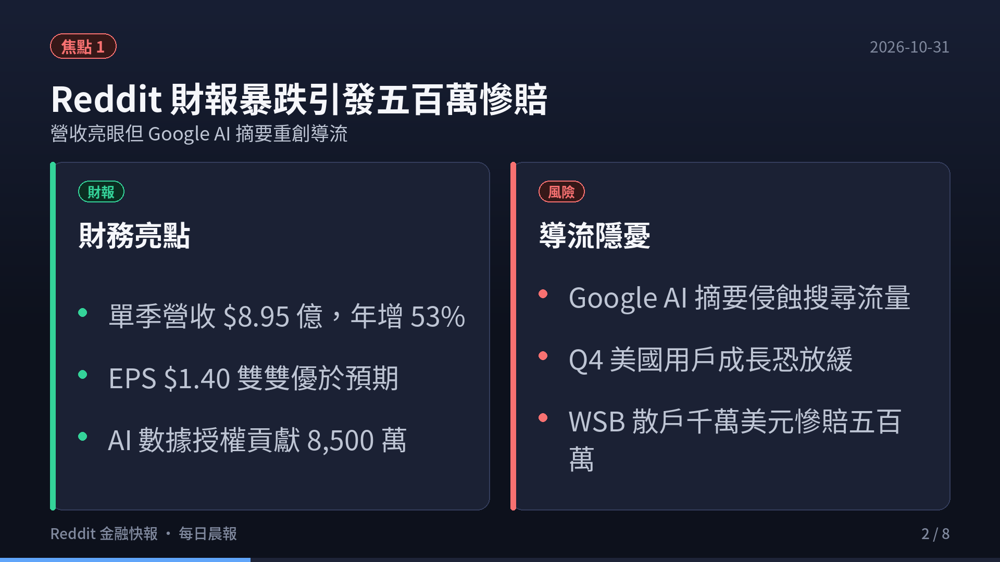
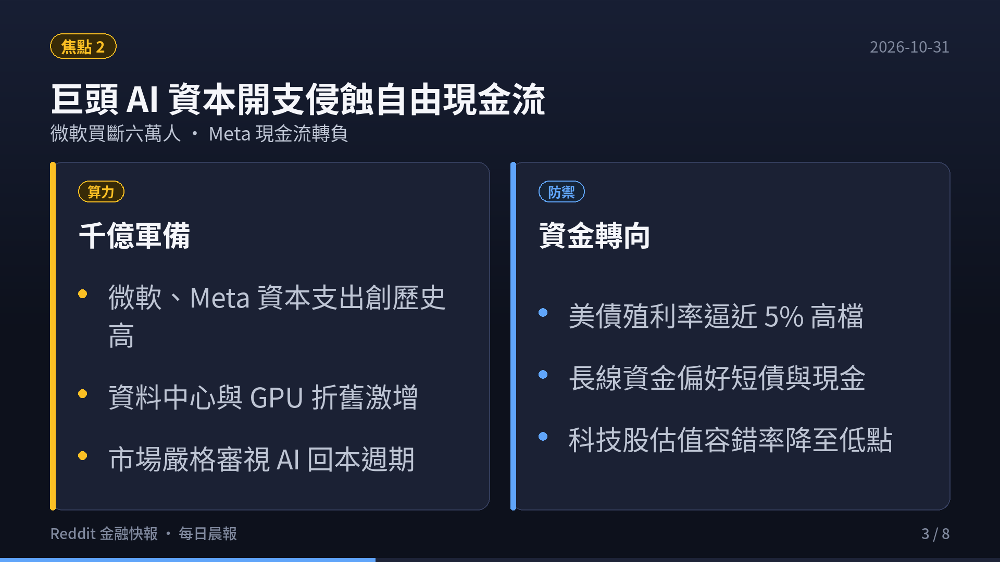
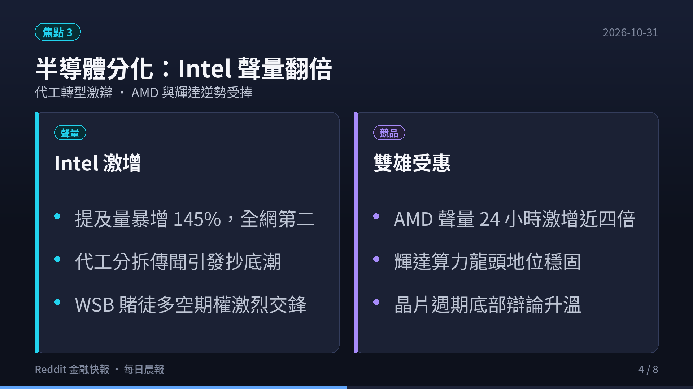
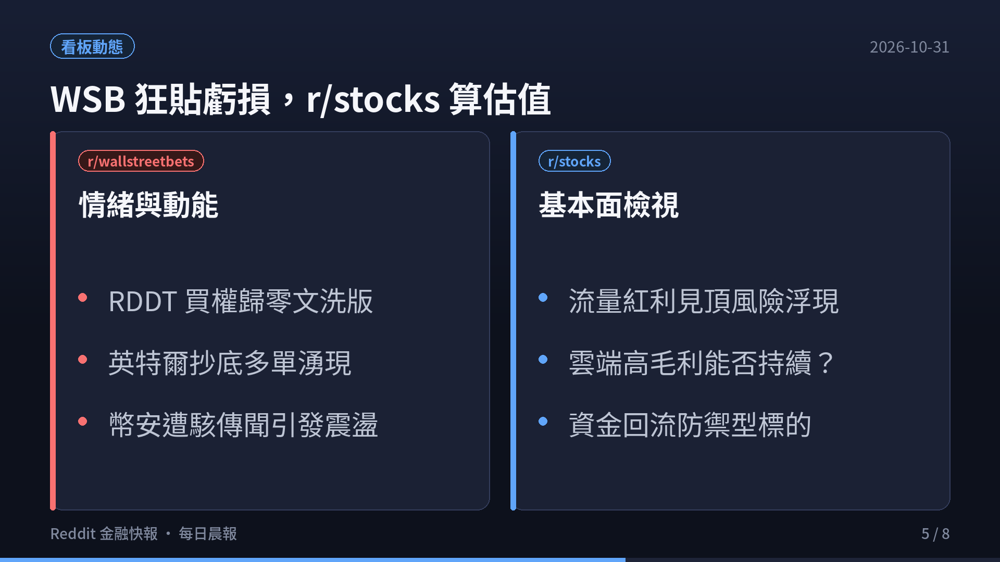
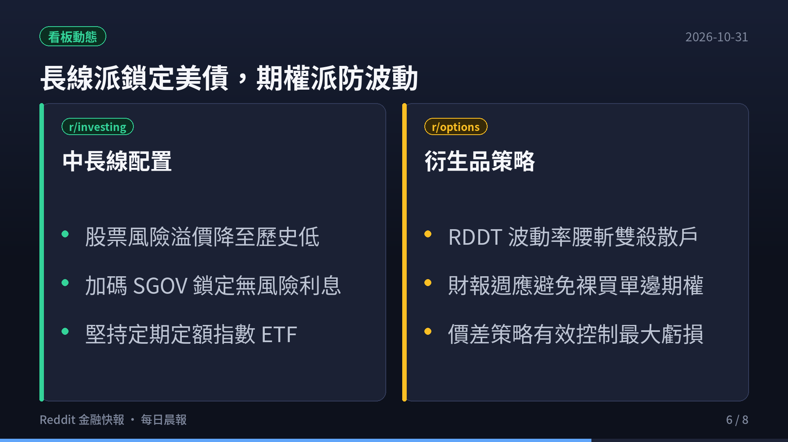
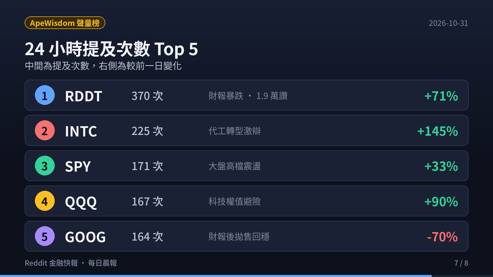
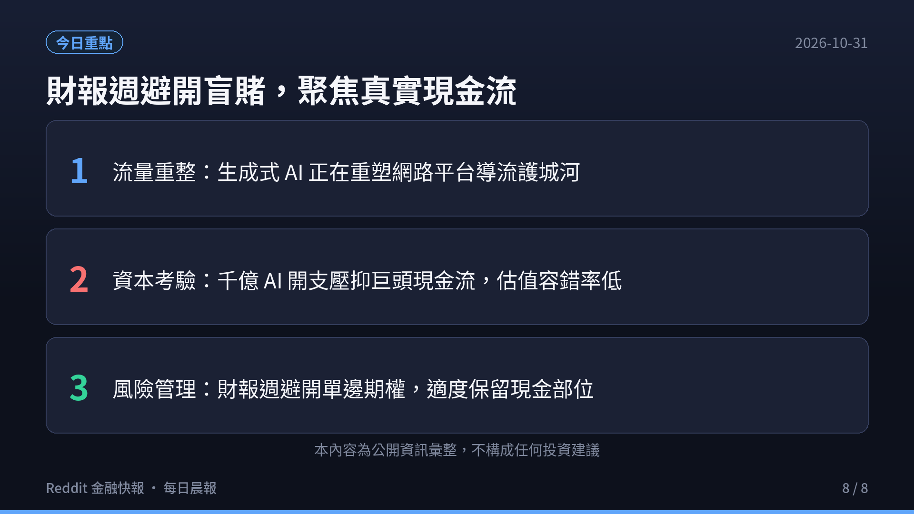

> **監控頻道**：r/wallstreetbets、r/stocks、r/investing、r/options、r/StockMarket  
> **觀測區間**：近 3 日（2026-10-28 至 2026-10-31）最熱門話題 Top 3  
> **資料來源**：Reddit 公開數據流、ApeWisdom 全網即時熱度監控 API  
> **核心原則**：Reddit 反映的是市場「誰在關注什麼」（注意力、資金流向與情緒溫度），一手財報與客觀現金流為客觀驗證基準。

  <video controls width="100%" poster="s01.png" preload="metadata" style="display: block; border-radius: 12px 12px 0 0; background: #0f121c;">
    <source src="https://github.com/ckw19810413/ckw19810413.github.io/releases/download/media-reddit-finance-daily/reddit-finance-2026-10-31.mp4" type="video/mp4">
    您的瀏覽器不支援直接播放 MP4 影片。
  </video>
  

    🎬 <strong>60 秒晨間快報影音動態版</strong>（含 AI 摘要朗讀語音與專屬背景音樂）
  

---

## 🎯 跨頻道三大核心主題（宏觀速覽）

1. **Reddit ($RDDT) Q3 財報大震盪：營收增 53% 卻遭暴跌，WSB 湧現災難級 Loss Porn**
   - **財務表現 vs 導流隱憂**：Reddit 於 10/29 盤後公布 Q3 財報，單季營收達 **$8.95 億美元**（年增 53%），EPS 為 **$1.40** 均大幅擊敗華爾街預期，AI 數據授權變現高達 **$8,500 萬美元**。然而，CEO Steve Huffman 與管理層警示：**Google 的「AI Overviews」與「AI Mode」正在大幅侵蝕未登入用戶的搜尋推薦導流（top-of-funnel search referrals）**，預計 Q4 美國活躍用戶成長恐面臨雙位數放緩壓力。
   - **社群情緒崩盤**：財報公布後股價重挫近 20%~30%，觸發大規模獲利了結與空方踩踏。WSB 版面出現知名賭客 **$10,000,000 YOLO 慘虧 $5,000,000** 的震撼貼文，散戶大量買權歸零，哀鴻遍野。ApeWisdom 全網提及量暴增至 **370 次**，高居美股全網聲量第一名。

2. **科技巨頭千億 AI 資本開支（CapEx）侵蝕自由現金流，市場容錯率降至冰點**
   - **現金流分化**：繼 Alphabet 因廣告成長放緩及 Capex 激增引發盤後大跌後，微軟、Meta、亞馬遜陸續公布財報，巨頭資本支出全面創歷史新高。Meta 季度自由現金流（FCF）轉為負值，微軟更是宣布向全球 6 萬名員工開放自願退休買斷方案以精簡人事費用，吸收龐大的資料中心折舊。
   - **長線資金防禦**：10 年期美債殖利率維持在接近 5% 的高檔水準，美股股票風險溢價（ERP）降至數十年來低點。理性派投資人持續質疑 AI 基礎設施的投資回報率（ROI），防禦型資金大幅流入超短天期國庫券 ETF（`SGOV`、`BIL`）與現金部位。

3. **半導體板塊劇烈分化：英特爾（INTC）聲量翻倍，AMD 與輝達（NVDA）逆勢受捧**
   - **英特爾多空對決**：英特爾聲量在 ApeWisdom 飆升至全網第二名（225 次，24 小時內激增 144.6%），社群針對其晶圓代工部門虧損修復、潛在分拆傳聞以及能否在政府補助與新架構下觸底反彈展開熱烈多空攻防。
   - **算力霸權持續**：AMD 24 小時提及量激增 371%（132 次），輝達亦大增 263%（109 次）。市場普遍認為，即便終端軟體公司現金流承壓，上游先進算力晶片供應鏈依然具備最強大的定價權與護城河。

---

## 📊 五大核心頻道：近 3 日熱門話題 Top 3 與要點剖析

### 1. r/wallstreetbets（規模：1,800 萬+ · 類型：情緒／動能 · 雜訊：🔴 極高）

| 排名 | 貼文話題 / 標題 | 發布日期 | 核心討論與要點剖析 |
|:---:|:---|:---:|:---|
| **#1** | **[$10,000,000 RDDT YOLO Post-Mortem: I Was Wrong :(](https://www.reddit.com/r/wallstreetbets/comments/1xjklng/10000000_rddt_yolo_postmortem_i_was_wrong/)** | 2026-10-30 | **千萬美元 YOLO 單日腰斬**：WSB 賭客在財報前投入千萬美元全倉做多 RDDT，財報後股價劇烈下挫，帳面單日直接蒸發逾 500 萬美元。貼文引發數千名賭徒圍觀朝聖，滿版「Loss Porn」與對管理層指引保守的憤怒宣洩。 |
| **#2** | **[Crypto exchange Binance hacked of over $6 billion](https://www.reddit.com/r/wallstreetbets/comments/1xj7w95/crypto_exchange_binance_hacked_of_over_6_billion/)** | 2026-10-30 | **巨額遭駭傳聞引發連鎖恐慌**：未經證實的幣安遭駭 60 億美元傳聞在板塊內瘋傳，引發加密貨幣概念股（COIN、MSTR）及比特幣短期劇烈波動，空方期權押注瞬間湧入，隨後官方澄清暫緩部分恐慌，但流動性警示再度拉響。 |
| **#3** | **[Thank you Intel 🥳 - Options Volatility Plays](https://www.reddit.com/r/wallstreetbets/comments/1xjfwki/thank_you_intel/)** | 2026-10-30 | **英特爾波動率交易狂歡**：英特爾在財報與技術升級消息推動下盤中劇烈震盪，部分幸運賭徒依靠短期末日期權獲利數萬美元，促使社群狂刷「感謝 Intel」，但也引發大量反向做空與跨月價差博弈。 |

- **頻道標的提及榜（ApeWisdom 即時）**：
  - `RDDT`（314 次，24h +48.1%，獲 18,768 讚）
  - `INTC`（202 次，24h +127.0%，獲 4,731 讚）
  - `SPY`（156 次，24h +32.2%）
  - `QQQ`（150 次，24h +100.0%）
  - `AMD`（108 次，24h +414.3%）

---

### 2. r/stocks（規模：約 900 萬 · 類型：綜合討論 · 雜訊：🟡 中）

| 排名 | 貼文話題 / 標題 | 發布日期 | 核心討論與要點剖析 |
|:---:|:---|:---:|:---|
| **#1** | **[Reddit ($RDDT) Q3 Earnings Breakdown: $895M Revenue (+53% YoY) but AI Search Referrals Drop](https://www.reddit.com/r/stocks/comments/1xj3jao/rddt_leadership_is_one_of_us/)** | 2026-10-30 | **社群巨頭的 AI 兩面刃**：深度拆解 Reddit 財報。一方面 AI 數據授權每年帶來近億美元無本暴利，但另一方面 Google AI 摘要直接在搜尋結果頁回答問題，導致 Reddit 傳統未登入訪客流失，估值重估引發股價重修。 |
| **#2** | **[Tech Earnings Season Reality Check: AI Capex Ballooning Across Hyperscalers](https://www.reddit.com/r/stocks/comments/1xhh3xa/rstocks_daily_discussion_wednesday_oct_28_2026/)** | 2026-10-29 | **資本開支對比投資回報率**：檢視微軟、Alphabet、亞馬遜及 Meta 的資本支出總額。社群分析師指出，目前企業端軟體應用普及率尚未跟上雲端運算基礎建設的折舊速度，大型科技股短期本益比擴張受限。 |
| **#3** | **[Semiconductor Rebound or Value Trap? The Battle Between INTC, AMD, and NVDA](https://www.reddit.com/r/stocks/comments/1xgnw3d/rstocks_daily_discussion_technicals_tuesday_oct/)** | 2026-10-29 | **晶片板塊輪動與護城河評估**：探討英特爾在經歷數季重整後是否已具備左側建倉價值，以及 AMD 在資料中心與 MI300 系列晶片對輝達生態系的實際滲透進展，防禦性資金逐步向現金流充沛的龍頭集中。 |

- **頻道標的提及榜（ApeWisdom 即時）**：
  - `RDDT`（53 次，24h +1666.7%）
  - `GOOG`（44 次，24h +18.9%，獲 3,593 讚）
  - `TSLA`（27 次，24h +2600.0%）
  - `META`（17 次，24h +183.3%）
  - `AMZN`（15 次，24h -21.1%）

---

### 3. r/investing（規模：約 300 萬 · 類型：中長期配置 · 雜訊：🟢 低）

| 排名 | 貼文話題 / 標題 | 發布日期 | 核心討論與要點剖析 |
|:---:|:---|:---:|:---|
| **#1** | **[Big Tech AI CapEx vs True Free Cash Flow (FCF) Divergence](https://www.reddit.com/r/investing/comments/1xg1o4j/microsoft_offers_voluntary_buyouts_to_60000/)** | 2026-10-29 | **自由現金流縮減與會計真實面**：理性派投資人對比各大巨頭帳面利潤與扣除 Capex 後的自由現金流（FCF）。指出若排除非現金股權激勵（SBC）與巨額資料中心資本支出，部分巨頭實質現金收益率已低於 3%，遠遜於無風險美債。 |
| **#2** | **[Treasury Yields near 5% & Equity Risk Premium at Multi-Decade Lows](https://www.reddit.com/r/investing/comments/1xhh3xa/rstocks_daily_discussion_wednesday_oct_28_2026/)** | 2026-10-29 | **資產配置天平向固收傾斜**：在通膨韌性與公債殖利率接近 5% 的宏觀環境下，討論是否有必要承擔美股高估值風險。Bogleheads 社群建議堅守「大盤核心指數 ETF（VOO/VTI）+ 超短天期公債（SGOV）槓鈴策略」。 |
| **#3** | **[Generative AI Search Disruption: The Long-Term Threat to Open Web Platforms](https://www.reddit.com/r/investing/comments/1xg3ih3/anthropic_will_pay_up_to_1205b_for_spacexs_ai/)** | 2026-10-29 | **搜尋生態結構性變革的商業影響**：分析 Google、Perplexity 與 OpenAI 搜尋產品如何改變使用者習慣。仰賴 SEO 與公開爬蟲獲取用戶的內容平台（如 Reddit、維基百科、出版商）正面臨商業模式的根本性顛覆。 |

- **頻道標的提及榜（ApeWisdom 即時）**：
  - `VOO`（28 次，24h +833.3%）
  - `GOOG`（14 次，24h +1300.0%）
  - `GOOGL`（13 次，新進榜）
  - `AMD`（9 次，24h +800.0%）
  - `NOW`（8 次，24h +60.0%）

---

### 4. r/options（規模：約 100 萬+ · 類型：衍生品策略 · 雜訊：🟡 中）

| 排名 | 貼文話題 / 標題 | 發布日期 | 核心討論與要點剖析 |
|:---:|:---|:---:|:---|
| **#1** | **[RDDT Post-Earnings Implied Volatility (IV) Crush: The Anatomy of a Dual-Sided Trap](https://www.reddit.com/r/options/comments/1xgw0v4/)** | 2026-10-30 | **隱含波動率崩塌（IV Crush）血淚實錄**：RDDT 財報公布前近月平價期權隱含波動率（IV）飆破 130%，財報後瞬間暴跌至 45% 以下。無論是押注大漲的買 Call 散戶，或是行使價防守過淺的賣 Put 交易者，均遭遇雙殺毀滅。 |
| **#2** | **[Theta Gang Survival Guide in Earnings Season: Credit Spreads vs Naked Puts](https://www.reddit.com/r/options/comments/1xg0e7w/)** | 2026-10-29 | **定義風險策略勝率優勢**：社群資深賣方總結教訓，強調在科技股動輒 15%~20% 跳空的財報季，絕對禁止裸賣 Put（Naked Put），必須透過垂直價差（Vertical Credit Spreads）或鐵禿鷹（Iron Condor）鎖定最大潛在虧損。 |
| **#3** | **[Hedging Mega-Cap Volatility with QQQ & SPY Puts: Gamma Risk Management](https://www.reddit.com/r/options/comments/1xguuqz/)** | 2026-10-29 | **大盤指數期權避險對沖操作**：解析在權值股財報密集公布期，如何利用負 Gamma 避險與日曆價差降低整體投資組合的 Delta 曝險，避免單一巨頭暴跌引發的淨值重創。 |

- **頻道標的提及榜（ApeWisdom 即時）**：
  - `TQQQ`、`ASTS`、`YOU`、`HOOD`、`GME`

---

### 5. r/StockMarket（規模：約 300 萬+ · 類型：新聞與圖表 · 雜訊：🟡 中）

| 排名 | 貼文話題 / 標題 | 發布日期 | 核心討論與要點剖析 |
|:---:|:---|:---:|:---|
| **#1** | **[Earnings Week Heatmap: Tech Giants Bleed as AI Payoff Timeline Lengthens](https://www.reddit.com/r/StockMarket/comments/1xftqfz/daily_general_discussion_and_advice_thread/)** | 2026-10-30 | **市場熱圖全面轉紅**：標普 500 與納斯達克 100 熱圖直擊，科技與通訊板塊連日下挫，多數成分股跌破短期月均線，社群普遍預期短期大盤將進入均線回測與整理區間。 |
| **#2** | **[Reddit ($RDDT) Crash & Technical Bounce: Evaluating Long-Term Data Moat](https://www.reddit.com/r/StockMarket/comments/1xiux5n/rddt_q3_earnings_record_revenue/)** | 2026-10-30 | **暴跌後的技術面支撐與估值修復**：技術分析圖表指出 RDDT 暴跌已回測前波突破頸線，雖然短期流量承壓，但其身為全球最強人類真實對話數據庫的地位不可取代，逢低吸納買盤開始出現。 |
| **#3** | **[Semiconductor Sector Divergence: Intel vs AMD vs NVDA Technical Breakdown](https://www.reddit.com/r/StockMarket/comments/1xezi13/daily_general_discussion_and_advice_thread/)** | 2026-10-29 | **費城半導體指數關鍵均線攻防**：費半指數在 50 日均線附近劇烈震盪，Intel 在技術面呈現島狀反轉博弈，而 NVDA 與 AMD 則維持長期上升通道下軌支撐。 |

- **頻道標的提及榜（ApeWisdom 即時）**：
  - `AMZN`（10 次，24h +900.0%）
  - `FCF`（8 次，24h +700.0%）
  - `NVDA`（7 次，24h +600.0%）
  - `GOOG`（6 次，24h -60.0%）
  - `AMD`（5 次，24h +400.0%）

---

## 📈 全市場熱度排行（ApeWisdom 即時數據，All-Stocks Top 10）

根據 ApeWisdom 全網爬蟲對 Reddit 財經板塊之即時提及量統計（2026-10-31 06:00 最新）：

| 排名 | 標的代號 | 公司名稱 | 即時提及數 | 24 小時提及趨勢 | 當前獲讚數 | 討論核心驅動因素 |
|:---:|:---|:---|:---:|:---:|:---:|:---|
| **1** | **RDDT** | Reddit Inc. | **370** | ↑ 由 216 激增 **+71.3%** | 19,359 | Q3 財報營收年增 53%、Google AI 摘要侵蝕導流、WSB 千萬 YOLO 慘賠引爆全網 |
| **2** | **INTC** | Intel Corp. | **225** | 🚀 由 92 暴增 **+144.6%** | 5,154 | 晶圓代工分拆傳聞、Q3 虧損改善預期、多空期權博弈激烈 |
| **3** | **SPY** | SPDR S&P 500 ETF | **171** | ↑ 由 129 增長 **+32.6%** | 441 | 大盤高檔回測、美債殖利率逼近 5% 壓抑估值、指數防禦策略 |
| **4** | **QQQ** | Invesco QQQ ETF | **167** | ↑ 由 88 激增 **+89.8%** | 321 | 科技權值股財報巨震、避險看跌期權量能攀升 |
| **5** | **GOOG** | Alphabet Inc. | **164** | ↓ 由 540 回落 **-69.6%** | 4,500 | Q3 財報拋售潮趨於冷卻、社群聚焦千億 Capex 對 FCF 的實質侵蝕 |
| **6** | **AMD** | Advanced Micro Devices | **132** | 🚀 由 28 暴增 **+371.4%** | 962 | 資料中心市占拓展、與 Intel 競爭格局熱議 |
| **7** | **NVDA** | NVIDIA Corporation | **109** | 🚀 由 30 暴增 **+263.3%** | 1,165 | 算力護城河依舊無可匹敵、巨頭資本開支之最直接受惠者 |
| **8** | **GOOGL** | Alphabet Inc. (Class A) | **103** | ↓ 由 294 回落 **-65.0%** | 2,305 | 與 GOOG 雙雙維持高討論度，機構與散戶逢低檢視估值 |
| **9** | **AMZN** | Amazon.com Inc. | **96** | ↓ 由 158 略降 **-39.2%** | 2,004 | AWS 雲端資本支出與零售業務利潤率檢驗 |
| **10** | **TSLA** | Tesla Inc. | **81** | ↑ 由 36 翻倍 **+125.0%** | 980 | Robotaxi 長線商業化進度與基本面毛利率辯論 |

---

## 💡 總結與投資者觀察

1. **流量紅利重構的現實衝擊**：過去依賴搜尋引擎免費導流的平台生態，正在遭遇生成式 AI 摘要（如 Google AI Overviews）的實質打擊。即便 Reddit 握有高價值授權協議，終端日活用戶的成長預期一旦鬆動，高估值倍數就會面臨無情修正。
2. **財報週切勿盲賭單邊期權**：RDDT 的慘劇再次印證「隱含波動率崩塌（IV Crush）」的殺傷力。在財報公布前 IV 處於極端高位時，純買 Call 或純買 Put 的期望值均極低；適度使用垂直價差或鎖定已知最大風險才是存活之道。
3. **無風險利率誘惑下的資產配置**：在 10 年期美債逼近 5% 的當下，股票市場不再具備「沒有其他選擇（TINA）」的光環。保留充足現金、利用短債鎖定無風險收益，並以長期定期定額方式參與指數，是目前穿越科技股財報震盪的最穩健姿態。
4. **資料誠實聲明**：本報告數據採集自 Reddit 公開社群資訊流與 ApeWisdom 即時數據庫；本報告僅作為社群情緒與市場注意力監控彙整，**不構成任何買賣要約或個人投資建議**。

---

### ☕ 支持與精選推薦

如果你覺得這份每日晨報對你的投資與市場視野有幫助，歡迎透過以下方式支持我們持續產出高質量的市場深度內容：

- ☕ **請我喝杯咖啡**：[Ko-fi 小費贊助](https://ko-fi.com/ytstories0413)（支持每日自動化爬蟲與語音影音渲染運算）
- 📚 **數位產品與實戰工具**：
  - [Gumroad 數位商品專區](https://slashmaster6.gumroad.com/)：收錄精選 AI Prompt 庫、生產力工作流模板與自動化腳本
  - [飛書精選高人效商業模板](https://slashmaster6.gumroad.com/l/xohjh)
- 🛠️ **免費線上工具箱**：[SlashmanTools 免費 Web 工具集](https://slashmantools.us/)（Token 成本換算、顯存試算、AI 工具庫）
- 📖 **推薦經典閱讀**：[《晶片戰爭》（Chip War）繁中版 / 英文版精裝推薦](https://www.amazon.com/dp/059371671X?tag=ytstories0413-20)
