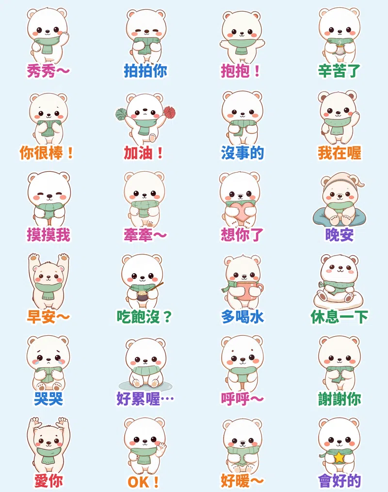

2026 下半年 LINE 上最紅的貼圖有三個共通點：**圓圓軟軟的小動物**、**可以天天用的短句**，還有一股「**成年人崩潰，需要被秀秀**」的療癒風。所以這次的主角是一隻圍著薄荷綠圍巾的小北極熊——**秀秀**。牠的工作只有一個：拍拍你、抱抱你、跟你說「辛苦了」。

> 🐻‍❄️ **北極熊秀秀・療癒拍拍**（動態貼圖 24 張）👉 [Massor 的 LINE 貼圖小舖](https://line.me/S/shop/sticker/author/6564520?utm_source=ghpages&utm_medium=bridge&utm_campaign=5s-hook&utm_content=author-6564520)（本套審核中，上架後同一頁就買得到）

## 每個表情都是「演」出來的

每張貼圖的動作都由本地端 **MiniMax H3**（首尾幀相同的影片生成）產生，不是單純的位移或縮放。「秀秀～」是伸出小掌一下一下拍空氣，像在摸你的頭；「抱抱！」是張開雙手撲上來；「辛苦了」是鞠躬遞上一杯熱飲；「牽牽～」是害羞地伸手扭來扭去；「好累喔…」是整隻攤平在地上；「呼呼～」是鼓起臉頰對著傷口吹氣。角色先用 FLUX＋LoRA 畫好 24 個姿勢，H3 生成 73 幀影片後，再抽成 20 幀、剛好 3 秒的 APNG，加上白邊和大字，深色模式也看得清楚。

## 🔊 點一下就有聲音

LINE Creators Market 目前沒有「有聲貼圖」類型，所以 App 裡的貼圖本身不會出聲。我幫每張貼圖另外配了溫柔的語音版本，點下面的卡片就能聽（手機上按「傳給朋友」可以直接分享）。

  <figure class="ms-c">
    <video src="https://github.com/ckw19810413/ckw19810413.github.io/releases/download/media-line-animated-sticker-polar-bear-healing-pats/shoushou-a01.mp4" poster="sound/a01.jpg" muted autoplay loop playsinline preload="metadata"></video>
    <figcaption>秀秀～不痛不痛喔～</figcaption>
    <button type="button" class="ms-share">傳給朋友</button>
  </figure>
  <figure class="ms-c">
    <video src="https://github.com/ckw19810413/ckw19810413.github.io/releases/download/media-line-animated-sticker-polar-bear-healing-pats/shoushou-a02.mp4" poster="sound/a02.jpg" muted autoplay loop playsinline preload="metadata"></video>
    <figcaption>拍拍你～沒事沒事～</figcaption>
    <button type="button" class="ms-share">傳給朋友</button>
  </figure>
  <figure class="ms-c">
    <video src="https://github.com/ckw19810413/ckw19810413.github.io/releases/download/media-line-animated-sticker-polar-bear-healing-pats/shoushou-a03.mp4" poster="sound/a03.jpg" muted autoplay loop playsinline preload="metadata"></video>
    <figcaption>來～抱抱！</figcaption>
    <button type="button" class="ms-share">傳給朋友</button>
  </figure>
  <figure class="ms-c">
    <video src="https://github.com/ckw19810413/ckw19810413.github.io/releases/download/media-line-animated-sticker-polar-bear-healing-pats/shoushou-a04.mp4" poster="sound/a04.jpg" muted autoplay loop playsinline preload="metadata"></video>
    <figcaption>辛苦了～喝杯茶吧～</figcaption>
    <button type="button" class="ms-share">傳給朋友</button>
  </figure>
  <figure class="ms-c">
    <video src="https://github.com/ckw19810413/ckw19810413.github.io/releases/download/media-line-animated-sticker-polar-bear-healing-pats/shoushou-a05.mp4" poster="sound/a05.jpg" muted autoplay loop playsinline preload="metadata"></video>
    <figcaption>哇～你很棒耶！</figcaption>
    <button type="button" class="ms-share">傳給朋友</button>
  </figure>
  <figure class="ms-c">
    <video src="https://github.com/ckw19810413/ckw19810413.github.io/releases/download/media-line-animated-sticker-polar-bear-healing-pats/shoushou-a06.mp4" poster="sound/a06.jpg" muted autoplay loop playsinline preload="metadata"></video>
    <figcaption>加油！加油！</figcaption>
    <button type="button" class="ms-share">傳給朋友</button>
  </figure>
  <figure class="ms-c">
    <video src="https://github.com/ckw19810413/ckw19810413.github.io/releases/download/media-line-animated-sticker-polar-bear-healing-pats/shoushou-a07.mp4" poster="sound/a07.jpg" muted autoplay loop playsinline preload="metadata"></video>
    <figcaption>沒事的，有我在～</figcaption>
    <button type="button" class="ms-share">傳給朋友</button>
  </figure>
  <figure class="ms-c">
    <video src="https://github.com/ckw19810413/ckw19810413.github.io/releases/download/media-line-animated-sticker-polar-bear-healing-pats/shoushou-a08.mp4" poster="sound/a08.jpg" muted autoplay loop playsinline preload="metadata"></video>
    <figcaption>我在喔～一直都在！</figcaption>
    <button type="button" class="ms-share">傳給朋友</button>
  </figure>
  <figure class="ms-c">
    <video src="https://github.com/ckw19810413/ckw19810413.github.io/releases/download/media-line-animated-sticker-polar-bear-healing-pats/shoushou-a09.mp4" poster="sound/a09.jpg" muted autoplay loop playsinline preload="metadata"></video>
    <figcaption>摸摸我嘛～</figcaption>
    <button type="button" class="ms-share">傳給朋友</button>
  </figure>
  <figure class="ms-c">
    <video src="https://github.com/ckw19810413/ckw19810413.github.io/releases/download/media-line-animated-sticker-polar-bear-healing-pats/shoushou-a10.mp4" poster="sound/a10.jpg" muted autoplay loop playsinline preload="metadata"></video>
    <figcaption>牽牽～好不好～</figcaption>
    <button type="button" class="ms-share">傳給朋友</button>
  </figure>
  <figure class="ms-c">
    <video src="https://github.com/ckw19810413/ckw19810413.github.io/releases/download/media-line-animated-sticker-polar-bear-healing-pats/shoushou-a11.mp4" poster="sound/a11.jpg" muted autoplay loop playsinline preload="metadata"></video>
    <figcaption>嗚～想你了啦～</figcaption>
    <button type="button" class="ms-share">傳給朋友</button>
  </figure>
  <figure class="ms-c">
    <video src="https://github.com/ckw19810413/ckw19810413.github.io/releases/download/media-line-animated-sticker-polar-bear-healing-pats/shoushou-a12.mp4" poster="sound/a12.jpg" muted autoplay loop playsinline preload="metadata"></video>
    <figcaption>晚安～做個好夢～</figcaption>
    <button type="button" class="ms-share">傳給朋友</button>
  </figure>
  <figure class="ms-c">
    <video src="https://github.com/ckw19810413/ckw19810413.github.io/releases/download/media-line-animated-sticker-polar-bear-healing-pats/shoushou-a13.mp4" poster="sound/a13.jpg" muted autoplay loop playsinline preload="metadata"></video>
    <figcaption>早安～今天也要開心！</figcaption>
    <button type="button" class="ms-share">傳給朋友</button>
  </figure>
  <figure class="ms-c">
    <video src="https://github.com/ckw19810413/ckw19810413.github.io/releases/download/media-line-animated-sticker-polar-bear-healing-pats/shoushou-a14.mp4" poster="sound/a14.jpg" muted autoplay loop playsinline preload="metadata"></video>
    <figcaption>吃飽沒呀？</figcaption>
    <button type="button" class="ms-share">傳給朋友</button>
  </figure>
  <figure class="ms-c">
    <video src="https://github.com/ckw19810413/ckw19810413.github.io/releases/download/media-line-animated-sticker-polar-bear-healing-pats/shoushou-a15.mp4" poster="sound/a15.jpg" muted autoplay loop playsinline preload="metadata"></video>
    <figcaption>記得多喝水喔～</figcaption>
    <button type="button" class="ms-share">傳給朋友</button>
  </figure>
  <figure class="ms-c">
    <video src="https://github.com/ckw19810413/ckw19810413.github.io/releases/download/media-line-animated-sticker-polar-bear-healing-pats/shoushou-a16.mp4" poster="sound/a16.jpg" muted autoplay loop playsinline preload="metadata"></video>
    <figcaption>休息一下下嘛～</figcaption>
    <button type="button" class="ms-share">傳給朋友</button>
  </figure>
  <figure class="ms-c">
    <video src="https://github.com/ckw19810413/ckw19810413.github.io/releases/download/media-line-animated-sticker-polar-bear-healing-pats/shoushou-a17.mp4" poster="sound/a17.jpg" muted autoplay loop playsinline preload="metadata"></video>
    <figcaption>嗚嗚…哭哭…</figcaption>
    <button type="button" class="ms-share">傳給朋友</button>
  </figure>
  <figure class="ms-c">
    <video src="https://github.com/ckw19810413/ckw19810413.github.io/releases/download/media-line-animated-sticker-polar-bear-healing-pats/shoushou-a18.mp4" poster="sound/a18.jpg" muted autoplay loop playsinline preload="metadata"></video>
    <figcaption>好累喔…融化了…</figcaption>
    <button type="button" class="ms-share">傳給朋友</button>
  </figure>
  <figure class="ms-c">
    <video src="https://github.com/ckw19810413/ckw19810413.github.io/releases/download/media-line-animated-sticker-polar-bear-healing-pats/shoushou-a19.mp4" poster="sound/a19.jpg" muted autoplay loop playsinline preload="metadata"></video>
    <figcaption>呼呼～痛痛飛走囉～</figcaption>
    <button type="button" class="ms-share">傳給朋友</button>
  </figure>
  <figure class="ms-c">
    <video src="https://github.com/ckw19810413/ckw19810413.github.io/releases/download/media-line-animated-sticker-polar-bear-healing-pats/shoushou-a20.mp4" poster="sound/a20.jpg" muted autoplay loop playsinline preload="metadata"></video>
    <figcaption>謝謝你喔～</figcaption>
    <button type="button" class="ms-share">傳給朋友</button>
  </figure>
  <figure class="ms-c">
    <video src="https://github.com/ckw19810413/ckw19810413.github.io/releases/download/media-line-animated-sticker-polar-bear-healing-pats/shoushou-a21.mp4" poster="sound/a21.jpg" muted autoplay loop playsinline preload="metadata"></video>
    <figcaption>最愛你了！</figcaption>
    <button type="button" class="ms-share">傳給朋友</button>
  </figure>
  <figure class="ms-c">
    <video src="https://github.com/ckw19810413/ckw19810413.github.io/releases/download/media-line-animated-sticker-polar-bear-healing-pats/shoushou-a22.mp4" poster="sound/a22.jpg" muted autoplay loop playsinline preload="metadata"></video>
    <figcaption>OK！沒問題！</figcaption>
    <button type="button" class="ms-share">傳給朋友</button>
  </figure>
  <figure class="ms-c">
    <video src="https://github.com/ckw19810413/ckw19810413.github.io/releases/download/media-line-animated-sticker-polar-bear-healing-pats/shoushou-a23.mp4" poster="sound/a23.jpg" muted autoplay loop playsinline preload="metadata"></video>
    <figcaption>好暖和喔～</figcaption>
    <button type="button" class="ms-share">傳給朋友</button>
  </figure>
  <figure class="ms-c">
    <video src="https://github.com/ckw19810413/ckw19810413.github.io/releases/download/media-line-animated-sticker-polar-bear-healing-pats/shoushou-a24.mp4" poster="sound/a24.jpg" muted autoplay loop playsinline preload="metadata"></video>
    <figcaption>會好的，一定會好的！</figcaption>
    <button type="button" class="ms-share">傳給朋友</button>
  </figure>

想一次看完？這是 24 張連播的直式語音版（適合轉傳到限動）：

<video src="https://github.com/ckw19810413/ckw19810413.github.io/releases/download/media-line-animated-sticker-polar-bear-healing-pats/shoushou-voice.mp4" controls playsinline preload="metadata" style="max-width:360px;width:100%;border-radius:12px"></video>

24 張語音短片打包下載：[Shoushou_sound_stickers.zip](https://github.com/ckw19810413/ckw19810413.github.io/releases/download/media-line-animated-sticker-polar-bear-healing-pats/Shoushou_sound_stickers.zip)

## 怎麼用：24 張的使用時機

| 編號 | 貼圖 | 適合用在 |
| :--- | :--- | :--- |
| 01 | 秀秀～ | 朋友受委屈、撞到、心情不好 |
| 02 | 拍拍你 | 安慰、陪伴、沒事沒事 |
| 03 | 抱抱！ | 見面、和好、想給溫暖 |
| 04 | 辛苦了 | 下班、交報告、家人忙完 |
| 05 | 你很棒！ | 稱讚、考過了、完成目標 |
| 06 | 加油！ | 考試、面試、上台前 |
| 07 | 沒事的 | 出包、搞砸了的時候 |
| 08 | 我在喔 | 深夜聊天、我都在 |
| 09 | 摸摸我 | 撒嬌、討拍、求安慰 |
| 10 | 牽牽～ | 情侶撒嬌、約出門 |
| 11 | 想你了 | 遠距離、好久不見 |
| 12 | 晚安 | 睡前、結束聊天 |
| 13 | 早安～ | 早安圖替代、開工 |
| 14 | 吃飽沒？ | 關心長輩、問候朋友 |
| 15 | 多喝水 | 提醒喝水、關心身體 |
| 16 | 休息一下 | 勸人別太拼、午休 |
| 17 | 哭哭 | 難過、被拒絕 |
| 18 | 好累喔… | 社畜崩潰、加班 |
| 19 | 呼呼～ | 受傷呼呼、生病關心 |
| 20 | 謝謝你 | 感謝、收到禮物 |
| 21 | 愛你 | 告白、晚安愛你 |
| 22 | OK！ | 收到、沒問題 |
| 23 | 好暖～ | 冬天、喝熱可可、被暖到 |
| 24 | 會好的 | 鼓勵、陪伴低潮 |

> 🐻‍❄️ [Massor 的 LINE 貼圖小舖](https://line.me/S/shop/sticker/author/6564520?utm_source=ghpages&utm_medium=bridge&utm_campaign=5s-hook&utm_content=author-6564520)（本套審核中，上架後同一頁就買得到）｜全系列依主題整理在 [Massor LINE 貼圖全系列](/line-stickers/)

本套貼圖為 AI 輔助創作。
