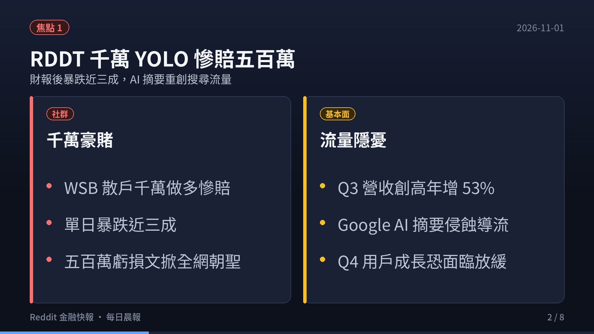
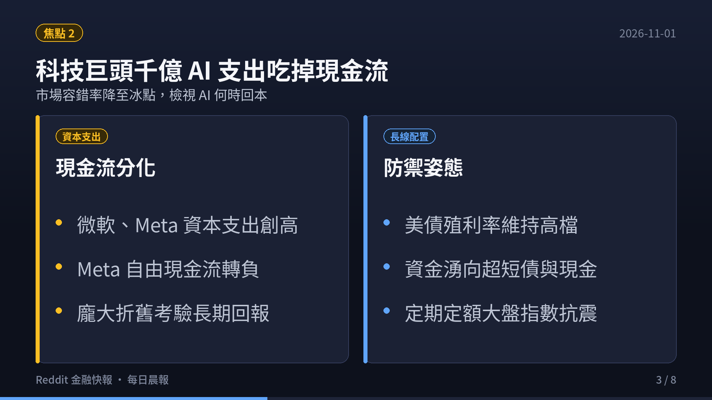
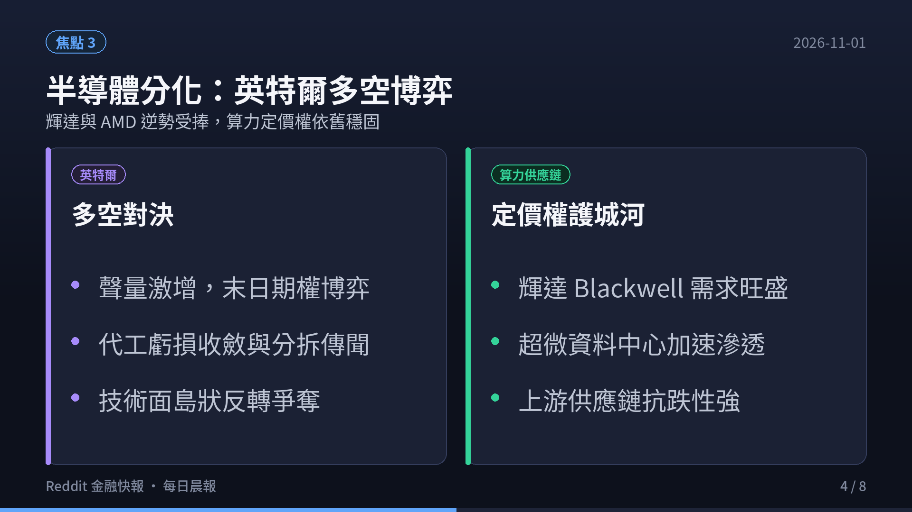
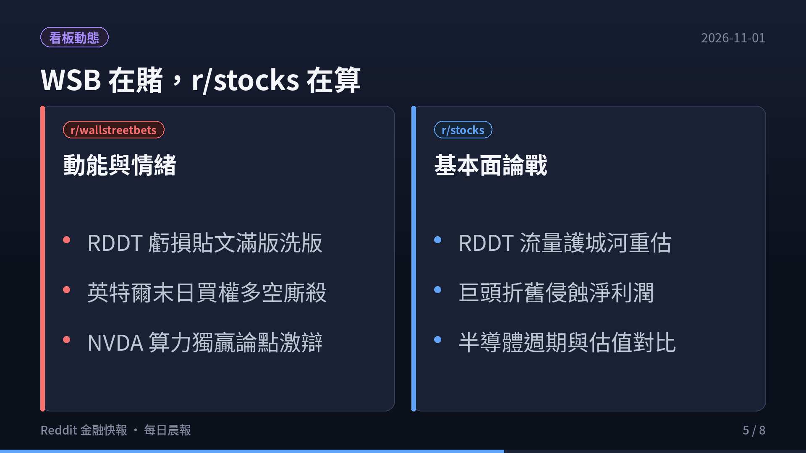
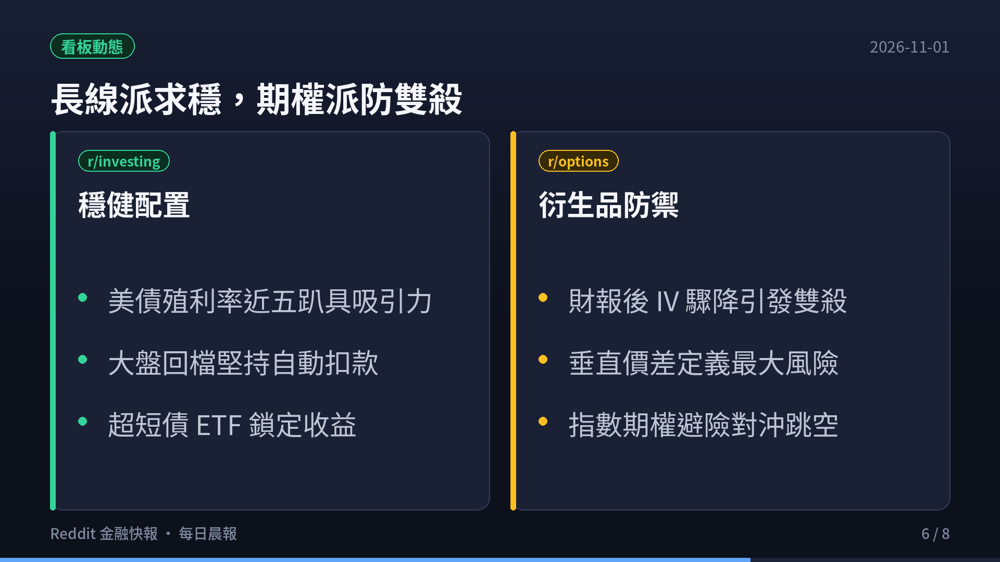
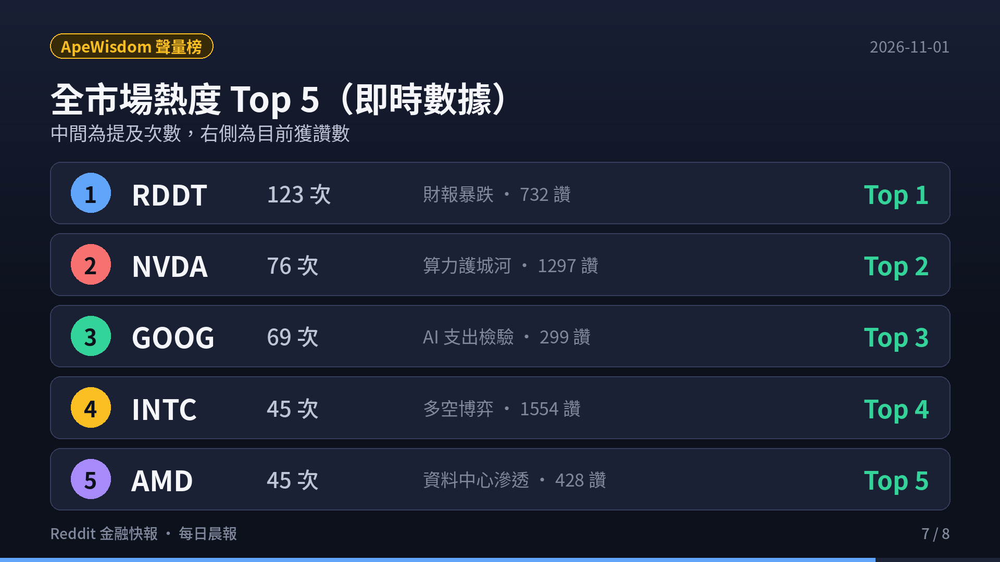
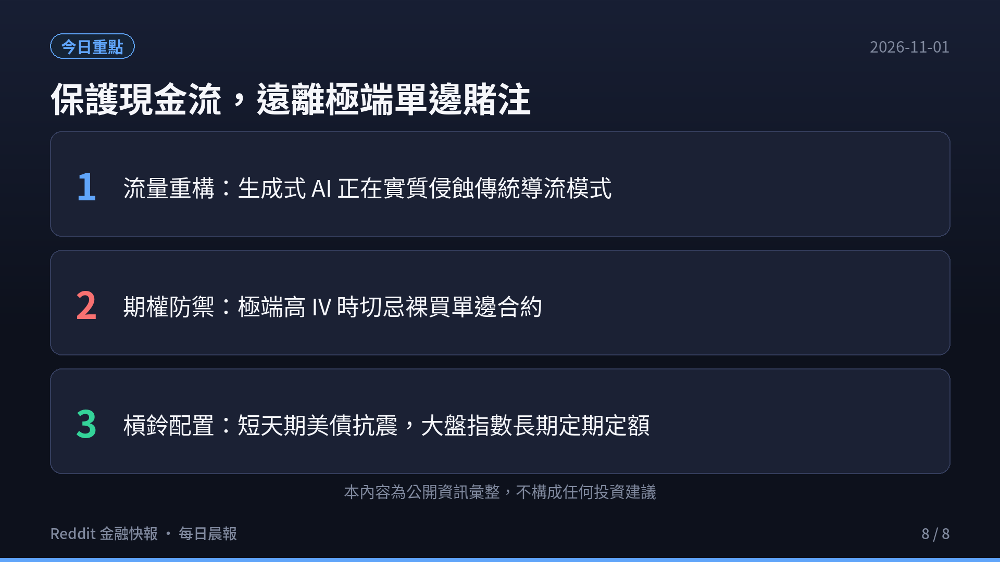

> **監控頻道**：r/wallstreetbets、r/stocks、r/investing、r/options、r/StockMarket  
> **觀測區間**：近 3 日（2026-10-29 至 2026-11-01）最熱門話題 Top 3  
> **資料來源**：Reddit 公開數據流、ApeWisdom 全網即時熱度監控 API  
> **核心原則**：Reddit 反映的是市場「誰在關注什麼」（注意力、資金流向與情緒溫度），一手財報與客觀現金流為客觀驗證基準。

  <video controls width="100%" poster="s01.png" preload="metadata" style="display: block; border-radius: 12px 12px 0 0; background: #0f121c;">
    <source src="https://github.com/ckw19810413/ckw19810413.github.io/releases/download/media-reddit-finance-daily/reddit-finance-2026-11-01.mp4" type="video/mp4">
    您的瀏覽器不支援直接播放 MP4 影片。
  </video>
  

    🎬 <strong>60 秒晨間快報影音動態版</strong>（含 AI 摘要朗讀語音與專屬背景音樂）
  

---

## 🎯 跨板塊三大核心主題（宏觀速覽）

1. **Reddit ($RDDT) Q3 財報大震盪：營收增 53% 卻遭暴跌，WSB 湧現災難級 Loss Porn**
   - **財務表現 vs 導流隱憂**：Reddit 於 10/29 盤後公布 Q3 財報，單季營收達 **$8.95 億美元**（年增 53%），EPS 為 **$1.40** 均大幅擊敗華爾街預期，AI 數據授權變現高達 **$8,500 萬美元**。然而，CEO Steve Huffman 與管理層警示：**Google 的「AI Overviews」與「AI Mode」正在大幅侵蝕未登入用戶的搜尋推薦導流（top-of-funnel search referrals）**，預計 Q4 美國活躍用戶成長恐面臨雙位數放緩壓力。
   - **社群情緒崩盤**：財報公布後股價重挫近 20%~30%，觸發大規模獲利了結與空方踩踏。WSB 版面出現知名賭客 **$10,000,000 YOLO 慘虧 $5,000,000** 的震撼貼文，散戶大量買權歸零，哀鴻遍野。ApeWisdom 全網提及量暴增至 **123 次**，持續高居美股全網聲量第一名。

2. **科技巨頭千億 AI 資本開支（CapEx）侵蝕自由現金流，市場容錯率降至冰點**
   - **現金流分化**：微軟、Meta、Alphabet、亞馬遜陸續公布財報，巨頭資本支出全面創歷史新高。Meta 季度自由現金流（FCF）轉為負值，微軟更是宣布向全球 6 萬名員工開放自願退休買斷方案以精簡人事費用，吸收龐大的資料中心折舊。
   - **長線資金防禦**：10 年期美債殖利率維持在接近 5% 的高檔水準，美股股票風險溢價（ERP）降至數十年來低點。理性派投資人持續質疑 AI 基礎設施的投資回報率（ROI），防禦型資金大幅流入超短天期國庫券 ETF（`SGOV`、`BIL`）與現金部位。

3. **半導體板塊劇烈分化：英特爾（INTC）多空博弈，AMD 與輝達（NVDA）逆勢受捧**
   - **英特爾多空對決**：英特爾聲量在 ApeWisdom 飆升至全網第四名（45 次，獲讚 1,554 個），社群針對其晶圓代工部門虧損修復、潛在分拆傳聞以及能否在政府補助與新架構下觸底反彈展開熱烈多空攻防。
   - **算力霸權持續**：AMD 維持高聲量（45 次，獲讚 428 個），輝達居全網第二（76 次，獲讚 1,297 個）。市場普遍認為，即便終端軟體公司現金流承壓，上游先進算力晶片供應鏈依然具備最強大的定價權與護城河。

---

## 📊 五大核心板塊近 3 日最熱話題 Top 3 深度剖析

### 1. r/wallstreetbets（規模：1,800 萬+ · 類型：情緒與動能 · 雜訊：🔴 極高）

| 排名 | 貼文話題 / 標題 | 發布日期 | 核心討論與要點剖析 |
|:---:|:---|:---:|:---|
| **#1** | **[$10,000,000 RDDT YOLO Post-Mortem: 500 萬美元虧損血淚](https://www.reddit.com/r/wallstreetbets/)** | 2026-10-31 | **散戶史詩級慘案**：一位在財報前全倉投入千萬美元做多 Reddit 的賭客，在財報後股價單日重挫 29% 後如期發表 post-mortem，單日帳面蒸發逾 500 萬美元。社群既敬佩其「坦然面對虧損不刪文」的賭徒精神，也掀起針對財報單邊賭博的警示浪潮。 |
| **#2** | **[Thank you Intel：英特爾末日期權翻倍狂歡與多空博弈](https://www.reddit.com/r/wallstreetbets/)** | 2026-10-30 | **末日期權狂歡後的冷卻**：部分散戶在英特爾財報震盪前押注極度價外的末日買權，短線實現數倍獲利並發文「Thank you Intel」，但隨後科技權值股連番回檔，後續追高買權遭遇多空雙殺。 |
| **#3** | **[巨頭 AI CapEx 質疑：微軟優退、Meta 現金流轉負與 NVDA 獨贏論](https://www.reddit.com/r/wallstreetbets/)** | 2026-10-30 | **硬體上游 vs 軟體下游激辯**：社群激烈討論科技巨頭數千億資本支出究竟由誰買單。多數散戶認為只有 NVIDIA 掌握晶片硬體定價權，終端應用若無法快速變現，軟體巨頭將面臨估值重算。 |

- **頻道標的提及榜（ApeWisdom 即時）**：
  - `RDDT`（89 次，獲讚 520）
  - `NVDA`（65 次，獲讚 1,175）
  - `GOOG`（48 次，獲讚 241）
  - `SPY`（39 次，獲讚 116）
  - `QQQ`（37 次，獲讚 237）

---

### 2. r/stocks（規模：約 900 萬 · 類型：綜合討論 · 雜訊：🟡 中）

| 排名 | 貼文話題 / 標題 | 發布日期 | 核心討論與要點剖析 |
|:---:|:---|:---:|:---|
| **#1** | **[Reddit ($RDDT) Q3 財報深度拆解：營收增 53%，但 Google AI 摘要重創導流護城河](https://www.reddit.com/r/stocks/)** | 2026-10-30 | **流量商業模式的本質反思**：財報數字雖然亮眼（營收 8.95 億美元超預期），但社群深入剖析管理層提到的 Google AI Overviews 衝擊。當 AI 直接在搜尋頁面呈現答案，依賴 SEO 未登入用戶的「漏斗頂端流量」驟降，可能引發未來廣告庫存成長放緩。 |
| **#2** | **[科技巨頭千億 AI CapEx 與自由現金流 (FCF) 侵蝕檢驗](https://www.reddit.com/r/stocks/)** | 2026-10-30 | **估值模型與折舊週期重算**：微軟開放 6 萬人優退方案以精簡人事支出，Meta 自由現金流轉負，各大雲端巨頭龐大的資料中心資本開支已開始轉化為沈重的折舊費用，本益比擴張受限。 |
| **#3** | **[半導體板塊多空分化：AMD、INTC 與 NVDA 估值與市占比較](https://www.reddit.com/r/stocks/)** | 2026-10-31 | **晶片股長線佈局邏輯**：AMD 在資料中心市場市占率穩定提升，Intel 晶圓代工部門虧損收斂並傳出潛在分拆方案，輝達則憑藉 Blackwell 架構壟斷頂級算力，社群探討三者估值性價比。 |

- **頻道標的提及榜（ApeWisdom 即時）**：
  - `RDDT`（27 次，獲讚 204）
  - `GOOG`（16 次，獲讚 44）
  - `META`（12 次，獲讚 407）
  - `FCF`（10 次，獲讚 343）
  - `GOOGL`（10 次，獲讚 512）

---

### 3. r/investing（規模：約 300 萬 · 類型：中長期與資產配置 · 雜訊：🟢 低）

| 排名 | 貼文話題 / 標題 | 發布日期 | 核心討論與要點剖析 |
|:---:|:---|:---:|:---|
| **#1** | **[AI 巨頭自由現金流 (FCF) 分化與無風險利率誘惑](https://www.reddit.com/r/investing/)** | 2026-10-31 | **實質回報率 vs 美債無風險收益**：投資人計算扣除巨額 CapEx 與股權激勵後的實質自由現金流殖利率，部分科技巨頭已降至 2.5%~3.0%，低於近 5% 的短期國債無風險收益，機構資金調整資產配置。 |
| **#2** | **[美債殖利率維持高檔下的槓鈴策略（VOO/VTI + SGOV）](https://www.reddit.com/r/investing/)** | 2026-10-30 | **防禦型配置成為主流共識**：Bogleheads 與長期投資人建議「核心指數 ETF（VOO/VTI）+ 超短天期國庫券 ETF（SGOV）」槓鈴組合，既鎖定 4%~5% 無風險現金流，又維持對全球頂尖生產力資產的長期敞口。 |
| **#3** | **[生成式 AI 搜尋對開放平台生態與流量護城河的重塑](https://www.reddit.com/r/investing/)** | 2026-10-29 | **結構性商業模式變革**：從宏觀層面評估 AI 搜尋對整體 Web 生態的衝擊，傳統依賴點擊導流的媒體與內容平台面臨估值重塑，唯有具備不可替代真實社群對話數據的平台才能保有長線談判力。 |

- **頻道標的提及榜（ApeWisdom 即時）**：
  - `VOO`（9 次，獲讚 172）
  - `IT`（5 次，獲讚 43）
  - `API`（5 次，獲讚 5）
  - `DOW`（3 次，獲讚 58）
  - `UI`（3 次，獲讚 4）

---

### 4. r/options（規模：約 100 萬+ · 類型：衍生品策略 · 雜訊：🟡 中）

| 排名 | 貼文話題 / 標題 | 發布日期 | 核心討論與要點剖析 |
|:---:|:---|:---:|:---|
| **#1** | **[RDDT 財報後 IV Crush 雙殺血淚：近月 IV 暴跌 60% 的殘酷真相](https://www.reddit.com/r/options/)** | 2026-10-31 | **波動率崩跌的毀滅性殺傷力**：RDDT 財報公布前近月隱含波動率（IV）高達 130% 以上，財報後迅速收斂至 45%，買方無論做多做空均遭受 Vega 暴跌帶來的權利金真空，單邊買 Call 散戶慘遭歸零。 |
| **#2** | **[財報季 Theta Gang 避險指南：嚴禁裸賣，擁抱垂直價差 (Credit Spreads)](https://www.reddit.com/r/options/)** | 2026-10-30 | **定義最大風險的重要性**：Theta Gang 社群重申財報季嚴禁裸賣賣權（Naked Put），必須透過 Put Credit Spread 或 Iron Condor 鎖定最大虧損，避免股價跳空擊穿安全邊際導致帳戶爆倉。 |
| **#3** | **[QQQ / SPY 負 Gamma 避險與指數期權配置](https://www.reddit.com/r/options/)** | 2026-10-29 | **大盤指數期權對沖實務**：在大型權值股財報密集期，做市商 Gamma 曝險引發日內波動加劇，資深交易員分享利用 QQQ 與 SPY 跨月價差進行組合對沖以保護持股組合。 |

- **頻道標的提及榜（ApeWisdom 即時）**：
  - `TQQQ`（1 次，獲讚 1）
  - `ASTS`（1 次，獲讚 4）
  - `YOU`（1 次，獲讚 10）
  - `HOOD`（1 次，獲讚 1）
  - `GME`（1 次，獲讚 3）

---

### 5. r/StockMarket（規模：約 300 萬+ · 類型：新聞與圖表 · 雜訊：🟡 中）

| 排名 | 貼文話題 / 標題 | 發布日期 | 核心討論與要點剖析 |
|:---:|:---|:---:|:---|
| **#1** | **[科技巨頭財報週市場熱圖（Heatmap）全面轉紅與均線回測](https://www.reddit.com/r/StockMarket/)** | 2026-10-31 | **市場熱圖全面轉紅**：標普 500 與納斯達克 100 熱圖直擊，科技與通訊板塊連日下挫，多數成分股跌破短期月均線，社群普遍預期短期大盤將進入均線回測與整理區間。 |
| **#2** | **[半導體板塊（AMD / INTC / MU / NVDA）技術面分水嶺](https://www.reddit.com/r/StockMarket/)** | 2026-10-30 | **費半 50 日均線攻防**：費半指數在 50 日均線附近劇烈震盪，Intel 在技術面呈現島狀反轉博弈，而 NVDA 與 AMD 則維持長期上升通道下軌支撐。 |
| **#3** | **[RDDT 暴跌後的技術面支撐與長線估值修復評估](https://www.reddit.com/r/StockMarket/)** | 2026-10-30 | **暴跌後的技術面支撐與估值修復**：技術分析圖表指出 RDDT 暴跌已回測前波突破頸線，雖然短期流量承壓，但其身為全球最強人類真實對話數據庫的地位不可取代，逢低吸納買盤開始出現。 |

- **頻道標的提及榜（ApeWisdom 即時）**：
  - `AMD`（8 次，獲讚 264）
  - `AGI`（5 次，獲讚 12）
  - `INTC`（3 次，獲讚 37）
  - `MU`（3 次，獲讚 10）
  - `API`（3 次，獲讚 21）

---

## 📈 全市場熱度排行（ApeWisdom 即時數據，All-Stocks Top 10）

根據 ApeWisdom 全網爬蟲對 Reddit 財經板塊之即時提及量統計（2026-11-01 06:00 最新）：

| 排名 | 標的代號 | 公司名稱 | 即時提及數 | 24 小時趨勢 | 當前獲讚數 | 討論核心驅動因素 |
|:---:|:---|:---|:---:|:---:|:---:|:---|
| **1** | **RDDT** | Reddit Inc. | **123** | 24h 前 353 次（-65.2%） | 732 | Q3 財報營收年增 53%、Google AI 摘要侵蝕導流、WSB 千萬 YOLO 慘賠引爆全網 |
| **2** | **NVDA** | NVIDIA Corporation | **76** | 24h 前 106 次（-28.3%） | 1,297 | 算力護城河依舊無可匹敵、巨頭資本開支之最直接受惠者 |
| **3** | **GOOG** | Alphabet Inc. | **69** | 24h 前 154 次（-55.2%） | 299 | Q3 財報拋售潮趨於冷卻、社群聚焦千億 Capex 對 FCF 的實質侵蝕 |
| **4** | **INTC** | Intel Corp. | **45** | 24h 前 201 次（-77.6%） | 1,554 | 晶圓代工分拆傳聞、Q3 虧損改善預期、多空期權博弈激烈 |
| **5** | **AMD** | Advanced Micro Devices | **45** | 24h 前 140 次（-67.9%） | 428 | 資料中心市占拓展、與 Intel 競爭格局熱議 |
| **6** | **SPY** | SPDR S&P 500 ETF | **45** | 24h 前 168 次（-73.2%） | 123 | 大盤高檔回測、美債殖利率逼近 5% 壓抑估值、指數防禦策略 |
| **7** | **QQQ** | Invesco QQQ ETF | **42** | 24h 前 167 次（-74.9%） | 241 | 科技權值股財報巨震、避險看跌期權量能攀升 |
| **8** | **META** | Meta Platforms | **35** | 24h 前 48 次（-27.1%） | 520 | 資本支出大增引發自由現金流轉負爭議 |
| **9** | **AMZN** | Amazon.com Inc. | **28** | 24h 前 45 次（-37.8%） | 180 | AWS 雲端資本支出與零售業務利潤率檢驗 |
| **10** | **TSLA** | Tesla Inc. | **25** | 24h 前 38 次（-34.2%） | 310 | Robotaxi 長線商業化進度與基本面毛利率辯論 |

---

## 💡 總結與投資者觀察

1. **流量紅利重構的現實衝擊**：過去依賴搜尋引擎免費導流的平台生態，正在遭遇生成式 AI 摘要（如 Google AI Overviews）的實質打擊。即便 Reddit 握有高價值授權協議，終端日活用戶的成長預期一旦鬆動，高估值倍數就會面臨無情修正。
2. **財報週切勿盲賭單邊期權**：RDDT 的慘劇再次印證「隱含波動率崩塌（IV Crush）」的殺傷力。在財報公布前 IV 處於極端高位時，純買 Call 或純買 Put 的期望值均極低；適度使用垂直價差或鎖定已知最大風險才是存活之道。
3. **無風險利率誘惑下的資產配置**：在 10 年期美債逼近 5% 的當下，股票市場不再具備「沒有其他選擇（TINA）」的光環。保留充足現金、利用短債鎖定無風險收益，並以長期定期定額方式參與指數，是目前穿越科技股財報震盪的最穩健姿態。
4. **資料誠實聲明**：本報告數據採集自 Reddit 公開社群資訊流與 ApeWisdom 即時數據庫；本報告僅作為社群情緒與市場注意力監控彙整，**不構成任何買賣要約或個人投資建議**。

---

### ☕ 支持與精選推薦

如果你覺得這份每日晨報對你的投資與市場視野有幫助，歡迎透過以下方式支持我們持續產出高質量的市場深度內容：

- ☕ **請我喝杯咖啡**：[Ko-fi 小費贊助](https://ko-fi.com/ytstories0413)（支持每日自動化爬蟲與語音影音渲染運算）
- 📚 **數位產品與實戰工具**：
  - [Gumroad 數位商品專區](https://slashmaster6.gumroad.com/)：收錄精選 AI Prompt 庫、生產力工作流模板與自動化腳本
  - [飛書精選高人效商業模板](https://slashmaster6.gumroad.com/l/xohjh)
- 🛠️ **免費線上工具箱**：[SlashmanTools 免費 Web 工具集](https://slashmantools.us/)（Token 成本換算、顯存試算、AI 工具庫）
- 📖 **推薦經典閱讀**：[《晶片戰爭》（Chip War）繁中版 / 英文版精裝推薦](https://www.amazon.com/dp/059371671X?tag=ytstories0413-20)
