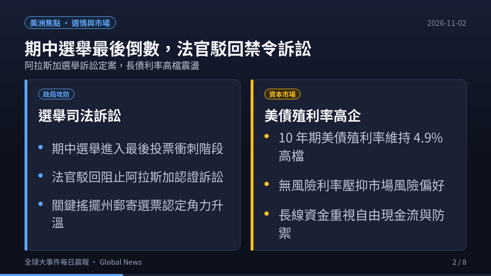
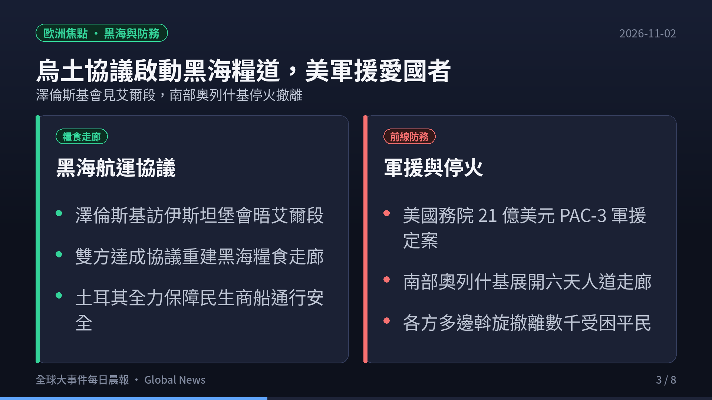
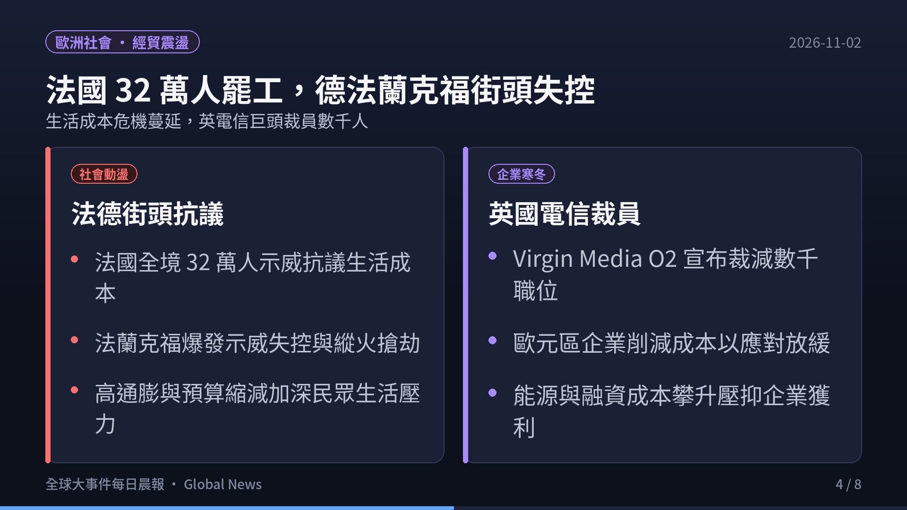
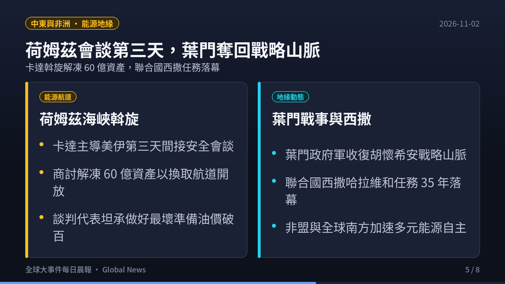
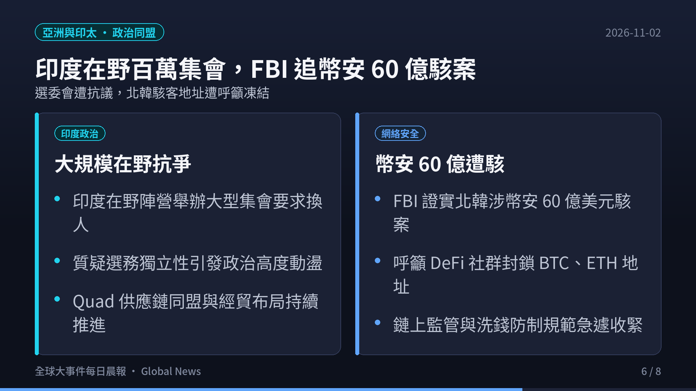
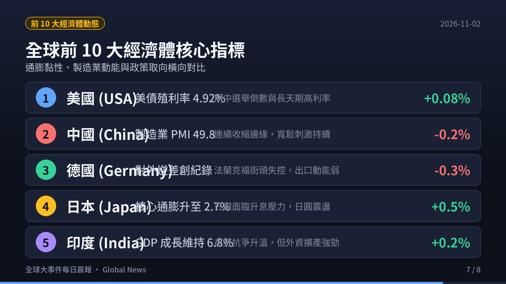
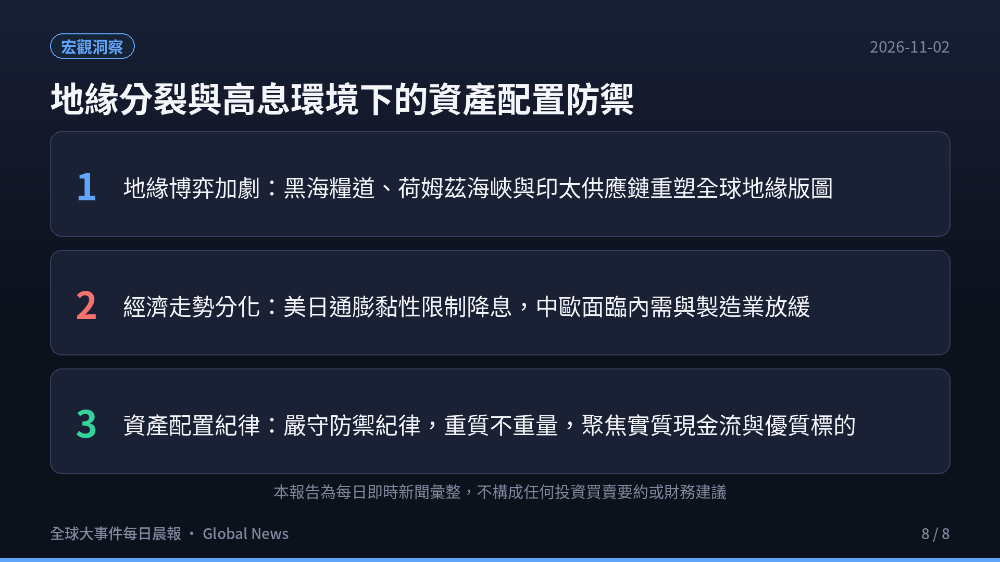

> **觀測週期**：2026-11-02 晨間即時彙整  
> **情報涵蓋**：全球六大洲（北美、南美、歐洲、亞洲、中東、非洲、大洋洲）與全球前 10 大經濟體  
> **核心來源**：各國政府公報、路透社（Reuters）、新華社（Xinhua）、IMF 數據庫、ApeWisdom 即時金融情報庫  
> **定位宗旨**：以客觀數據、官方決策與供應鏈結構為準繩，剔除短期情緒噪音，提煉出真正驅動全球資金流向與地緣版圖重構的核心脈絡。

  

    <iframe src="https://www.youtube.com/embed/Ch3fy4dV6qQ" title="2026.11.02 全球大事件每日晨報" style="position: absolute; top:0; left: 0; width: 100%; height: 100%; border: 0;" allow="accelerometer; autoplay; clipboard-write; encrypted-media; gyroscope; picture-in-picture; web-share" allowfullscreen></iframe>
  

  

    🎬 <strong>120 秒晨間快報影音動態版</strong>（含 AI 自然神經語音朗讀與背景配樂）
  

---

## 🎯 今日全球前 6 大核心事件深度拆解

### 1. 美洲政局與資本市場：期中選舉進入最後倒數，法官駁回禁令訴訟，長債殖利率高企
- **期中選舉司法訴訟定案**：
  - 美國聯邦法官正式駁回了川普團隊要求阻止阿拉斯加州參院選舉結果認證的司法禁令申請，掃清了選舉認證程序的一項關鍵法律障礙。
  - 兩黨在全美多個關鍵搖擺州針對海外選票認定與郵寄投票規則的攻防全面進入白熱化。
- **無風險利率持續維持高檔**：
  - 10 年期美債殖利率維持在 **4.92%** 的高檔震盪區間，持續壓抑美股市場的股權風險溢價（ERP）。
  - 華爾街大型機構普遍收緊防禦倉位，將配置核心轉向兼具自由現金流與強大定價權的龍頭標的。

---

### 2. 歐洲防務與黑海走廊：烏土協議重啟黑海糧食走廊，美落實 21 億愛國者軍援
- **重啟黑海民生航運通道**：
  - 烏克蘭總統澤倫斯基抵達伊斯坦堡會晤土耳其總統艾爾段，雙方正式宣布達成全面協議，聯手推動重建「黑海糧食走廊（Black Sea Grain Corridor）」。
  - 土耳其承諾全力支援黑海航道之安全巡弋與航行保障，防止國際糧價與肥料供應鏈再度因戰事受阻而暴漲。
- **防空防禦系統落實交付**：
  - 美國國務院落實向烏克蘭提供 **500 枚愛國者三型（PAC-3）防空飛彈**（總額 21 億美元），全面鞏固冬季防空電網。
  - 赫爾松南部奧列什基（Oleshky）為期 6 天的罕見局部人道停火走廊持續運轉，協助前線受困平民安全撤離。

---

### 3. 歐洲社會與工業震盪：法國 32 萬人抗議生活成本，德國法蘭克福爆發搶劫與衝突
- **法國全境抗爭浪潮**：
  - 巴黎及全法各主要城市爆發超過 **32 萬人**的大規模示威抗議，工會與群眾強烈抗議物價生活成本居高不下以及公共財政預算的大幅削減。
  - 警方在里昂、格勒諾布爾等多地動用催淚瓦斯維持秩序，部分公共運輸與市政服務陷入癱瘓。
- **德國多地示威演變為失控暴力**：
  - 德國法蘭克福等主要城市週末示威活動失控，出現沿街縱火焚燒路障與商店遭洗劫（Looting）的暴力事件，社會治安警報大作。
- **英國企業寒冬**：
  - 英國寬頻巨頭 Virgin Media O2 宣布將裁減數千名員工，凸顯高利率與消費緊縮對歐洲電信與通訊基建企業營運造成的實質擠壓。

---

### 4. 中東能源航道與非洲安全：卡達斡旋美伊解凍 60 億資產，葉門政府軍收復戰略山脈
- **荷姆茲海峽重啟談判角力**：
  - 卡達擔任中介的美伊間接安全談判進入關鍵第三天，主要聚焦解凍伊朗被扣押的 **60 億美元** 海外資產，以換取重啟荷姆茲海峽之航行安全。
  - 談判各方坦承「做好最壞打算（braced for worst）」，航運風險推升布蘭特原油持續站穩每桶 **104 美元** 高檔。
- **葉門戰況取得突破**：
  - 葉門政府軍在空軍掩護下發起攻勢，完全收復賈夫省胡懷希安（Huwayshian）戰略山脈，瓦解了胡塞武裝針對省會阿爾哈茲姆的第一道防禦線。
- **聯合國西撒任務落幕**：
  - 聯合國安理會未能就延長授權達成共識，維持了長達 **35 年** 的西撒哈拉維和任務（MINURSO）正式告終，北非地緣格局面臨重新洗牌。

---

### 5. 亞洲政局與網絡安全：印度在野陣營發動大規模集會，FBI 指控北韓涉幣安 60 億駭案
- **印度在野陣營政治風暴**：
  - 印度在野黨聯盟號召全印度數十萬人舉行大規模集會抗爭，強烈要求選委會主席辭職，引發外界對選舉中立性與國內政局穩定性的高度關注。
  - 儘管政治雜音升溫，美日印澳 Quad 關鍵礦產與先進半導體防護網仍加速推進。
- **FBI 揭露史上最大加密貨幣竊案之一**：
  - 美國聯邦調查局（FBI）正式證實北韓國家駭客組織涉及 **60 億美元的幣安（Binance）駭客攻擊事件**。
  - FBI 公開呼籲全球去中心化金融（DeFi）社群全面列入黑名單，凍結涉案比特幣（BTC）、以太坊（ETH）與 Solana（SOL）地址，引發鏈上資產安全大震盪。

---

### 6. 全球前十大經濟體核心指標與趨勢橫向比較

| 排名 | 國家 / 經濟體 | 核心總體經濟數據 / 最新指標 | 2026-11-02 即時動態與政策取向 | 全球產業鏈與市場意涵 |
|:---:|:---|:---|:---|:---|
| **1** | **美國 (USA)** | 10年期美債殖利率 **4.92%** · 通膨 **3.6%** | 期中選舉最後衝刺；阿拉斯加訴訟遭駁回；21億軍援落實 | 長天期資金成本維持高檔，股權風險溢價受限，防禦型價值股獲資金青睞。 |
| **2** | **中國 (China)** | 10月製造業 PMI **49.8** · 通膨 **1.0%** | 製造業接近景氣榮枯線邊緣；房市支持政策與降準降息窗口持續開啟 | 復甦動能穩步修復，內需消費與高端裝備製造為政策重點發力方向。 |
| **3** | **德國 (Germany)** | 通膨率 **2.7%** · 亞太逆差創紀錄 | 法蘭克福示威失控搶劫；出口動能受高能耗成本與地緣摩擦雙重擠壓 | 歐洲經濟火車頭動能承壓，製造業外移與產業鏈去風險化迫在眉睫。 |
| **4** | **日本 (Japan)** | 核心 CPI 通膨升至 **2.7%** · 債務 **199%** | 日銀升息壓力驟增；日圓匯率防守戰持續，套息交易平倉潮隱現 | 債券殖利率上限面臨考驗，全球資本流向受到日圓升值潛在衝擊。 |
| **5** | **印度 (India)** | GDP 年增率 **6.8%** · 通膨 **5.0%** | 在野抗議升溫；印太 Quad 關鍵礦產聯盟核心夥伴；跨國製造投資湧入 | 作為全球供應鏈多元化替代樞紐，製造業外資流入維持強勁動能。 |
| **6** | **英國 (UK)** | 通膨率 **3.3%** · 失業率 **5.3%** | Virgin Media O2 裁員數千人；生活成本上升壓抑內需消費支出 | 電信與基建成本削減反映高利率後遺症，市場預期英國央行降息呼聲升高。 |
| **7** | **法國 (France)** | 通膨率 **2.4%** · 示威人數 **32 萬+** | 全國大規模抗議生活成本高漲與公共削減；巴黎交通及市政受嚴重干擾 | 財政赤字壓力限制政策擴張空間，社會福利支出與財政整頓矛盾難解。 |
| **8** | **義大利 (Italy)** | 通膨率 **3.3%** · 債務佔比 **137.9%** | 歐元區成長放緩下國債利差維持穩定；高度依賴歐盟復甦基金資助 | 高負債水準對長期利率敏感度高，基礎建設投資成為維持經濟動能主軸。 |
| **9** | **加拿大 (Canada)** | 通膨率 **2.8%** · 失業率 **6.5%** | 國際油價逼近 104 美元挹注經常帳；美加貿易走勢與房貸展期壓力並存 | 能源商品出口支撐本國貨幣，但家計部門房貸再融資成本持續增加。 |
| **10** | **澳洲 (Australia)** | 通膨率 **3.9%** · 債務佔比 **52.6%** | 核心 CPI 通膨高企；澳洲央行 (RBA) 降息預期落空，甚至面臨緊縮壓力 | 原物料出口獲利維持穩健，但國內高物價與房貸利息使消費意願轉趨保守。 |

---

## 💡 總結與投資者生存指南

1. **戰略航道與關鍵基礎設施的地緣博弈**：
   - 烏克蘭與土耳其聯手推動重啟 **黑海糧食走廊**，加上美伊在卡達斡旋下就 **荷姆茲海峽** 重啟展開談判，清楚表明能源與糧食通道已成為大國地緣斡旋的最核心籌碼。
   - 任何航道談判的進退都將直接牽動布蘭特原油（逼近 104 美元）與大宗原物料走勢。
2. **通膨黏性與歐美社會壓力的外溢效應**：
   - 法國 32 萬人大罷工、德國法蘭克福街頭失控抢劫以及英國電信巨頭大幅裁員，表明長期高利率與輸入型通膨對已開發國家家庭與企業資產負債表的侵蝕已浮上檯面。
   - 歐美央行降息空間受到通膨黏性與能源價格制約，全球貨幣寬鬆路徑遠比市場早期預期的更具顛簸性。
3. **高利率分化格局下的資產配置守則**：
   - 10 年期美債殖利率逼近 4.92%，資金成本的剛性上升要求投資人恪守「防禦優先、重質不重量」的紀律。
   - 降低高負債與高槓桿標的敞口，聚焦於具備**真實現金流保護、核心技術壁壘與供應鏈定價權**的防禦型優質資產。

---

### ☕ 支持與精選推薦

如果你覺得這份每日晨報對你的宏觀視野與決策有實質幫助，歡迎透過以下方式支持我們持續產出深度內容：

- ☕ **請我喝杯咖啡**：[Ko-fi 小費贊助 (ytstories0413)](https://ko-fi.com/ytstories0413) 或 [Ko-fi 贊助 (slashman413)](https://ko-fi.com/slashman413)（支持每日自動化爬蟲、語音合成與雲端運算）
- 📚 **數位產品與高人效生產力工具**：
  - [Gumroad 數位商品專區](https://slashmaster6.gumroad.com/)：收錄精選 AI Prompt 庫、生產力自動化工作流與實戰腳本
  - [飛書精選高人效商業模板庫](https://slashmaster6.gumroad.com/l/xohjh)：助你一人公司高效運營，打通專案管理與自動化數據流
  - [SlashmanTools 免費 Web 工具集](https://slashmantools.us/)：Token 成本計算器、顯存預估、開源 AI 工具導航
- 📖 **精選經典閱讀推薦**：
  - [《晶片戰爭》（Chip War）](https://www.amazon.com/dp/059371671X?tag=ytstories0413-20)：理解全球晶片霸權與印太供應鏈重組的必讀經典
  - [《原子習慣》— 細微改變帶來巨大成就](https://www.books.com.tw/products/0010792915)
  - [《人生的智慧》— 叔本華處世哲學經典](https://www.books.com.tw/products/0010613113)
