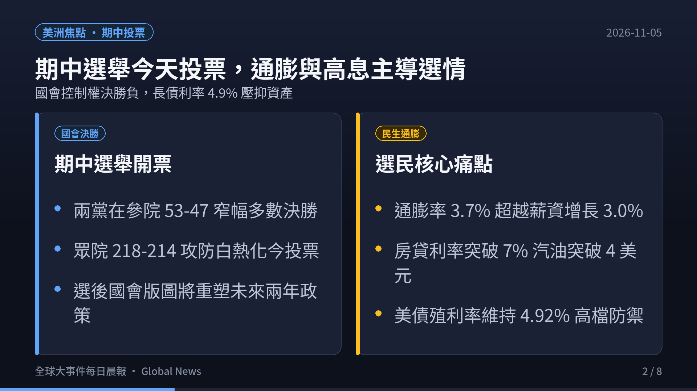
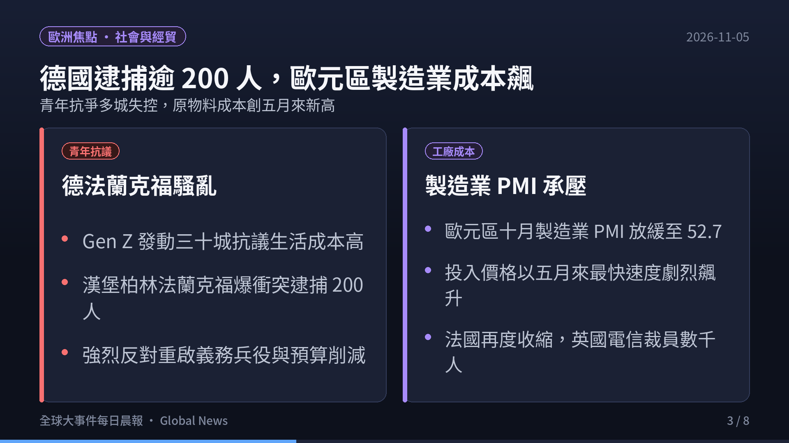
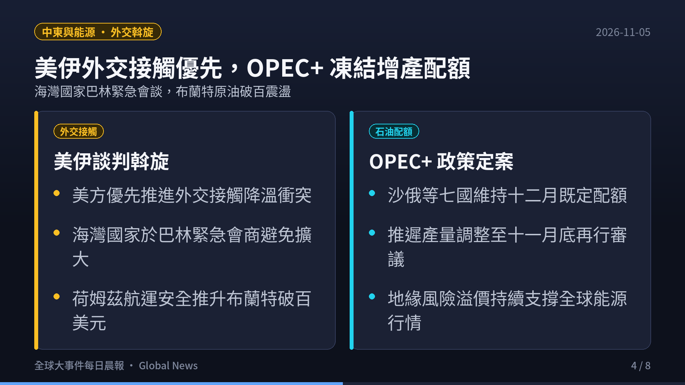
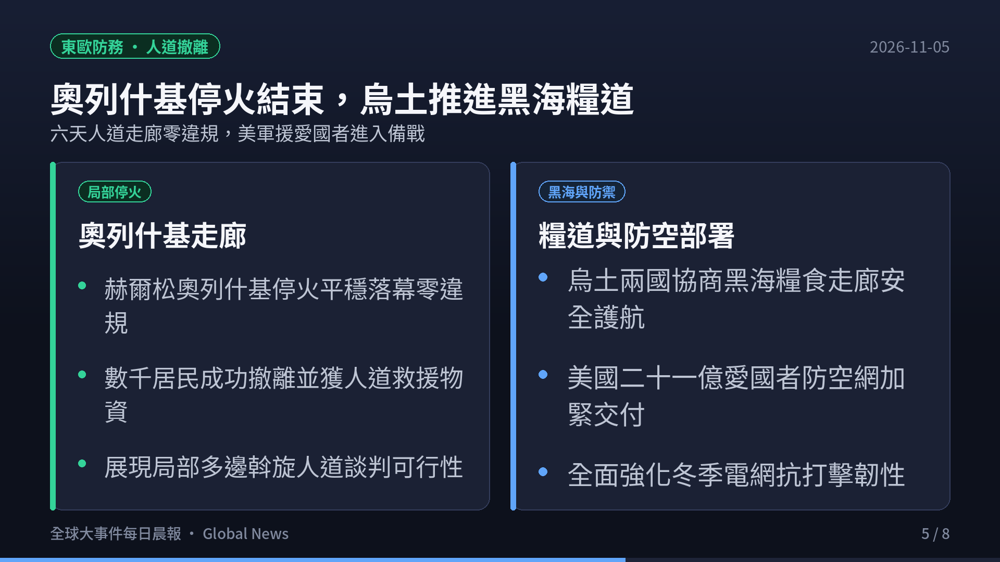
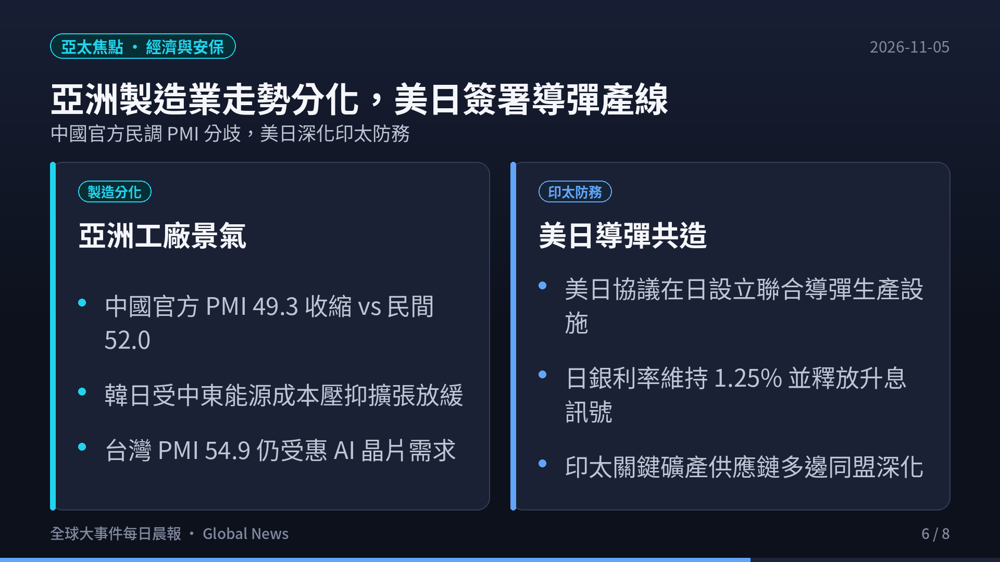
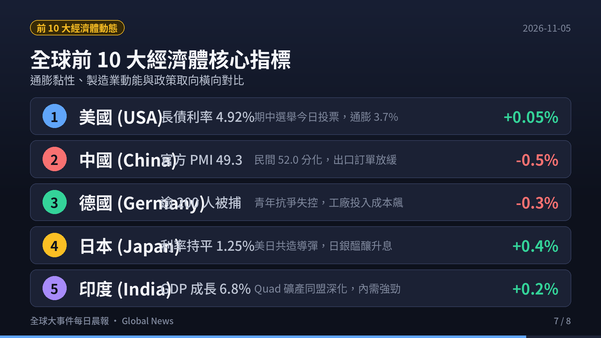
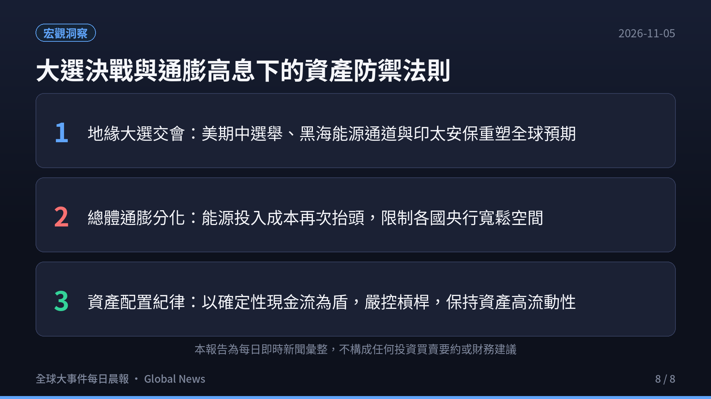

> **觀測週期**：2026-11-05 晨間即時彙整  
> **情報涵蓋**：全球各大洲（北美、歐洲、中東、亞洲/印太、非洲、大洋洲）與全球前 10 大經濟體  
> **核心來源**：各國政府公報、路透社（Reuters）、Anadolu Agency、IMF 數據庫、S&P Global PMI 報告  
> **定位宗旨**：以客觀數據、官方決策與供應鏈結構為準繩，剔除短期情緒噪音，提煉出真正驅動全球資金流向與地緣版圖重構的核心脈絡。

  

    <iframe src="https://www.youtube.com/embed/U0rHZbmc4-o" title="2026-11-05 全球大事件每日晨報" style="position: absolute; top:0; left: 0; width: 100%; height: 100%; border: 0;" allow="accelerometer; autoplay; clipboard-write; encrypted-media; gyroscope; picture-in-picture; web-share" allowfullscreen></iframe>
  

  

    🎬 <strong>120 秒晨間快報影音動態版</strong>（含 AI 自然神經語音朗讀與背景配樂）
  

---

## 🎯 今日全球前 6 大核心事件深度拆解

### 1. 美洲政局與資本市場：期中選舉今日投票決勝，通膨 3.7% 與長債利率 4.9% 主導選民情緒
- **國會控制權決勝最後倒數**：
  - 美國期中選舉今天正式迎來全美選民投票日。參議院與眾議院兩院控制權面臨極限攻防。
  - 最新民調顯示，選民最關切的核心議題壓倒性集中在「生活成本」與「通膨感受」。9 月 CPI 攀升至 3.7%，連續六個月超越實質薪資增長率（3.0%）。
- **資本市場結構與長債無風險利率**：
  - 10 年期美債殖利率維持在 **4.92%** 高檔震盪，30 年期固定房貸利率突破 7%，一般無鉛汽油全美均價破 4 美元/加侖。
  - 華爾街大型機構在投票日維持高度防禦性現金水位，嚴控股權風險溢價（ERP），聚焦具備強大自由現金流保護與定價權的防禦標的。

---

### 2. 歐洲社會與工業震盪：德國 30 城青年示威爆發衝突逾 200 人被捕，歐元區製造業成本劇增
- **德國全境青年抗議蔓延**：
  - 德國「Gen Z Regelt」組織在全德超過 30 個主要城市發起大規模青年示威，抗議高昂生活成本、教育經費緊縮及重啟義務役兵役計畫。
  - 漢堡、柏林及法蘭克福街頭出現激進團體架設路障與縱火焚燒垃圾桶，警方展開強力驅離，全境逮捕逾 200 人。
- **歐元區工廠投入價格創五月來新高**：
  - 標普全球（S&P Global）公佈歐元區 10 月製造業 PMI 終值降至 52.7，原物料與能源投入成本創下 5 月以來最快上漲步伐。
  - 法國製造業再度跌入收縮區間，英國電信巨頭裁員數千人，歐洲央行面臨「停滯性通膨」壓力與升息兩難。

---

### 3. 中東外交與能源局勢：美方優先推進美伊外交接觸，OPEC+ 凍結產量配額原油站穩百元
- **美伊外交接觸與海灣國家緊急斡旋**：
  - 川普政府在期中選舉前夕優先推進針對伊朗的外交接觸，抵抗以方要求立即採取軍事行動之壓力。
  - 海灣阿拉伯國家高級官員週末於巴林首都麥納瑪召開緊急協調會議，全力尋求外交途徑防止中東新一輪軍事打擊與航道封鎖風險。
- **OPEC+ 產油國決策定案**：
  - 沙烏地阿拉伯、俄羅斯、伊拉克等 7 個 OPEC+ 主要成員國正式拍板，12 月產量配額將維持 9 月水準不變，暫緩任何增產調整。
  - 荷姆茲海峽航行安全溢價支撐國際布蘭特原油持續站穩每桶 100 美元上方。

---

### 4. 東歐防務與人道進展：赫爾松奧列什基停火零違規平穩結束，烏土推進黑海糧食走廊
- **六天人道停火締造罕見成果**：
  - 烏克蘭南部赫爾松州奧列什基（Oleshky）為期 6 天的局部人道停火走廊於週日深夜正式結束，雙方均未通報任何違規交火。
  - 人道救援車隊順利運送食物、飲水及醫療物資進駐，並成功撤離數千名受困前線之平民。
- **黑海糧食護航與防空武器交付**：
  - 澤倫斯基政府持續與土耳其海軍及外交團隊研擬重啟「黑海糧食走廊」之防護機制，確保農產品航運免受威脅。
  - 美國落實總額 21 億美元之 500 枚愛國者三型（PAC-3）防空飛彈系統整備，加緊強化冬季關鍵電力基礎設施防護電網。

---

### 5. 亞洲景氣與印太安保：亞洲製造業官民數據分化，美日協議在日共造先進防空導彈
- **亞洲工廠活動分歧顯著**：
  - 中國 10 月官方製造業 PMI（49.3）跌入收縮區間，而民間製造業 PMI 則錄得 52.0，反映內需大型傳產與出口導向科技製造業的結構性脫鉤。
  - 韓國 PMI 降至 51.3、日本降至 53.3；台灣 PMI 則維持在 54.9 高位，主要受惠於全球 AI 算力中心對晶片的剛性採購。
- **美日深化印太軍事防衛共造**：
  - 美國與日本防衛省正式達成歷史性防務協議，將在日本本土設立聯合導彈生產設施，共同製造先進防禦型飛彈。
  - 日本央行（BOJ）政策會議維持利率於 1.25%，但明確釋放未來進一步升息訊號，以抑制日圓貶值帶來之輸入型物價壓力。

---

### 6. 全球前十大經濟體核心指標與趨勢橫向比較

| 排名 | 國家 / 經濟體 | 核心總體經濟數據 / 最新指標 | 2026-11-05 即時動態與政策取向 | 全球產業鏈與市場意涵 |
|:---:|:---|:---|:---|:---|
| **1** | **美國 (USA)** | 10年期美債殖利率 **4.92%** · 通膨 **3.7%** | 期中選舉今天正式投票開票；Q3 GDP 年化 3.4%；油價房貸居高不下 | 長債殖利率對資產定價構成硬約束，兩黨國會版圖將左右 2027 年債務上限法案。 |
| **2** | **中國 (China)** | 官方 PMI **49.3** vs 民間 PMI **52.0** | 官民製造業數據分化；出口新訂單放緩；財政赤字率與內需提振措施落地 | 供應鏈加速高技術附加值轉型，房市築底期消費需求依賴政策進一步托底。 |
| **3** | **德國 (Germany)** | 通膨率 **2.7%** · 30 城青年抗爭逾 200 人被捕 | 生活成本激化街頭抗爭；製造業 PMI 投入價格創 5 月來最快漲幅 | 能源成本高企削弱出口競爭力，青年就業與生活成本演變為政局關鍵變數。 |
| **4** | **日本 (Japan)** | 央行基準利率維持 **1.25%** · 核心 CPI 升溫 | 美日協議在日共造防禦導彈；日銀釋放後續升息預期以穩定匯價 | 日本防衛工業體系國際化提速，日銀潛在升息將持續引導全球套息資金再平衡。 |
| **5** | **印度 (India)** | GDP 預測成長 **6.8%** · 通膨率 **5.0%** | Quad 關鍵礦產與半導體供應鏈深化合作；國內在野政治集會餘波未平 | 印度作為跨國科技巨頭「China+1」製造首選受惠顯著，資本支出持續擴張。 |
| **6** | **英國 (UK)** | 通膨率 **3.3%** · 失業率 **5.3%** | Virgin Media O2 宣布裁員數千人；企業削減支出抵禦高借貸成本 | 通訊與科技基建面臨盈餘重估，英格蘭銀行對服務業通膨仍保持緊縮觀望。 |
| **7** | **法國 (France)** | 製造業重回景氣收縮線下 · 罷工餘波 | 繼 32 萬人示威後工廠活動再次收縮；公共預算削減面臨國會僵局 | 財政重整與街頭抗爭雙重夾擊，歐洲第二大經濟體復甦動能面臨失速隱憂。 |
| **8** | **義大利 (Italy)** | 通膨率 **3.3%** · 國債佔比 **138%** | 歐元區經濟分化下國債利差持穩；積極引進歐盟復甦基金基礎建設專案 | 對歐洲央行貨幣政策高度敏感，能源過渡支出受財政赤字嚴密監控。 |
| **9** | **加拿大 (Canada)** | 通膨率 **2.8%** · 失業率 **6.5%** | 國際油價破百挹注能源經常帳收入；緊盯美國期中大選對北美貿易協定之衝擊 | 能源貿易帶來匯率支撐，但家庭部門高槓桿房貸再融資壓力持續釋放。 |
| **10** | **澳洲 (Australia)** | 通膨率 **3.9%** · 基準利率 **4.35%** | 服務業通膨具黏性；澳洲央行降息預期延後；大宗商品出口維持順差 | 中國製造業分化牽動鐵礦砂需求，澳幣受商品行情與利差博弈雙向震盪。 |

---

## 💡 總結與投資者生存指南

1. **大選投票與地緣變數引發的全球資產重定價**：
   - 美國期中大選結果將直接重塑華府未來兩年的財政與外交政策，尤其在對伊軍事決策與關稅法案上的行政掣肘。
   - 伴隨 OPEC+ 產量凍結、荷姆茲海峽風險溢價持續，油價維持高檔將成為各國央行延後降息或重啟緊縮的催化劑。
2. **通膨黏性與社會結構性矛盾爆發**：
   - 德國 200 多人被捕的青年抗爭與法國製造業收縮，再次揭示高生活成本對歐美民生結構造成的持久性創傷。
   - 工廠端投入成本以五月以來最快速度反彈，反映全球供應鏈在地緣分割與脫鉤下的「結構性摩擦成本」難以在短期內消除。
3. **高息持久戰下的資產配置防禦紀律**：
   - 10 年期美債殖利率維持在 4.9% 附近，高無風險利率代表一切依賴低息流動性的商業模式都將加速接受壓力測試。
   - 投資者應堅守「高確定性現金流、低財務槓桿、具備技術與定價護城河」的三大原則，保持彈性資產配置。

---

### ☕ 支持與精選推薦

如果你覺得這份每日晨報對你的宏觀視野與決策有實質幫助，歡迎透過以下方式支持我們持續產出深度內容：

- ☕ **請我喝杯咖啡**：[Ko-fi 小費贊助 (ytstories0413)](https://ko-fi.com/ytstories0413) 或 [Ko-fi 贊助 (slashman413)](https://ko-fi.com/slashman413)（支持每日自動化爬蟲、語音合成與雲端運算）
- 📚 **數位產品與高人效生產力工具**：
  - [Gumroad 數位商品專區](https://slashmaster6.gumroad.com/)：收錄精選 AI Prompt 庫、生產力自動化工作流與實戰腳本
  - [SlashmanTools 免費 Web 工具集](https://slashmantools.us/)：Token 成本計算器、顯存預估、開源 AI 工具導航
- 📖 **精選經典閱讀推薦**：
  - [《晶片戰爭》（Chip War）](https://www.amazon.com/dp/059371671X?tag=ytstories0413-20)：理解全球晶片霸權與印太供應鏈重組的必讀經典
  - [《原子習慣》— 細微改變帶來巨大成就](https://www.books.com.tw/products/0010792915)
  - [《人生的智慧》— 叔本華處世哲學經典](https://www.books.com.tw/products/0010613113)
