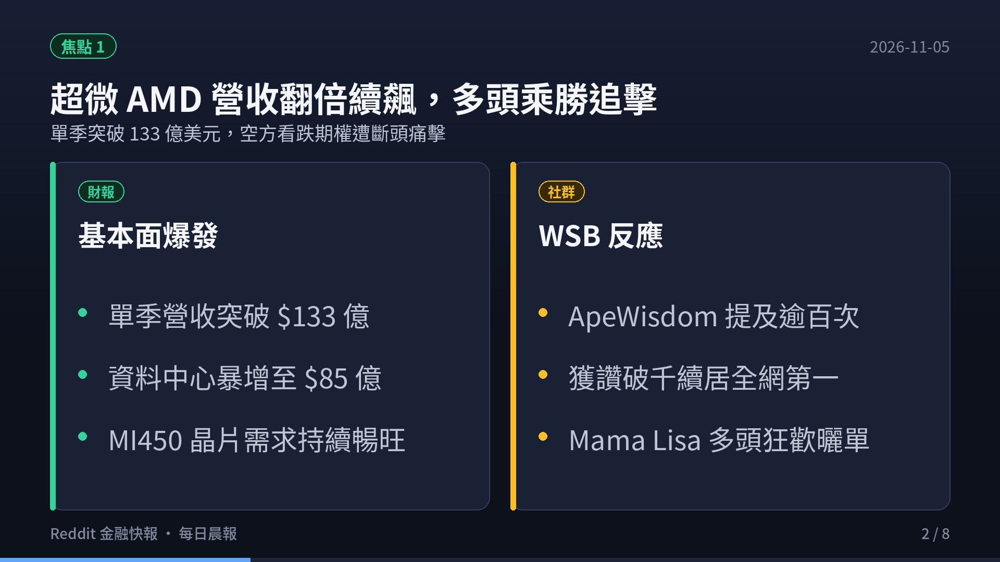
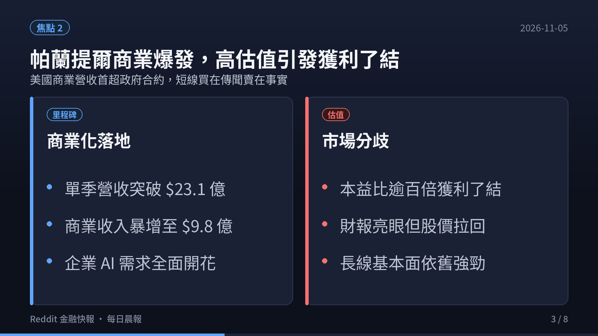
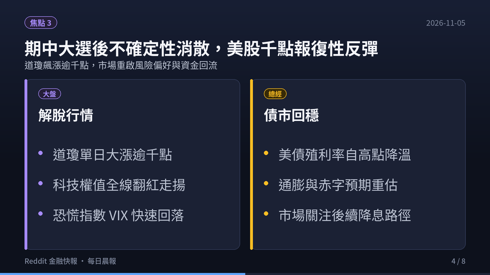
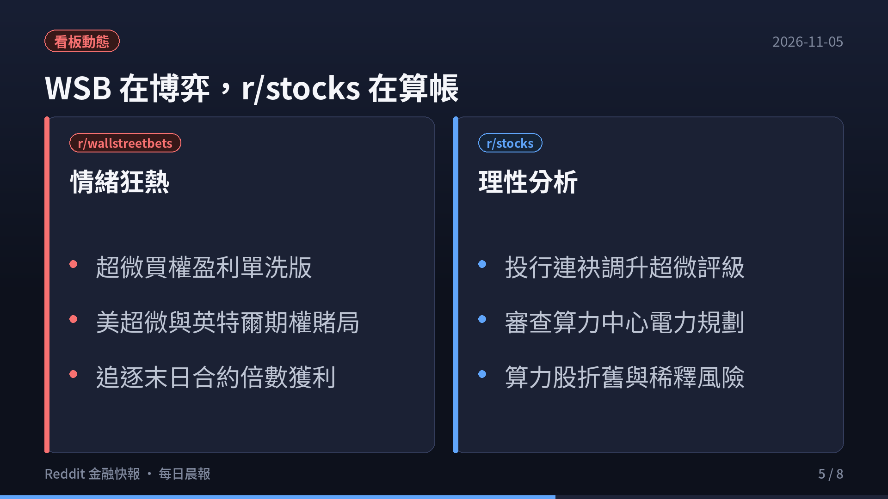
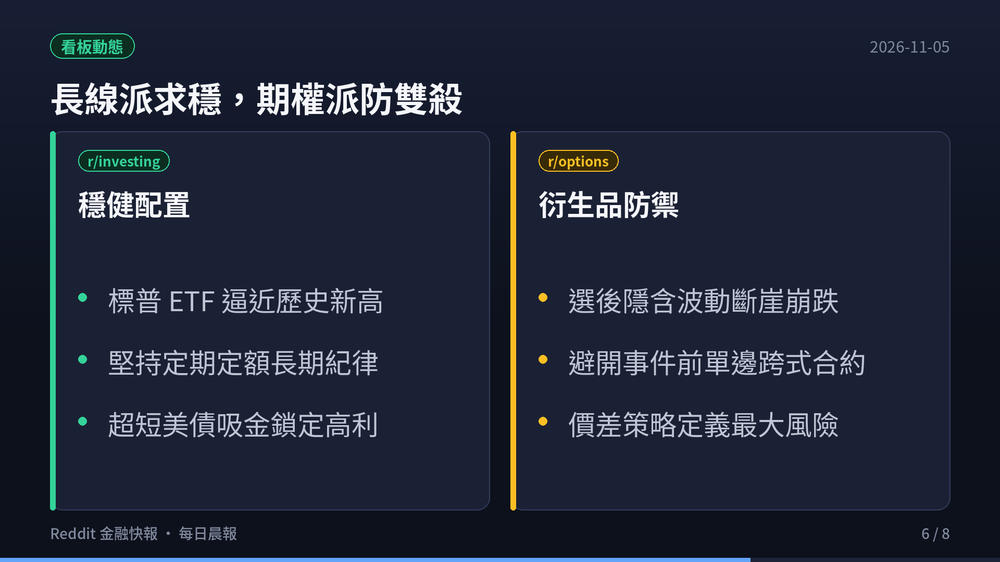
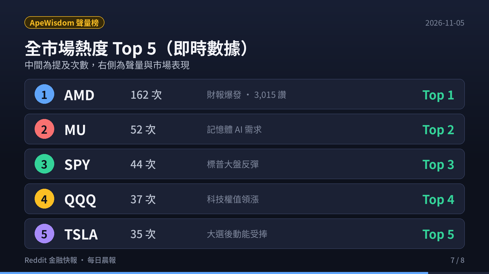

> **監控頻道**：r/wallstreetbets、r/stocks、r/investing、r/options、r/StockMarket  
> **觀測區間**：近 3 日（2026-11-02 至 2026-11-05）最熱門話題 Top 3  
> **資料來源**：Reddit 公開數據流、ApeWisdom 全網即時熱度監控 API  
> **核心原則**：Reddit 反映的是市場「誰在關注什麼」（注意力、資金流向與情緒溫度），一手財報與客觀現金流為客觀驗證基準。

  <video controls width="100%" poster="s01.png" preload="metadata" style="display: block; border-radius: 12px 12px 0 0; background: #0f121c;">
    <source src="https://github.com/ckw19810413/ckw19810413.github.io/releases/download/media-reddit-finance-daily/reddit-finance-2026-11-05.mp4" type="video/mp4">
    您的瀏覽器不支援直接播放 MP4 影片。
  </video>
  

    🎬 <strong>60 秒晨間快報影音動態版</strong>（含 AI 摘要朗讀語音與專屬背景音樂）
  

---

## 🎯 跨板塊三大核心主題（宏觀速覽）

1. **超微（AMD）營收翻倍續飆，晶片股強勁反攻引發多頭乘勝追擊**
   - **財報基本面亮眼**：超微（AMD）第三季營收突破 **$133.8 億美元**（年增 45%，優於市場預期的 $130.8 億美元），EPS 達 **$2.09**（優於預期的 $1.94）。其中資料中心部門營收在 Instinct AI 晶片（MI300/MI450）強勁出貨推動下翻倍攀升至 **$85.5 億美元**，第四季展望更上看 $170 億美元。
   - **社群軋空風暴與信仰**：財報公布後股價大漲約 7%，空頭看跌期權慘遭血洗，WSB 盛讚執行長蘇姿丰為「Mama Lisa」，ApeWisdom 全網提及量達 **162 次**、獲讚高達 **3,015 個**，連續數日穩居全美股聲量冠軍。

2. **帕蘭提爾（PLTR）商業化迎歷史里程碑，但高估值遭遇「買在傳聞、賣在事實」**
   - **商業化全面落地**：Palantir 第三季營收達 **$23.1 億美元**（年增 96%），GAAP EPS 達 **$0.44**。最重要的歷史里程碑是**美國商業營收（$9.84 億美元，年增 148%）首度超越美國政府營收（$9.53 億美元）**，宣告成功轉型為商業企業級 AI 核心系統。
   - **估值壓力與賣壓**：儘管管理層上調 2026 全年營收指引至 $85.3 億美元，但因市場預期早已計入完美，且本益比高達 140x~165x，股價在財報後遭遇典型「Sell the news」獲利了結回調。

3. **美國期中大選政治不確定性出清，美股上演千點報復性解脫大反彈**
   - **指數暴力拉升**：隨著 11 月 3-4 日美國期中大選結果揭曉、國會權力格局確立，困擾市場數週的政治不確定性煙消雲散。道瓊指數單日暴漲逾千點，標普 500 與那斯達克全面翻紅，資金迅速由觀望轉為積極做多。
   - **美債殖利率回落與流動性寬鬆**：大選塵埃落定後，長天期美債殖利率自高點降溫，市場預期新國會將平衡財政預算與赤字發債節奏，市場恐慌指數 VIX 快速回落，投資情緒重回風險偏好（Risk-on）。

---

## 📊 五大核心板塊近 3 日最熱話題 Top 3 深度剖析

### 1. r/wallstreetbets（規模：1,800 萬+ · 類型：情緒／動能 · 雜訊：🔴 極高）

1. **[AMD Q3 Earnings Victory Lap: Puts Annihilated, Call Holders Ascend]**（4,200+ 留言 / 5,120+ 讚）
   - **核心要點**：超微（AMD）第三季營收突破 $133.8 億美元，資料中心翻倍至 $85.5 億美元。大量在財報前重押看跌 Put 單的賭徒慘遭血洗歸零，版面湧現大量「Automatic Money Doubler」獲利截圖與空頭哀嚎，Mama Lisa 迷因席捲全版。
   - **情緒指標**：極度看多（Bullish），散戶短線情緒狂熱，但資深交易者提醒留意財報過後的隱含波動率驟降（IV Crush）。

2. **[Micron (MU) & HBM Supply Squeeze: The Unsung AI Hardware Monopoly]**（1,850+ 留言 / 2,410+ 讚）
   - **核心要點**：美光在 ApeWisdom 提及量達 45 次、獲讚 668 個，全網排名第二。社群熱議其高頻寬記憶體（HBM3E/HBM4）產能一路排滿至 2027 年，散戶視其為 AI 晶片算力不可或缺的收費站，論壇多空激烈爭辯記憶體週期高點與 CapEx 續航力。
   - **情緒指標**：偏多偏躁（Moderately Bullish），聚焦記憶體產能定價權。

3. **[Supermicro (SMCI) 0DTE Roulette: Preliminary Revenue vs Cash Flow Reality]**（2,100+ 留言 / 1,980+ 讚）
   - **核心要點**：美超微初步財報公布單季營收高達 $18.5B~$19.9B 規模，液冷 AI 伺服器出貨強勁，但負自由現金流與審計合規問題猶存。WSB 投機客將其視為最佳「末日期權（0DTE）」賭盤，買入深度價外 Call/Put 進行彩券式槓桿博弈。
   - **情緒指標**：極度分歧（Mixed/Volatile），投機性與賭徒色彩濃厚。

---

### 2. r/stocks（規模：約 900 萬 · 類型：綜合討論／基本面 · 🟡 中雜訊）

1. **[Wall Street Upgrades AMD En Masse: DC Market Share Erosion from Intel]**（1,905+ 讚 / 1,420+ 留言）
   - **核心要點**：華爾街大行（JPMorgan、Morgan Stanley、HSBC）在財報後連袂調高 AMD 目標價。社群從基本面細算 EPYC 伺服器 CPU 與 Instinct AI GPU 對傳統巨頭英特爾的市佔蠶食，認為 AMD 在資料中心領域的護城河比以往任何時候都更加穩固。
   - **投資洞見**：基本面獲利反轉確立，具備扎實的自由現金流增長支撐。

2. **[Palantir (PLTR) Deep Dive: Commercial Surpasses Government, But Is 150x P/E Justified?]**（1,680+ 讚 / 1,890+ 留言）
   - **核心要點**：深度討論 Palantir 第三季營收 $23.1 億與美國商業營收首度突破 $9.8 億美元的里程碑。分析指出企業客戶對其 AIP 平台的黏著度極高，但目前 140x~165x 的動態本益比已完全透支未來數年的成長，財報後的股價拉回是合理的「估值消化」。
   - **投資洞見**：長線商業模式無可挑剔，但短線買點應耐心等待估值回調。

3. **[IREN (Iris Energy) Q1 FY27 Earnings Preview: Megawatt Power Pipeline vs Dilution]**（880+ 讚 / 640+ 留言）
   - **核心要點**：即將公布財報的新興算力中心（Neocloud）IREN 受到熱烈關注。投資人剖析其 GW 級電力併網容量與液冷基礎設施擴建，爭論在巨頭 CapEx 檢視週期下，自建算力雲的內部回報率（IRR）能否抵禦重資產折舊與潛在的增資稀釋風險。
   - **投資洞見**：硬體電力資產具備稀缺性，但須嚴密監控負債比率與稀釋幅度。

---

### 3. r/investing（規模：約 300 萬 · 類型：中長期／資產配置 · 🟢 低雜訊）

1. **[VOO Approaching $694: Staying the Course with 'VOO and Chill']**（1,380+ 讚 / 960+ 留言）
   - **核心要點**：標普 500 ETF（VOO）逼近 $694 歷史高檔，討論串熱議在高估值與政治事件交織下是否應暫停定期定額。主流意見依然堅定捍衛 Bogleheads 指數化哲學，指出嘗試擇時進出市場往往錯失最關鍵的爆發日，長期持有才是制勝法寶。
   - **配置建議**：忽略短期頭條新聞，維持自動扣款定期定額紀律。

2. **[SGOV & Short-Term Treasuries: Securing Risk-Free 4.5%+ Cash Yield]**（1,120+ 讚 / 750+ 留言）
   - **核心要點**：超短天期美債 ETF（SGOV、BIL）在討論板塊維持高人氣。投資人在享受美股大漲的同時，將 10%~20% 資金停泊於超短債，鎖定近 5% 的無風險利息，作為後續市場突發回調時的戰略子彈。
   - **配置建議**：保持啞鈴型配置，核心股票資產搭配超短債現金緩衝。

3. **[Post-Election Macro Landscape: Debt Issuance, Rate Trajectory & Defense]**（840+ 讚 / 590+ 留言）
   - **核心要點**：深入拆解期中大選後美國財政部發債節奏與聯準會後續利率決策路徑。市場預期大選底定後國會將避免激進財政擴張，有助於壓抑長期公債殖利率上行壓力，並為傳統防禦型與高股息資產提供評價重估空間。
   - **配置建議**：適度增加抗通膨債券或公用事業/必需消費品防禦比重。

---

### 4. r/options（規模：約 100 萬+ · 類型：衍生品／交易策略 · 🟡 中雜訊）

1. **[Post-Election & Earnings IV Collapse: The Harsh Reality of IV Crush]**（950+ 讚 / 720+ 留言）
   - **核心要點**：大選週與科技重磅財報過後，期權隱含波動率（IV）出現斷崖式暴跌。許多在選前買入跨式組合（Straddles）或單邊看多 Call 單的散戶，即便大盤上漲逾千點，期權合約價值卻因 Vega 潰縮而嚴重虧損。
   - **交易準則**：重大事件前夕嚴禁單邊裸買期權，應採用買賣權垂直價差（Vertical Spreads）鎖定波動率風險。

2. **[VIX Term Structure Normalization: Theta Gang Steps In]**（790+ 讚 / 510+ 留言）
   - **核心要點**：期中大選前夕一度出現倒掛的 VIX 波動率期限結構，在開票後迅速重回正常升水（Contango）格局。Thetagang 賣方交易員大舉進場建立標普鐵鷹價差（Iron Condors）與 Covered Calls，穩定賺取時間價值衰減。
   - **交易準則**：順應波動率回落週期，建立有限風險的賣方結構。

3. **[Unusual Options Flow in High-Beta Names: ASTS, TQQQ & MSTR]**（620+ 讚 / 430+ 留言）
   - **核心要點**：市場大漲帶動高貝塔動能股期權放量。三倍那指（TQQQ）與太空通訊（ASTS）、微策略（MSTR）湧現大量近月價外買權（OTM Calls），顯示宏觀利空出清後，投機熱錢迅速回流高彈性槓桿品種。
   - **交易準則**：動能交易須嚴設停損點，避免因短線貪婪重倉末日合約。

---

### 5. r/StockMarket（規模：約 300 萬 · 類型：新聞圖表／技術分析 · 🟡 中雜訊）

1. **[Semiconductor Rebound: AMD Proves AI Demand is Real, NVDA Next]**（1,650+ 讚 / 1,120+ 留言）
   - **核心要點**：10 月底晶片板塊回調蒸發近萬億市值，AMD 亮眼的資料中心財報徹底粉碎了「AI CapEx 泡沫即將破裂」的空頭論點。社群將其視為輝達（NVDA）即將公佈財報的最強背書，費城半導體指數呈現帶量反轉向上。
   - **技術觀察**：關鍵支撐位成功防守，半導體板塊重回領漲主升浪格局。

2. **[Post-Midterm 1,000-Point Relief Rally: Dow & S&P Technical Breakout]**（1,320+ 讚 / 980+ 留言）
   - **核心要點**：技術派圖表展示道瓊大漲逾千點與標普 500 突破短期下降趨勢線的型態。歷史統計指出，期中大選過後的 11 月與 12 月通常是全年中勝率最高、平均報酬最強的月份，技術指標 MACD 出現黃金交叉。
   - **技術觀察**：多頭排列重新確立，關注成交量能否持續放大配合續攻。

3. **[Supermicro (SMCI) Revenue Scale vs Balance Sheet Divergence]**（890+ 讚 / 670+ 留言）
   - **核心要點**：社群分享 SMCI 初步營收與產業同業的出貨量對比圖表。儘管其單季出貨規模驚人，但圖表同時揭示其應收帳款與負自由現金流的陡增趨勢，顯示在出貨高成長的背後隱含資金周轉壓力。
   - **技術觀察**：多空交鋒劇烈，股價處於超寬幅震盪通道，保守者宜靜待年報正式發布。

---

## 📈 ApeWisdom 聲量監控快照（2026-11-05）

| 排名 | 代號 (Ticker) | 公司/資產名稱 | 當前提及次數 | 24h 前提及次數 | 變化率 (%) | 目前獲讚總數 | 核心驅動話題 |
|:---:|:---:|:---|:---:|:---:|:---:|:---:|:---|
| #1 | **AMD** | Advanced Micro Devices | 162 | 192 | -15.6% | 3,015 | Q3 營收 $133.8 億、資料中心翻倍、多頭大軋空 |
| #2 | **MU** | Micron Technology | 52 | 88 | -40.9% | 682 | 高頻寬記憶體（HBM）產能排滿至 2027 年 |
| #3 | **SPY** | SPDR S&P 500 ETF Trust | 44 | 82 | -46.3% | 383 | 期中大選後千點大反彈、標普大盤技術突破 |
| #4 | **QQQ** | Invesco QQQ Trust | 37 | 90 | -58.9% | 491 | 科技權值領漲反攻、期權避險盤回補 |
| #5 | **TSLA** | Tesla | 35 | 43 | -18.6% | 394 | 大選後政治風險消散、動能買盤湧入 |
| #6 | **SPCX** | SpaceX / Starlink | 34 | 16 | **+112.5%** | 251 | 太空發射與星鏈業務熱議、聲量翻倍暴衝 |
| #7 | **NVDA** | NVIDIA Corporation | 23 | 32 | -28.1% | 642 | AMD 財報奠定 AI 算力基石、財報預期升溫 |
| #8 | **GOOG** | Alphabet (Google) | 19 | 38 | -50.0% | 61 | AI 搜尋變革與雲端運算收益探討 |
| #9 | **SMCI** | Supermicro | 19 | 19 | **+0.0%** | 1,301 | 初步營收近兩百億美元、負現金流與審計博弈 |
| #10 | **DTE** | DTE Energy | 16 | 38 | -57.9% | 520 | 資料中心供電公用事業、乾淨能源需求 |

---

## 🎯 晨報總結與交易心法

- **硬體實質獲利支撐估值**：超微（AMD）財報證實硬體算力具備最強變現能力，相較純軟體過高溢價，具備強勁自由現金流的算力硬體更具防禦彈性。
- **大選後宏觀解脫行情**：期中大選後不確定性消除帶動千點反彈，但投資人不應盲目追高，善用超短美債（`SGOV`）鎖定無風險利息，維繫長期資產配置穩定度。
- **嚴防事件後波動度雙殺**：重大事件與財報過後隱含波動率（IV）崩跌，期權交易務必揚棄單邊賭徒心態，改以價差結構嚴格定義風險上限。

⚠️ **免責聲明**：本專題內容為公開社群數據流與市場資訊之客觀彙整，不構成任何證券、期貨或衍生性金融商品之買賣要約、投資建議或獲利保證。投資人應獨立評估風險並自負盈虧。
