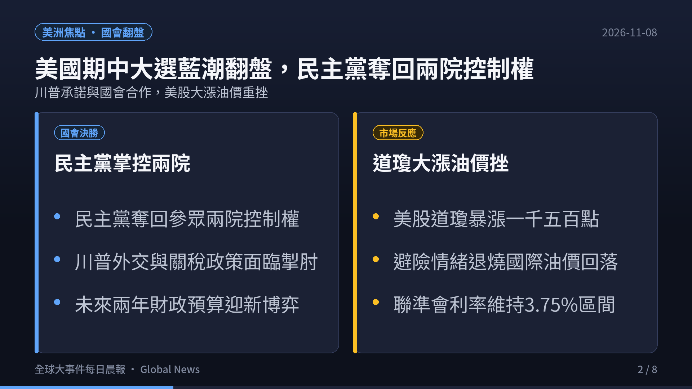
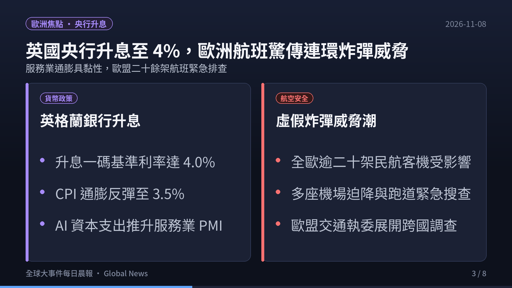
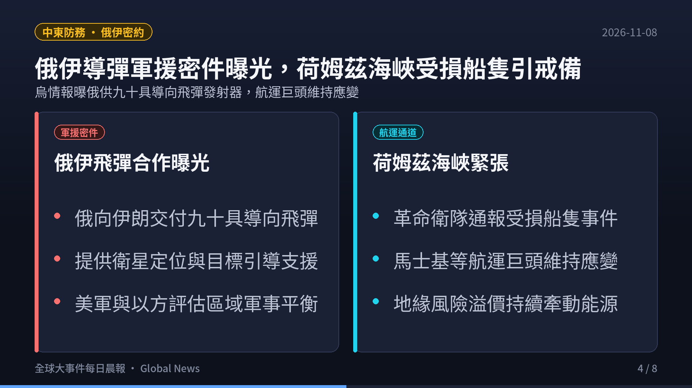
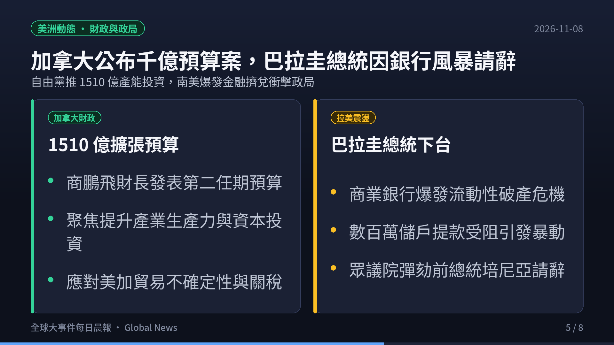
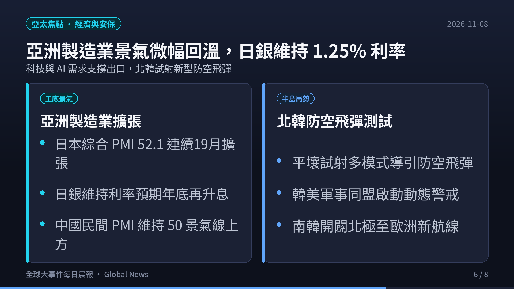
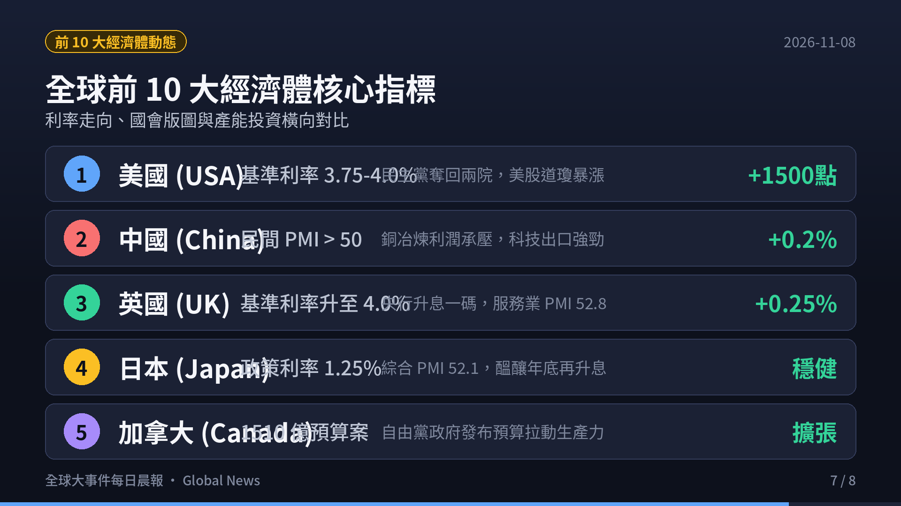
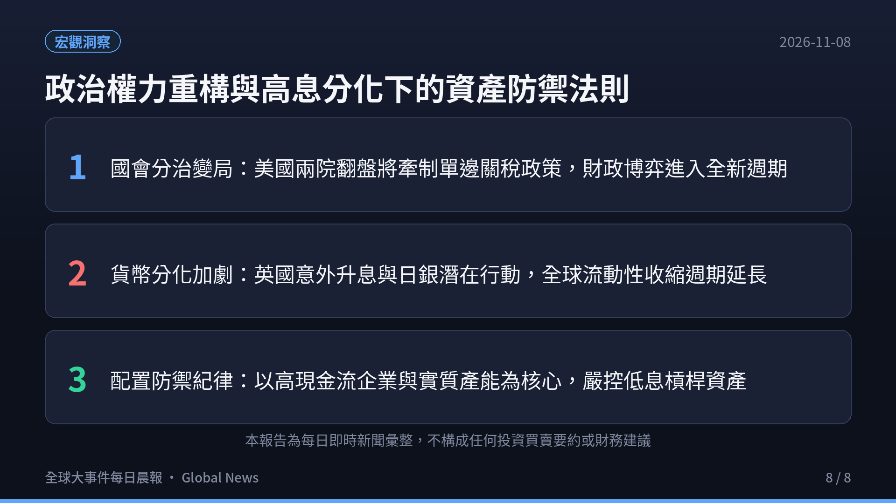

> **觀測週期**：2026-11-08 晨間即時彙整  
> **情報涵蓋**：全球各大洲（北美、歐洲、中東、亞洲/印太、拉美、大洋洲）與全球前 10 大經濟體  
> **核心來源**：各國政府公報、路透社（Reuters）、美聯社（AP）、英國衛報（The Guardian）、各國央行公報與 S&P Global PMI 報告  
> **定位宗旨**：以客觀數據、官方決策與供應鏈結構為準繩，剔除短期情緒噪音，提煉出真正驅動全球資金流向與地緣版圖重構的核心脈絡。

  

    <iframe src="https://www.youtube.com/embed/p00rccMbvik" title="2026-11-08 全球大事件每日晨報" style="position: absolute; top:0; left: 0; width: 100%; height: 100%; border: 0;" allow="accelerometer; autoplay; clipboard-write; encrypted-media; gyroscope; picture-in-picture; web-share" allowfullscreen></iframe>
  

  

    🎬 <strong>120 秒晨間快報影音動態版</strong>（含 AI 自然神經語音朗讀與背景配樂）
  

---

## 🎯 今日全球前 6 大核心事件深度拆解

### 1. 美洲政局與資本市場：美國期中選舉藍潮掀天翻地覆，民主黨重奪兩院掌控權，道瓊狂飆千點
- **兩院版圖大翻盤與行政掣肘**：
  - 美國期中大選計票塵埃落定，民主黨成功掀起「藍色浪潮」，一舉擊敗共和黨，同時奪回參議院與眾議院的絕對多數席次。
  - 川普總統面臨任期後兩年的重大國會掣肘，白宮發言人隨後表態願與新國會多數展開跨黨派合作。此結果大幅降低了單邊全面徵收高額行政關稅的極端立法風險。
- **資本市場暴力狂歡與避險消退**：
  - 華爾街股市迎來狂歡式反彈，道瓊工業指數單日暴漲逾 1,500 點；與此同時，地緣避險溢價迅速回吐，國際原油期貨價格重挫回落。
  - 聯準會利率目標區間維持在 3.75%–4.00%，市場預期分裂國會將遏制過度擴張性的財政赤字刺激，減輕後續通膨二次抬頭的風險。

---

### 2. 歐洲貨幣與航空安全：英格蘭銀行升息一碼至 4.0%，全歐二十餘航班遭遇虛假炸彈威脅緊急排查
- **英國央行逆勢緊縮打擊通膨**：
  - 英國央行（Bank of England）在 11 月議息會議宣布將基準利率上調 25 個基點至 **4.0%**，以壓制最新反彈至 3.5% 的核心消費者物價指數（CPI）。
  - 標普全球（S&P Global）數據顯示，企業在人工智慧（AI）與雲端科技的資本支出推動英國服務業 PMI 躍升至八個月新高 52.8，但服務業工資黏性仍促使央行維持強硬立場。
- **歐洲民航遭遇系統性虛假警報衝擊**：
  - 全歐洲境內超過 21 架次國際商業航班遭遇協同性質的連環炸彈威脅，多座主要國際機場被迫緊急暫停起降並引導客機實施跑道滑行隔離搜查。
  - 歐盟交通運輸專員已緊急聯手各國情報與航空安全局展開跨國溯源調查。

---

### 3. 中東防務與航運樞紐：烏情報曝俄向伊朗提供 90 具先進導向飛彈發射器，荷姆茲海峽受損船隻引發航運警戒
- **俄伊戰略軍事技術合作文件外洩**：
  - 烏克蘭情報部門獲取並經外媒確認的洩密防務文件顯示，俄羅斯已與伊朗達成協議，向德黑蘭提供 90 具先進 LMUR 直升機發射型精確導引飛彈系統，並持續提供軍用級衛星定位與目標偵察數據。
  - 此舉被視為俄伊戰略夥伴關係的實質升級，引發美國五角大廈與中東盟邦對波斯灣軍事平衡的高度戒備。
- **波斯灣與荷姆茲海峽航行警戒持續**：
  - 伊朗伊斯蘭革命衛隊（IRGC）報告波斯灣荷姆茲海峽水域發生零星船隻受損事件，國際航運龍頭馬士基（Maersk）等持續啟動緊急應變規避指引，區域海上保險費率維持高檔。

---

### 4. 美洲與拉美震盪：加拿大推出 1510 億產能擴張預算，巴拉圭爆發銀行擠兌危機總統培尼亞請辭
- **加拿大 2026 年度聯邦預算拍板**：
  - 加拿大財政部長商鵬飛（François-Philippe Champagne）在總理馬克·卡尼（Mark Carney）內閣下發表高達 1,510 億加幣的第二任期聯邦預算案。
  - 預算核心著重於大規模拉動私人資本投資、改善國家生產力瓶頸，並緩解家庭生活成本壓力，同時為美加可能出現的新一輪貿易摩擦築起防禦緩衝。
- **南美爆發金融擠兌引發政局崩盤**：
  - 南美洲巴拉圭大型商業銀行突發性流動性崩潰，引發全境數百萬民眾恐慌性排隊擠兌與街頭混亂。
  - 在眾議院即將通過彈劾案前夕，巴拉圭總統聖地牙哥·培尼亞（Santiago Peña）正式宣布辭職，南美新興市場主權風險溢價隨之上升。

---

### 5. 亞洲工廠動能與印太安保：亞洲製造業獲科技需求支撐，日銀按兵不動醞釀升息，北韓試射防空導彈
- **亞洲供應鏈展現韌性**：
  - 日本綜合採購經理人指數（Composite PMI）錄得 52.1，寫下連續第 19 個月保持在擴張區間的穩健紀錄，科技與半導體周邊設備需求提供主要支撐。
  - 中國 RatingDog / S&P 合作發布的民間製造業 PMI 穩守 50 榮枯線之上，儘管銅冶煉廠面臨副產品硫酸價格暴跌帶來的利潤擠壓，高技術產品外銷仍具支撐力。
- **印太安全情勢與東北亞動態**：
  - 日本央行在貨幣政策決議中以 8 比 1 投票結果維持基準利率在 1.25% 不變，但總裁植田和男再次暗示若物價符合預期，年底或 2027 年初將進一步實施貨幣政策正常化。
  - 北韓官方宣布成功完成新型防空飛彈與巡弋飛彈的多模式導向性能測試，美韓軍事同盟啟動動態警戒應對。

---

### 6. 全球前十大經濟體核心指標與趨勢橫向全景

| 排名 | 國家 / 經濟體 | 核心總體經濟數據 / 最新指標 | 2026-11-08 即時動態與政策取向 | 全球產業鏈與市場意涵 |
|:---:|:---|:---|:---|:---|
| **1** | **美國 (USA)** | 基準利率 **3.75%–4.00%** · 通膨 **3.7%** | 期中大選藍潮奪回兩院；道瓊暴漲 1500 點；川普承諾與國會合作 | 國會分治阻絕激進單邊關稅風險，美股風險溢價快速重估，長端殖利率壓力略減。 |
| **2** | **中國 (China)** | 民間 PMI **> 50** · 銅冶煉利潤承壓 | 科技製造業外銷訂單維持動能；副產品價格下跌壓抑冶煉業；財政基建持續落地 | 科技與新能源供應鏈維持韌性，製造業加速向高附加價值端升級。 |
| **3** | **德國 (Germany)** | 歐洲央行存款利率 **2.50%** · 工業疲軟 | 歐元區航班炸彈威脅衝擊交通；ECB 利率按兵不動；汽車供應鏈轉型陣痛 | 德國作為歐洲工業龍頭持續受制於高能源成本與地緣分割，依賴新基建帶動。 |
| **4** | **日本 (Japan)** | 政策利率維持 **1.25%** · 綜合 PMI **52.1** | 連續 19 個月維持景氣擴張；日銀釋放年底進一步升息預期；AI 晶片設備出口穩健 | 日圓匯率築底反彈，日銀正常化進程持續牽引全球套息交易（Carry Trade）倉位調整。 |
| **5** | **印度 (India)** | GDP 預測成長 **6.8%** · 通膨率 **5.0%** | Quad 關鍵礦產與半導體產線深化；新德里選務抗議維安警戒；內需消費強勁 | 作為全球供應鏈多元化核心樞紐，資本流入動能強勁，製造業產能迅速擴增。 |
| **6** | **英國 (UK)** | 基準利率升至 **4.0%** · 服務業 PMI **52.8** | 英國央行升息一碼應對 3.5% 通膨；企業 AI 支出爆發帶動服務業八個月新高 | 服務業需求展現高韌性，但高利率對地產與按揭貸款家庭造成進一步借貸成本壓力。 |
| **7** | **法國 (France)** | 歐洲央行存款利率 **2.50%** · 罷工餘波 | 生活成本高漲引發全國黑色星期四抗議；航空炸彈警報波及巴黎等樞紐機場 | 社會福利與財政緊縮政策博弈加劇，公共部門預算整頓面臨政治民意反彈。 |
| **8** | **義大利 (Italy)** | 歐元區統一利率 **2.50%** · 國債監控 | 歐元區降息預期暫緩；國債利差持穩；歐盟綠色轉型與基礎建設專案推進 | 財政審查嚴格，對歐洲央行貨幣緊縮節奏極度敏感，聚焦高收益基建回報。 |
| **9** | **加拿大 (Canada)** | 1510 億聯邦預算 · 刺激生產力 | 財長商鵬飛發表卡尼內閣預算案；拉動私人資本投資防範美加貿易變數 | 擴張性預算旨在提升人均生產力，並在美選後對北美自由貿易協定進行動態預防。 |
| **10** | **澳洲 (Australia)** | 基準利率 **4.35%** · 商品貿易順差 | 澳洲央行維持限制性高息；大宗金屬與天然氣出口穩定；籌備 COP31 氣候峰會 | 能源過渡與關鍵礦產吸引跨國資本，但服務業通膨黏性限制央行短期降息空間。 |

---

## 💡 總結與投資者生存指南

1. **大選投票與地緣變數引發的全球資產重定價**：
   - 美國期中大選結果將直接重塑華府未來兩年的財政與外交政策，尤其在對伊軍事決策與關稅法案上的行政掣肘。
   - 伴隨 OPEC+ 產量凍結、荷姆茲海峽風險溢價持續，油價維持高檔將成為各國央行延後降息或重啟緊縮的催化劑。
2. **通膨黏性與社會結構性矛盾爆發**：
   - 德國 200 多人被捕的青年抗爭與法國製造業收縮，再次揭示高生活成本對歐美民生結構造成的持久性創傷。
   - 工廠端投入成本以五月以來最快速度反彈，反映全球供應鏈在地緣分割與脫鉤下的「結構性摩擦成本」難以在短期內消除。
3. **高息持久戰下的資產配置防禦紀律**：
   - 10 年期美債殖利率維持在 4.9% 附近，高無風險利率代表一切依賴低息流動性的商業模式都將加速接受壓力測試。
   - 投資者應堅守「高確定性現金流、低財務槓桿、具備技術與定價護城河」的三大原則，保持彈性資產配置。

---

### ☕ 支持與精選推薦

如果你覺得這份每日晨報對你的宏觀視野與決策有實質幫助，歡迎透過以下方式支持我們持續產出深度內容：

- ☕ **請我喝杯咖啡**：[Ko-fi 小費贊助 (ytstories0413)](https://ko-fi.com/ytstories0413) 或 [Ko-fi 贊助 (slashman413)](https://ko-fi.com/slashman413)（支持每日自動化爬蟲、語音合成與雲端運算）
- 📚 **數位產品與高人效生產力工具**：
  - [Gumroad 數位商品專區](https://slashmaster6.gumroad.com/)：收錄精選 AI Prompt 庫、生產力自動化工作流與實戰腳本
  - [SlashmanTools 免費 Web 工具集](https://slashmantools.us/)：Token 成本計算器、顯存預估、開源 AI 工具導航
- 📖 **精選經典閱讀推薦**：
  - [《晶片戰爭》（Chip War）](https://www.amazon.com/dp/059371671X?tag=ytstories0413-20)：理解全球晶片霸權與印太供應鏈重組的必讀經典
  - [《原子習慣》— 細微改變帶來巨大成就](https://www.books.com.tw/products/0010792915)
  - [《人生的智慧》— 叔本華處世哲學經典](https://www.books.com.tw/products/0010613113)
