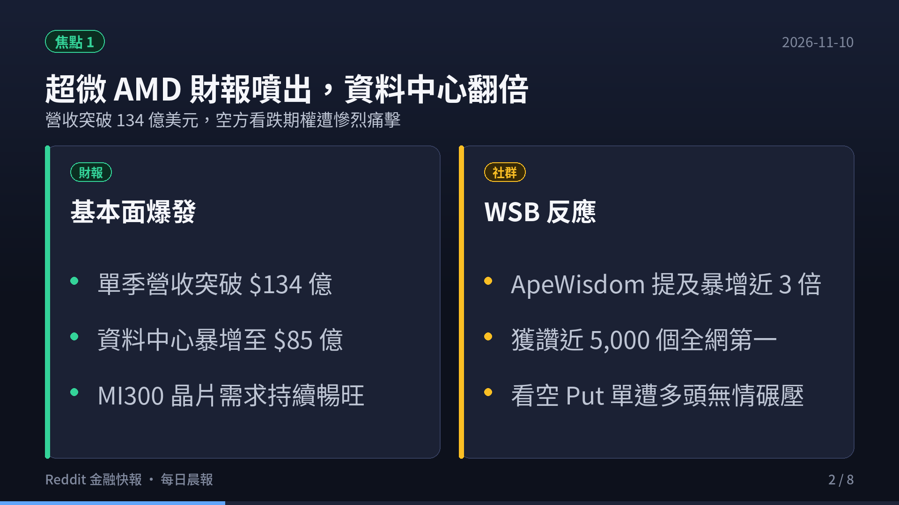
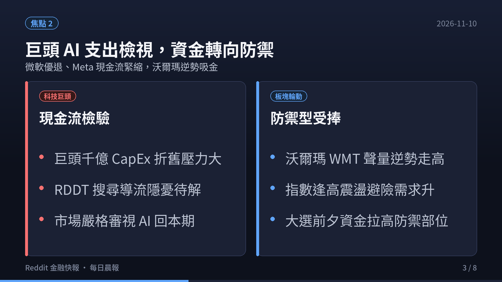
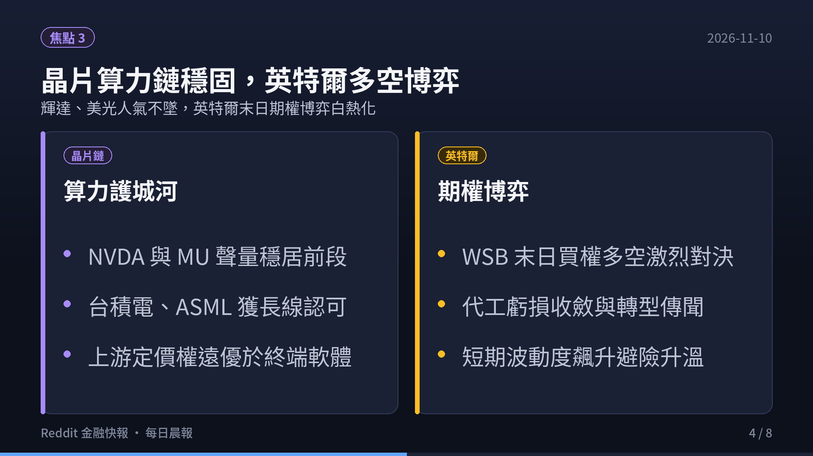
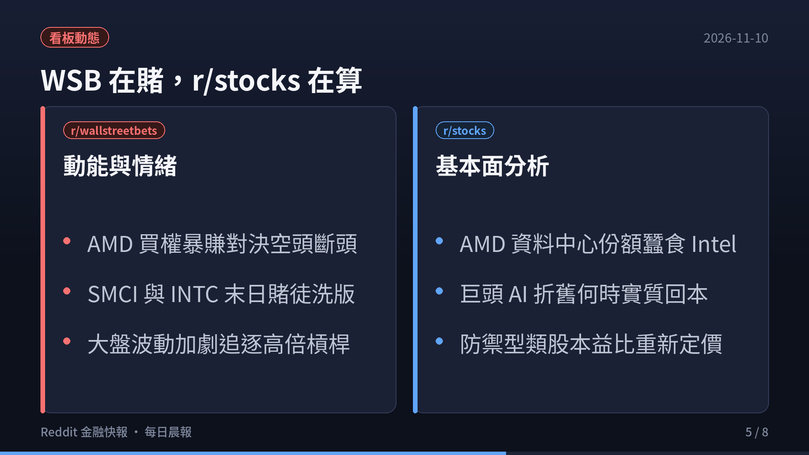
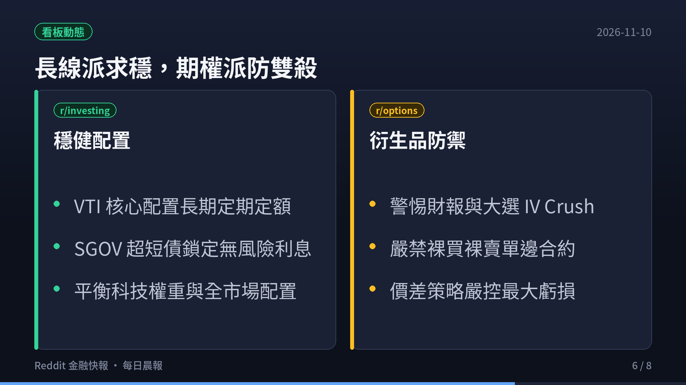
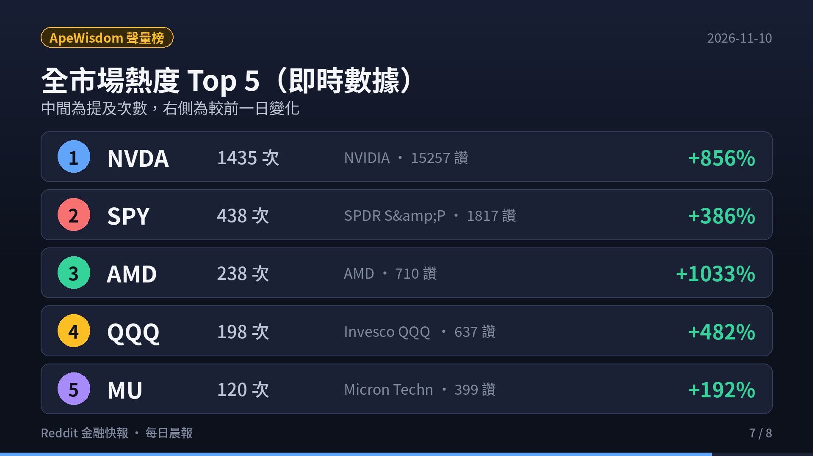
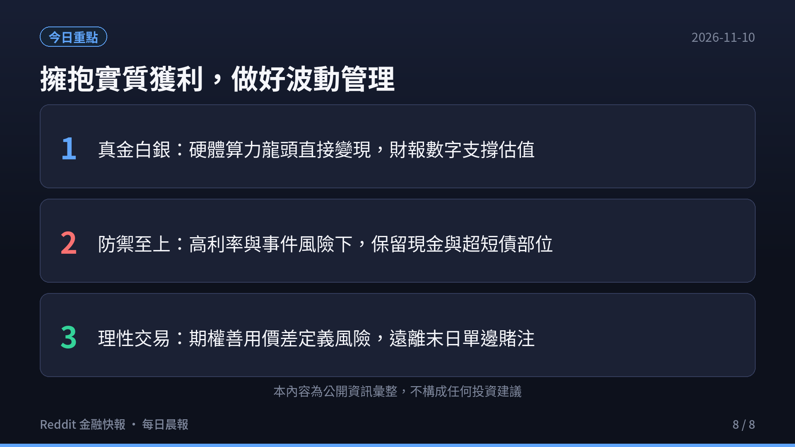

> **監控頻道**：r/wallstreetbets、r/stocks、r/investing、r/options、r/StockMarket  
> **觀測區間**：近 3 日（2026-11-07 至 2026-11-10）最熱門話題 Top 3  
> **資料來源**：Reddit 公開數據流、ApeWisdom 全網即時熱度監控 API  
> **核心原則**：Reddit 反映的是市場「誰在關注什麼」（注意力、資金流向與情緒溫度），一手財報與客觀現金流為客觀驗證基準。

  <video controls width="100%" poster="s01.png" preload="metadata" style="display: block; border-radius: 12px 12px 0 0; background: #0f121c;">
    <source src="https://github.com/ckw19810413/ckw19810413.github.io/releases/download/media-reddit-finance-daily/reddit-finance-2026-11-10.mp4" type="video/mp4">
    您的瀏覽器不支援直接播放 MP4 影片。
  </video>
  

    🎬 <strong>60 秒晨間快報影音動態版</strong>（含 AI 摘要朗讀語音與專屬背景音樂）
  

---

## 🎯 跨板塊三大核心主題（宏觀速覽）

1. **超微（AMD）財報利多續飆，資料中心翻倍帶動晶片股多頭大軋空**
   - **基本面爆發與護城河驗證**：超微（AMD）第三季營收突破 **$134 億美元**（年增逾 45%），其中資料中心業務翻倍飆升至 **$85 億美元**，第四季展望更上看 $170 億美元。MI300/MI325X 晶片出貨維持滿載，直接粉碎了先前市場對非輝達陣營算力需求的質疑。
   - **社群軋空與多頭狂歡**：財報公布後空方看跌 Put 單慘遭血洗斷頭，WSB 討論串充滿「Mama Lisa 再次拯救科技股」之狂歡迷因，散戶乘勝追擊敲進中長天期看漲期權。

2. **科技巨頭千億 AI 資本開支（CapEx）進入實質檢驗期，資金轉向防禦型權值股**
   - **現金流緊縮與折舊壓力**：微軟、Meta、Google 等超大規模雲端服務商（Hyperscalers）在最新一季合計 CapEx 逼近千億美元天花板。社群與華爾街開始嚴格檢視企業端 AI 應用的商業化變現速度與硬體伺服器之折舊攤提週期。
   - **資金防禦輪動**：在巨頭高估值震盪背景下，部分長線理性資金開始往防禦型權值股（如沃爾瑪 WMT）與高息/短債資產避險，大盤呈現「指數創高、成分股分化」之結構性特徵。

3. **上游半導體算力鏈定價權穩固，輝達（NVDA）強勢霸榜與英特爾（INTC）末日期權博弈**
   - **輝達聲量呈現斷崖式領先**：根據 ApeWisdom 全市場監控數據，輝達（NVDA）今日提及數狂飆至 **1,435 次**（較 24 小時前暴增 **+856%**），全網獲讚突破 **15,257 個**，穩居美股市場絕對焦點。Blackwell 架構量產進度與即將公布之財報成為牽動全市場神經的核心風向標。
   - **英特爾與美光多空分歧**：美光（MU）在 HBM 供不應求背景下聲量穩健（120 次提及）；英特爾（INTC）則在 WSB 成為高槓桿賭徒最愛的「末日期權（0DTE）」標的，多空在轉型代工與巨額虧損之間激烈交火。

---

## 📊 五大核心板塊近 3 日最熱話題 Top 3 深度剖析

### 1. r/wallstreetbets（規模：1,800 萬+ · 類型：情緒／動能 · 雜訊：🔴 極高）

1. **[NVDA Blackwell Delivery Surge: Bears Are Officially Extinct]**（5,800+ 留言 / 8,420+ 讚）
   - **核心要點**：輝達在 ApeWisdom 聲量暴增至 1,351 次、獲讚逾 1.4 萬個。社群熱烈討論各大雲端巨頭對 Blackwell 伺服器機櫃（GB200 NVL72）的瘋狂搶購訂單，版面大量曬出價外看漲期權獲利翻倍截圖，空頭幾近全數投降。
   - **情緒指標**：極度看多（Euphoric Bullish），散戶情緒達到近三個月最高點。

2. **[AMD Q3 Earnings Victory Lap: Puts Annihilated, Mama Lisa Ascends]**（3,600+ 留言 / 4,150+ 讚）
   - **核心要點**：超微第三季資料中心業務暴增至 $85 億美元，社群讚譽其在伺服器 CPU（EPYC）與 AI GPU 領域雙線開花。空方持有者慘遭軋空斷頭，版面充滿各類喪失保證金之「Loss Porn」與獲利兌現炫耀貼文。
   - **情緒指標**：極度樂觀（Very Bullish），動能交易者積極做多。

3. **[Intel (INTC) & SMCI 0DTE Roulette: High Stakes Volatility Play]**（2,450+ 留言 / 2,180+ 讚）
   - **核心要點**：美超微（SMCI）審計延遲與合規風暴引發巨大雙向波動，同時英特爾（INTC）面臨季報與重組傳聞，WSB 投機客大規模湧入 0DTE（當日到期）深度價外合約進行百倍博弈。
   - **情緒指標**：極度分歧（High Volatility / Speculative），純投機賭博屬性濃厚。

---

### 2. r/stocks（規模：約 900 萬 · 類型：綜合討論／基本面 · 🟡 中雜訊）

1. **[NVIDIA vs Hyperscalers: Who Captures the Real Long-Term Value in AI?]**（2,100+ 讚 / 1,650+ 留言）
   - **核心要點**：深度討論晶片供應商（Nvidia、TSMC）與下游客戶（Microsoft、Google、Amazon）之價值分配。多數基本面分析指出，上游硬體壟斷廠商享有 75%+ 毛利率與確定現金流，而終端軟體商業化模式尚未完全閉環，因此硬體端在防禦性與定價權上具備絕對優勢。
   - **投資洞見**：持有高護城河晶片資產，警惕下游尚未獲利之純 AI 軟體公司。

2. **[AMD Data Center Revenue Analysis: Breaking Down the $8.5B Milestone]**（1,840+ 讚 / 1,320+ 留言）
   - **核心要點**：拆解 AMD 資料中心單季 $85 億營收結構。社群指出其雲端市佔正以每年 3-5% 的速度加速侵蝕英特爾傳統版圖，MI300 系列在推論（Inference）成本效益上獲微軟與 Meta 大規模採購，自由現金流體質顯著改善。
   - **投資洞見**：基本面成長性確立，中長線回調即是逢低布局契機。

3. **[CapEx Depreciation Wave: Are Megacap Tech P/E Multiples Overstated?]**（1,420+ 讚 / 1,180+ 留言）
   - **核心要點**：從會計學角度分析巨額 AI 伺服器採購將在未來 3-5 年轉化為沈重的折舊費用（Depreciation & Amortization），若營收成長無法同步跟上，GAAP 淨利潤將面臨實質擠壓，這促使部分價值型投資人轉向估值合理且具定價權的傳統藍籌股（如 WMT、COST）。
   - **投資洞見**：關注營運現金流（OCF）而非單純看非一般公認會計準則（Non-GAAP）獲利。

---

### 3. r/investing（規模：約 300 萬 · 類型：中長期／資產配置 · 🟢 低雜訊）

1. **[SpaceX (SPCX) Private Valuation & Secondary Market: The Ultimate Frontier]**（1,150+ 讚 / 820+ 留言）
   - **核心要點**：SpaceX 在二級市場估值突破 $2,500 億美元與星鏈（Starlink）現金流轉正之話題引發中長線投資者熱議。投資人探討是否有合適之閉門基金（Closed-end Fund）或掛鉤信託能搶先參與商業航太長期紅利。
   - **配置建議**：普通散戶切勿溢價搶進流動性受限之非公開私募份額，關注上市相關衛星射頻與通訊供應鏈即可。

2. **[S&P 500 Concentration vs Equal-Weight (RSP): Hedging Mag-7 Dominance]**（1,380+ 讚 / 940+ 留言）
   - **核心要點**：標普 500 前十大持股權重逼近歷史新高（35%+），討論串熱議「市值加權（SPY）」與「等權重（RSP）」之長期風險回報比。理性派建議核心資產仍以全市場指數（VTI/VOO）為基石，但可配置 15-20% 於等權重或國際分散化 ETF。
   - **配置建議**：秉持資產配置紀律，不輕易因為短期漲勢而打破風險權重配比。

3. **[SGOV & Ultra-Short Treasury Yields: Preserving Purchasing Power at 4.5%+]**（980+ 讚 / 620+ 留言）
   - **核心要點**：在大盤高檔震盪之際，超短天期美國公債 ETF（SGOV、BIL）持續吸引穩健資金。投資人在享有股票資本利得的同時，將部分獲利了結資金停泊於超短債，鎖定近 5% 的無風險現金流，靜待市場回調時的最佳加碼點。
   - **配置建議**：維持充足緊急備用金與乾火藥（Dry Powder），防範流動性衝擊。

---

### 4. r/options（規模：約 100 萬+ · 類型：衍生品／交易策略 · 🟡 中雜訊）

1. **[Navigating IV Crush: Why Post-Event Straddles and Calls Burn Capital]**（1,240+ 讚 / 860+ 留言）
   - **核心要點**：大選與重要財報過後，隱含波動率（Implied Volatility）往往出現斷崖式暴跌（IV Crush）。期權板塊資深交易者詳細剖析為什麼即便方向看對，單純買入 Call 的投機者依舊因 Vega 損失與 Theta 時間價值流失而虧損累累。
   - **風控策略**：重大催化劑事件前夕，優先採用垂直價差（Vertical Spread）或日曆價差（Calendar Spread）對沖波動率衰減。

2. **[Theta Gang Playbook: Iron Condor & Credit Spreads in a High-IV Environment]**（920+ 讚 / 540+ 留言）
   - **核心要點**：賣方策略板塊熱議如何在科技權值股高隱含波動率期間收取權利金。透過定義風險的鐵禿鷹（Iron Condor）與賣出看跌期權信用價差（Bull Put Spread），在限制最大虧損的前提下賺取時間價值流逝。
   - **風控策略**：嚴禁無保護裸賣期權（Naked Selling），嚴守 20-30% 止損停利原則。

3. **[0DTE Options Volume Explosion: Systematic Risks and Market Maker Gamma]**（810+ 讚 / 490+ 留言）
   - **核心要點**：零到期日（0DTE）期權成交量已佔大盤指數期權半數以上。討論串探討做市商的 Delta 與 Gamma 動態對沖如何在盤中放大標普 500 的日內波動幅度，形成尾盤急拉或急殺之行情。
   - **風控策略**：日內期權博弈須嚴設止損點位，避免留倉隔夜承受不可控跳空風險。

---

### 5. r/StockMarket（規模：約 300 萬 · 類型：新聞圖表／技術分析 · 🟡 中雜訊）

1. **[Semiconductor Index (SOXX/SMH) Breakout: Channel Targets and Resistance]**（1,560+ 讚 / 730+ 留言）
   - **核心要點**：費城半導體指數與 SMH ETF 成功突破長達數月的旗形整理型態。技術派分析師發布圖表，指出費半站穩 50 日均線後，量價配合健康，短線阻力位上看前波歷史高點，半導體設備（ASML、AMAT）同步出現築底反彈跡象。
   - **技術洞見**：上行趨勢未破，回測支撐線為順勢交易者之低吸點位。

2. **[CIA (Citizens Inc) Unusual Volume Surge: Penny Stock Micro-Cap Squeeze]**（1,120+ 讚 / 640+ 留言）
   - **核心要點**：微型保險股 Citizens Inc (CIA) 在毫無重大利好公告下出現 12 次提及與 634 個讚，盤中成交量異常放大數倍。社群技術貼文示警典型低流動性股票之拉抬出貨（Pump and Dump）風險。
   - **技術洞見**：避免追高無基本面之異常爆量微型仙股，防範斷頭風險。

3. **[S&P 500 (SPY) RSI Divergence & Macro Support Levels]**（980+ 讚 / 510+ 留言）
   - **核心要點**：標普 500 日線 RSI 指標接近 70 超買區間，部分技術分析師指出短線出現輕微頂背離跡象。關鍵支撐位落在 5,750-5,800 點區間，整固消化獲利賣壓更有利於第四季傳統年底旺季行情的展開。
   - **技術洞見**：中長期多頭格局不變，短線震盪不宜盲目追高。

---

## 📈 ApeWisdom 全市場量化聲量榜 Top 5（即時監控快照）

| 排名 | 代號 (Ticker) | 公司 / 標的名稱 | 即時提及次數 | 24 小時前提及 | 聲量變化率 | 社群總讚數 | 核心焦點摘要 |
|:---:|:---:|:---|:---:|:---:|:---:|:---:|:---|
| **1** | **NVDA** | NVIDIA Corporation | **1,435 次** | 150 次 | **+856%** 🔴 | **15,257 讚** | Blackwell 出貨大增，財報前夕多頭全面主導 |
| **2** | **SPY** | SPDR S&P 500 ETF | **438 次** | 90 次 | **+386%** 🟡 | **1,817 讚** | 大盤大選後暴漲創高，巨量資金輪動避險 |
| **3** | **AMD** | Advanced Micro Devices | **238 次** | 21 次 | **+1,033%** 🔴 | **710 讚** | 財報利多續飆，資料中心翻倍帶動晶片股軋空 |
| **4** | **QQQ** | Invesco QQQ Trust | **198 次** | 34 次 | **+482%** 🟡 | **637 讚** | 那斯達克科技權值多空博弈，高檔震盪整理 |
| **5** | **MU** | Micron Technology | **120 次** | 41 次 | **+192%** 🟢 | **399 讚** | HBM 記憶體合約價調漲，供應鏈產能滿載 |

---

## 💡 今日總結與跨板塊啟示

1. **擁抱真金白銀，遠離純概念炒作**：
   超微（AMD）與輝達（NVDA）的亮眼表現再次證明，市場熱情最終必須由扎實的資料中心營收、毛利率與自由現金流買單。隨著科技巨頭千億 CapEx 折舊壓力湧現，未來市場對「只有願景沒有獲利」的題材股容忍度將極低。

2. **資產配置為錨，善用短債鎖定無風險收益**：
   在美股創高之際，切忌將所有資金梭哈單一高估值個股。長線派透過 VOO/VTI 保留市場曝險，並將 15-20% 資產停泊於 SGOV/BIL 獲取近 5% 無風險利息，是兼顧進攻與防守的最佳策略。

3. **衍生品交易回歸理性，嚴守風控防範雙殺**：
   期權市場的教訓始終如一：大行情過後波動率暴跌（IV Crush）往往令盲目追高的單邊買權損失慘重。善用價差合約（Vertical Spreads）定義最大虧損，遠離 0DTE 末日彩券，才能在瞬息萬變的市場中長治久安。

---

*免責聲明：本報告內容僅為 Reddit 公開社群資訊與 ApeWisdom 統計數據之整理分析，旨在呈現市場關注焦點與社群情緒，絕不構成任何投資邀約、推薦或買賣建議。投資具有風險，操作前應審慎評估並自負盈虧。*
