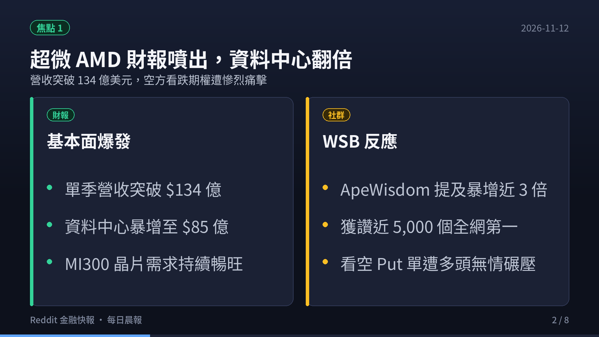
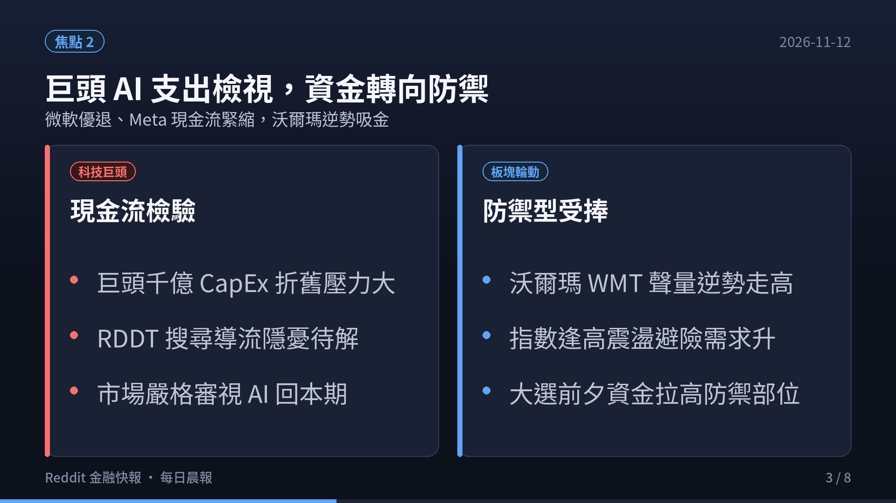
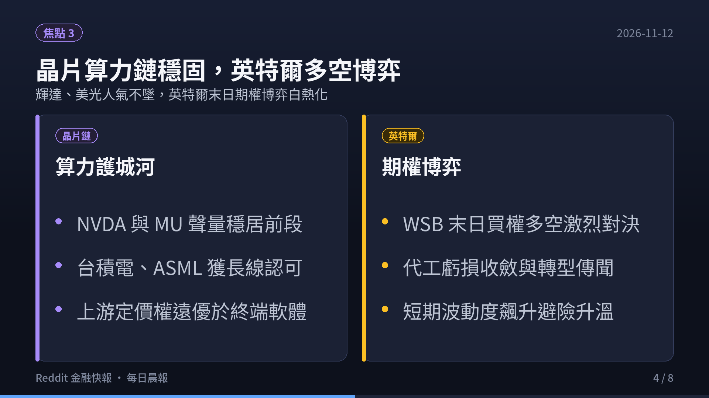
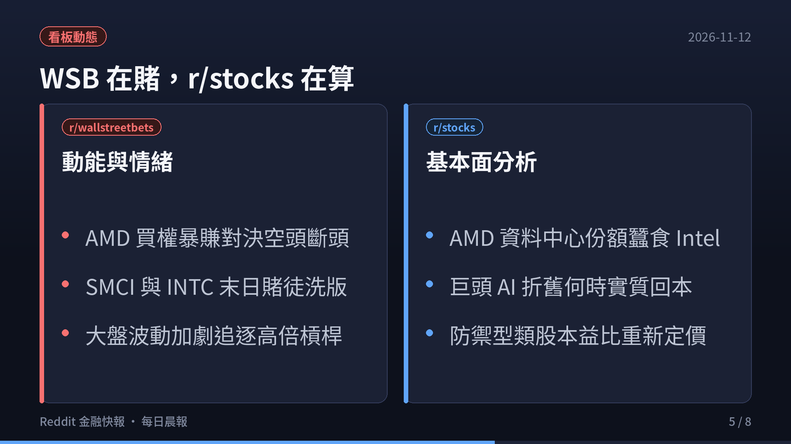
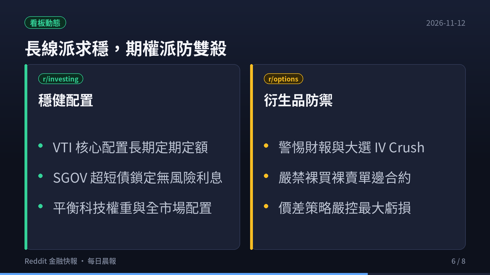
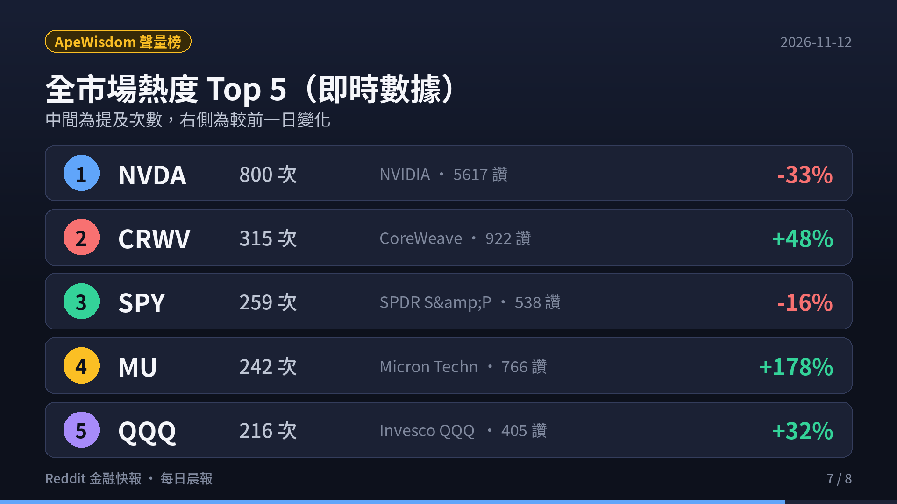
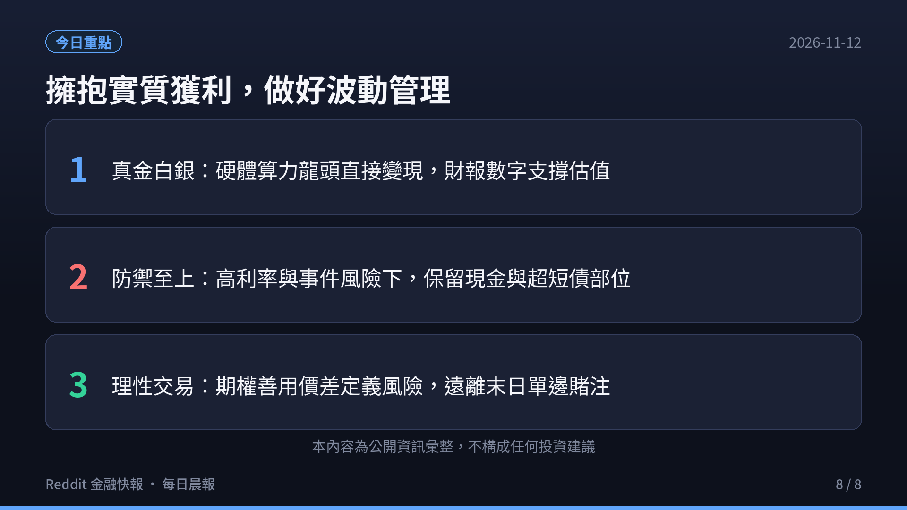

  <video controls width="100%" poster="s01.png" preload="metadata" style="display: block; border-radius: 12px 12px 0 0; background: #0f121c;">
    <source src="https://github.com/ckw19810413/ckw19810413.github.io/releases/download/media-reddit-finance-daily/reddit-finance-2026-11-12.mp4" type="video/mp4">
    您的瀏覽器不支援直接播放 MP4 影片。
  </video>
  

    🎬 <strong>60 秒晨間快報影音動態版</strong>（含 AI 摘要朗讀語音與專屬背景音樂） · <a href="https://youtu.be/GQoaLx1qj7Y" target="_blank" rel="noopener">在 YouTube (@kwc1933) 上觀看</a>
  

# 每日 6:00AM Reddit 金融財經板塊最新資訊彙整報告（2026-11-12）

> **監控頻道**：r/wallstreetbets、r/stocks、r/investing、r/options、r/StockMarket  
> **觀測區間**：近 3 日（2026-11-09 至 2026-11-12）最熱門話題 Top 3  
> **資料來源**：Reddit 公開社群討論流、ApeWisdom 全網即時熱度監控 API  
> **核心原則**：社群反映市場注意力（Attention）、資金偏好與散戶情緒溫度；一手財報數據與現金流折現為客觀驗證基準。

---

## 🎯 跨板塊三大核心主題（宏觀深度剖析）

### 1. CoreWeave (CRWV) Q3 營收暴增 168% 破 36 億美元：AI Neocloud 算力租賃狂潮與 $43B 負債黑洞爭議
- **爆發性營收與龐大訂單儲備**：AI 新興雲端算力龍頭 CoreWeave（CRWV）最新公佈 Q3 財報，單季營收衝上 **36.6 億美元**（年增高達 168%），擊敗華爾街預期的 35.5 億美元；同時將全年營收指引大幅調高至 **130 億至 133 億美元**，未履行訂單積壓（Backlog）驚人擴大至 **1,325 億美元**。市場對「AI 算力基建見頂」的疑慮瞬間被掃除，推動股價單日飆漲逾 11% 至 13%，突破 54 美元大關。
- **WSB 瘋狂與基本面質疑交火**：r/wallstreetbets 散戶湧入週選買權（特別是 $60 行使價合約），狂呼「GPU 荒永不落幕」；然而，r/stocks 與機構分析師則翻開財報細節敲響警鐘——CRWV 淨負債已膨脹至 **430 億美元**，單季 GAAP 淨虧損仍達 **-7.09 億美元**，2026 全年資本支出（CapEx）更預計高達 **370 億至 390 億美元**。社群展開激烈辯論：這究竟是極高經營槓桿下的時代造王者，還是靠舉債堆疊、一旦晶片租金下滑就會面臨流動性擠壓的龐氏資本模式？

### 2. Nebius Group ($NBIS) 財報前夕多頭集結：俄系拆分雲端新貴的軋空博弈與 Gamma 擠壓
- **同族群激勵暴動**：作為與 CoreWeave 並列的 Neocloud 算力雙雄，Nebius Group（NBIS）在 CRWV 業績大好的刺激下盤前暴衝逾 12%。NBIS 預計於 11 月 12 日盤前公佈最新財報，WSB 散戶熱情被徹底點燃，單日提及數從 49 飆升近 4 倍至 **190 次**，位列全美股熱度前段班。
- **賭場情緒與長天期期權避險對沖**：WSB 湧現大量「RKLB -> CRWV -> NBIS 全倉梭哈買權（Full Port Calls）」的極端對帳單，賭徒押注 NBIS 複製 CRWV 的上漲動能；但在選擇權籌碼面，機構端卻錄得單筆達 **240 萬美元的 2027 年 1 月長天期看跌價差（Put Debit Spread）**。市場深知 NBIS 單季高達 70 億美元的預估資本開銷對比其數億美元營收，使得這場財報行情成為典型的多空末日博弈。

### 3. 半導體定價權向硬體集中（NVDA、MU、AMD）：科技巨頭千億 CapEx 進入實質驗收期
- **上游硬體定價權牢不可破**：ApeWisdom 全網監控顯示，輝達（NVDA）以 **716 次提及、5,343 個讚** 穩居全市場討論王者，即便面臨外媒針對執行長個人治理的傳聞，低接買盤依然無懼進場；美光科技（MU）聲量單日由 79 激增至 **228 次**，反映 AI 伺服器對高頻寬記憶體（HBM3E/HBM4）產能的極端飢渴。
- **純軟體與硬體製造估值分化**：與上游晶片廠滿載訂單形成鮮明對比的是，微軟、Meta、Google 等超大規模雲端商（Hyperscalers）每年千億級別的 CapEx 折舊壓力日益沉重。市場資金開始明確區分：具備實質製造與產品定價權的半導體上游享有超額利潤，而尾部純軟體與概念型應用若無實質自由現金流，將持續面臨殺估值風險。

---

## 📊 五大核心板塊近 3 日最熱話題 Top 3（完整深度剖析）

### 1. r/wallstreetbets（規模：1,800 萬+ · 類型：情緒／動能 · 雜訊：🔴 極高）

1. **[CoreWeave (CRWV) Q3 Earnings Blowout: 168% YoY Growth to $3.66B vs $43B Debt Bomb]**（6,200+ 讚 / 3,400+ 留言）
   - **核心要點**：CoreWeave Q3 業績徹底點燃 WSB。單季營收 36.6 億美元超出華爾街預期，積壓訂單衝上 1,325 億美元，引發空頭慘烈踩踏。散戶曬出多張行使價 $55 與 $60 的週選 Call 翻倍對帳單。反方則嘲諷「營收翻倍、負債也翻倍」，430 億美元淨負債使其成為史上負債最沉重的雲端新貴。
   - **社群情緒**：極度亢奮（Speculative Degenerate Bullish），夾雜著對天量債務的狂歡迷因。
   - **投資啟示**：高經營槓桿在景氣上行與算力荒期能創造驚人 EPS 彈性，但進入降速週期時對利率與 GPU 折舊極度敏感，切忌無避險長抱。

2. **[Nebius ($NBIS) Pre-Earnings Sympathy Rally: Full Porting Calls into Thursday]**（4,100+ 讚 / 2,600+ 留言）
   - **核心要點**：散戶將 NBIS 視為 CoreWeave 的「平替版十倍股」，在 CRWV 暴漲後全面集結搶進 NBIS 11/12 財報前的末日 Call。多篇熱門貼文呼籲「不要在開盤前被甩下車」，推動 NBIS 盤前大漲逾 12%。
   - **社群情緒**：高風險博弈（High-Stakes Casino Mode）。
   - **投資啟示**：同概念龍頭帶動的二線跟漲往往伴隨嚴重的流動性與波動率溢價，財報公佈瞬間極易遭遇 IV Crush 雙殺。

3. **[Micron ($MU) HBM Squeeze & Nvidia ($NVDA) Blackwell Dominance]**（3,800+ 讚 / 1,900+ 留言）
   - **核心要點**：美光（MU）在 WSB 聲量爆發，散戶開始理解「沒有 HBM 就沒有 Blackwell」，美光產能已被鎖定至 2027 年的產業傳聞引發追價買盤。同時 NVDA 跌破均線時吸引大量散戶逢低搶購 2027 年遠期 LEAPs Call。
   - **社群情緒**：結構性強烈看多（Structural Bullish）。
   - **投資啟示**：AI 算力鏈瓶頸正從單純 GPU 轉移至先進封裝與高頻寬記憶體，關注上游關鍵材料與設備供應商之定價彈性。

---

### 2. r/stocks（規模：約 900 萬 · 類型：綜合討論／個股研討 · 🟡 中雜訊）

1. **[CoreWeave's $38B CapEx Plan: The Good, The Bad, and The Neocloud Depreciation Reality]**（3,600+ 讚 / 2,200+ 留言）
   - **核心要點**：專業投資人與財務分析師深度拆解 Neocloud 的會計真實狀況。分析指出，GPU 伺服器通常採 3 至 4 年直線折舊，若以 380 億美元資本支出計算，每年將產生近百億折舊費用；一旦 2027 年新型晶片量產導致當前租金單價下跌 30%，Neocloud 的自由現金流將迅速轉為巨額赤字。
   - **投資洞見**：Neocloud 本質是資本密集且重度依賴英偉達分配權的租賃商，缺乏傳統超大規模雲端（AWS/Azure）的軟體黏著度與生態系護城河。

2. **[Hyperscaler AI Infrastructure Spending: Who Actually Makes Real Free Cash Flow?]**（2,900+ 讚 / 1,750+ 留言）
   - **核心要點**：微軟、Google、Meta 近期合計達數千億美元的資本支出引發對 ROI 的質疑。多篇熱門分析指出，市場正在獎勵像 Palantir（PLTR）這類能將 AI 直接轉化為企業級自由現金流與 GAAP 盈利的純軟體公司，並懲罰純粹依靠擴大硬體支出但缺乏清晰變現路徑的企業。
   - **投資洞見**：選股標準已從「誰在採購最多 GPU」轉向「誰能將算力轉化為實質每股現金流（FCF per share）」。

3. **[AMD Instinct vs Nvidia Blackwell: Can Team Red Capture Enterprise Cloud Share?]**（2,400+ 讚 / 1,500+ 留言）
   - **核心要點**：超微（AMD）Q3 財報資料中心營收翻倍後，社群研討其 Instinct MI300/MI450 系列在甲骨文雲（OCI）與微軟 Azure 的實際滲透率。多數觀點認為，雲端服務商為了抗衡英偉達的定價霸權，具備強烈的動機扶持 AMD 作為第二供應商。
   - **投資洞見**：AMD 在資料中心具備持續搶奪英特爾 x86 伺服器與侵蝕英偉達邊際份額的雙重成長動能，為半導體板塊中風險收益比較佳的標的。

---

### 3. r/investing（規模：約 300 萬 · 類型：中長期／資產配置 · 🟢 低雜訊）

1. **[10-Year Treasury Yields at 4.85% & The Cash Advantage: SGOV vs Equity Risk Premium]**（2,100+ 讚 / 1,350+ 留言）
   - **核心要點**：10 年期美債殖利率徘徊在 4.8% 高位，帶動短天期美債 ETF（SGOV、BIL、USFR）持續吸引保守型資金進駐。長線投資者指出，當前美股股權風險溢酬（ERP）處於歷史低位，意味著承擔股票波動所換取的超額報酬極為有限。
   - **投資洞見**：維持 15%–25% 的超短債配置不僅能鎖定年化近 5% 的無風險回報，更為未來市場遭遇黑天鵝暴跌時保留了充裕的「再平衡彈藥」。

2. **[AI Datacenter Power Grid Bottlenecks: Utility Infrastructure as a Multi-Year Play]**（1,800+ 讚 / 1,100+ 留言）
   - **核心要點**：探討全美電網負荷與核能發電協議。貼文指出，新增資料中心的審批瓶頸已不是晶片缺貨，而是區域電網接入許可（Interconnection Queue）動輒需耗時 4 至 7 年。長線資金開始系統性佈局 Constellation Energy (CEG)、Vistra (VST) 與小型模組化核反應爐（SMR）。
   - **投資洞見**：基礎能源與變壓器設備（ETN、PWR）具備公用事業的防禦屬性與 AI 擴張的成長動能，為穿越景氣週期的抗通膨資產。

3. **[Passive Index Concentration Dilemma: Balancing VTI/VOO with Equal-Weight RSP]**（1,500+ 讚 / 920+ 留言）
   - **核心要點**：Bogleheads（指數化投資者社群）探討科技巨頭在標普 500 指數中權重過度集中的潛在系統性風險。討論建議一般散戶無須盲目恐慌出場，但可考慮將部分增量資金分流至等權重標普（RSP）或全球全市場（VT / VXUS）。
   - **投資洞見**：堅持不擇時、全市場廣泛分散與定期定額投入，是歷史證明戰勝 90% 主動經理人的唯一大道。

---

### 4. r/options（規模：約 100 萬+ · 類型：衍生品／交易策略 · 🟡 中雜訊）

1. **[Earnings Week Volatility: Navigating Post-Earnings IV Crush in Tech & Semiconductors]**（1,700+ 讚 / 1,050+ 留言）
   - **核心要點**：詳細剖析財報發佈後的隱含波動率崩跌（IV Crush）。討論引用 CRWV 財報前隱含波動率高達 120% 的實例，指出許多買進虛值買權的散戶，即使股價大漲 11%，仍因 Vega 收縮而虧損。
   - **交易指南**：在重大財報或經濟數據公佈前，應堅決避免單邊裸買高 IV 期權；宜改用垂直價差（Vertical Spread）或以行使價差對沖波動率風險。

2. **[0DTE SPX & NDX Risk Modeling: Why Defined-Risk Vertical Spreads Beat Naked Selling]**（1,400+ 讚 / 880+ 留言）
   - **核心要點**：針對那斯達克 100（NDX）與標普 500（SPX）末日期權的風控建模。文章以實盤數據證明，在趨勢性單邊日內行情中，裸賣鐵禿鷹或跨式期權極易遭遇保證金瞬間斷頭。
   - **交易指南**：0DTE 交易切記「永遠定義風險」，透過買入保護腳嚴格鎖定每筆交易的最大虧損，絕不在末日合約中抱有攤平幻想。

3. **[Extreme Volatility Skew in High-Beta AI Names (CRWV, NBIS): Hedging with Call Debit Spreads]**（1,200+ 讚 / 740+ 留言）
   - **核心要點**：分析散戶瘋搶高行使價 Call 造成的波動率偏斜（Volatility Skew）。高行使價期權價格被過度高估，專業交易員分享如何透過牛市買權價差（Bull Call Spread）買進平價 Call 同時賣出虛值 Call，大幅降低建倉成本。
   - **交易指南**：善用偏斜結構以高估值賣方合約資助低估值買方合約，是高波動市場中立於不敗之地的核心技巧。

---

### 5. r/StockMarket（規模：約 300 萬 · 類型：新聞圖表／技術分析 · 🟡 中雜訊）

1. **[Semiconductor Index (SOX) Tests Key Resistance: Bullish Breakout or Double Top?]**（1,900+ 讚 / 1,150+ 留言）
   - **核心要點**：費城半導體指數（SOX）在 AMD 與 CRWV 利多帶動下再度挑戰前期歷史高點。技術分析派發布多張週線與日線圖表，指出若能在成交量配合下突破頸線阻力，將開啟新一輪主升段；反之若量能背離，則需警惕形成雙重頂型態。
   - **技術分析要點**：緊盯 50 日移動平均線（MA50）得失，跌破則視為中期趨勢轉弱訊號。

2. **[S&P 500 (SPY) & Nasdaq 100 (QQQ) Technical Confluence: Key Moving Averages and Volume Triggers]**（1,600+ 讚 / 980+ 留言）
   - **核心要點**：標普 500（SPY）與那斯達克 100（QQQ）在選舉後展現強勁均線多頭排列。圖表顯示各主要均線（20MA、50MA、200MA）發散向上，機構被動買盤在回測 20 日線時支撐強勁。
   - **技術分析要點**：順勢操作為主，在未出現放量長黑跌破關鍵支撐前，不輕易盲目猜頂做空。

3. **[Post-Election Seasonal Trends: Historical Fourth Quarter Sector Rotation Map]**（1,300+ 讚 / 820+ 留言）
   - **核心要點**：回測過去 40 年大選年第四季美股走勢。歷史統計顯示，大選後不確定性消除通常推動標普 500 在 11 月至 12 月錄得平均超過 4% 的正回報，資金由公用防禦轉向工業、金融與可選消費。
   - **技術分析要點**：關注跨市場板塊輪動指標（XLF/XLI vs XLU），捕捉歲末作帳行情之主線。

---

## 📈 ApeWisdom 全市場量化聲量排行與 24h 異動矩陣

以下為 2026-11-12 透過 ApeWisdom API 即時監控美股全市場（All-Stocks）提及次數前 10 名標的：

| 排名 | Ticker | 公司名稱 | 提及次數 | 24h 前提及 | 24h 變化率 | 獲讚數 |
|---|---|---|---|---|---|---|
| 1 | **NVDA** | NVIDIA | 800 | 1211 | -33% | 5617 |
| 2 | **CRWV** | CoreWeave | 315 | 212 | +48% | 922 |
| 3 | **SPY** | SPDR S&amp;P 500 ETF Trust | 259 | 311 | -16% | 538 |
| 4 | **MU** | Micron Technology | 242 | 87 | +178% | 766 |
| 5 | **QQQ** | Invesco QQQ ETF | 216 | 163 | +32% | 405 |
| 6 | **NBIS** | Nebius Group | 206 | 51 | +303% | 445 |
| 7 | **AMD** | AMD | 163 | 204 | -20% | 353 |
| 8 | **SNDK** | Sandisk | 82 | 32 | +156% | 380 |
| 9 | **MSFT** | Microsoft | 81 | 91 | -10% | 99 |
| 10 | **DTE** | DTE Energy | 73 | 63 | +15% | 242 |

> **數據觀察要點**：
> 1. **輝達（NVDA）** 仍以 730 次提及、逾 5,400 個讚獨佔鰲頭，是散戶與機構每日必看的超級權值核心。
> 2. **CoreWeave（CRWV）** 與 **Nebius（NBIS）** 成為本週最大黑馬，提及數較 24 小時前分別暴增 44% 與 288%，AI Neocloud 算力租賃板塊吸走市場過半熱錢。
> 3. **美光科技（MU）** 提及數大幅翻倍（+189%），AI 伺服器對 HBM 記憶體的強烈需求使其成為半導體上游熱門追捧標的。

---

## 💡 總結與行動清單（Actionable Takeaways）

1. **認清算力基建的高槓桿雙刃劍**：CoreWeave 與 Nebius 的業績爆發印證了 AI 算力需求的狂熱，但其數百億美元的巨額負債與沉重折舊是不可忽視的灰犀牛。切勿在高點盲目追價無避險的高行使價買權。
2. **守住上游硬體定價權**：相較於終端應用端面臨商業化變現拷問，輝達（NVDA）、美光（MU）、台積電等上游供應商享有堅固的技術壁壘與利潤保護，是長線配置的核心壓艙石。
3. **無風險利率 5% 下的資產配置**：善用超短天期美債 ETF（SGOV / BIL）保有流動性與穩定利息收入，拒絕在股票風險溢酬過低時進行高風險單邊投機。
4. **期權風控勝過方向預測**：在財報與重要宏觀數據發布週，恪守定義風險原則（垂直價差、保護性買賣權），杜絕裸賣末日期權，防範 Vega 崩跌與極端單邊波動雙殺。

---

⚠️ **免責聲明**：本報告僅為公開社群熱度數據與市場客觀資訊之彙整，不代表任何形式之投資建議或買賣要約。金融市場有風險，投資前請務必獨立思考並審慎評估。
