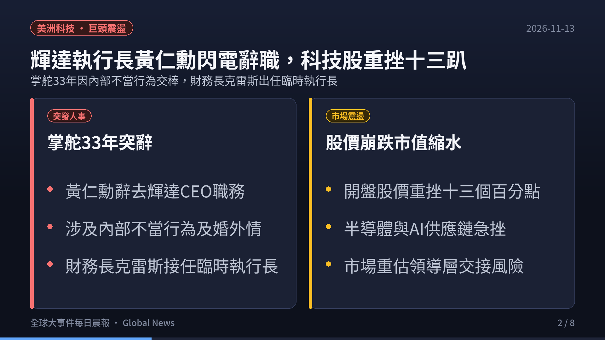
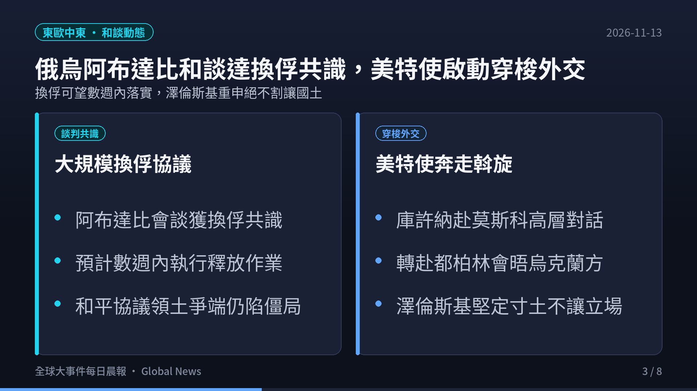
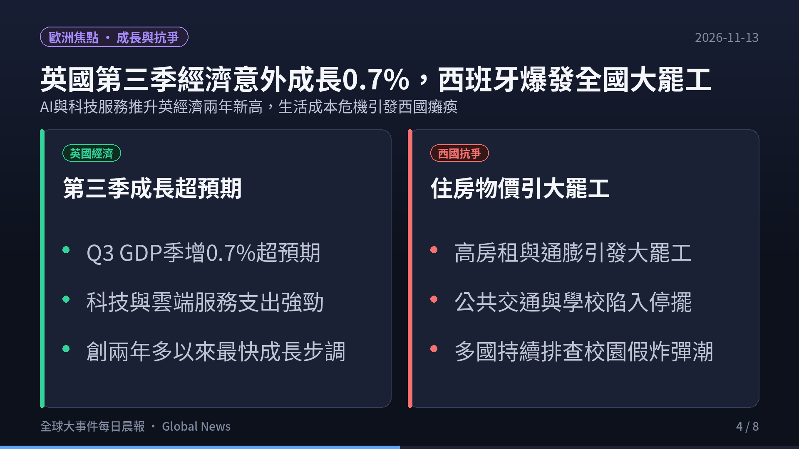
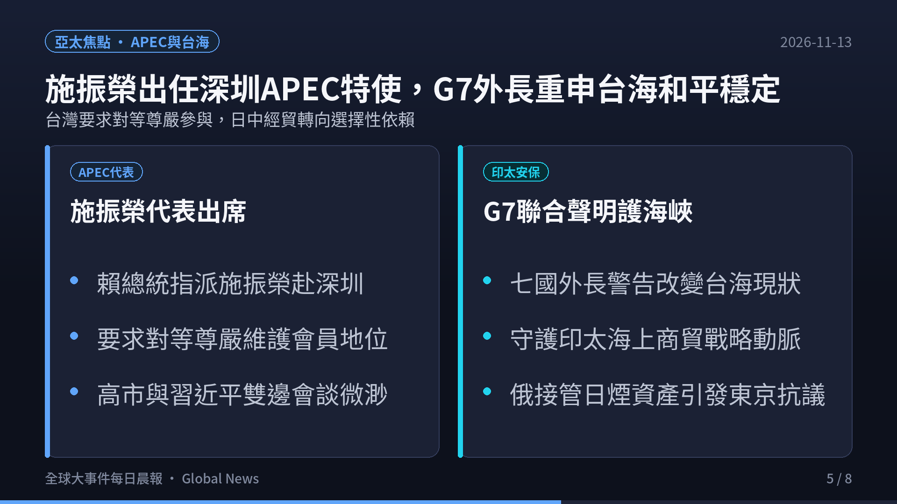
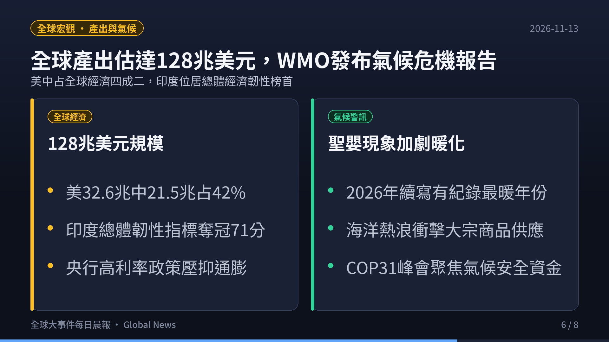
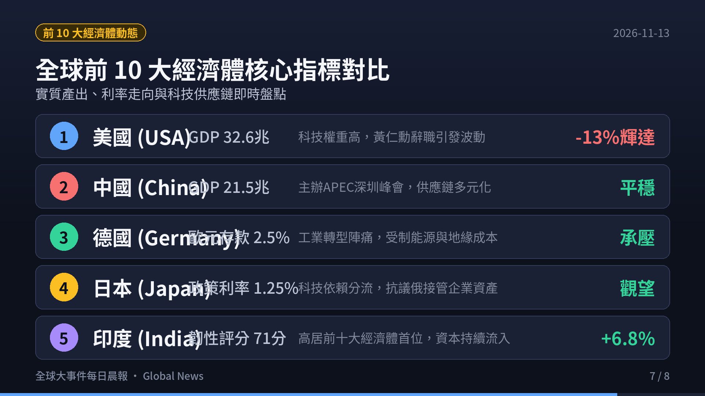
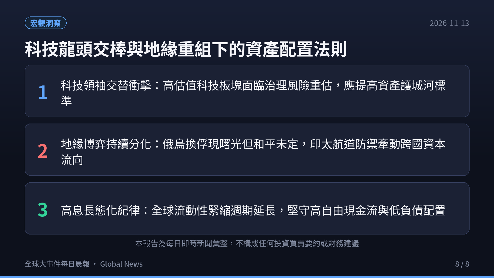

> **觀測週期**：2026-11-13 晨間即時彙整  
> **情報涵蓋**：全球各大洲（北美、歐洲、東歐/中東、亞洲/印太、大洋洲）與全球前 10 大經濟體  
> **核心來源**：各國政府公報、路透社（Reuters）、美聯社（AP）、彭博社（Bloomberg）、英國衛報（The Guardian）、各國央行公報與世界氣象組織（WMO）  
> **定位宗旨**：以客觀數據、官方決策與供應鏈結構為準繩，剔除短期情緒噪音，提煉出真正驅動全球資金流向與地緣版圖重構的核心脈絡。

  

    <iframe src="https://www.youtube.com/embed/o_UP7siu_54" title="2026-11-13 全球大事件每日晨報" style="position: absolute; top:0; left: 0; width: 100%; height: 100%; border: 0;" allow="accelerometer; autoplay; clipboard-write; encrypted-media; gyroscope; picture-in-picture; web-share" allowfullscreen></iframe>
  

  

    🎬 <strong>120 秒晨間快報影音動態版</strong>（含 AI 自然神經語音朗讀與背景配樂）
  

---

## 🎯 今日全球前 6 大核心事件深度拆解

### 1. 美洲科技與資本市場：輝達（Nvidia）執行長黃仁勳閃電辭職，科技股重挫 13%，領導層交接震撼市場
- **掌舵 33 年突發人事更迭**：
  - 全球人工智慧龍頭輝達宣布，創辦人兼執行長黃仁勳（Jensen Huang）因涉及內部不當行為及個人婚外情調查，已於即日起正式辭去執行長職務。
  - 董事會指派現任執行副總裁兼財務長科萊特·克雷斯（Colette Kress）接任臨時執行長，同時啟動全球高階獵才遴選程序。
- **資本市場震撼重挫與供應鏈溢波**：
  - 消息震撼華爾街，輝達股價開盤跳水大跌逾 13%，市值一度蒸發數千億美元，連帶衝擊那斯達克指數與台灣、日本等全球半導體 AI 代工供應鏈。
  - 市場目前正嚴格評估輝達次世代架構研發節奏與高階領導團隊穩定度，科技板塊風險溢價迅速拉升。

---

### 2. 東歐與中東地緣防務：俄烏阿布達比秘密談判獲大規模換俘共識，美特使展開穿梭外交
- **阿布達比和談協議實質進展**：
  - 在美國代表團積極牽線斡旋下，俄羅斯與烏克蘭代表團在阿布達比舉行了閉門多邊磋商，雙方已就數週內執行大規模被俘人員交換達成原則性共識。
  - 這是近數月以來交戰雙方最具體的互信接觸，為人道走廊與局部降溫開啟契機。
- **和平協議核心僵局仍存**：
  - 儘管換俘取得進展，烏克蘭總統澤倫斯基（Volodymyr Zelenskyy）再次向國際社會重申，基輔不會在主權與被佔領土上妥協。
  - 美國特使團隊持續兵分多路，於莫斯科高層接觸後轉赴都柏林與歐洲領導人緊密協調後續外交框架。

---

### 3. 歐洲總體經濟與社會風暴：英國第三季 GDP 季增 0.7% 創兩年最快，西班牙爆發全國大罷工
- **英國經濟成長展現強韌韌性**：
  - 英國國家統計局發布最新數據，英國第三季國內生產毛額（GDP）季增 **0.7%**，顯著優於市場預期，創下兩年多以來最快季度擴張步伐。
  - 增長主要由生成式 AI 企業應用、雲端運算與專業科技服務支出強力驅動，為英國財政整頓提供緩衝空間。
- **西班牙爆發全國大罷工癱瘓民生**：
  - 西班牙全境爆發大規模跨行業總工會大罷工，數十萬勞工與青年走上街頭，強烈抗議飆漲的房租、物價與生活成本危機。
  - 鐵路交通、港口與公共學校陷入局部癱瘓；與此同時，歐洲多國亦持續清查協同性質的校園虛假炸彈警報。

---

### 4. 亞太經貿與印太安保：施振榮出任深圳 APEC 特使，G7 外長發表聯合聲明維護台海現狀
- **台灣委派宏碁創辦人赴 APEC**：
  - 總統賴清德正式宣布指派宏碁創辦人施振榮代表台灣出席 11 月中旬在中國深圳舉行的 APEC 經濟領袖會議。
  - 台灣政府強調在符合 APEC 慣例規範下，確保代表團享有公平、尊嚴的完整會員參與權利。
- **G7 外長公報與供應鏈安全防線**：
  - 七大工業國組織（G7）外長發表聯合公報，再次重申維護台海和平與穩定對全球安全與繁榮不可或缺，強烈反對任何單方面透過武力或脅迫改變現狀的企圖。
  - 針對俄羅斯扣押日本煙草（Japan Tobacco）在俄資產，東京當局提出強烈外交抗議，日中經貿亦持續朝「關鍵領域去風險、一般貿易選擇性依賴」方向演進。

---

### 5. 全球宏觀總量與氣候警訊：全球經濟總量上看 128 兆美元，WMO 警告極端氣候衝擊實體產能
- **全球名目 GDP 版圖高度集中**：
  - 最新國際機構數據顯示，2026 年全球名目 GDP 預計將跨越 **128 兆美元**大關。美國（32.6 兆美元）與中國（21.5 兆美元）合計占據全球總產出的 42% 以上。
  - 印度在大型經濟體總體韌性排行榜中拿下 71 分高居榜首，受惠於充沛人口紅利與全球製造業產能分散佈局。
- **世界氣象組織（WMO）發布年度極端氣候警報**：
  - WMO 於土耳其安塔利亞會議上公布最新報告，指出受強聖嬰現象影響，2026 年持續逼近有紀錄以來最高氣溫。
  - 海洋熱浪與極端乾旱正對大宗農產品收成、內陸航運與能源供需造成結構性成本推升，成為央行壓制通膨的外部不確定性。

---

### 6. 全球前十大經濟體核心指標與趨勢橫向全景

| 排名 | 國家 / 經濟體 | 核心總體經濟數據 / 最新指標 | 2026-11-13 即時動態與政策取向 | 全球產業鏈與市場意涵 |
|:---:|:---|:---|:---|:---|
| **1** | **美國 (USA)** | 基準利率 **3.75%–4.00%** · 名目 GDP **32.6 兆** | 輝達黃仁勳突辭職衝擊科技板塊；美股盤面急劇震盪重估領導治理 | 科技板塊面臨估值重定，長端殖利率壓力略減但科技自主與研發連續性受考驗。 |
| **2** | **中國 (China)** | 名目 GDP **21.5 兆** · 民間製造業擴張 | 籌備深圳 APEC 領袖峰會；深化高科技產業自主化與供應鏈多元性 | 面對科技出口管制與地緣分流，持續加速內需基建與自主軟硬體替代。 |
| **3** | **德國 (Germany)** | 歐洲央行存款利率 **2.50%** · 製造業陣痛 | 歐元區通膨黏性與地緣能源成本牽制；汽車與重工業加速綠能改造 | 工業龍頭受高能源成本與出口市場分流壓力，仰賴高附加價值設備出口支撐。 |
| **4** | **日本 (Japan)** | 政策利率維持 **1.25%** · 綜合 PMI **52.1** | 密切關注 APEC 會議互動；抗議俄羅斯接管日企資產；日圓維持震盪 | 日銀政策正常化進程持續，科技關鍵設備與材料供應鏈自主防禦性強化。 |
| **5** | **印度 (India)** | GDP 預期成長 **6.8%** · 總體韌性 **71 分** | 奪得十大經濟體韌性榜首；半導體封裝與關鍵零組件資本持續湧入 | 人口紅利與全球供應鏈「China+1」戰略最大受惠國，資本形成動能強勁。 |
| **6** | **英國 (UK)** | 基準利率 **4.00%** · Q3 GDP 季增 **0.7%** | 經濟成長創兩年最快紀錄；AI 科技服務與企業軟體支出大幅爆發 | 服務業動能強韌減緩衰退擔憂，但高利率對消費融資與房貸成本形成持續考驗。 |
| **7** | **法國 (France)** | 歐洲央行存款利率 **2.50%** · 赤字博弈 | 密切防範西班牙罷工外溢；國會預算整頓與社會福利政策激烈交鋒 | 財政緊縮政策面臨工會反彈，巴黎航空樞紐全面提升維安反恐層級。 |
| **8** | **義大利 (Italy)** | 歐元區基準利率 **2.50%** · 國債利差 | 歐元區降息節奏放緩；受惠於歐盟復甦基金基礎建設落地投資 | 財政紀律受到嚴格監管，致力於提升數位基礎建設與高科技製造就業。 |
| **9** | **加拿大 (Canada)** | 1510 億產能投資預算 · 通膨放緩 | 總理卡尼赴歐出席歐洲政治共同體峰會；推動提高生產力財政方案 | 擴張性預算聚焦提升人均生產力，並在北美自由貿易機制下尋求多元貿易市場。 |
| **10** | **澳洲 (Australia)** | 基準利率 **4.35%** · 資源出口穩定 | 澳洲央行維持高息對抗通膨；能源與關鍵礦產外銷維持順差 | 綠色金屬與液化天然氣出口提供貿易順差，但家庭負債對限制性利率極度敏感。 |

---

## 💡 總結與投資者生存指南

1. **科技巨頭治理風險與資產重新定價**：
   - 輝達（Nvidia）執行長黃仁勳的閃電辭職，為過去兩年高度狂熱的人工智慧科技股敲響警鐘。
   - 投資者應重新檢視高估值科技板塊的領導人關鍵人風險（Key-Person Risk），並將焦點轉向具備實質自由現金流與深厚專利防護的企業。
2. **地緣和談與局部動盪並存的複雜現實**：
   - 俄烏阿布達比換俘談判帶來人道亮光，但領土根本僵局意味著地緣風險溢價無法徹底消退。
   - 歐洲西班牙大罷工與多國社會抗爭，再次顯示通膨與高生活成本對基層社會結構的侵蝕已進入臨界點。
3. **高息長態化下的核心配置法則**：
   - 全球央行在成長與通膨黏性之間走鋼索，降息空間受到極限壓縮。
   - 在高利率、高波動年代，務必落實「三不一要」策略：不盲目追逐題材槓桿、不忽視地緣黑天鵝、不配置脆弱負債資產；要堅守優質現金流資產與多元避險防線。

---

### ☕ 支持與精選推薦

如果你覺得這份每日晨報對你的宏觀視野與決策有實質幫助，歡迎透過以下方式支持我們持續產出深度內容：

- ☕ **請我喝杯咖啡**：[Ko-fi 小費贊助 (ytstories0413)](https://ko-fi.com/ytstories0413) 或 [Ko-fi 贊助 (slashman413)](https://ko-fi.com/slashman413)（支持每日自動化爬蟲、語音合成與雲端運算）
- 📚 **數位產品與高人效生產力工具**：
  - [Gumroad 數位商品專區](https://slashmaster6.gumroad.com/)：收錄精選 AI Prompt 庫、生產力自動化工作流與實戰腳本
  - [SlashmanTools 免費 Web 工具集](https://slashmantools.us/)：Token 成本計算器、顯存預估、開源 AI 工具導航
- 📖 **精選經典閱讀推薦**：
  - [《晶片戰爭》（Chip War）](https://www.amazon.com/dp/059371671X?tag=ytstories0413-20)：理解全球晶片霸權與印太供應鏈重組的必讀經典
  - [《原子習慣》— 細微改變帶來巨大成就](https://www.books.com.tw/products/0010792915)
  - [《人生的智慧》— 叔本華處世哲學經典](https://www.books.com.tw/products/0010613113)
