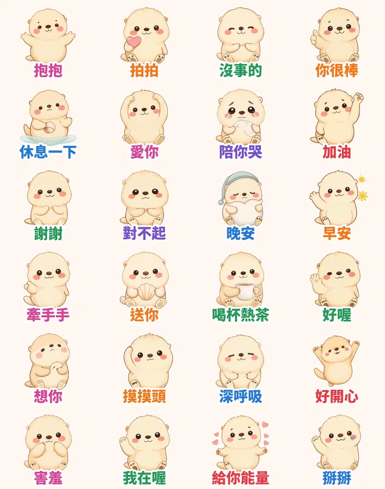

這陣子 LINE 貼圖排行榜上最常出現的組合是：**圓滾滾、毛茸茸的小動物**＋**每天用得到的短句**＋**「被接住」的療癒感**。日本那邊ラッコ（海獺）系角色一直很紅，台灣、香港的使用者也很愛「拍拍」「抱抱」這種一按就能安慰人的貼圖。所以這次的主角是一隻會漂在水上、抱著貝殼的小海獺——**暖暖**。

> 🦦 **海獺暖暖・療癒拍拍**（動態貼圖 24 張）👉 [Massor 的 LINE 貼圖小舖](https://line.me/S/shop/sticker/author/6564520?utm_source=ghpages&utm_medium=bridge&utm_campaign=nuannuan-otter&utm_content=author-6564520)（本套送審中，上架後同一頁就買得到）

## 每個表情都是「演」出來的

角色先用 FLUX＋繪本風 LoRA 畫好 24 個姿勢，再交給本地端 **MiniMax H3**（首尾幀相同的影片生成）演出真正的動作，不是單純的位移或縮放：「抱抱」是張開雙手再把自己抱緊；「拍拍」是一下一下輕拍小愛心；「深呼吸」是肚子鼓起來再慢慢吐氣；「陪你哭」是眼眶泛淚、抽鼻子、拿面紙擦眼淚；「休息一下」是仰躺漂在水上摸肚子。H3 的影片再抽成 20 幀、剛好 3 秒的 APNG，加上白邊和大字，深色模式也看得清楚。

## 🔊 點一下就有聲音

每張貼圖都配了一句暖心語音（小海獺「啾啾」叫聲＋一句話）。點下面的卡片就能聽，手機上按「傳給朋友」可以直接分享。

  <figure class="ms-c">
    <video src="https://github.com/ckw19810413/ckw19810413.github.io/releases/download/media-line-animated-sticker-sea-otter-healing-pats/nuannuan-a01.mp4" poster="sound/a01.jpg" muted autoplay loop playsinline preload="metadata"></video>
    <figcaption>來，抱抱～</figcaption>
    <button type="button" class="ms-share">傳給朋友</button>
  </figure>
  <figure class="ms-c">
    <video src="https://github.com/ckw19810413/ckw19810413.github.io/releases/download/media-line-animated-sticker-sea-otter-healing-pats/nuannuan-a02.mp4" poster="sound/a02.jpg" muted autoplay loop playsinline preload="metadata"></video>
    <figcaption>拍拍，乖喔～</figcaption>
    <button type="button" class="ms-share">傳給朋友</button>
  </figure>
  <figure class="ms-c">
    <video src="https://github.com/ckw19810413/ckw19810413.github.io/releases/download/media-line-animated-sticker-sea-otter-healing-pats/nuannuan-a03.mp4" poster="sound/a03.jpg" muted autoplay loop playsinline preload="metadata"></video>
    <figcaption>沒事的，有我在</figcaption>
    <button type="button" class="ms-share">傳給朋友</button>
  </figure>
  <figure class="ms-c">
    <video src="https://github.com/ckw19810413/ckw19810413.github.io/releases/download/media-line-animated-sticker-sea-otter-healing-pats/nuannuan-a04.mp4" poster="sound/a04.jpg" muted autoplay loop playsinline preload="metadata"></video>
    <figcaption>你真的很棒！</figcaption>
    <button type="button" class="ms-share">傳給朋友</button>
  </figure>
  <figure class="ms-c">
    <video src="https://github.com/ckw19810413/ckw19810413.github.io/releases/download/media-line-animated-sticker-sea-otter-healing-pats/nuannuan-a05.mp4" poster="sound/a05.jpg" muted autoplay loop playsinline preload="metadata"></video>
    <figcaption>累了就休息一下嘛</figcaption>
    <button type="button" class="ms-share">傳給朋友</button>
  </figure>
  <figure class="ms-c">
    <video src="https://github.com/ckw19810413/ckw19810413.github.io/releases/download/media-line-animated-sticker-sea-otter-healing-pats/nuannuan-a06.mp4" poster="sound/a06.jpg" muted autoplay loop playsinline preload="metadata"></video>
    <figcaption>愛你喔～</figcaption>
    <button type="button" class="ms-share">傳給朋友</button>
  </figure>
  <figure class="ms-c">
    <video src="https://github.com/ckw19810413/ckw19810413.github.io/releases/download/media-line-animated-sticker-sea-otter-healing-pats/nuannuan-a07.mp4" poster="sound/a07.jpg" muted autoplay loop playsinline preload="metadata"></video>
    <figcaption>嗚嗚，我陪你哭</figcaption>
    <button type="button" class="ms-share">傳給朋友</button>
  </figure>
  <figure class="ms-c">
    <video src="https://github.com/ckw19810413/ckw19810413.github.io/releases/download/media-line-animated-sticker-sea-otter-healing-pats/nuannuan-a08.mp4" poster="sound/a08.jpg" muted autoplay loop playsinline preload="metadata"></video>
    <figcaption>加油加油！</figcaption>
    <button type="button" class="ms-share">傳給朋友</button>
  </figure>
  <figure class="ms-c">
    <video src="https://github.com/ckw19810413/ckw19810413.github.io/releases/download/media-line-animated-sticker-sea-otter-healing-pats/nuannuan-a09.mp4" poster="sound/a09.jpg" muted autoplay loop playsinline preload="metadata"></video>
    <figcaption>謝謝你～</figcaption>
    <button type="button" class="ms-share">傳給朋友</button>
  </figure>
  <figure class="ms-c">
    <video src="https://github.com/ckw19810413/ckw19810413.github.io/releases/download/media-line-animated-sticker-sea-otter-healing-pats/nuannuan-a10.mp4" poster="sound/a10.jpg" muted autoplay loop playsinline preload="metadata"></video>
    <figcaption>對不起嘛…</figcaption>
    <button type="button" class="ms-share">傳給朋友</button>
  </figure>
  <figure class="ms-c">
    <video src="https://github.com/ckw19810413/ckw19810413.github.io/releases/download/media-line-animated-sticker-sea-otter-healing-pats/nuannuan-a11.mp4" poster="sound/a11.jpg" muted autoplay loop playsinline preload="metadata"></video>
    <figcaption>晚安，好夢喔</figcaption>
    <button type="button" class="ms-share">傳給朋友</button>
  </figure>
  <figure class="ms-c">
    <video src="https://github.com/ckw19810413/ckw19810413.github.io/releases/download/media-line-animated-sticker-sea-otter-healing-pats/nuannuan-a12.mp4" poster="sound/a12.jpg" muted autoplay loop playsinline preload="metadata"></video>
    <figcaption>早安！今天也要好好的</figcaption>
    <button type="button" class="ms-share">傳給朋友</button>
  </figure>
  <figure class="ms-c">
    <video src="https://github.com/ckw19810413/ckw19810413.github.io/releases/download/media-line-animated-sticker-sea-otter-healing-pats/nuannuan-a13.mp4" poster="sound/a13.jpg" muted autoplay loop playsinline preload="metadata"></video>
    <figcaption>牽手手，不怕</figcaption>
    <button type="button" class="ms-share">傳給朋友</button>
  </figure>
  <figure class="ms-c">
    <video src="https://github.com/ckw19810413/ckw19810413.github.io/releases/download/media-line-animated-sticker-sea-otter-healing-pats/nuannuan-a14.mp4" poster="sound/a14.jpg" muted autoplay loop playsinline preload="metadata"></video>
    <figcaption>這個送給你！</figcaption>
    <button type="button" class="ms-share">傳給朋友</button>
  </figure>
  <figure class="ms-c">
    <video src="https://github.com/ckw19810413/ckw19810413.github.io/releases/download/media-line-animated-sticker-sea-otter-healing-pats/nuannuan-a15.mp4" poster="sound/a15.jpg" muted autoplay loop playsinline preload="metadata"></video>
    <figcaption>喝杯熱茶暖暖心</figcaption>
    <button type="button" class="ms-share">傳給朋友</button>
  </figure>
  <figure class="ms-c">
    <video src="https://github.com/ckw19810413/ckw19810413.github.io/releases/download/media-line-animated-sticker-sea-otter-healing-pats/nuannuan-a16.mp4" poster="sound/a16.jpg" muted autoplay loop playsinline preload="metadata"></video>
    <figcaption>好喔，沒問題！</figcaption>
    <button type="button" class="ms-share">傳給朋友</button>
  </figure>
  <figure class="ms-c">
    <video src="https://github.com/ckw19810413/ckw19810413.github.io/releases/download/media-line-animated-sticker-sea-otter-healing-pats/nuannuan-a17.mp4" poster="sound/a17.jpg" muted autoplay loop playsinline preload="metadata"></video>
    <figcaption>好想你喔…</figcaption>
    <button type="button" class="ms-share">傳給朋友</button>
  </figure>
  <figure class="ms-c">
    <video src="https://github.com/ckw19810413/ckw19810413.github.io/releases/download/media-line-animated-sticker-sea-otter-healing-pats/nuannuan-a18.mp4" poster="sound/a18.jpg" muted autoplay loop playsinline preload="metadata"></video>
    <figcaption>摸摸頭，辛苦了</figcaption>
    <button type="button" class="ms-share">傳給朋友</button>
  </figure>
  <figure class="ms-c">
    <video src="https://github.com/ckw19810413/ckw19810413.github.io/releases/download/media-line-animated-sticker-sea-otter-healing-pats/nuannuan-a19.mp4" poster="sound/a19.jpg" muted autoplay loop playsinline preload="metadata"></video>
    <figcaption>深呼吸～慢慢來</figcaption>
    <button type="button" class="ms-share">傳給朋友</button>
  </figure>
  <figure class="ms-c">
    <video src="https://github.com/ckw19810413/ckw19810413.github.io/releases/download/media-line-animated-sticker-sea-otter-healing-pats/nuannuan-a20.mp4" poster="sound/a20.jpg" muted autoplay loop playsinline preload="metadata"></video>
    <figcaption>耶！好開心！</figcaption>
    <button type="button" class="ms-share">傳給朋友</button>
  </figure>
  <figure class="ms-c">
    <video src="https://github.com/ckw19810413/ckw19810413.github.io/releases/download/media-line-animated-sticker-sea-otter-healing-pats/nuannuan-a21.mp4" poster="sound/a21.jpg" muted autoplay loop playsinline preload="metadata"></video>
    <figcaption>討厭啦～好害羞</figcaption>
    <button type="button" class="ms-share">傳給朋友</button>
  </figure>
  <figure class="ms-c">
    <video src="https://github.com/ckw19810413/ckw19810413.github.io/releases/download/media-line-animated-sticker-sea-otter-healing-pats/nuannuan-a22.mp4" poster="sound/a22.jpg" muted autoplay loop playsinline preload="metadata"></video>
    <figcaption>我一直都在喔</figcaption>
    <button type="button" class="ms-share">傳給朋友</button>
  </figure>
  <figure class="ms-c">
    <video src="https://github.com/ckw19810413/ckw19810413.github.io/releases/download/media-line-animated-sticker-sea-otter-healing-pats/nuannuan-a23.mp4" poster="sound/a23.jpg" muted autoplay loop playsinline preload="metadata"></video>
    <figcaption>給你滿滿能量！</figcaption>
    <button type="button" class="ms-share">傳給朋友</button>
  </figure>
  <figure class="ms-c">
    <video src="https://github.com/ckw19810413/ckw19810413.github.io/releases/download/media-line-animated-sticker-sea-otter-healing-pats/nuannuan-a24.mp4" poster="sound/a24.jpg" muted autoplay loop playsinline preload="metadata"></video>
    <figcaption>掰掰，明天見</figcaption>
    <button type="button" class="ms-share">傳給朋友</button>
  </figure>

想一次看完？這是 24 張連播的直式語音版（適合轉傳到限動）：

<video src="https://github.com/ckw19810413/ckw19810413.github.io/releases/download/media-line-animated-sticker-sea-otter-healing-pats/nuannuan-voice.mp4" controls playsinline preload="metadata" style="max-width:360px;width:100%;border-radius:12px"></video>

24 張語音短片打包下載：[Nuannuan_sound_stickers.zip](https://github.com/ckw19810413/ckw19810413.github.io/releases/download/media-line-animated-sticker-sea-otter-healing-pats/Nuannuan_sound_stickers.zip)

## 怎麼用：24 張的使用時機

| 編號 | 貼圖 | 適合用在 |
| :--- | :--- | :--- |
| 01 | 抱抱 | 想給溫暖、見面、和好 |
| 02 | 拍拍 | 朋友心情不好、受委屈 |
| 03 | 沒事的 | 出包、慌張的時候 |
| 04 | 你很棒 | 稱讚、考過了、完成目標 |
| 05 | 休息一下 | 勸人別太拼、週末 |
| 06 | 愛你 | 告白、晚安愛你 |
| 07 | 陪你哭 | 一起難過、陪伴低潮 |
| 08 | 加油 | 考試、面試、上台前 |
| 09 | 謝謝 | 感謝、收到禮物 |
| 10 | 對不起 | 道歉、遲到 |
| 11 | 晚安 | 睡前、結束聊天 |
| 12 | 早安 | 早安圖替代、開工 |
| 13 | 牽手手 | 情侶撒嬌、害怕時 |
| 14 | 送你 | 送禮、分享好東西 |
| 15 | 喝杯熱茶 | 天冷、下午茶、關心 |
| 16 | 好喔 | 收到、沒問題 |
| 17 | 想你 | 遠距離、好久不見 |
| 18 | 摸摸頭 | 下班、交報告、辛苦了 |
| 19 | 深呼吸 | 焦慮、緊張、壓力大 |
| 20 | 好開心 | 好消息、慶祝 |
| 21 | 害羞 | 被稱讚、害羞 |
| 22 | 我在喔 | 深夜聊天、我都在 |
| 23 | 給你能量 | 打氣、補充能量 |
| 24 | 掰掰 | 說再見、明天見 |

> 🦦 [Massor 的 LINE 貼圖小舖](https://line.me/S/shop/sticker/author/6564520?utm_source=ghpages&utm_medium=bridge&utm_campaign=nuannuan-otter&utm_content=author-6564520)（本套送審中，上架後同一頁就買得到）｜同系列療癒款：北極熊秀秀、無尾熊可可｜全系列依主題整理在 [Massor LINE 貼圖全系列](/line-stickers/)

本套貼圖為 AI 輔助創作。
