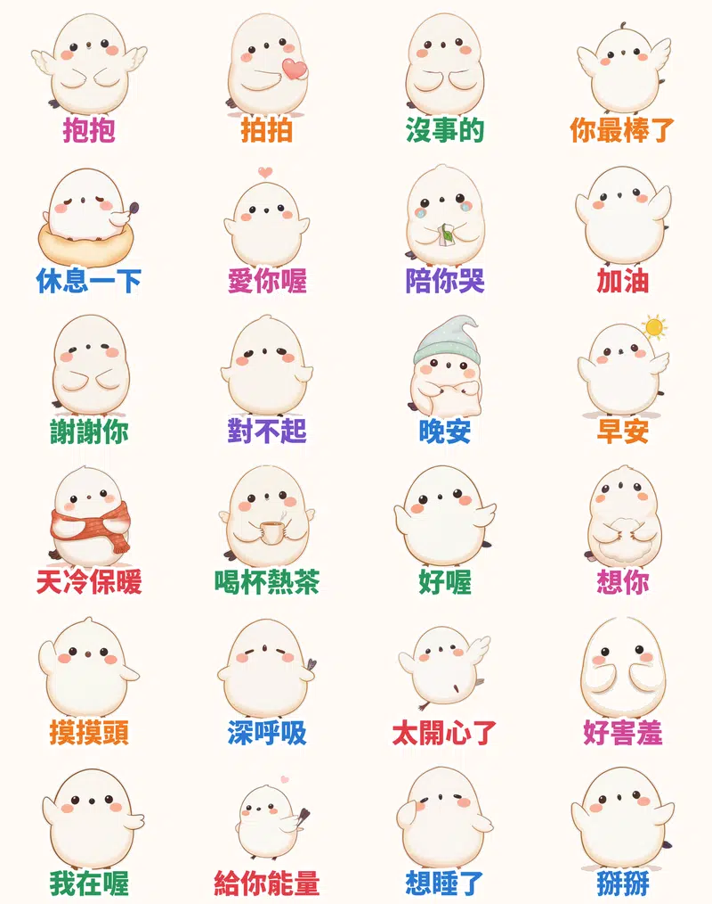

近期在台灣、日本與香港的 LINE 貼圖榜單中，**「極致軟萌白白小動物」**＋**「高頻率日常情緒接住」**＋**「拍拍抱抱撫慰」**成為無可撼動的爆款常勝方程式。來自北海道的「雪之妖精」**銀喉長尾山雀（シマエナガ）**，圓滾滾如軟雪大福般的純白羽毛、圓溜黑豆眼與天然呆萌小翅膀，融化無數人的心。這次我們正式推出了全新角色——**雪精靈啾啾（Chiu-Chiu）**！

> 🕊️ **雪精靈啾啾・暖心拍拍**（動態語音貼圖 24 張）👉 [Massor 的 LINE 貼圖小舖](https://line.me/S/shop/sticker/author/6564520?utm_source=ghpages&utm_medium=bridge&utm_campaign=chiuchiu-snowfairy&utm_content=author-6564520)（本套送審中，通過審核後同一頁即刻開賣）

## 真正的動作演繹，拒絕生硬變形

有別於一般簡單位移或縮放變形的靜態貼圖轉動畫，本套 24 張貼圖均先以 **FLUX + 專屬繪本風 LoRA** 確立角色一致姿態，再交由本地端 **MiniMax H3 (fl2va)** 多模態影片模型進行真實肢體物理運算：
- **「抱抱」**：張開柔軟潔白的小翅膀，左右搖擺送上溫暖擁抱。
- **「拍拍」**：翅膀尖端一下一下溫柔拍打漂浮的小粉紅愛心。
- **「深呼吸」**：毛茸茸的胸脯飽滿鼓起吸氣，再輕緩吐氣放鬆。
- **「陪你哭」**：眼眶汪汪泛著水光，拿著小樹葉紙巾吸鼻拭淚。
- **「天冷保暖」**：圍上大紅色針織毛線圍巾，暖呼呼吹著熱氣。

每組動作皆精準抽幀為 20 幀、3.0 秒的完美循環 APNG，外圈加上平滑純白保護邊框與高對比文字，不論淺色或深色對話框皆清晰好辨識。

## 🔊 點一下聽聽軟萌語音

每張動態貼圖均搭載清脆靈動的鳥鳴鳥叫（Piu-piu~）與台灣配音（`zh-TW-HsiaoYuNeural`），音訊嚴格經正規化 loudnorm 與降噪處理。點擊下方卡片即可即時試聽：

  <figure class="ms-c">
    <video src="https://github.com/ckw19810413/ckw19810413.github.io/releases/download/media-line-animated-sticker-snow-fairy-fluffy-pats/chiuchiu-a01.mp4" poster="sound/a01.jpg" muted autoplay loop playsinline preload="metadata"></video>
    <figcaption>來，抱抱～</figcaption>
    <button type="button" class="ms-share">傳給朋友</button>
  </figure>
  <figure class="ms-c">
    <video src="https://github.com/ckw19810413/ckw19810413.github.io/releases/download/media-line-animated-sticker-snow-fairy-fluffy-pats/chiuchiu-a02.mp4" poster="sound/a02.jpg" muted autoplay loop playsinline preload="metadata"></video>
    <figcaption>拍拍，沒事喔～</figcaption>
    <button type="button" class="ms-share">傳給朋友</button>
  </figure>
  <figure class="ms-c">
    <video src="https://github.com/ckw19810413/ckw19810413.github.io/releases/download/media-line-animated-sticker-snow-fairy-fluffy-pats/chiuchiu-a03.mp4" poster="sound/a03.jpg" muted autoplay loop playsinline preload="metadata"></video>
    <figcaption>沒事的，有我在</figcaption>
    <button type="button" class="ms-share">傳給朋友</button>
  </figure>
  <figure class="ms-c">
    <video src="https://github.com/ckw19810413/ckw19810413.github.io/releases/download/media-line-animated-sticker-snow-fairy-fluffy-pats/chiuchiu-a04.mp4" poster="sound/a04.jpg" muted autoplay loop playsinline preload="metadata"></video>
    <figcaption>你真的最棒了！</figcaption>
    <button type="button" class="ms-share">傳給朋友</button>
  </figure>
  <figure class="ms-c">
    <video src="https://github.com/ckw19810413/ckw19810413.github.io/releases/download/media-line-animated-sticker-snow-fairy-fluffy-pats/chiuchiu-a05.mp4" poster="sound/a05.jpg" muted autoplay loop playsinline preload="metadata"></video>
    <figcaption>累了就休息一下嘛</figcaption>
    <button type="button" class="ms-share">傳給朋友</button>
  </figure>
  <figure class="ms-c">
    <video src="https://github.com/ckw19810413/ckw19810413.github.io/releases/download/media-line-animated-sticker-snow-fairy-fluffy-pats/chiuchiu-a06.mp4" poster="sound/a06.jpg" muted autoplay loop playsinline preload="metadata"></video>
    <figcaption>好愛你喔～</figcaption>
    <button type="button" class="ms-share">傳給朋友</button>
  </figure>
  <figure class="ms-c">
    <video src="https://github.com/ckw19810413/ckw19810413.github.io/releases/download/media-line-animated-sticker-snow-fairy-fluffy-pats/chiuchiu-a07.mp4" poster="sound/a07.jpg" muted autoplay loop playsinline preload="metadata"></video>
    <figcaption>嗚嗚，我陪你哭</figcaption>
    <button type="button" class="ms-share">傳給朋友</button>
  </figure>
  <figure class="ms-c">
    <video src="https://github.com/ckw19810413/ckw19810413.github.io/releases/download/media-line-animated-sticker-snow-fairy-fluffy-pats/chiuchiu-a08.mp4" poster="sound/a08.jpg" muted autoplay loop playsinline preload="metadata"></video>
    <figcaption>加油加油，衝呀！</figcaption>
    <button type="button" class="ms-share">傳給朋友</button>
  </figure>
  <figure class="ms-c">
    <video src="https://github.com/ckw19810413/ckw19810413.github.io/releases/download/media-line-animated-sticker-snow-fairy-fluffy-pats/chiuchiu-a09.mp4" poster="sound/a09.jpg" muted autoplay loop playsinline preload="metadata"></video>
    <figcaption>謝謝你～</figcaption>
    <button type="button" class="ms-share">傳給朋友</button>
  </figure>
  <figure class="ms-c">
    <video src="https://github.com/ckw19810413/ckw19810413.github.io/releases/download/media-line-animated-sticker-snow-fairy-fluffy-pats/chiuchiu-a10.mp4" poster="sound/a10.jpg" muted autoplay loop playsinline preload="metadata"></video>
    <figcaption>對不起嘛…</figcaption>
    <button type="button" class="ms-share">傳給朋友</button>
  </figure>
  <figure class="ms-c">
    <video src="https://github.com/ckw19810413/ckw19810413.github.io/releases/download/media-line-animated-sticker-snow-fairy-fluffy-pats/chiuchiu-a11.mp4" poster="sound/a11.jpg" muted autoplay loop playsinline preload="metadata"></video>
    <figcaption>晚安，祝你好夢</figcaption>
    <button type="button" class="ms-share">傳給朋友</button>
  </figure>
  <figure class="ms-c">
    <video src="https://github.com/ckw19810413/ckw19810413.github.io/releases/download/media-line-animated-sticker-snow-fairy-fluffy-pats/chiuchiu-a12.mp4" poster="sound/a12.jpg" muted autoplay loop playsinline preload="metadata"></video>
    <figcaption>早安！今天也要好好的</figcaption>
    <button type="button" class="ms-share">傳給朋友</button>
  </figure>
  <figure class="ms-c">
    <video src="https://github.com/ckw19810413/ckw19810413.github.io/releases/download/media-line-animated-sticker-snow-fairy-fluffy-pats/chiuchiu-a13.mp4" poster="sound/a13.jpg" muted autoplay loop playsinline preload="metadata"></video>
    <figcaption>天冷要穿暖暖喔</figcaption>
    <button type="button" class="ms-share">傳給朋友</button>
  </figure>
  <figure class="ms-c">
    <video src="https://github.com/ckw19810413/ckw19810413.github.io/releases/download/media-line-animated-sticker-snow-fairy-fluffy-pats/chiuchiu-a14.mp4" poster="sound/a14.jpg" muted autoplay loop playsinline preload="metadata"></video>
    <figcaption>喝杯熱茶暖暖身</figcaption>
    <button type="button" class="ms-share">傳給朋友</button>
  </figure>
  <figure class="ms-c">
    <video src="https://github.com/ckw19810413/ckw19810413.github.io/releases/download/media-line-animated-sticker-snow-fairy-fluffy-pats/chiuchiu-a15.mp4" poster="sound/a15.jpg" muted autoplay loop playsinline preload="metadata"></video>
    <figcaption>好喔，完全沒問題！</figcaption>
    <button type="button" class="ms-share">傳給朋友</button>
  </figure>
  <figure class="ms-c">
    <video src="https://github.com/ckw19810413/ckw19810413.github.io/releases/download/media-line-animated-sticker-snow-fairy-fluffy-pats/chiuchiu-a16.mp4" poster="sound/a16.jpg" muted autoplay loop playsinline preload="metadata"></video>
    <figcaption>好想你喔…</figcaption>
    <button type="button" class="ms-share">傳給朋友</button>
  </figure>
  <figure class="ms-c">
    <video src="https://github.com/ckw19810413/ckw19810413.github.io/releases/download/media-line-animated-sticker-snow-fairy-fluffy-pats/chiuchiu-a17.mp4" poster="sound/a17.jpg" muted autoplay loop playsinline preload="metadata"></video>
    <figcaption>摸摸頭，辛苦了</figcaption>
    <button type="button" class="ms-share">傳給朋友</button>
  </figure>
  <figure class="ms-c">
    <video src="https://github.com/ckw19810413/ckw19810413.github.io/releases/download/media-line-animated-sticker-snow-fairy-fluffy-pats/chiuchiu-a18.mp4" poster="sound/a18.jpg" muted autoplay loop playsinline preload="metadata"></video>
    <figcaption>深呼吸，慢慢來</figcaption>
    <button type="button" class="ms-share">傳給朋友</button>
  </figure>
  <figure class="ms-c">
    <video src="https://github.com/ckw19810413/ckw19810413.github.io/releases/download/media-line-animated-sticker-snow-fairy-fluffy-pats/chiuchiu-a19.mp4" poster="sound/a19.jpg" muted autoplay loop playsinline preload="metadata"></video>
    <figcaption>耶！太開心了！</figcaption>
    <button type="button" class="ms-share">傳給朋友</button>
  </figure>
  <figure class="ms-c">
    <video src="https://github.com/ckw19810413/ckw19810413.github.io/releases/download/media-line-animated-sticker-snow-fairy-fluffy-pats/chiuchiu-a20.mp4" poster="sound/a20.jpg" muted autoplay loop playsinline preload="metadata"></video>
    <figcaption>討厭啦～好害羞</figcaption>
    <button type="button" class="ms-share">傳給朋友</button>
  </figure>
  <figure class="ms-c">
    <video src="https://github.com/ckw19810413/ckw19810413.github.io/releases/download/media-line-animated-sticker-snow-fairy-fluffy-pats/chiuchiu-a21.mp4" poster="sound/a21.jpg" muted autoplay loop playsinline preload="metadata"></video>
    <figcaption>我一直都在喔</figcaption>
    <button type="button" class="ms-share">傳給朋友</button>
  </figure>
  <figure class="ms-c">
    <video src="https://github.com/ckw19810413/ckw19810413.github.io/releases/download/media-line-animated-sticker-snow-fairy-fluffy-pats/chiuchiu-a22.mp4" poster="sound/a22.jpg" muted autoplay loop playsinline preload="metadata"></video>
    <figcaption>給你滿滿的正能量！</figcaption>
    <button type="button" class="ms-share">傳給朋友</button>
  </figure>
  <figure class="ms-c">
    <video src="https://github.com/ckw19810413/ckw19810413.github.io/releases/download/media-line-animated-sticker-snow-fairy-fluffy-pats/chiuchiu-a23.mp4" poster="sound/a23.jpg" muted autoplay loop playsinline preload="metadata"></video>
    <figcaption>好想睡覺覺喔</figcaption>
    <button type="button" class="ms-share">傳給朋友</button>
  </figure>
  <figure class="ms-c">
    <video src="https://github.com/ckw19810413/ckw19810413.github.io/releases/download/media-line-animated-sticker-snow-fairy-fluffy-pats/chiuchiu-a24.mp4" poster="sound/a24.jpg" muted autoplay loop playsinline preload="metadata"></video>
    <figcaption>掰掰，明天見喔</figcaption>
    <button type="button" class="ms-share">傳給朋友</button>
  </figure>

## 24 款貼圖實用對照表

| 編號 | 貼圖名稱 | 最推薦使用時機 |
|:---:|:---|:---|
| 01 | 抱抱 | 想給溫暖、打氣、和好擁抱 |
| 02 | 拍拍 | 朋友受委屈、心情不好時拍拍安慰 |
| 03 | 沒事的 | 事情出包或緊張時的安撫定心丸 |
| 04 | 你最棒了 | 稱讚對方超厲害、慶祝目標達成 |
| 05 | 休息一下 | 下班下課、勸人不要太累早點休息 |
| 06 | 愛你喔 | 情侶放閃、家人表達愛意與感謝 |
| 07 | 陪你哭 | 陪伴低潮難過、替朋友打抱不平 |
| 08 | 加油 | 考試面試前夕、充滿熱血衝勁 |
| 09 | 謝謝你 | 收到幫忙或禮物時的真心致謝 |
| 10 | 對不起 | 做錯事羞愧道歉、誠懇求原諒 |
| 11 | 晚安 | 睡前道別、溫柔祝願好夢 |
| 12 | 早安 | 開啟美好一天、晨間元氣問候 |
| 13 | 天冷保暖 | 氣溫驟降天冷、提醒穿暖別感冒 |
| 14 | 喝杯熱茶 | 下午茶放鬆、喝杯熱茶暖胃暖心 |
| 15 | 好喔 | 收到通知答應、俐落回覆沒問題 |
| 16 | 想你 | 思念朋友戀人、遠距離想念撒嬌 |
| 17 | 摸摸頭 | 下班打卡、交差完成摸摸頭辛苦了 |
| 18 | 深呼吸 | 情緒焦慮緊張時、深呼吸緩和情緒 |
| 19 | 太開心了 | 大好消息降臨、雀躍跳躍慶祝 |
| 20 | 好害羞 | 被誇獎受寵若驚、害羞臉紅 |
| 21 | 我在喔 | 深夜談心隨傳隨到、我一直都在 |
| 22 | 給你能量 | 充電補給站、注入滿滿正能量 |
| 23 | 想睡了 | 熬夜眼皮沉重、萌萌打瞌睡 |
| 24 | 掰掰 | 結束對話說再見、期待明天再聊 |

---

**系列作品連載**：
- 海獺暖暖・療癒拍拍動起來
- 無尾熊可可・療癒拍拍動起來
- 芋圓貓・黏TT戀愛日常
- 綿綿羊・喜氣羊羊過好年
