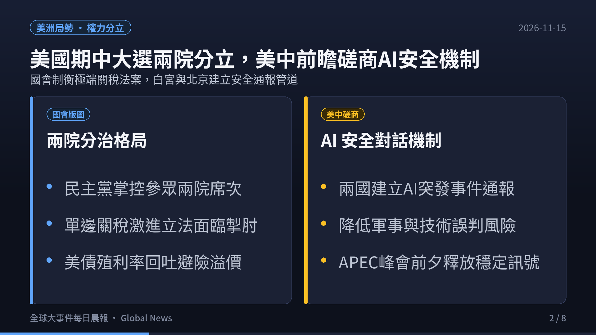
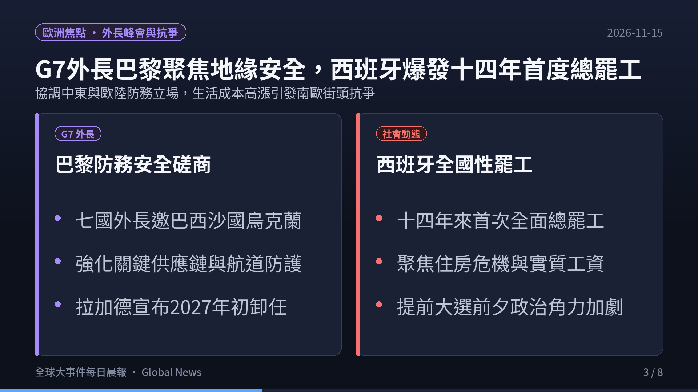
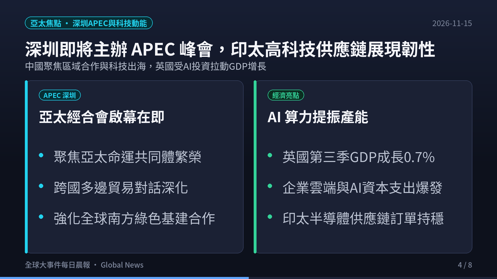
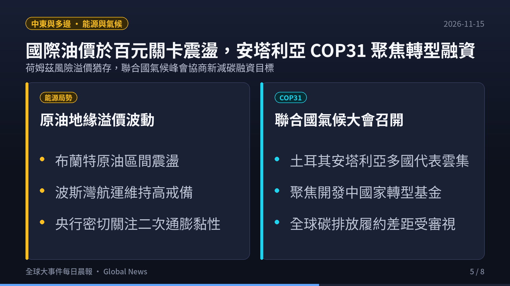
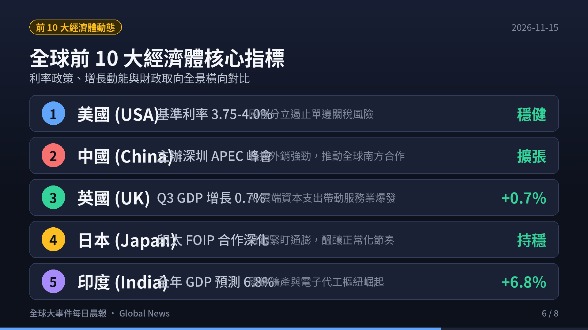
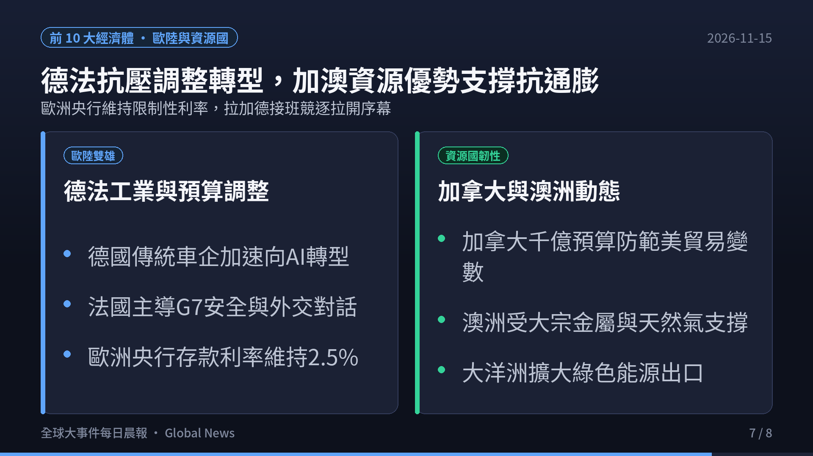
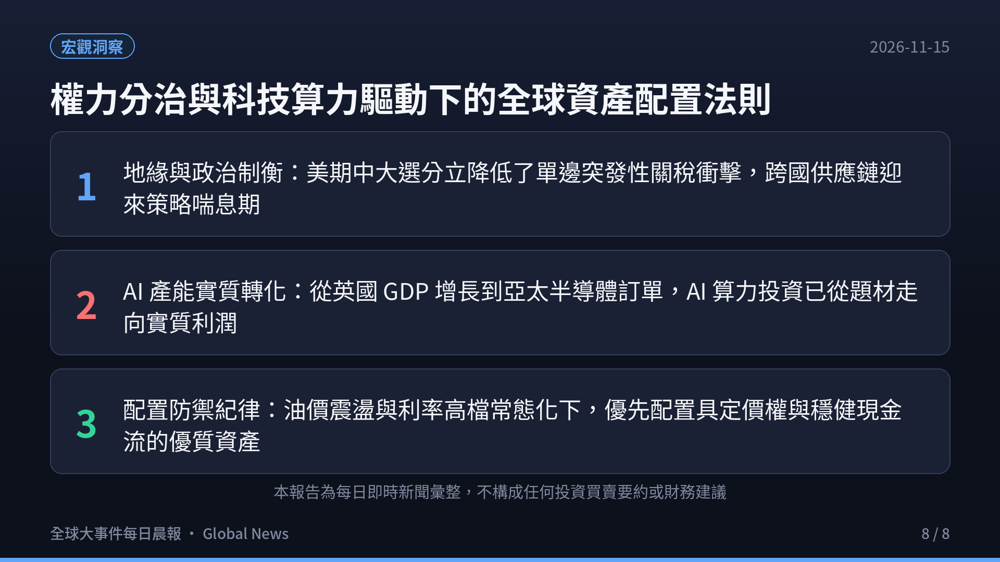

> **觀測週期**：2026-11-15 晨間即時彙整  
> **情報涵蓋**：全球各大洲（北美、歐洲、亞太/印太、中東、拉丁美洲、大洋洲）與全球前 10 大經濟體  
> **核心來源**：各國政府公報、路透社（Reuters）、美聯社（AP）、英國衛報（The Guardian）、各國央行公報、IMF 經濟展望與 S&P Global 報告  
> **定位宗旨**：以客觀數據、官方決策與供應鏈結構為準繩，剔除短期情緒噪音，提煉出真正驅動全球資金流向與地緣版圖重構的核心脈絡。

  

    <iframe src="https://www.youtube.com/embed/H_yaa3bq8DQ" title="2026-11-15 全球大事件每日晨報" style="position: absolute; top:0; left: 0; width: 100%; height: 100%; border: 0;" allow="accelerometer; autoplay; clipboard-write; encrypted-media; gyroscope; picture-in-picture; web-share" allowfullscreen></iframe>
  

  

    🎬 <strong>120 秒晨間快報影音動態版</strong>（含 AI 自然神經語音朗讀與背景配樂）
  

---

## 🎯 今日全球前 6 大核心事件深度拆解

### 1. 美洲局勢與跨太平洋外交互動：美期中大選確立國會分治格局，美中在峰會前夕磋商 AI 事故通報機制
- **國會分治格局確立與單邊極端法案受阻**：
  - 美國期中大選計票塵埃落定，參眾兩院呈現權力分治與微弱多數平衡格局。這意味著未來兩年華府在極端單邊關稅、跨國貿易協定審查與激進財政赤字法案上將面臨實質立法掣肘。
  - 華爾街股市與債券市場迅速重估風險溢價，長端美債殖利率回吐部分避險溢價，反映市場對極端政策不確定性降溫的寬慰。
- **美中 AI 安全機制與峰會前瞻對話**：
  - 在即將召開的亞太高層雙邊互動前，美中工作小組就人工智慧（AI）軍事防護與突發事件通報框架展開實質磋商，旨在降低高科技競爭與前沿演算法部署中的意外摩擦風險。
  - 此舉為雙方經貿與供應鏈對話注入了務實的「風險護欄」，釋放跨太平洋戰略穩定的積極訊號。

---

### 2. 歐洲安全協調與社會結構摩擦：G7 外長齊聚巴黎磋商防務，西班牙爆發 14 年來首次全面大罷工
- **G7 外長巴黎會晤與防務協作深化**：
  - 七大工業國（G7）外長攜手巴西、沙烏地阿拉伯及烏克蘭高級代表在巴黎舉行高級安全會談，集中協調對中東航運走廊的聯合安全護航及歐洲關鍵基礎設施防護機制。
  - 歐洲央行（ECB）總裁拉加德宣布將於 2027 年初卸任，提前拉開了歐洲央行最高決策層的接班競逐序幕，但貨幣政策短期維持限制性高息以壓抑通膨回潮。
- **南歐居住成本壓力引發大罷工**：
  - 西班牙遭遇 14 年來首次跨行業全國性總罷工，數十萬民眾走上街頭抗議房價與租金暴漲、實質薪資停滯以及公共醫療資源吃緊。
  - 罷工使大眾交通與港口物流行程嚴重受阻，對即將舉行的提前大選選情產生直接衝擊，凸顯歐洲長期通膨黏性對民生基底的深層侵蝕。

---

### 3. 亞太經合盛會與高科技動能：深圳即將迎來第 33 屆 APEC 峰會，英國受 AI 投資拉動 Q3 GDP 增長 0.7%
- **第 33 屆 APEC 峰會於深圳倒數啟幕**：
  - 亞太經合組織（APEC）領袖會議將於 11 月 18 至 19 日在深圳隆重舉行。作為中國改革開放與前沿科技的核心樞紐，深圳將見證多國元首圍繞「亞太命運共同體、區域自由貿易與綠色數位轉型」展開深度談判。
  - 中國藉此主場外交平台強化與東協、拉美及「全球南方」的新型夥伴關係，加速高技術綠色產能出海佈局。
- **AI 算力投資化為實質 GDP 增長**：
  - 最新經濟數據顯示，英國第三季 GDP 季增率達 **0.7%**（年化近 1.9%），超出市場普遍預期。主要增長引擎來自企業對雲端計算、專業諮詢與 AI 資料中心基礎建設的爆發式資本支出。
  - 這印證了生成式 AI 投資正在從實驗室原型轉化為帶動現代服務業與生產力提升的實體動能。

---

### 4. 中東能源博弈與全球氣候議程：油價百元關卡高位震盪，COP31 聯合國氣候峰會安塔利亞爭奪綠色基金
- **中東航運地緣溢價與能源供應博弈**：
  - 荷姆茲海峽與紅海周邊的安全緊張態勢維持高檔，主要海運巨頭持續採取繞行好望角與額外保險加成措施。布蘭特原油價格在每桶 90 至 110 美元高位區間劇烈波動。
  - 國際貨幣基金組織（IMF）警告，高能源成本使得全球 headline 通膨回落進程放緩，各國央行在 2026 年底前重啟降息週期的門檻顯著拉高。
- **COP31 氣候大會聚焦新融資目標**：
  - 聯合國氣候變化大會（COP31）在土耳其安塔利亞如火如荼展開，超過 190 國代表就後巴黎協定時期的「全球氣候金融集體量化新目標（NCQG）」進行激烈博弈。
  - 發展中國家強烈呼籲已開發經濟體落實每年數千億美元的能源轉型基金與技術轉移承諾，碳邊境調整機制（CBAM）與全球碳定價標準成為焦點爭端。

---

### 5. 全球前十大經濟體核心指標與趨勢橫向全景

| 排名 | 國家 / 經濟體 | 核心總體經濟數據 / 最新指標 | 2026-11-15 即時動態與政策取向 | 全球產業鏈與市場意涵 |
|:---:|:---|:---|:---|:---|
| **1** | **美國 (USA)** | 基準利率 **3.75%–4.00%** · 通膨 **3.6%** | 期中大選兩院分治；美中磋商 AI 事故通報；美股科技板塊走揚 | 國會分立降低激進關稅衝擊，AI 資本支出維持強韌，長端殖利率重回基本面定價。 |
| **2** | **中國 (China)** | 主辦深圳 **APEC** · 外銷動能穩健 | 深圳峰會啟幕在即，推進高科技出海與全球南方貿易互利 | 數位經濟與高端製造業產能展現抗逆力，內需刺激政策進入政策評估落地期。 |
| **3** | **德國 (Germany)** | 歐洲央行存款利率 **2.50%** · 工業轉型 | 傳統車企加速向 AI 自駕與新電池轉型；參與 G7 巴黎防務協調 | 工業體系積極對沖高能源成本，深耕智慧自動化與綠色氫能基礎建設。 |
| **4** | **日本 (Japan)** | 推進 **FOIP** 印太佈局 · 政策利率 **1.25%** | 高市內閣深化東南亞基建安全合作；日銀審慎評估進一步升息節奏 | 日圓套息交易處於動態再平衡，半導體材料與先進設備出口訂單持續攀升。 |
| **5** | **印度 (India)** | GDP 預測成長 **6.8%** · 通膨 **5.1%** | 關鍵礦產與電子代工樞紐崛起；平衡 Quad 與多元大國關係 | 跨國供應鏈「China+1」最大受益者，內需人口紅利與基建投資動能強勁。 |
| **6** | **英國 (UK)** | Q3 GDP **+0.7%** · 基準利率 **4.0%** | AI 雲端資本支出推動 GDP 超預期；英格蘭銀行維持審慎觀望 | 專業服務業與數位科技領跑歐洲，但冬季能源帳單壓力仍需央行維持防禦性高息。 |
| **7** | **法國 (France)** | 歐洲央行存款利率 **2.50%** · G7 會晤主辦 | 馬克宏政府力推歐洲防務戰略自主；關注拉加德後續接班格局 | 聚焦高階航太、核能與綠色技術，積極在歐盟預算與主權債務協商中爭取主導。 |
| **8** | **義大利 (Italy)** | 歐元區統一利率 **2.50%** · 國債監控 | 歐盟復甦基金落實率提升；綠色基建與地中海能源管線推進 | 嚴格維持財政紀律以防國債利差擴大，得益於地中海能源過渡樞紐戰略定位。 |
| **9** | **加拿大 (Canada)** | 1510 億產能預算 · 戰略礦產開發 | 卡尼內閣推進生產力提振專案；防範美選後北美貿易協定變更 | 關鍵鋰、鎳等戰略金屬與乾淨能源吸引美歐長約，築高貿易防護緩衝。 |
| **10** | **澳洲 (Australia)** | 基準利率 **4.35%** · 大宗商品順差 | 澳洲央行維持限制性高息；大宗鐵礦與天然氣出口強勁；參與 COP31 | 能源轉型關鍵原料供應大國，商品貿易順差為抗擊通膨提供堅實後盾。 |

---

### 6. 歐陸抗壓轉型與資源國韌性：德法工業調整推進，加澳資源紅利對沖全球宏觀震盪
- **歐洲核心工業軸心的智慧韌性**：
  - 德國與法國作為歐元區雙引擎，在面對高利率與高能源成本的常態化環境下，正加速將國家資源向人工智慧工業應用、電網智慧升級與國防安全自主化集中。
  - 歐洲央行將在 12 月議息會議面臨拉加德任期尾聲的關鍵決策，市場預期限制性利率將延續至 2027 年年中。
- **大宗資源國家的逆週期防禦力**：
  - 加拿大推出的 1,510 億預算案聚焦於重塑本國製造業人均生產力，並在北美供應鏈中牢牢鎖定關鍵礦物優勢。
  - 澳洲則透過向印太盟邦穩定供應液化天然氣（LNG）與稀有金屬，維持了亮眼的商品貿易順差，為全球流動性收縮期提供了穩健的避險資產錨點。

---

## 💡 總結與投資者生存指南

1. **政治制衡確立與地緣尾部風險降溫**：
   - 美國期中大選兩院分治的結果，排除了短期內出現極端單邊行政命令或顛覆性關稅法案的可能性，為跨國供應鏈爭取到了至少兩年的策略調整喘息窗口。
   - 美中啟動 AI 安全機制磋商，顯示科技領域的激烈競爭正在建立底線風險護欄，市場系統性風險溢價有助於持續收斂。
2. **AI 算力投資的「實質產能兌現期」到來**：
   - 英國 Q3 GDP 增長由 AI 與雲端資本支出驅動的案例表明，人工智慧對宏觀經濟的影響已跨越純概念炒作階段，正式邁入「資本開支推動實質生產力」的收穫期。
   - 投資者應重點跟蹤真正具備企業級落地場景、高現金流回報與技術壁壘的基礎設施標的。
3. **長期高息環境下的資產配置鐵律**：
   - 儘管市場預期極端通膨不再，但能源與供應鏈摩擦成本讓全球利率難以迅速重回零利率時代。「Higher for Longer」仍是當前的主旋律。
   - 資產配置宜堅守「高確定性自由現金流、健康資產負債表、定價權優勢」三大防禦護城河，避免過度押注高槓桿流動性資產。

---

### ☕ 支持與精選推薦

如果你覺得這份每日晨報對你的宏觀視野與決策有實質幫助，歡迎透過以下方式支持我們持續產出深度內容：

- ☕ **請我喝杯咖啡**：[Ko-fi 小費贊助 (ytstories0413)](https://ko-fi.com/ytstories0413) 或 [Ko-fi 贊助 (slashman413)](https://ko-fi.com/slashman413)（支持每日自動化爬蟲、語音合成與雲端運算）
- 📚 **數位產品與高人效生產力工具**：
  - [Gumroad 數位商品專區](https://slashmaster6.gumroad.com/)：收錄精選 AI Prompt 庫、生產力自動化工作流與實戰腳本
  - [SlashmanTools 免費 Web 工具集](https://slashmantools.us/)：Token 成本計算器、顯存預估、開源 AI 工具導航
- 📖 **精選經典閱讀推薦**：
  - [《晶片戰爭》（Chip War）](https://www.amazon.com/dp/059371671X?tag=ytstories0413-20)：理解全球晶片霸權與印太供應鏈重組的必讀經典
  - [《原子習慣》— 細微改變帶來巨大成就](https://www.books.com.tw/products/0010792915)
  - [《人生的智慧》— 叔本華處世哲學經典](https://www.books.com.tw/products/0010613113)
