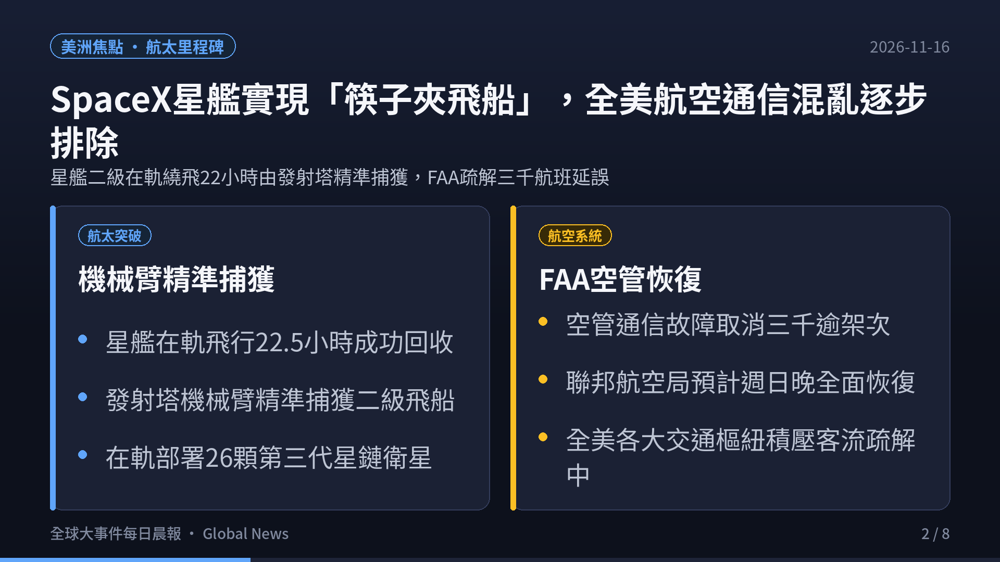
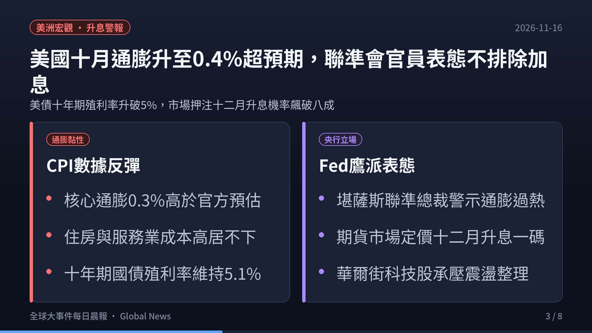
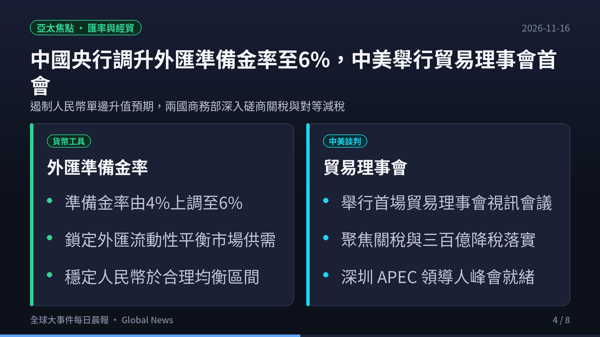
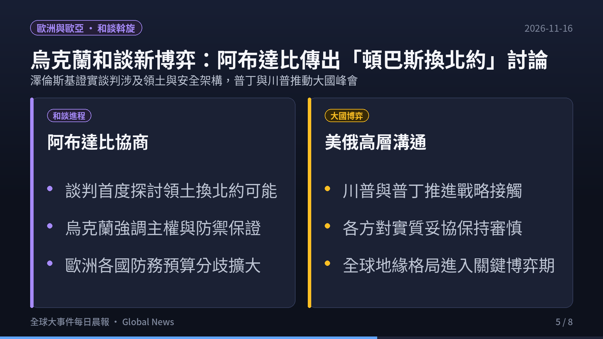
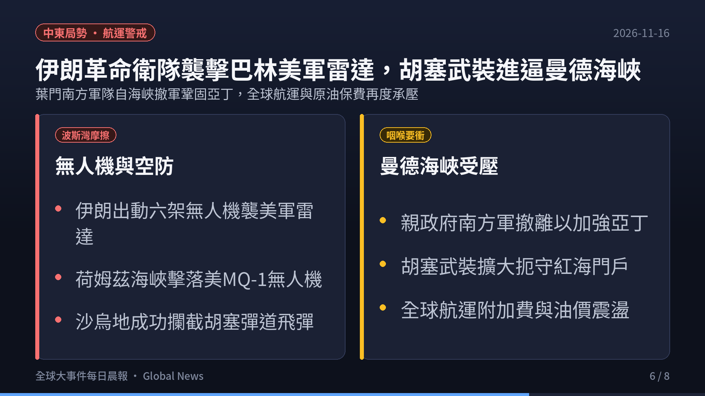
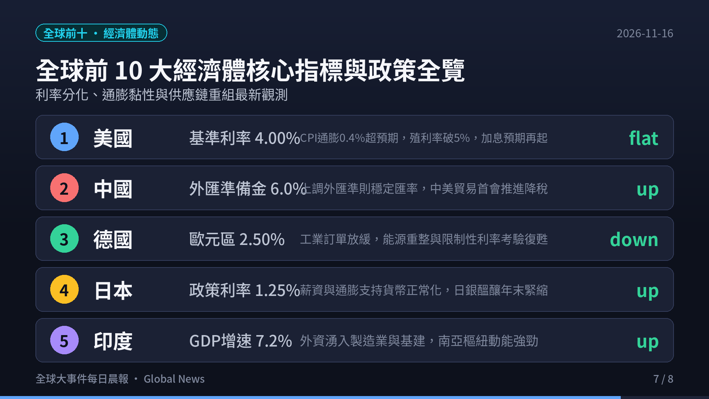
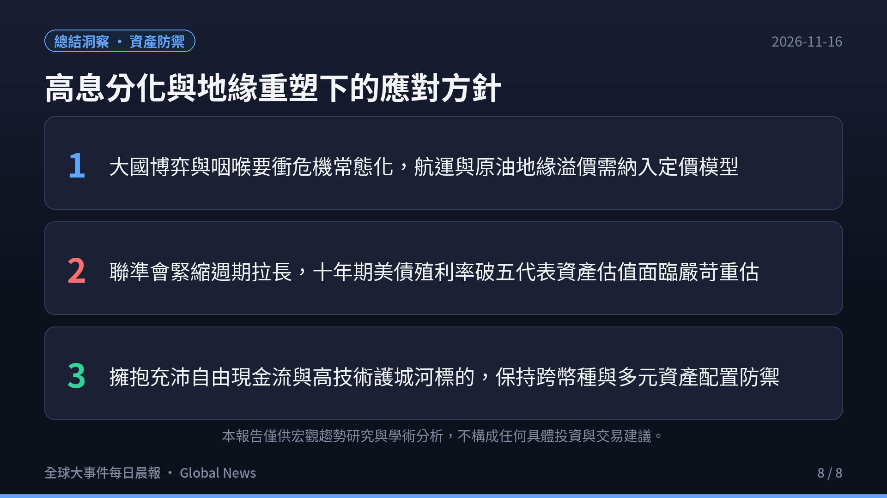

> **觀測週期**：2026-11-16 晨間即時彙整  
> **情報涵蓋**：全球各大洲（北美、歐洲、中東、亞洲/印太、拉美、大洋洲）與全球前 10 大經濟體  
> **核心來源**：各國政府公報、路透社（Reuters）、美聯社（AP）、新華社、各國央行公報與 S&P Global PMI 報告  
> **定位宗旨**：以客觀數據、官方決策與供應鏈結構為準繩，剔除短期情緒噪音，提煉出真正驅動全球資金流向與地緣版圖重構的核心脈絡。

  

    <iframe src="https://www.youtube.com/embed/vE_8XUdjXSE" title="2026-11-16 全球大事件每日晨報" style="position: absolute; top:0; left: 0; width: 100%; height: 100%; border: 0;" allow="accelerometer; autoplay; clipboard-write; encrypted-media; gyroscope; picture-in-picture; web-share" allowfullscreen></iframe>
  

  

    🎬 <strong>120 秒晨間快報影音動態版</strong>（含 AI 自然神經語音朗讀與背景配樂）
  

---

## 🎯 今日全球前 6 大核心事件深度拆解

### 1. 美洲航太與基礎設施：SpaceX 星艦創歷史性「筷子夾飛船」二級空中回收，全美航空停飛混亂逐步疏解
- **星艦二級空中精準捕獲里程碑**：
  - SpaceX 星艦從德州星艦基地升空，在軌繞飛 14 圈（歷時 22.5 小時）並成功部署 26 顆星鏈 V3 衛星後受控返回。發射塔巨型機械臂「Mechazilla（筷子）」首次在空中成功接住第二級飛船本體，實現人類航太史上首次完全可重複使用軌道飛船的空中捕捉。
  - 儘管超重型助推器返航時轉向墨西哥灣觸水前解體，本次任務對二級飛船的捕獲驗證了星艦全面低成本進入太空與在軌加油的核心工程邏輯。
- **全美航空通信故障逐步排除**：
  - 針對美國空管系統日前突發通信故障引發全美逾 3,300 架次航班取消的混亂，美國聯邦航空局（FAA）局長布賴恩·貝德福德表示系統已修復，週日晚間各空運樞紐運能恢復正常，客流積壓正加速疏導。

---

### 2. 美洲宏觀經濟與資本市場：美國十月通膨反彈超預期，Fed 鷹派官員警示加息，美債十年期殖利率破 5%
- **物價黏性與核心通膨反彈**：
  - 美國最新公布的十月消費者物價指數（CPI）月增率達到 0.4%，核心 CPI 月增率 0.3%，均超出華爾街市場預估。租金住房成本與醫療服務業通膨具備高度黏性，通膨頑固回落困難。
  - 十年期美國國債殖利率維持在 4.98%–5.15% 高檔震盪，兩年期殖利率升至 4.73%，創下數月以來新高。
- **聯準會官員密集釋出鷹派信號**：
  - 堪薩斯聯準銀行總裁 Jeff Schmid 與達拉斯聯準銀行總裁 Lorie Logan 等決策官員相繼發表公開演說，強調物價壓力依然過熱、通膨正走向錯誤方向，不排除需要進一步收緊貨幣政策。
  - 利率期貨市場定價對十二月聯邦公開市場委員會（FOMC）升息一碼的機率已飆升至 80% 附近，高利率環境對全球科技股與高槓桿資產持續帶來重估壓力。

---

### 3. 亞太匯率與跨國經貿：中國央行調升外匯存款準備金率至 6%，中美經貿磋商機制項下首度舉行貿易理事會
- **人行上調外匯存準率鎖定流動性**：
  - 中國人民銀行（PBOC）自 11 月 15 日起正式將金融機構外匯存款準備金率由 4% 上調至 6%。此舉將收縮金融體系外幣流動性，有助於平衡外匯市場供求，有效抑制近期人民幣匯率的單邊升值預期，維持匯率在合理均衡水平上的基本穩定。
- **中美貿易理事會首會落實對等降稅**：
  - 中美雙方透過視訊形式舉行了經貿磋商機制項下「貿易理事會」首次會議。兩國圍繞落實元首共識，深入探討了關稅安排、「300億對300億」對等降稅清單以及農產品貿易，致力於拉長合作清單、壓縮問題清單。
  - 同時，2026 APEC 深圳領導人會議周籌備工作已全面就緒，北交所亦迎來開市五週年，總市值達 8,000 億元人民幣。

---

### 4. 歐洲地緣與大國斡旋：烏克蘭和平談判迎關鍵轉折，阿布達比談判首度浮現「頓巴斯換北約」設想
- **停火籌碼與領土談判公開化**：
  - 在阿布達比舉行的最新一輪閉門和平斡旋中，美方談判代表首度向各方探討烏克蘭是否可能在東部頓巴斯地區做出領土妥協以換取加入北約的具體安排。
  - 烏克蘭總統澤倫斯基在記者會上首度證實該議題已在談判桌上被提出，但強調任何方案都必須具備不可推翻的國際集體防衛安全保證，引發歐洲各國高度關注與戰略評估。
- **美俄高層外交接觸加速**：
  - 國際分析指出普丁與川普團隊正在推動高層戰略對話，但歐盟內部對於未來防務預算分攤以及烏克蘭主權邊界的保障仍存在顯著分歧，地緣博弈進入高度複雜的多方博弈期。

---

### 5. 中東安全與咽喉要衝：伊朗無人機突襲巴林美軍雷達站，葉門親政府軍撤離曼德海峽，紅海航運風險再飆
- **波斯灣軍事摩擦與空防交火**：
  - 伊朗伊斯蘭革命衛隊（IRGC）宣稱出動六架自殺式無人機襲擊了位於巴林 Al-Riffa 直升機基地的美軍防空雷達系統，並在荷姆茲海峽格什姆島上空擊落一架美軍 MQ-1「捕食者」無人機；沙烏地聯軍則成功攔截了朝利雅德首都圈與東部油田射來的胡塞彈道飛彈。
- **曼德海峽控制權位移與全球航運溢價**：
  - 葉門政府盟友「南方武裝部隊」宣布從關鍵戰略節點曼德海峽沿岸撤離，回防南部重鎮亞丁市。此舉使伊朗支持的胡塞武裝進一步擴大並鞏固了對曼德海峽紅海咽喉要道的控制。
  - 國際航運保費應聲調漲，各大航運巨頭維持繞行好望角策略，全球航運供應鏈週轉效率再次承壓。

---

### 6. 全球前 10 大經濟體核心總體數據橫向比對
以下為本觀測週期全球前十大經濟體的貨幣政策、通膨走勢、實質動態與最新展望：

| 排名 | 經濟體 | 核心貨幣政策與利率 | 最新重大進展與數據脈動 | 結構性趨勢與中長期展望 |
|:---:|:---|:---|:---|:---|
| **1** | **美國 (US)** | 聯邦基準利率 **3.75%–4.00%** · 12月升息預期升溫 | 10月 CPI 上漲 0.4%，10年期美債殖利率破 5.15%；全美航空空管修復 | 勞動力市場具黏性，高息環境壓制商業地產與中小型企業，科技資本支出呈現分化。 |
| **2** | **中國 (China)** | 外匯存準率調升至 **6.0%** · 穩健貨幣政策 | 外匯存準率正式調升平衡匯市；中美貿易理事會首會磋商 300 億對等降稅 | 政策穩步推進長期資本與新質生產力，北交所 5 週年市值達 8,000 億，深圳 APEC 在即。 |
| **3** | **德國 (Germany)** | 歐洲央行存款利率 **2.50%** · 限制性區間 | 歐元區通膨趨緩但製造業訂單疲弱；能源重組與綠色法規推升工業成本 | 工業龍頭在去碳化與高能源成本間艱難轉型，出口導向經濟體受全球關稅博弈壓制。 |
| **4** | **日本 (Japan)** | 無擔保隔夜拆款利率 **1.25%** · 醞釀緊縮 | 日銀評估秋季薪資與服務業通膨，市場密切關注年末是否啟動進一步升息 | 擺脫三十年通縮循環，企業調薪推動良性通膨循環，日圓匯率與海外利差動態平衡。 |
| **5** | **印度 (India)** | 附買回利率 **6.50%** · 經濟高速擴張 | 本季 GDP 增速維持在 7.2% 高位；跨國電子製造業加速投資設廠 | 人口紅利與「印度製造」吸引外資，但通膨與基礎設施瓶頸仍是中長期約束因素。 |
| **6** | **英國 (UK)** | 基準利率 **4.00%** · 應對服務業黏性通膨 | 央行維持緊縮立場，服務業通膨反彈至 3.5%；金融與 AI 投資提供支撐 | 房貸按揭負擔沈重壓制居民消費，高息環境對公共財政赤字整頓帶來持續考驗。 |
| **7** | **法國 (France)** | 歐洲央行統一利率 **2.50%** · 財政嚴格監控 | 財政預算審查與社會福利博弈白熱化；航空安全與地緣警戒推升維穩支出 | 公共債務高企限縮財政刺激空間，核心製造業與航空航太產業受地緣供應鏈牽制。 |
| **8** | **義大利 (Italy)** | 歐元區存款利率 **2.50%** · 國債利差持穩 | 歐元區降息節奏放緩；義大利 10 年期國債利差保持健康，歐盟基建款穩步到位 | 倚重歐盟「復甦基金」推動數位化與能源基建，經濟成長高度依賴外部資金支持。 |
| **9** | **加拿大 (Canada)** | 基準利率 **3.25%** · 貿易防範預警 | 聯邦政府平衡房地產降溫與赤字開支；提前防範北美貿易協定潛在地緣變數 | 人均生產力停滯，央行需在防範通膨回潮與避免按揭市場斷供之間維持精細平衡。 |
| **10** | **澳洲 (Australia)** | 現金利率目標 **4.35%** · 商品貿易順差 | 澳洲央行維持限制性高息；大宗鐵礦石與液化天然氣出口維持強韌貿易帳 | 關鍵礦產與綠色能源出口吸引跨國投資，但房租與服務業通膨黏性限制短期降息空間。 |

---

## 💡 總結與投資者生存指南

1. **航運咽喉危機與能源溢價的常態化重估**：
   - 曼德海峽控制權位移與波斯灣無人機交火，證明全球能源與貿易關鍵節點的地緣風險正在結構性上升。
   - 繞行好望角帶來的航運附加費與交付週期拉長，將轉化為終端商品的結構性摩擦成本，推遲全球通膨回歸央行 2% 目標的時間線。
2. **美債殖利率破 5% 時代的資產估值壓力**：
   - 10 年期美債殖利率站上 5.15%，標誌著無風險利率的持久高原期。任何依賴廉價融資與遠期故事的商業模式將持續遭遇資本壓力測試。
   - 投資者應堅守「高自由現金流、低負債率、具備實質定價權與技術護城河」的三大原則，防範市場估值中樞下移風險。
3. **中美經貿機制與跨幣種資產分散戰略**：
   - 中國調升外匯準備金率與中美經貿談判推進，反映大國在維持基本戰略穩定與防範匯率無序波動上的政策合力。
   - 投資組合應避免單一美元資產曝險，適度配置大宗抗通膨資產、高流動性短期債券與具備供應鏈替代壁壘的優質股權。

---

### ☕ 支持與精選推薦

如果你覺得這份每日晨報對你的宏觀視野與決策有實質幫助，歡迎透過以下方式支持我們持續產出深度內容：

- ☕ **請我喝杯咖啡**：[Ko-fi 小費贊助 (ytstories0413)](https://ko-fi.com/ytstories0413) 或 [Ko-fi 贊助 (slashman413)](https://ko-fi.com/slashman413)（支持每日自動化爬蟲、語音合成與雲端運算）
- 📚 **數位產品與高人效生產力工具**：
  - [Gumroad 數位商品專區](https://slashmaster6.gumroad.com/)：收錄精選 AI Prompt 庫、生產力自動化工作流與實戰腳本
  - [SlashmanTools 免費 Web 工具集](https://slashmantools.us/)：Token 成本計算器、顯存預估、開源 AI 工具導航
- 📖 **精選經典閱讀推薦**：
  - [《晶片戰爭》（Chip War）](https://www.amazon.com/dp/059371671X?tag=ytstories0413-20)：理解全球晶片霸權與印太供應鏈重組的必讀經典
  - [《原子習慣》— 細微改變帶來巨大成就](https://www.books.com.tw/products/0010792915)
  - [《人生的智慧》— 叔本華處世哲學經典](https://www.books.com.tw/products/0010613113)
