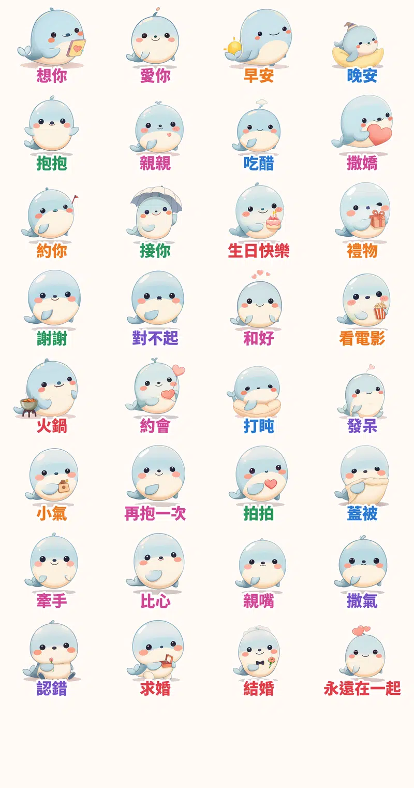

近期在台、日、港的 LINE 貼圖榜單中，**「會動的軟萌角色」＋「日常情緒接住」＋「有聲音的貼圖」**持續成為爆款公式：角色要有高辨識度的圓滾滾造型、動作要是「真的會動」而不是放大縮小、再加上一句軟萌語音，使用頻率與分享率都顯著上升。這次我們把公式套在一隻圓滾滾的小藍鯨上——**小鯨魚泡泡**，推出全新 32 張動態語音貼圖。

> 🐋 **小鯨魚泡泡・黏黏戀愛日常**（動態語音貼圖 32 張）👉 [Massor 的 LINE 貼圖小舖](https://line.me/S/shop/sticker/author/6564520?utm_source=ghpages&utm_medium=bridge&utm_campaign=baobao-whale&utm_content=author-6564520)（本套已送審，通過後同一頁開賣）

## 真實動作演繹，拒絕生硬變形

有別於一般「放大縮小加位移」的假動畫，本套 32 張全部由本地端 **MiniMax H3** 影片模型從 FLUX + 專屬繪本風 LoRA 生成的靜態角色圖演繹而成，角色維持同一隻鯨魚、同一個構圖，只有表情與肢體在動：

- **「想你」**：頭歪向手機、慢慢眨眼，螢幕上的小愛心發光。
- **「早安」**：對著小太陽伸展、打個快樂的哈欠，翻滾起身。
- **「抱抱」**：大張雙鰭左右搖擺，像在說「來這裡」。
- **「吃醋」**：鼓腮、頭頂小烏雲掉雨滴，然後驕傲地消氣。
- **「求婚」**：半跪舉起小愛心戒指，眼睛亮晶晶。
- **「永遠在一起」**：兩隻小鯨魚依偎，尾巴輕輕交疊搖。

每組動作抽幀為 20 幀、3.0 秒完美循環 APNG，外加平滑純白保護邊框，淺色深色對話框都清晰。

## 🔊 點一下，聽泡泡對你說

每張貼圖都配了台灣軟萌女聲（`zh-TW-HsiaoYuNeural`）＋小鯨魚特有的「啵～」泡泡音效，音訊經 loudnorm 正規化、精修音量。點擊卡片即可試聽：

  <figure class="ms-c">
    <video src="https://github.com/ckw19810413/ckw19810413.github.io/releases/download/media-line-animated-sticker-baby-whale-baobao-voice/baobao-a01.mp4" poster="sound/a01.jpg" muted autoplay loop playsinline preload="metadata"></video>
    <figcaption>好想你喔～</figcaption>
    <button type="button" class="ms-share">傳給朋友</button>
  </figure>
  <figure class="ms-c">
    <video src="https://github.com/ckw19810413/ckw19810413.github.io/releases/download/media-line-animated-sticker-baby-whale-baobao-voice/baobao-a02.mp4" poster="sound/a02.jpg" muted autoplay loop playsinline preload="metadata"></video>
    <figcaption>最喜歡你啦</figcaption>
    <button type="button" class="ms-share">傳給朋友</button>
  </figure>
  <figure class="ms-c">
    <video src="https://github.com/ckw19810413/ckw19810413.github.io/releases/download/media-line-animated-sticker-baby-whale-baobao-voice/baobao-a03.mp4" poster="sound/a03.jpg" muted autoplay loop playsinline preload="metadata"></video>
    <figcaption>早安早安～</figcaption>
    <button type="button" class="ms-share">傳給朋友</button>
  </figure>
  <figure class="ms-c">
    <video src="https://github.com/ckw19810413/ckw19810413.github.io/releases/download/media-line-animated-sticker-baby-whale-baobao-voice/baobao-a04.mp4" poster="sound/a04.jpg" muted autoplay loop playsinline preload="metadata"></video>
    <figcaption>晚安好夢喔</figcaption>
    <button type="button" class="ms-share">傳給朋友</button>
  </figure>
  <figure class="ms-c">
    <video src="https://github.com/ckw19810413/ckw19810413.github.io/releases/download/media-line-animated-sticker-baby-whale-baobao-voice/baobao-a05.mp4" poster="sound/a05.jpg" muted autoplay loop playsinline preload="metadata"></video>
    <figcaption>來給你抱抱</figcaption>
    <button type="button" class="ms-share">傳給朋友</button>
  </figure>
  <figure class="ms-c">
    <video src="https://github.com/ckw19810413/ckw19810413.github.io/releases/download/media-line-animated-sticker-baby-whale-baobao-voice/baobao-a06.mp4" poster="sound/a06.jpg" muted autoplay loop playsinline preload="metadata"></video>
    <figcaption>親你一口</figcaption>
    <button type="button" class="ms-share">傳給朋友</button>
  </figure>
  <figure class="ms-c">
    <video src="https://github.com/ckw19810413/ckw19810413.github.io/releases/download/media-line-animated-sticker-baby-whale-baobao-voice/baobao-a07.mp4" poster="sound/a07.jpg" muted autoplay loop playsinline preload="metadata"></video>
    <figcaption>哼我吃醋了</figcaption>
    <button type="button" class="ms-share">傳給朋友</button>
  </figure>
  <figure class="ms-c">
    <video src="https://github.com/ckw19810413/ckw19810413.github.io/releases/download/media-line-animated-sticker-baby-whale-baobao-voice/baobao-a08.mp4" poster="sound/a08.jpg" muted autoplay loop playsinline preload="metadata"></video>
    <figcaption>陪陪我嘛～</figcaption>
    <button type="button" class="ms-share">傳給朋友</button>
  </figure>
  <figure class="ms-c">
    <video src="https://github.com/ckw19810413/ckw19810413.github.io/releases/download/media-line-animated-sticker-baby-whale-baobao-voice/baobao-a09.mp4" poster="sound/a09.jpg" muted autoplay loop playsinline preload="metadata"></video>
    <figcaption>週末一起出去玩</figcaption>
    <button type="button" class="ms-share">傳給朋友</button>
  </figure>
  <figure class="ms-c">
    <video src="https://github.com/ckw19810413/ckw19810413.github.io/releases/download/media-line-animated-sticker-baby-whale-baobao-voice/baobao-a10.mp4" poster="sound/a10.jpg" muted autoplay loop playsinline preload="metadata"></video>
    <figcaption>我來接你啦</figcaption>
    <button type="button" class="ms-share">傳給朋友</button>
  </figure>
  <figure class="ms-c">
    <video src="https://github.com/ckw19810413/ckw19810413.github.io/releases/download/media-line-animated-sticker-baby-whale-baobao-voice/baobao-a11.mp4" poster="sound/a11.jpg" muted autoplay loop playsinline preload="metadata"></video>
    <figcaption>生日快樂呀</figcaption>
    <button type="button" class="ms-share">傳給朋友</button>
  </figure>
  <figure class="ms-c">
    <video src="https://github.com/ckw19810413/ckw19810413.github.io/releases/download/media-line-animated-sticker-baby-whale-baobao-voice/baobao-a12.mp4" poster="sound/a12.jpg" muted autoplay loop playsinline preload="metadata"></video>
    <figcaption>送你的收下吧</figcaption>
    <button type="button" class="ms-share">傳給朋友</button>
  </figure>
  <figure class="ms-c">
    <video src="https://github.com/ckw19810413/ckw19810413.github.io/releases/download/media-line-animated-sticker-baby-whale-baobao-voice/baobao-a13.mp4" poster="sound/a13.jpg" muted autoplay loop playsinline preload="metadata"></video>
    <figcaption>多謝你喔</figcaption>
    <button type="button" class="ms-share">傳給朋友</button>
  </figure>
  <figure class="ms-c">
    <video src="https://github.com/ckw19810413/ckw19810413.github.io/releases/download/media-line-animated-sticker-baby-whale-baobao-voice/baobao-a14.mp4" poster="sound/a14.jpg" muted autoplay loop playsinline preload="metadata"></video>
    <figcaption>對不起嘛原諒我</figcaption>
    <button type="button" class="ms-share">傳給朋友</button>
  </figure>
  <figure class="ms-c">
    <video src="https://github.com/ckw19810413/ckw19810413.github.io/releases/download/media-line-animated-sticker-baby-whale-baobao-voice/baobao-a15.mp4" poster="sound/a15.jpg" muted autoplay loop playsinline preload="metadata"></video>
    <figcaption>我們和好吧</figcaption>
    <button type="button" class="ms-share">傳給朋友</button>
  </figure>
  <figure class="ms-c">
    <video src="https://github.com/ckw19810413/ckw19810413.github.io/releases/download/media-line-animated-sticker-baby-whale-baobao-voice/baobao-a16.mp4" poster="sound/a16.jpg" muted autoplay loop playsinline preload="metadata"></video>
    <figcaption>一起看電影吧</figcaption>
    <button type="button" class="ms-share">傳給朋友</button>
  </figure>
  <figure class="ms-c">
    <video src="https://github.com/ckw19810413/ckw19810413.github.io/releases/download/media-line-animated-sticker-baby-whale-baobao-voice/baobao-a17.mp4" poster="sound/a17.jpg" muted autoplay loop playsinline preload="metadata"></video>
    <figcaption>一起吃火鍋</figcaption>
    <button type="button" class="ms-share">傳給朋友</button>
  </figure>
  <figure class="ms-c">
    <video src="https://github.com/ckw19810413/ckw19810413.github.io/releases/download/media-line-animated-sticker-baby-whale-baobao-voice/baobao-a18.mp4" poster="sound/a18.jpg" muted autoplay loop playsinline preload="metadata"></video>
    <figcaption>今晚約會去</figcaption>
    <button type="button" class="ms-share">傳給朋友</button>
  </figure>
  <figure class="ms-c">
    <video src="https://github.com/ckw19810413/ckw19810413.github.io/releases/download/media-line-animated-sticker-baby-whale-baobao-voice/baobao-a19.mp4" poster="sound/a19.jpg" muted autoplay loop playsinline preload="metadata"></video>
    <figcaption>抱著你打個盹</figcaption>
    <button type="button" class="ms-share">傳給朋友</button>
  </figure>
  <figure class="ms-c">
    <video src="https://github.com/ckw19810413/ckw19810413.github.io/releases/download/media-line-animated-sticker-baby-whale-baobao-voice/baobao-a20.mp4" poster="sound/a20.jpg" muted autoplay loop playsinline preload="metadata"></video>
    <figcaption>又在想你喔</figcaption>
    <button type="button" class="ms-share">傳給朋友</button>
  </figure>
  <figure class="ms-c">
    <video src="https://github.com/ckw19810413/ckw19810413.github.io/releases/download/media-line-animated-sticker-baby-whale-baobao-voice/baobao-a21.mp4" poster="sound/a21.jpg" muted autoplay loop playsinline preload="metadata"></video>
    <figcaption>小氣一下下啦</figcaption>
    <button type="button" class="ms-share">傳給朋友</button>
  </figure>
  <figure class="ms-c">
    <video src="https://github.com/ckw19810413/ckw19810413.github.io/releases/download/media-line-animated-sticker-baby-whale-baobao-voice/baobao-a22.mp4" poster="sound/a22.jpg" muted autoplay loop playsinline preload="metadata"></video>
    <figcaption>再抱一次嘛</figcaption>
    <button type="button" class="ms-share">傳給朋友</button>
  </figure>
  <figure class="ms-c">
    <video src="https://github.com/ckw19810413/ckw19810413.github.io/releases/download/media-line-animated-sticker-baby-whale-baobao-voice/baobao-a23.mp4" poster="sound/a23.jpg" muted autoplay loop playsinline preload="metadata"></video>
    <figcaption>拍拍輕鬆一下</figcaption>
    <button type="button" class="ms-share">傳給朋友</button>
  </figure>
  <figure class="ms-c">
    <video src="https://github.com/ckw19810413/ckw19810413.github.io/releases/download/media-line-animated-sticker-baby-whale-baobao-voice/baobao-a24.mp4" poster="sound/a24.jpg" muted autoplay loop playsinline preload="metadata"></video>
    <figcaption>被窩蓋好喔</figcaption>
    <button type="button" class="ms-share">傳給朋友</button>
  </figure>
  <figure class="ms-c">
    <video src="https://github.com/ckw19810413/ckw19810413.github.io/releases/download/media-line-animated-sticker-baby-whale-baobao-voice/baobao-a25.mp4" poster="sound/a25.jpg" muted autoplay loop playsinline preload="metadata"></video>
    <figcaption>牽好手不放手</figcaption>
    <button type="button" class="ms-share">傳給朋友</button>
  </figure>
  <figure class="ms-c">
    <video src="https://github.com/ckw19810413/ckw19810413.github.io/releases/download/media-line-animated-sticker-baby-whale-baobao-voice/baobao-a26.mp4" poster="sound/a26.jpg" muted autoplay loop playsinline preload="metadata"></video>
    <figcaption>給你一顆心</figcaption>
    <button type="button" class="ms-share">傳給朋友</button>
  </figure>
  <figure class="ms-c">
    <video src="https://github.com/ckw19810413/ckw19810413.github.io/releases/download/media-line-animated-sticker-baby-whale-baobao-voice/baobao-a27.mp4" poster="sound/a27.jpg" muted autoplay loop playsinline preload="metadata"></video>
    <figcaption>么么親一個</figcaption>
    <button type="button" class="ms-share">傳給朋友</button>
  </figure>
  <figure class="ms-c">
    <video src="https://github.com/ckw19810413/ckw19810413.github.io/releases/download/media-line-animated-sticker-baby-whale-baobao-voice/baobao-a28.mp4" poster="sound/a28.jpg" muted autoplay loop playsinline preload="metadata"></video>
    <figcaption>哼我要撒氣了</figcaption>
    <button type="button" class="ms-share">傳給朋友</button>
  </figure>
  <figure class="ms-c">
    <video src="https://github.com/ckw19810413/ckw19810413.github.io/releases/download/media-line-animated-sticker-baby-whale-baobao-voice/baobao-a29.mp4" poster="sound/a29.jpg" muted autoplay loop playsinline preload="metadata"></video>
    <figcaption>我認錯啦別生氣</figcaption>
    <button type="button" class="ms-share">傳給朋友</button>
  </figure>
  <figure class="ms-c">
    <video src="https://github.com/ckw19810413/ckw19810413.github.io/releases/download/media-line-animated-sticker-baby-whale-baobao-voice/baobao-a30.mp4" poster="sound/a30.jpg" muted autoplay loop playsinline preload="metadata"></video>
    <figcaption>嫁給我好嗎</figcaption>
    <button type="button" class="ms-share">傳給朋友</button>
  </figure>
  <figure class="ms-c">
    <video src="https://github.com/ckw19810413/ckw19810413.github.io/releases/download/media-line-animated-sticker-baby-whale-baobao-voice/baobao-a31.mp4" poster="sound/a31.jpg" muted autoplay loop playsinline preload="metadata"></video>
    <figcaption>今天我們結婚</figcaption>
    <button type="button" class="ms-share">傳給朋友</button>
  </figure>
  <figure class="ms-c">
    <video src="https://github.com/ckw19810413/ckw19810413.github.io/releases/download/media-line-animated-sticker-baby-whale-baobao-voice/baobao-a32.mp4" poster="sound/a32.jpg" muted autoplay loop playsinline preload="metadata"></video>
    <figcaption>永遠在一起</figcaption>
    <button type="button" class="ms-share">傳給朋友</button>
  </figure>

## 32 款貼圖實用對照表

| 編號 | 貼圖名稱 | 最推薦使用時機 |
|:---:|:---|:---|
| 01 | 想你 | 思念遠方的人、深夜想起對方 |
| 02 | 愛你 | 向伴侶、摯愛直接表達愛意 |
| 03 | 早安 | 起床問候、新的一天開始 |
| 04 | 晚安 | 睡前道別、溫柔祝願好夢 |
| 05 | 抱抱 | 安慰難過的朋友、撒嬌求擁抱 |
| 06 | 親親 | 調情撒嬌、親密關係的日常互動 |
| 07 | 吃醋 | 半開玩笑的吃醋、小小心機 |
| 08 | 撒嬌 | 黏著對方、撒嬌討關注 |
| 09 | 約你 | 約對方出門、安排週末見面 |
| 10 | 接你 | 告訴對方我去接你、已經到站了 |
| 11 | 生日快樂 | 祝福朋友生日快樂、送生日問候 |
| 12 | 禮物 | 遞上禮物、收到驚喜時的回應 |
| 13 | 謝謝 | 真心致謝、被幫到手忙腳亂後道謝 |
| 14 | 對不起 | 道歉求原諒、化解小爭執 |
| 15 | 和好 | 爭吵後主動求和好、遞出橄欖枝 |
| 16 | 看電影 | 約一起看電影、票已經買好了 |
| 17 | 火鍋 | 約火鍋、冬天暖身聚會 |
| 18 | 約會 | 正式邀約約會、今晚出發 |
| 19 | 打盹 | 累了想小憩、求陪伴打個盹 |
| 20 | 發呆 | 無時無刻想念、腦海裡全是對方 |
| 21 | 小氣 | 小撒嬌、假裝小氣一下下 |
| 22 | 再抱一次 | 不捨分開、再抱一次 |
| 23 | 拍拍 | 拍肩打氣、輕鬆一下放鬆 |
| 24 | 蓋被 | 天冷提醒保暖、關心對方蓋好被 |
| 25 | 牽手 | 表達牽手不放的承諾 |
| 26 | 比心 | 用比心表達愛意與感謝 |
| 27 | 親嘴 | 親嘴撒嬌、甜膩的日常互動 |
| 28 | 撒氣 | 撒氣嘟嘴、賣萌求哄 |
| 29 | 認錯 | 認錯求和解、平息對方的氣 |
| 30 | 求婚 | 求婚的浪漫時刻、一生一次 |
| 31 | 結婚 | 慶祝結婚、新婚祝福 |
| 32 | 永遠在一起 | 表達永遠在一起的承諾 |

---

**系列作品連載**：
- 雪精靈啾啾・暖心拍拍
- 無尾熊可可・療癒拍拍動起來
- 芋圓貓・黏TT戀愛日常
- 綿綿羊・喜氣羊羊過好年
