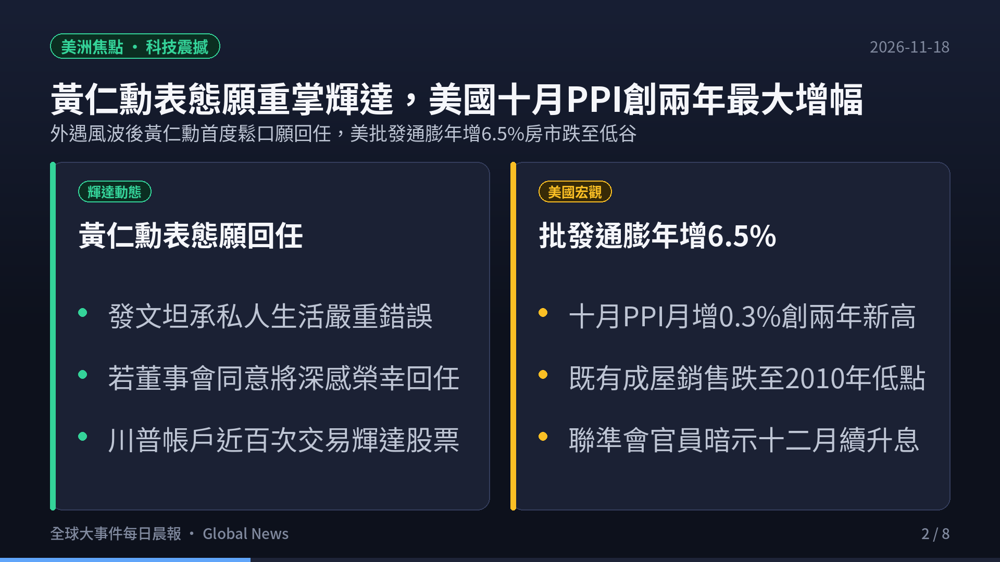
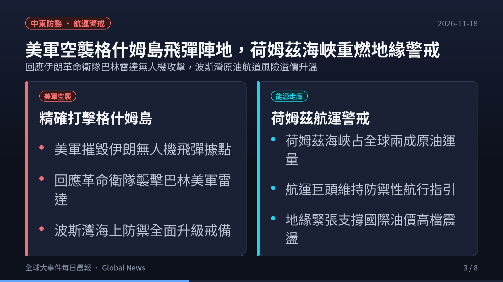
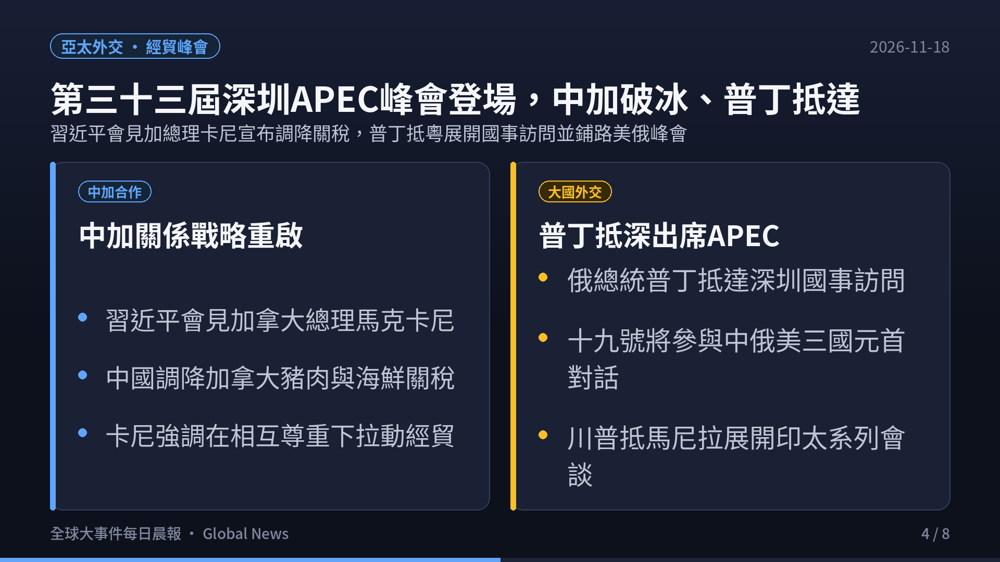
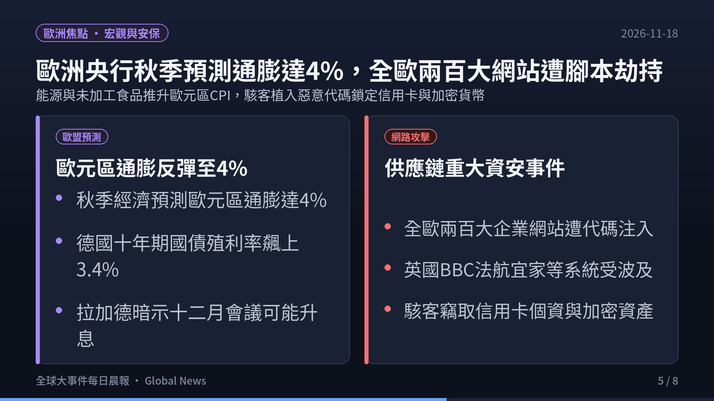
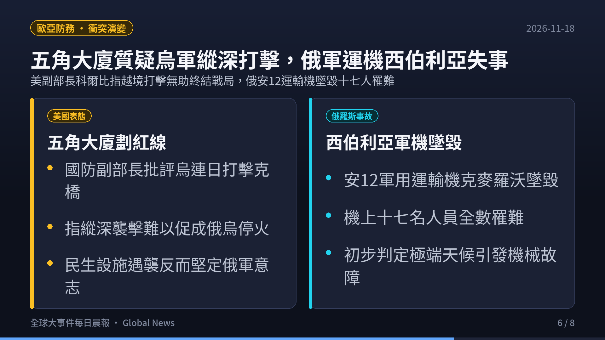
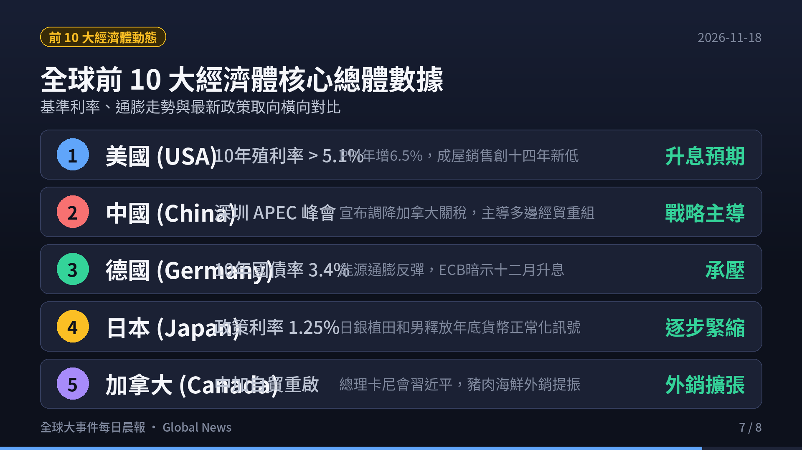
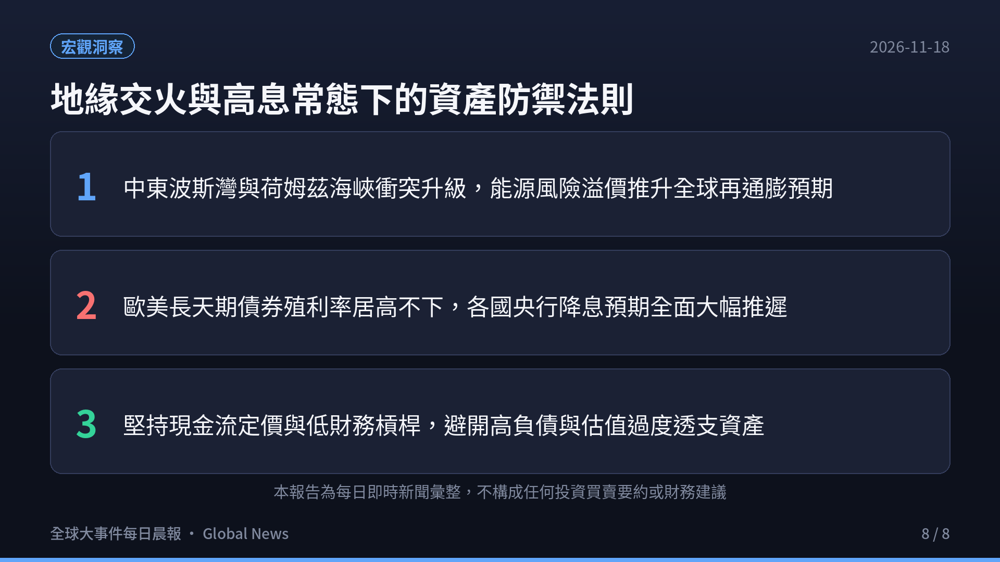

> **觀測週期**：2026-11-18 晨間即時彙整  
> **情報涵蓋**：全球各大洲（北美、歐洲、中東、亞洲/印太、拉美、大洋洲）與全球前 10 大經濟體  
> **核心來源**：路透社（Reuters）、美聯社（AP）、海峽時報（The Straits Times）、歐洲央行（ECB）公報、各國外交部與國防部公告  
> **定位宗旨**：以客觀數據、官方決策與供應鏈結構為準繩，剔除短期情緒噪音，提煉出真正驅動全球資金流向與地緣版圖重構的核心脈絡。

  

    <iframe src="https://www.youtube.com/embed/Z5a9Wzwby78" title="2026-11-18 全球大事件每日晨報" style="position: absolute; top:0; left: 0; width: 100%; height: 100%; border: 0;" allow="accelerometer; autoplay; clipboard-write; encrypted-media; gyroscope; picture-in-picture; web-share" allowfullscreen></iframe>
  

  

    🎬 <strong>120 秒晨間快報影音動態版</strong>（含 AI 自然神經語音朗讀與背景配樂）
  

---

## 🎯 今日全球前 6 大核心事件深度拆解

### 1. 美洲焦點與科技震撼：黃仁勳發文表態願重掌輝達，美國十月 PPI 年增 6.5% 房市降溫
- **輝達領袖異動後續震撼**：
  - 輝達（Nvidia）前執行長黃仁勳在社群平台 X 上公開坦承「在私人生活上犯下嚴重錯誤」，並首度正面表態：若董事會評估符合股東與員工最佳利益，他「將深感榮幸重返執行長職位」。
  - 美國證券交易委員會（SEC）監管申報文件顯示，在卸任前約八個月，黃仁勳夫婦已將近 5,900 萬股輝達股票轉移入家族不可撤銷信託；同時分析顯示川普相關投資帳戶曾頻繁交易輝達股票。
- **美國批發通膨反彈與房市低迷**：
  - 美國勞工統計局最新公布 10 月生產者物價指數（PPI）月增 0.3%，年增率高達 6.5%，創下 2022 年 11 月以來最快年度增速；核心 PPI 年增亦達 4.9%。
  - 全美不動產經紀人協會（NAR）報告 10 月成屋銷售年化降至 375 萬戶，創 2010 年 8 月以來 14 年最低水平，聯準會多位官員相繼釋放支持進一步升息的鷹派訊號。

---

### 2. 中東防務與能源動脈：美軍空襲格什姆島飛彈陣地，荷姆茲海峽重燃航運戰略警戒
- **美伊波斯灣直接軍事交火升溫**：
  - 美軍於 11 月 17 日對位於荷姆茲海峽戰略要衝的伊朗格什姆島（Qeshm Island）實施精確空襲，摧毀伊斯蘭革命衛隊（IRGC）的飛彈與無人機發射設施。
  - 本次打擊係直接回應數小時前革命衛隊對巴林美軍雷達站發動的無人機襲擊。儘管阿曼與卡達持續斡旋，美伊雙方仍爆發實質交火。
- **波斯灣原油航道風險溢價攀升**：
  - 荷姆茲海峽承擔全球約五分之一原油與液化天然氣海運吞吐量，航行安全警訊再度升至最高級別。
  - 國際航運巨頭馬士基（Maersk）與地中海航運（MSC）維持防禦性航行應變規範，海上戰爭險費率居高不下，為國際原油價格提供強烈底部支撐。

---

### 3. 亞太外交與多邊經貿：第三十三屆深圳 APEC 峰會盛大揭幕，中加自貿重啟、普丁抵深
- **中加雙邊關係破冰與關稅下調**：
  - 國家主席習近平在深圳會見出席 APEC 會議的加拿大總理馬克·卡尼（Mark Carney）。中方宣布調降加拿大對華出口的豬肉與海鮮等農產品關稅。
  - 卡尼總理盛讚雙邊關係朝「更高確定性與穩定性」邁進，雙方確立在綠色經濟、新農業與人工智慧領域深化實質合作。
- **普丁抵達深圳與中美俄歷史性三方會談**：
  - 俄羅斯總統普丁抵達廣東深圳，除了在 APEC 工商領導人峰會發表演說，19 日更將迎來中美俄三國元首歷史性的三方高峰會談。
  - 與此同時，美國總統川普抵達菲律賓馬尼拉出席 Quad 與 ASEAN 防務論壇，隨後轉往深圳，亞太地緣外交博弈迎來關鍵時刻。

---

### 4. 歐洲宏觀與科技安保：歐盟秋季經濟預測通膨反彈至 4%，全歐兩百大企業網站遭代碼注入
- **歐盟通膨抬頭與債券殖利率飆升**：
  - 歐盟執委會發布秋季經濟預測，歐元區 10 月通膨率回升至 4.0%，能源價格年增近 21%；德國十年期基準國債殖利率飆上 3.4%，法國國債利差擴大。
  - 歐洲央行總裁拉加德在答辯中暗示，不排除在 12 月議息會議重啟升息 25 個基點以阻斷二次通膨預期。
- **數位供應鏈遭受重大惡意劫持**：
  - 網路安全機構偵測到全球近 200 家大型企業網站遭遇大規模供應鏈攻擊，包括英國 BBC、阿聯酋匯豐銀行（HSBC UAE）、法國航空（Air France）與宜家（IKEA）等。
  - 攻擊者透過注入遭篡改的第三方分析工具腳本，意圖竊取消費者信用卡個資與加密貨幣資產，全歐資安應變中心緊急啟動溯源防禦。

---

### 5. 歐亞防務與衝突演變：五角大廈劃紅線質疑烏縱深襲擊，俄安-12 運輸機墜毀十七人罹難
- **美軍高層對烏克蘭打擊策略劃界**：
  - 美國國防部國防政策副部長埃爾布里奇·科爾比（Elbridge Colby）公開質疑烏克蘭連續兩日對克里米亞大橋及俄境內深處基礎設施的無人機襲擊。
  - 美方評估縱深襲擊並未能有效終結戰爭，反而可能堅定俄方作戰意志並分散防禦資源，暴露出美烏在戰略目標上的分歧。
- **西伯利亞軍事運輸機墜毀事故**：
  - 俄羅斯一架安-12（An-12）軍用運輸機在西伯利亞西南部克麥羅沃州（Kemerovo）失事墜毀，機上 17 名乘員不幸全數罹難，俄空軍已暫停同型機飛行進行安全排查。

---

### 6. 全球前十大經濟體核心指標與趨勢橫向全景

| 排名 | 國家 / 經濟體 | 核心總體經濟數據 / 最新指標 | 2026-11-18 即時動態與政策取向 | 全球產業鏈與市場意涵 |
|:---:|:---|:---|:---|:---|
| **1** | **美國 (USA)** | 10年期公債殖利率 **> 5.1%** · PPI **6.5%** | 黃仁勳表態願重掌輝達；批發通膨飆升；房市跌至14年低點；川普巡訪印太 | 通膨頑固迫使長端殖利率重估，降息週期全面大幅推遲，科技股波動加劇。 |
| **2** | **中國 (China)** | 深圳 APEC 主辦國 · 關稅政策主動 | 主席習近平會見加總理卡尼調降關稅；接待普丁訪深；主導亞太自貿 | 展現多邊外交主導力，穩定外部經貿合作夥伴，農業與綠色產業受惠。 |
| **3** | **德國 (Germany)** | 10年期公債殖利率 **3.4%** · 能源成本高企 | 歐盟通膨反彈至 4.0%；ECB 暗示 12 月升息；工業部門承擔融資成本壓力 | 歐洲工業龍頭持續承受高利率與地緣能源摩擦成本，基建投資推進放緩。 |
| **4** | **日本 (Japan)** | 政策利率維持 **1.25%** · 綜合 PMI **52.1** | 植田和男總裁暗示若物價達標年底將進一步升息；關注 APEC 區域對話 | 日圓匯率築底整理，套息交易平倉風險仍存，出口型半導體供應鏈穩健。 |
| **5** | **印度 (India)** | GDP 預測成長 **6.8%** · 內需維持強勁 | 莫迪總理出席印太防務峰會並提議對東協免簽；Quad 關鍵礦產合作深化 | 內需與外資投入雙輪驅動，作為全球供應鏈替代樞紐的戰略地位持續強化。 |
| **6** | **英國 (UK)** | 基準利率 **4.0%** · 服務業 PMI **52.8** | 央行官員密切評估通膨黏性；BBC 等系統遭遇惡意腳本注入攻擊 | 服務業韌性支撐薪資增長，但按揭貸款成本高檔制約居民消費動能。 |
| **7** | **法國 (France)** | 歐洲央行存款利率 **2.50%** · 航空交通排查 | 歐盟秋季經濟預測通膨壓力未解；法航系統遭資安攻擊全面盤查 | 財政赤字緊縮壓力與公共部門博弈未歇，地緣防務支出擠壓民生預算。 |
| **8** | **義大利 (Italy)** | 歐元區統一利率 **2.50%** · 國債利差持穩 | 密切觀測歐洲央行升息動向；歐盟綠色轉型與再生能源專案持續推進 | 對歐洲央行流動性政策極度敏感，主權融資成本維持在限制性區間。 |
| **9** | **加拿大 (Canada)** | 中加戰略合作深化 · 農漁產品關稅下調 | 總理卡尼與習近平會面落實雙邊合作；生豬與海鮮對華外銷預期大增 | 擴大對亞洲市場出口通道，在美加貿易不確定性下築起有效分散避險網絡。 |
| **10** | **澳洲 (Australia)** | 基準利率 **4.35%** · 資源大宗商品順差 | 澳洲央行維持高息對抗服務業通膨；大宗金屬與 LNG 出口維持強勁 | 亞太 APEC 自由貿易推進有利大宗商品出口，但高利率壓抑國內房地產投資。 |

---

## 💡 總結與投資者生存指南

1. **荷姆茲海峽重燃戰火與能源二次通膨風險**：
   - 美軍直接對伊朗格什姆島發動空襲，使波斯灣與荷姆茲海峽的軍事對峙進入新階段。
   - 只要原油運輸要衝的風險溢價維持高檔，全球能源成本便難以快速回落，直接摧毀各國央行在年底或明年初大幅降息的樂觀幻想。
2. **長端利率全面重估與資產折現壓力**：
   - 美國 10 年期國債殖利率飆破 5.1%、德國 10 年期國債達 3.4%，歐美批發與總體通膨雙雙超預期，代表全球流動性收縮「更高、更久」（Higher for Longer）已成為鐵律。
   - 依靠低成本槓桿或遠期本夢比推升的估值泡泡將面臨更嚴峻的貼現率殺傷。
3. **高息持久戰下的資產配置防禦紀律**：
   - 投資者應持續堅守「實質定價權、高現金流、低負債率」三大核心原則。
   - 配置重心偏向具備戰略護城河的能源基礎設施、抗通膨優質必需品龍頭，以及具備穩定現金股利的防禦型標的。

---

### ☕ 支持與精選推薦

如果你覺得這份每日晨報對你的宏觀視野與決策有實質幫助，歡迎透過以下方式支持我們持續產出深度內容：

- ☕ **請我喝杯咖啡**：[Ko-fi 小費贊助 (ytstories0413)](https://ko-fi.com/ytstories0413) 或 [Ko-fi 贊助 (slashman413)](https://ko-fi.com/slashman413)（支持每日自動化爬蟲、語音合成與雲端運算）
- 📚 **數位產品與高人效生產力工具**：
  - [Gumroad 數位商品專區](https://slashmaster6.gumroad.com/)：收錄精選 AI Prompt 庫、生產力自動化工作流與實戰腳本
  - [SlashmanTools 免費 Web 工具集](https://slashmantools.us/)：Token 成本計算器、顯存預估、開源 AI 工具導航
- 📖 **精選經典閱讀推薦**：
  - [《晶片戰爭》（Chip War）](https://www.amazon.com/dp/059371671X?tag=ytstories0413-20)：理解全球晶片霸權與印太供應鏈重組的必讀經典
  - [《原子習慣》— 細微改變帶來巨大成就](https://www.books.com.tw/products/0010792915)
  - [《人生的智慧》— 叔本華處世哲學經典](https://www.books.com.tw/products/0010613113)
