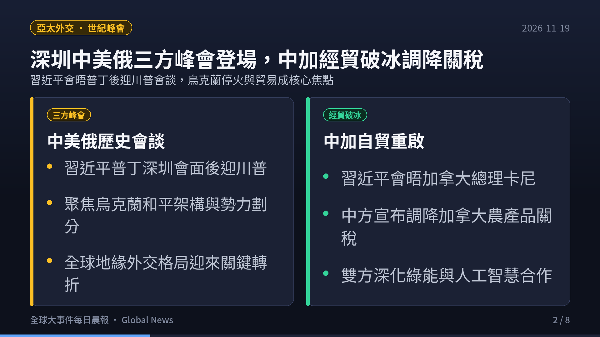
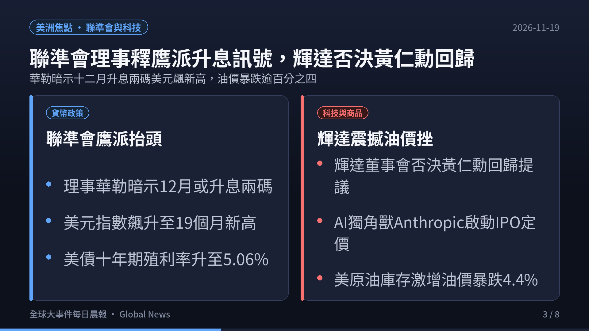
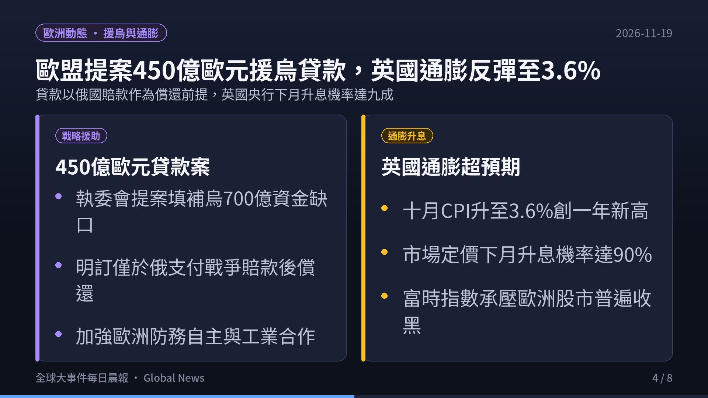
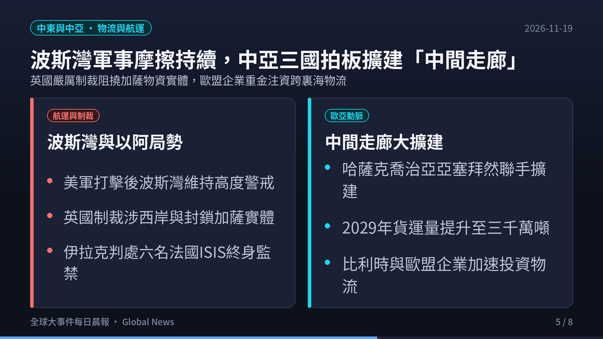
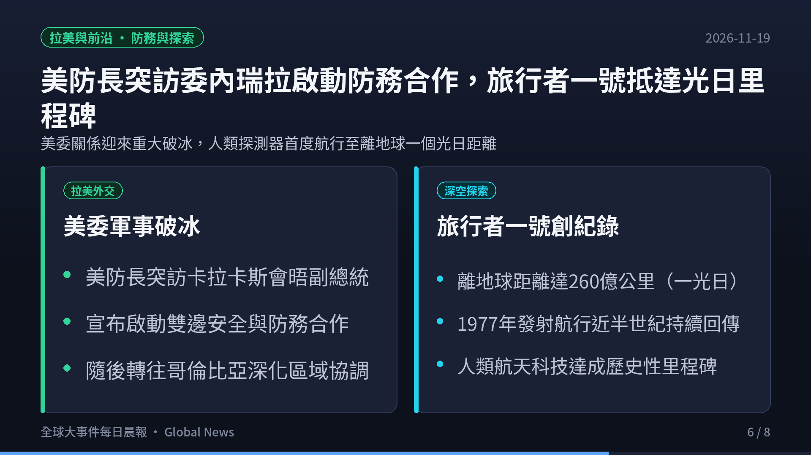
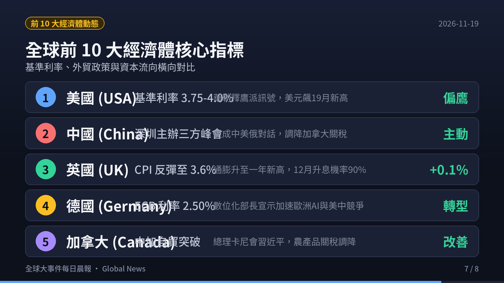
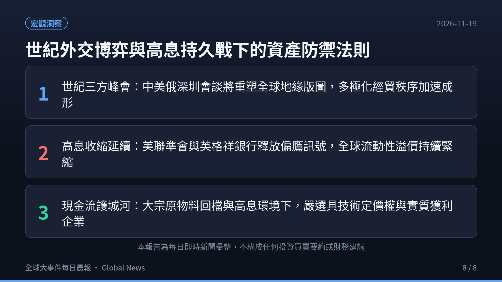

> **觀測週期**：2026-11-19 晨間即時彙整  
> **情報涵蓋**：全球各大洲（北美、歐洲、中東、亞洲/印太、拉美、大洋洲）與全球前 10 大經濟體  
> **核心來源**：各國政府公報、路透社（Reuters）、美聯社（AP）、Euronews、The Hindu、彭博社（Bloomberg）與各國央行公報  
> **定位宗旨**：以客觀數據、官方決策與供應鏈結構為準繩，剔除短期情緒噪音，提煉出真正驅動全球資金流向與地緣版圖重構的核心脈絡。

  

    <iframe src="https://www.youtube.com/embed/vTNLvRJ54gU" title="2026-11-19 全球大事件每日晨報" style="position: absolute; top:0; left: 0; width: 100%; height: 100%; border: 0;" allow="accelerometer; autoplay; clipboard-write; encrypted-media; gyroscope; picture-in-picture; web-share" allowfullscreen></iframe>
  

  

    🎬 <strong>120 秒晨間快報影音動態版</strong>（含 AI 自然神經語音朗讀與背景配樂）
  

---

## 🎯 今日全球前 6 大核心事件深度拆解

### 1. 亞太外交與地緣大棋局：深圳第三十三屆 APEC 峰會迎來中美俄歷史性三方會談，中加經貿破冰調降關稅
- **中美俄世紀高峰會登場**：
  - 中國國家主席習近平與俄羅斯總統普丁在廣東深圳舉行雙邊會晤後，今天（11 月 19 日）正式迎來與美國總統川普的歷史性三邊元首峰會。
  - 各國情報與外交圈高度聚焦烏克蘭和平談判框架、印太貿易秩序與二十一世紀大國勢力範圍劃分，外媒評估此峰會將決定未來數年地緣政治格局走勢。
- **中加雙邊自貿實質破冰**：
  - 習近平在深圳會見加拿大總理馬克·卡尼（Mark Carney），中方正式宣布調降加拿大對華出口的豬肉與海鮮等關鍵農產品關稅。
  - 雙方同意深化綠色轉型、新農業科技與人工智慧治理合作，為北美與亞洲貿易注入高確定性。

---

### 2. 美洲宏觀、貨幣政策與科技震撼：聯準會理事華勒釋放強烈升息訊號，輝達董事會否決黃仁勳回歸提議
- **聯準會鷹派立場突襲市場**：
  - 聯準會理事克里斯多福·華勒（Christopher Waller）在受訪時明確表態，央行可能需要在 12 月議息會議批准升息兩碼（50 個基點），或在 2027 年加快緊縮步伐，以徹底根除通膨反彈風險。
  - 此番言論推升美元指數升至 19 個月新高 103.8，美債十年期基準殖利率報 5.06%，美股道瓊指數承壓回落至 50,089 點。
- **輝達領袖治理異動與能源大跌**：
  - 輝達（Nvidia）董事會正式發布聲明，否決了上週請辭的前執行長黃仁勳重掌 CEO 的提議；與此同時，AI 獨角獸 Anthropic 啟動公開上市（IPO）股份定價。
  - 美國能源情報署（EIA）公佈原油庫存增幅遠超預期，國際油價暴跌 4.39% 至每桶 82.23 美元，布蘭特原油同步下挫。

---

### 3. 歐洲防務預算與貨幣緊縮：歐盟提案提供烏克蘭 450 億歐元鉅額貸款，英國通膨攀升至 3.6%
- **歐盟戰略援助機制突破**：
  - 歐盟執委會主席馮德萊恩正式提案，向烏克蘭提供高達 450 億歐元（約 495 億美元）的新型長期貸款，填補明年烏克蘭國防與財政高達 700 億歐元的資金缺口。
  - 該貸款機制最具爭議且創新之處在於：明訂烏克蘭僅需在俄羅斯支付戰後賠款後才需履行還款義務，實質建立長期戰略資產抵押聯盟。
- **英國通膨升溫加劇升息預期**：
  - 英國國家統計局公佈 10 月消費者物價指數（CPI）年增率回升至 3.6%，核心通膨維持在 2.8%，服務業通膨仍高達 3.7%。
  - 金融市場對英格蘭銀行 12 月再度升息一碼的定價機率飆升至 90%，富時 100 指數與歐洲泛歐 STOXX 600 指數在礦業與高利率雙重壓力下震盪走低。

---

### 4. 中東安全與跨歐亞物流樞紐：波斯灣美伊交火後維持戒備，哈喬亞三國擴建跨裏海「中間走廊」
- **波斯灣防務警戒與人道援助制裁**：
  - 美軍空襲伊朗格什姆島飛彈陣地後，伊斯蘭革命衛隊持續在荷姆茲海峽展示防務存在，國際航運公司馬士基與地中海航運維持防禦航行標準。
  - 英國政府宣布對涉及約旦河西岸定居點與惡意阻撓加薩人道援助物資進入的極端實體實施新一輪制裁；伊拉克法庭對 6 名法國籍 ISIS 成員宣判終身監禁。
- **歐亞物流大動脈提速擴張**：
  - 哈薩克、喬治亞與亞塞拜然在阿斯塔納正式簽署聯合協議，拍板將「跨裏海國際運輸走廊（中間走廊）」貨運吞吐量在 2029 年前提升至每年 3,000 萬噸。
  - 比利時等歐洲物流巨頭積極洽談注資建設中亞數位化貨運樞紐，大幅降低對傳統北線陸運的過境依賴。

---

### 5. 拉美破冰與深空探索：美國防長突訪卡拉卡斯啟動安全合作，旅行者一號航行突破一個「光日」距離
- **美委外交與軍事戰略大轉折**：
  - 美國國防部長未公開預告突訪委內瑞拉首都卡拉卡斯，與委內瑞拉副總統德爾西·羅德里格斯（Delcy Rodríguez）展開深入閉門會談，並正式宣布啟動雙邊安全與防務協調機制。
  - 這是美委關係中斷多年後的歷史性突破，美防長隨後前往哥倫比亞協調拉美反恐與能源通道安保。
- **人類深空航天科技歷史性里程碑**：
  - 美國太空總署（NASA）宣布，1977 年發射的「旅行者一號」（Voyager 1）探測器正式航行至距離地球一個「光日」（光行走 24 小時的距離，約 260 億公里 / 160 億英里）的深空領域。
  - 這艘近半世紀前發射的太空探測器在嚴苛星際空間持續回傳數據，寫下人類探索宇宙文明的空前成就。

---

### 6. 全球前十大經濟體核心指標與趨勢橫向全景

| 排名 | 國家 / 經濟體 | 核心總體經濟數據 / 最新指標 | 2026-11-19 即時動態與政策取向 | 全球產業鏈與市場意涵 |
|:---:|:---|:---|:---|:---|
| **1** | **美國 (USA)** | 基準利率 **3.75%–4.00%** · 美元指數 **103.8** | 華勒釋偏鷹升息訊號；輝達否決黃仁勳回歸；原油暴跌 4.4% | 緊縮預期升溫推升美債殖利率，美股高檔劇烈震盪，大宗原物料全線承壓。 |
| **2** | **中國 (China)** | 深圳主辦 APEC 峰會 · 實質擴大自貿 | 習近平會晤普丁後迎川普三方會談；調降加拿大農產品關稅 | 積極構築多邊經貿護城河，高科技與新能源供應鏈維持強大外銷韌性。 |
| **3** | **德國 (Germany)** | 歐洲央行基準利率 **2.50%** · AI 競速 | 數位化部長呼籲歐洲全力加速 AI 與美中競爭；通過加速電網審批 | 面臨高能源成本與地緣分割，依賴清潔能源新基建與技術自主尋求突破。 |
| **4** | **日本 (Japan)** | 政策利率維持 **1.25%** · 日經微升 0.28% | 綜合 PMI 穩健擴張；半導體設備與 AI 晶片出口支撐經濟成長 | 日銀正常化進程持續牽動全球套息交易倉位，印太硬體供應鏈具防禦力。 |
| **5** | **印度 (India)** | GDP 預測成長 **6.8%** · Quad 供應鏈深化 | 加速推進半導體晶圓廠與關鍵礦產自主；最高法院審理選務維安爭議 | 跨國製造業多元化配置首選標的，內需人口紅利與資本流入動能強勁。 |
| **6** | **英國 (UK)** | 基準利率 **4.0%** · 10 月通膨升至 **3.6%** | 通膨意外反彈創一年新高；市場定價 12 月升息機率飆至 90% | 高利率對房貸與企業借貸成本形成重壓，富時指數受礦業與緊縮雙重拖累。 |
| **7** | **法國 (France)** | 歐洲央行利率 **2.50%** · 反恐司法辯論 | 伊拉克法庭判處 6 名法籍 ISIS 成員終身監禁；歐盟防務預算增長 | 積極推動歐洲戰略自主與國防工業聯合採購，平衡內部福利與財政整頓。 |
| **8** | **義大利 (Italy)** | 歐元區利率 **2.50%** · 綠能電網審批 | 歐盟綠色電網審批提速直接受惠；國債利差持穩於健康區間 | 受惠地中海能源走廊建設，財政審查嚴格下聚焦高生產力基建專案回報。 |
| **9** | **加拿大 (Canada)** | 中加經貿自貿突破 · 關稅調降 | 總理卡尼在深圳取得農產品關稅調降突破；發表產能擴張預算 | 降低對單一市場依賴，在北美自貿協定動態微調中爭取多元出口彈性。 |
| **10** | **澳洲 (Australia)** | 基準利率 **4.35%** · ASX 200 收 8,827 點 | 大宗金屬與能源價格回檔；Quad 夥伴機制深化關鍵礦產合作 | 資源出口提供經濟底座，但全球原物料價格下修加劇澳洲央行維持高息壓力。 |

---

## 💡 總結與投資者生存指南

1. **世紀三方峰會下的全球地緣與貿易重構**：
   - 深圳中美俄三方峰會標誌著大國博弈進入實質談判與新勢力範圍劃分階段。中加農產品關稅調降證明務實經貿在多極化格局中依然具備破冰能力。
   - 投資者需高度關注峰會後在科技封鎖、關稅豁免與跨國供應鏈上的具體條款落地。
2. **貨幣政策鷹派預期抬頭與資產重定價**：
   - 聯準會理事華勒的加息訊號與英國 3.6% 的反彈通膨，徹底打破了市場短期激進降息的幻想。高息持久戰使得低息流動性支撐的估值泡沫加速擠壓。
   - 美原油大跌 4.4% 與黃金跌破 3,750 美元，反映大宗商品在流動性收緊與庫存攀升下的估值回歸。
3. **高息環境下的核心防禦紀律**：
   - 堅守「高確定性自由現金流、強定價護城河、低外債財務槓桿」三大選股基石。
   - 避開高度仰賴廉價借貸擴張的長久期投機資產，重視在能源過渡、國防自主與跨國新物流樞紐中具備不可替代性的實體產能。

---

### ☕ 支持與精選推薦

如果你覺得這份每日晨報對你的宏觀視野與決策有實質幫助，歡迎透過以下方式支持我們持續產出深度內容：

- ☕ **請我喝杯咖啡**：[Ko-fi 小費贊助 (ytstories0413)](https://ko-fi.com/ytstories0413) 或 [Ko-fi 贊助 (slashman413)](https://ko-fi.com/slashman413)（支持每日自動化爬蟲、語音合成與雲端運算）
- 📚 **數位產品與高人效生產力工具**：
  - [Gumroad 數位商品專區](https://slashmaster6.gumroad.com/)：收錄精選 AI Prompt 庫、生產力自動化工作流與實戰腳本
  - [SlashmanTools 免費 Web 工具集](https://slashmantools.us/）: Token 成本計算器、顯存預估、開源 AI 工具導航
- 📖 **精選經典閱讀推薦**：
  - [《晶片戰爭》（Chip War）](https://www.amazon.com/dp/059371671X?tag=ytstories0413-20)：理解全球晶片霸權與印太供應鏈重組的必讀經典
  - [《原子習慣》— 細微改變帶來巨大成就](https://www.books.com.tw/products/0010792915)
  - [《人生的智慧》— 叔本華處世哲學經典](https://www.books.com.tw/products/0010613113)
