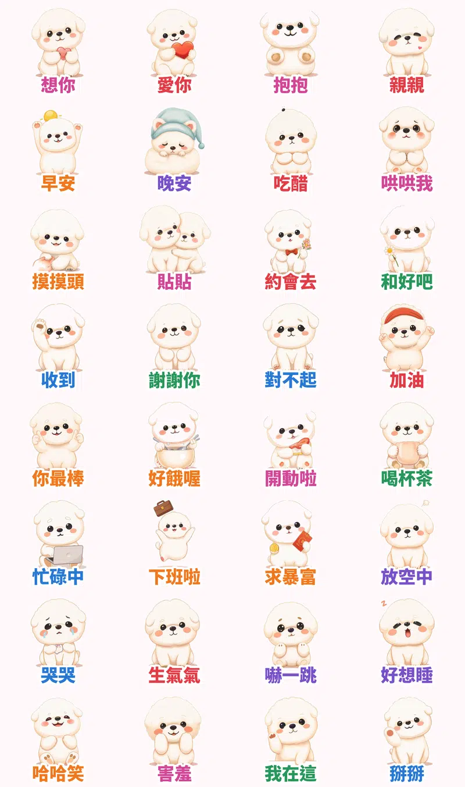

整理近期台灣、香港與日本 LINE 原創貼圖榜單，可以清楚看到三大爆款密碼：**「極致軟萌白胖小動物」＋「高情緒張力反差萌」＋「戀愛撒嬌與日常秒回實用梗」**。從比熊犬系列到各類毛絨絨白色小生物，圓滾滾的輪廓搭配一眼看懂的情緒表情，在群組和情侶對話中轉換率最高。

這次我們推出全新原創角色——**棉花糖比熊・球球（QiuQiu）**，一次帶來 **32 種表情動作＋專屬配音**！

> 🐶 **棉花糖比熊球球・戀愛日常動起來** 👉 [Massor 的 LINE 貼圖小舖](https://line.me/S/shop/sticker/author/6564520?utm_source=ghpages&utm_medium=bridge&utm_campaign=qiuqiu-bichon&utm_content=author-6564520)（本套已送審「戀愛日常」特輯，審核通過後將於同一頁面開放下載）

## 拒絕生硬變形！FLUX + LoRA 繪製、本地 MiniMax H3 真實動態演繹

有別於把靜態圖片直接左右平移或放大縮小的假動態貼圖，這組 32 張貼圖全部經過兩段式生成：
1. **FLUX + 繪本風 LoRA (`flux-whimsical-storybook-lora`)**：確立球球圓滾滾的棉花糖頭身比、烏溜黑豆眼與溫柔手繪深棕線條。
2. **本地端 MiniMax H3 (`fl2va`) 首尾幀閉環動作演繹**：依每張情緒撰寫專屬動作提示詞，讓球球真的會「搖耳朵、捧愛心晃動、鼓腮吃醋轉頭、淚眼汪汪拉小手求哄、興奮跳起來歡呼下班」，再經精準去背、加粗 6px 純白貼紙邊框與高對比文字，確保 LINE 深色與淺色主題都清晰不破圖。

## 🔊 點擊試聽：32 張專屬軟萌語音

每張貼圖都配了台灣甜萌配音（`zh-TW-HsiaoYuNeural`）與可愛小狗汪鳴音效，音訊均經降噪與 `-16 LUFS` 響度正規化處理。點擊影片即可開啟聲音試聽：

  <figure class="ms-c">
    <video src="https://github.com/ckw19810413/ckw19810413.github.io/releases/download/media-line-animated-sticker-bichon-qiuqiu-love-daily/qiuqiu-a01.mp4" poster="sound/a01.jpg" muted autoplay loop playsinline preload="metadata"></video>
    <figcaption>好想你喔</figcaption>
    <button type="button" class="ms-share" onclick="navigator.share?navigator.share({title:'棉花糖比熊球球：想你',url:window.location.href}):navigator.clipboard.writeText(window.location.href)">傳給朋友</button>
  </figure>
  <figure class="ms-c">
    <video src="https://github.com/ckw19810413/ckw19810413.github.io/releases/download/media-line-animated-sticker-bichon-qiuqiu-love-daily/qiuqiu-a02.mp4" poster="sound/a02.jpg" muted autoplay loop playsinline preload="metadata"></video>
    <figcaption>最愛你了</figcaption>
    <button type="button" class="ms-share" onclick="navigator.share?navigator.share({title:'棉花糖比熊球球：愛你',url:window.location.href}):navigator.clipboard.writeText(window.location.href)">傳給朋友</button>
  </figure>
  <figure class="ms-c">
    <video src="https://github.com/ckw19810413/ckw19810413.github.io/releases/download/media-line-animated-sticker-bichon-qiuqiu-love-daily/qiuqiu-a03.mp4" poster="sound/a03.jpg" muted autoplay loop playsinline preload="metadata"></video>
    <figcaption>過來抱抱</figcaption>
    <button type="button" class="ms-share" onclick="navigator.share?navigator.share({title:'棉花糖比熊球球：抱抱',url:window.location.href}):navigator.clipboard.writeText(window.location.href)">傳給朋友</button>
  </figure>
  <figure class="ms-c">
    <video src="https://github.com/ckw19810413/ckw19810413.github.io/releases/download/media-line-animated-sticker-bichon-qiuqiu-love-daily/qiuqiu-a04.mp4" poster="sound/a04.jpg" muted autoplay loop playsinline preload="metadata"></video>
    <figcaption>啾一個</figcaption>
    <button type="button" class="ms-share" onclick="navigator.share?navigator.share({title:'棉花糖比熊球球：親親',url:window.location.href}):navigator.clipboard.writeText(window.location.href)">傳給朋友</button>
  </figure>
  <figure class="ms-c">
    <video src="https://github.com/ckw19810413/ckw19810413.github.io/releases/download/media-line-animated-sticker-bichon-qiuqiu-love-daily/qiuqiu-a05.mp4" poster="sound/a05.jpg" muted autoplay loop playsinline preload="metadata"></video>
    <figcaption>早安呀</figcaption>
    <button type="button" class="ms-share" onclick="navigator.share?navigator.share({title:'棉花糖比熊球球：早安',url:window.location.href}):navigator.clipboard.writeText(window.location.href)">傳給朋友</button>
  </figure>
  <figure class="ms-c">
    <video src="https://github.com/ckw19810413/ckw19810413.github.io/releases/download/media-line-animated-sticker-bichon-qiuqiu-love-daily/qiuqiu-a06.mp4" poster="sound/a06.jpg" muted autoplay loop playsinline preload="metadata"></video>
    <figcaption>晚安好夢</figcaption>
    <button type="button" class="ms-share" onclick="navigator.share?navigator.share({title:'棉花糖比熊球球：晚安',url:window.location.href}):navigator.clipboard.writeText(window.location.href)">傳給朋友</button>
  </figure>
  <figure class="ms-c">
    <video src="https://github.com/ckw19810413/ckw19810413.github.io/releases/download/media-line-animated-sticker-bichon-qiuqiu-love-daily/qiuqiu-a07.mp4" poster="sound/a07.jpg" muted autoplay loop playsinline preload="metadata"></video>
    <figcaption>哼我吃醋了</figcaption>
    <button type="button" class="ms-share" onclick="navigator.share?navigator.share({title:'棉花糖比熊球球：吃醋',url:window.location.href}):navigator.clipboard.writeText(window.location.href)">傳給朋友</button>
  </figure>
  <figure class="ms-c">
    <video src="https://github.com/ckw19810413/ckw19810413.github.io/releases/download/media-line-animated-sticker-bichon-qiuqiu-love-daily/qiuqiu-a08.mp4" poster="sound/a08.jpg" muted autoplay loop playsinline preload="metadata"></video>
    <figcaption>快來哄哄我</figcaption>
    <button type="button" class="ms-share" onclick="navigator.share?navigator.share({title:'棉花糖比熊球球：哄哄我',url:window.location.href}):navigator.clipboard.writeText(window.location.href)">傳給朋友</button>
  </figure>
  <figure class="ms-c">
    <video src="https://github.com/ckw19810413/ckw19810413.github.io/releases/download/media-line-animated-sticker-bichon-qiuqiu-love-daily/qiuqiu-a09.mp4" poster="sound/a09.jpg" muted autoplay loop playsinline preload="metadata"></video>
    <figcaption>乖乖摸摸頭</figcaption>
    <button type="button" class="ms-share" onclick="navigator.share?navigator.share({title:'棉花糖比熊球球：摸摸頭',url:window.location.href}):navigator.clipboard.writeText(window.location.href)">傳給朋友</button>
  </figure>
  <figure class="ms-c">
    <video src="https://github.com/ckw19810413/ckw19810413.github.io/releases/download/media-line-animated-sticker-bichon-qiuqiu-love-daily/qiuqiu-a10.mp4" poster="sound/a10.jpg" muted autoplay loop playsinline preload="metadata"></video>
    <figcaption>要跟你貼貼</figcaption>
    <button type="button" class="ms-share" onclick="navigator.share?navigator.share({title:'棉花糖比熊球球：貼貼',url:window.location.href}):navigator.clipboard.writeText(window.location.href)">傳給朋友</button>
  </figure>
  <figure class="ms-c">
    <video src="https://github.com/ckw19810413/ckw19810413.github.io/releases/download/media-line-animated-sticker-bichon-qiuqiu-love-daily/qiuqiu-a11.mp4" poster="sound/a11.jpg" muted autoplay loop playsinline preload="metadata"></video>
    <figcaption>走吧去約會</figcaption>
    <button type="button" class="ms-share" onclick="navigator.share?navigator.share({title:'棉花糖比熊球球：約會去',url:window.location.href}):navigator.clipboard.writeText(window.location.href)">傳給朋友</button>
  </figure>
  <figure class="ms-c">
    <video src="https://github.com/ckw19810413/ckw19810413.github.io/releases/download/media-line-animated-sticker-bichon-qiuqiu-love-daily/qiuqiu-a12.mp4" poster="sound/a12.jpg" muted autoplay loop playsinline preload="metadata"></video>
    <figcaption>我們和好吧</figcaption>
    <button type="button" class="ms-share" onclick="navigator.share?navigator.share({title:'棉花糖比熊球球：和好吧',url:window.location.href}):navigator.clipboard.writeText(window.location.href)">傳給朋友</button>
  </figure>
  <figure class="ms-c">
    <video src="https://github.com/ckw19810413/ckw19810413.github.io/releases/download/media-line-animated-sticker-bichon-qiuqiu-love-daily/qiuqiu-a13.mp4" poster="sound/a13.jpg" muted autoplay loop playsinline preload="metadata"></video>
    <figcaption>收到沒問題</figcaption>
    <button type="button" class="ms-share" onclick="navigator.share?navigator.share({title:'棉花糖比熊球球：收到',url:window.location.href}):navigator.clipboard.writeText(window.location.href)">傳給朋友</button>
  </figure>
  <figure class="ms-c">
    <video src="https://github.com/ckw19810413/ckw19810413.github.io/releases/download/media-line-animated-sticker-bichon-qiuqiu-love-daily/qiuqiu-a14.mp4" poster="sound/a14.jpg" muted autoplay loop playsinline preload="metadata"></video>
    <figcaption>超級謝謝你</figcaption>
    <button type="button" class="ms-share" onclick="navigator.share?navigator.share({title:'棉花糖比熊球球：謝謝你',url:window.location.href}):navigator.clipboard.writeText(window.location.href)">傳給朋友</button>
  </figure>
  <figure class="ms-c">
    <video src="https://github.com/ckw19810413/ckw19810413.github.io/releases/download/media-line-animated-sticker-bichon-qiuqiu-love-daily/qiuqiu-a15.mp4" poster="sound/a15.jpg" muted autoplay loop playsinline preload="metadata"></video>
    <figcaption>對不起嘛</figcaption>
    <button type="button" class="ms-share" onclick="navigator.share?navigator.share({title:'棉花糖比熊球球：對不起',url:window.location.href}):navigator.clipboard.writeText(window.location.href)">傳給朋友</button>
  </figure>
  <figure class="ms-c">
    <video src="https://github.com/ckw19810413/ckw19810413.github.io/releases/download/media-line-animated-sticker-bichon-qiuqiu-love-daily/qiuqiu-a16.mp4" poster="sound/a16.jpg" muted autoplay loop playsinline preload="metadata"></video>
    <figcaption>加油你可以的</figcaption>
    <button type="button" class="ms-share" onclick="navigator.share?navigator.share({title:'棉花糖比熊球球：加油',url:window.location.href}):navigator.clipboard.writeText(window.location.href)">傳給朋友</button>
  </figure>
  <figure class="ms-c">
    <video src="https://github.com/ckw19810413/ckw19810413.github.io/releases/download/media-line-animated-sticker-bichon-qiuqiu-love-daily/qiuqiu-a17.mp4" poster="sound/a17.jpg" muted autoplay loop playsinline preload="metadata"></video>
    <figcaption>你真的超棒</figcaption>
    <button type="button" class="ms-share" onclick="navigator.share?navigator.share({title:'棉花糖比熊球球：你最棒',url:window.location.href}):navigator.clipboard.writeText(window.location.href)">傳給朋友</button>
  </figure>
  <figure class="ms-c">
    <video src="https://github.com/ckw19810413/ckw19810413.github.io/releases/download/media-line-animated-sticker-bichon-qiuqiu-love-daily/qiuqiu-a18.mp4" poster="sound/a18.jpg" muted autoplay loop playsinline preload="metadata"></video>
    <figcaption>肚子好餓喔</figcaption>
    <button type="button" class="ms-share" onclick="navigator.share?navigator.share({title:'棉花糖比熊球球：好餓喔',url:window.location.href}):navigator.clipboard.writeText(window.location.href)">傳給朋友</button>
  </figure>
  <figure class="ms-c">
    <video src="https://github.com/ckw19810413/ckw19810413.github.io/releases/download/media-line-animated-sticker-bichon-qiuqiu-love-daily/qiuqiu-a19.mp4" poster="sound/a19.jpg" muted autoplay loop playsinline preload="metadata"></video>
    <figcaption>開動吃飽飽</figcaption>
    <button type="button" class="ms-share" onclick="navigator.share?navigator.share({title:'棉花糖比熊球球：開動啦',url:window.location.href}):navigator.clipboard.writeText(window.location.href)">傳給朋友</button>
  </figure>
  <figure class="ms-c">
    <video src="https://github.com/ckw19810413/ckw19810413.github.io/releases/download/media-line-animated-sticker-bichon-qiuqiu-love-daily/qiuqiu-a20.mp4" poster="sound/a20.jpg" muted autoplay loop playsinline preload="metadata"></video>
    <figcaption>休息喝口茶</figcaption>
    <button type="button" class="ms-share" onclick="navigator.share?navigator.share({title:'棉花糖比熊球球：喝杯茶',url:window.location.href}):navigator.clipboard.writeText(window.location.href)">傳給朋友</button>
  </figure>
  <figure class="ms-c">
    <video src="https://github.com/ckw19810413/ckw19810413.github.io/releases/download/media-line-animated-sticker-bichon-qiuqiu-love-daily/qiuqiu-a21.mp4" poster="sound/a21.jpg" muted autoplay loop playsinline preload="metadata"></video>
    <figcaption>正在忙等我喔</figcaption>
    <button type="button" class="ms-share" onclick="navigator.share?navigator.share({title:'棉花糖比熊球球：忙碌中',url:window.location.href}):navigator.clipboard.writeText(window.location.href)">傳給朋友</button>
  </figure>
  <figure class="ms-c">
    <video src="https://github.com/ckw19810413/ckw19810413.github.io/releases/download/media-line-animated-sticker-bichon-qiuqiu-love-daily/qiuqiu-a22.mp4" poster="sound/a22.jpg" muted autoplay loop playsinline preload="metadata"></video>
    <figcaption>終於下班啦</figcaption>
    <button type="button" class="ms-share" onclick="navigator.share?navigator.share({title:'棉花糖比熊球球：下班啦',url:window.location.href}):navigator.clipboard.writeText(window.location.href)">傳給朋友</button>
  </figure>
  <figure class="ms-c">
    <video src="https://github.com/ckw19810413/ckw19810413.github.io/releases/download/media-line-animated-sticker-bichon-qiuqiu-love-daily/qiuqiu-a23.mp4" poster="sound/a23.jpg" muted autoplay loop playsinline preload="metadata"></video>
    <figcaption>祝你發大財</figcaption>
    <button type="button" class="ms-share" onclick="navigator.share?navigator.share({title:'棉花糖比熊球球：求暴富',url:window.location.href}):navigator.clipboard.writeText(window.location.href)">傳給朋友</button>
  </figure>
  <figure class="ms-c">
    <video src="https://github.com/ckw19810413/ckw19810413.github.io/releases/download/media-line-animated-sticker-bichon-qiuqiu-love-daily/qiuqiu-a24.mp4" poster="sound/a24.jpg" muted autoplay loop playsinline preload="metadata"></video>
    <figcaption>大腦放空中</figcaption>
    <button type="button" class="ms-share" onclick="navigator.share?navigator.share({title:'棉花糖比熊球球：放空中',url:window.location.href}):navigator.clipboard.writeText(window.location.href)">傳給朋友</button>
  </figure>
  <figure class="ms-c">
    <video src="https://github.com/ckw19810413/ckw19810413.github.io/releases/download/media-line-animated-sticker-bichon-qiuqiu-love-daily/qiuqiu-a25.mp4" poster="sound/a25.jpg" muted autoplay loop playsinline preload="metadata"></video>
    <figcaption>嗚嗚好委屈</figcaption>
    <button type="button" class="ms-share" onclick="navigator.share?navigator.share({title:'棉花糖比熊球球：哭哭',url:window.location.href}):navigator.clipboard.writeText(window.location.href)">傳給朋友</button>
  </figure>
  <figure class="ms-c">
    <video src="https://github.com/ckw19810413/ckw19810413.github.io/releases/download/media-line-animated-sticker-bichon-qiuqiu-love-daily/qiuqiu-a26.mp4" poster="sound/a26.jpg" muted autoplay loop playsinline preload="metadata"></video>
    <figcaption>人家生氣囉</figcaption>
    <button type="button" class="ms-share" onclick="navigator.share?navigator.share({title:'棉花糖比熊球球：生氣氣',url:window.location.href}):navigator.clipboard.writeText(window.location.href)">傳給朋友</button>
  </figure>
  <figure class="ms-c">
    <video src="https://github.com/ckw19810413/ckw19810413.github.io/releases/download/media-line-animated-sticker-bichon-qiuqiu-love-daily/qiuqiu-a27.mp4" poster="sound/a27.jpg" muted autoplay loop playsinline preload="metadata"></video>
    <figcaption>嚇我一大跳</figcaption>
    <button type="button" class="ms-share" onclick="navigator.share?navigator.share({title:'棉花糖比熊球球：嚇一跳',url:window.location.href}):navigator.clipboard.writeText(window.location.href)">傳給朋友</button>
  </figure>
  <figure class="ms-c">
    <video src="https://github.com/ckw19810413/ckw19810413.github.io/releases/download/media-line-animated-sticker-bichon-qiuqiu-love-daily/qiuqiu-a28.mp4" poster="sound/a28.jpg" muted autoplay loop playsinline preload="metadata"></video>
    <figcaption>眼皮好重喔</figcaption>
    <button type="button" class="ms-share" onclick="navigator.share?navigator.share({title:'棉花糖比熊球球：好想睡',url:window.location.href}):navigator.clipboard.writeText(window.location.href)">傳給朋友</button>
  </figure>
  <figure class="ms-c">
    <video src="https://github.com/ckw19810413/ckw19810413.github.io/releases/download/media-line-animated-sticker-bichon-qiuqiu-love-daily/qiuqiu-a29.mp4" poster="sound/a29.jpg" muted autoplay loop playsinline preload="metadata"></video>
    <figcaption>哈哈笑死我</figcaption>
    <button type="button" class="ms-share" onclick="navigator.share?navigator.share({title:'棉花糖比熊球球：哈哈笑',url:window.location.href}):navigator.clipboard.writeText(window.location.href)">傳給朋友</button>
  </figure>
  <figure class="ms-c">
    <video src="https://github.com/ckw19810413/ckw19810413.github.io/releases/download/media-line-animated-sticker-bichon-qiuqiu-love-daily/qiuqiu-a30.mp4" poster="sound/a30.jpg" muted autoplay loop playsinline preload="metadata"></video>
    <figcaption>討厭好害羞</figcaption>
    <button type="button" class="ms-share" onclick="navigator.share?navigator.share({title:'棉花糖比熊球球：害羞',url:window.location.href}):navigator.clipboard.writeText(window.location.href)">傳給朋友</button>
  </figure>
  <figure class="ms-c">
    <video src="https://github.com/ckw19810413/ckw19810413.github.io/releases/download/media-line-animated-sticker-bichon-qiuqiu-love-daily/qiuqiu-a31.mp4" poster="sound/a31.jpg" muted autoplay loop playsinline preload="metadata"></video>
    <figcaption>我一直都在喔</figcaption>
    <button type="button" class="ms-share" onclick="navigator.share?navigator.share({title:'棉花糖比熊球球：我在這',url:window.location.href}):navigator.clipboard.writeText(window.location.href)">傳給朋友</button>
  </figure>
  <figure class="ms-c">
    <video src="https://github.com/ckw19810413/ckw19810413.github.io/releases/download/media-line-animated-sticker-bichon-qiuqiu-love-daily/qiuqiu-a32.mp4" poster="sound/a32.jpg" muted autoplay loop playsinline preload="metadata"></video>
    <figcaption>掰掰下次聊</figcaption>
    <button type="button" class="ms-share" onclick="navigator.share?navigator.share({title:'棉花糖比熊球球：掰掰',url:window.location.href}):navigator.clipboard.writeText(window.location.href)">傳給朋友</button>
  </figure>

## 32 款貼圖實用對照表

| 編號 | 貼圖標籤 | 專屬語音台詞 | 最推薦使用時機 |
|:---:|:---|:---|:---|
| 01 | 想你 | 好想你喔 | 深夜或遠距離想念對方、傳送思念訊號 |
| 02 | 愛你 | 最愛你了 | 向另一半或摯愛直接告白示愛 |
| 03 | 抱抱 | 過來抱抱 | 朋友低落或情侶撒嬌求一個溫暖抱抱 |
| 04 | 親親 | 啾一個 | 甜膩情侶日常親親、早晚安吻 |
| 05 | 早安 | 早安呀 | 起床朝氣問候、開啟元氣滿滿一天 |
| 06 | 晚安 | 晚安好夢 | 睡前溫柔道晚安、祝對方有個好夢 |
| 07 | 吃醋 | 哼我吃醋了 | 半開玩笑吃醋嘟嘴、測試對方求生欲 |
| 08 | 哄哄我 | 快來哄哄我 | 委屈巴巴求哄哄、撒嬌求安慰 |
| 09 | 摸摸頭 | 乖乖摸摸頭 | 稱讚對方乖巧、輕輕摸頭安撫情緒 |
| 10 | 貼貼 | 要跟你貼貼 | 情侶黏TT日常、想靠在一起貼貼 |
| 11 | 約會去 | 走吧去約會 | 約對方出門約會、週末見面邀約 |
| 12 | 和好吧 | 我們和好吧 | 小吵架後主動遞台階求和好 |
| 13 | 收到 | 收到沒問題 | 收到訊息立刻答應、工作日常萬用回覆 |
| 14 | 謝謝你 | 超級謝謝你 | 收到幫忙、請客或禮物時的真心感謝 |
| 15 | 對不起 | 對不起嘛 | 遲到或小失誤時誠懇鞠躬道歉 |
| 16 | 加油 | 加油你可以的 | 考試、面試、上班衝刺打氣應援 |
| 17 | 你最棒 | 你真的超棒 | 大力讚美對方超厲害、滿滿正能量 |
| 18 | 好餓喔 | 肚子好餓喔 | 午餐晚餐宵夜時段、暗示好餓想吃飯 |
| 19 | 開動啦 | 開動吃飽飽 | 享用美食甜點開動啦、吃貨日常 |
| 20 | 喝杯茶 | 休息喝口茶 | 下午茶或忙碌空檔、提醒對方喝茶休息 |
| 21 | 忙碌中 | 正在忙等我喔 | 工作趕工中、先通知對方稍等回覆 |
| 22 | 下班啦 | 終於下班啦 | 準時下班打卡歡呼、迎接自由夜晚 |
| 23 | 求暴富 | 祝你發大財 | 發薪日或互相祝福招財暴富 |
| 24 | 放空中 | 大腦放空中 | 大腦當機放空中、厭世發呆必備 |
| 25 | 哭哭 | 嗚嗚好委屈 | 遇到委屈或搞笑崩潰時哭哭討拍 |
| 26 | 生氣氣 | 人家生氣囉 | 可愛跺腳假裝生氣氣、表達不滿撒嬌 |
| 27 | 嚇一跳 | 嚇我一大跳 | 聽到八卦或驚喜消息嚇一大跳 |
| 28 | 好想睡 | 眼皮好重喔 | 熬夜或午后犯睏、眼皮沉重打瞌睡 |
| 29 | 哈哈笑 | 哈哈笑死我 | 被群組訊息逗樂、哈哈大笑回覆 |
| 30 | 害羞 | 討厭好害羞 | 被誇獎或告白後臉紅害羞遮臉 |
| 31 | 我在這 | 我一直都在喔 | 隨時待命隨傳隨到、我一直都在喔 |
| 32 | 掰掰 | 掰掰下次聊 | 對話結束禮貌揮手道別、下次再聊 |

---

**Massor 原創貼圖系列連載**：
- [小鯨魚泡泡・黏黏戀愛日常](/blog/2026-11-17-line-animated-sticker-baby-whale-baobao-voice/)
- [雪精靈啾啾・暖心拍拍](/blog/2026-11-14-line-animated-sticker-snow-fairy-fluffy-pats/)
- [海獺暖暖・療癒拍拍動起來](/blog/2026-11-13-line-animated-sticker-sea-otter-healing-pats/)
- [北極熊秀秀・療癒拍拍動起來](/blog/2026-11-01-line-animated-sticker-polar-bear-healing-pats/)
